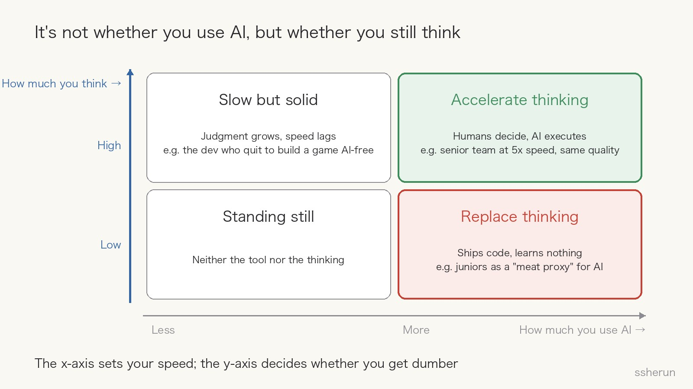
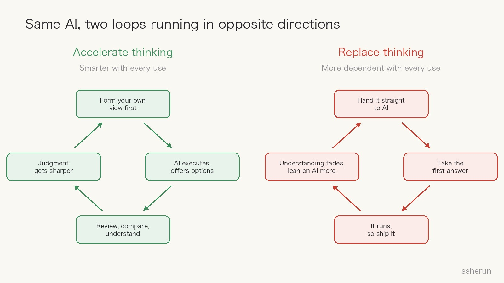
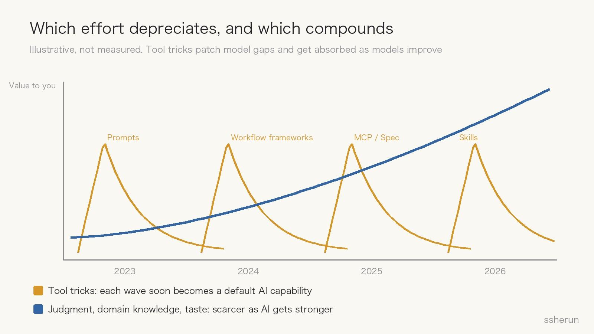

> Source discussions:
> - V2EX: [What scares me more than AI's ability is how fast it improves](https://www.v2ex.com/t/1246322) (21 replies)
> - Reddit r/gamedev: [AI models have caught up with Unity dev. My insights as someone with 30 years of experience.](https://www.reddit.com/r/gamedev/comments/1wo5asm/)
> - V2EX: [Feels like the programming profession is kind of dead](https://www.v2ex.com/t/1246421) (75 replies)

Three discussions I read over the past two weeks share one mood: panic.

The owner of a game studio, 30 years into software development, wrote: "Everyone I asked feel they are becoming dumber and losing their focus. I know I am."

On V2EX, someone said that every effort he made to use AI well soon became a default AI capability, so that "even effort itself no longer feels justified." Another thread was simply titled: "Feels like the programming profession is kind of dead."

So is human intelligence locked in place right now?

My view: **the key difference is not whether you use AI, but whether you use it to accelerate your thinking or to replace it.**

## What each discussion said

### The 30-year veteran: 5x speed, and everyone feels dumber

The Reddit poster has 30 years in software and runs a studio that builds industrial simulators and training apps. He scoffed at AI coding for years, until four or five months ago. He listed a dozen observations; these hit hardest:

- Dev speed went up roughly 5x almost overnight.
- **Quality hasn't dropped, because we're experienced devs and we don't let AI make decisions about project structure or design patterns.**
- There's no joy and no sense of accomplishment; all progress is credited to the AI.
- **There's no room for juniors**: every time they tried, the juniors became a "meat proxy" for the AI and learned nothing.
- **People who use AI for coding don't learn anything. To understand code you have to write it, and nobody is writing it.**
- He can no longer estimate how much work a task needs.

The top comments add even more. One with 723 upvotes said it's worse than not learning: **AI boosts your confidence, so you may not even notice you're not learning.** "I could easily ship code with a new framework but still not feel proficient."

A 20-year AAA veteran said their best developers are exhausted: they juggle several agents all day and only make high-level design and architecture calls. Writing code used to give the brain a rest from decisions; now only the most tiring part is left.

Another comment went into detail: when you used to write a game's settings menu, you'd think about whether mouse sensitivity should be a slider or an interactive demo, whether it affects menu speed, how it stacks with the OS setting. Now one prompt produces a menu, and **those details never get considered at all**.

### V2EX #1246322: the scary part is the speed, not the ability

The OP's path is typical: prompt crafting in 2023, LangChain and Dify workflows in 2024, MCP and coding specs in 2025, Skills in 2026.

His worry: **the result of every round of effort quickly became a default AI capability**, while people who just use whatever AI offers have an easier time. If AI progress is unpredictable, people grow wary of long-term effort.

One reply was cold: "Humanity isn't ready to accept its own mediocrity." Another was clear-eyed: "Good. It shows long-termists the world doesn't revolve around their plans."

### V2EX #1246421: the programming profession is kind of dead

The OP is an indie developer who used to support his family with app store income; over the last six months it has nearly vanished. The 75 replies split sharply:

- Someone with zero app development experience built an app with AI in an hour a day (7 likes);
- But another said several non-coders he knew launched apps full of excitement, and **when he checked recently, every one of them was dead**: no idea how to run or promote them (6 likes);
- And one offered a formula: income = X × (Y1 + Y2 + …), where X is coding ability and Y is design, communication, planning. **X is now approaching 1.**

## All three are saying the same thing

Put the three side by side and the same tool produces opposite outcomes:

- The Reddit veterans got 5x speed with no quality loss, because **humans decide architecture and design patterns** and AI executes. That's accelerating thinking.
- The juniors on the same team became meat proxies and learned nothing. That's replacing thinking.
- A V2EX reply described reading the docs and implementation summaries, having a second model cross-review, and "building experience and intuition along the way." He even said he learned his writing style from LLMs: break things into key points, never one big blob. That's accelerating thinking.
- An app built from one sentence, with no plan to operate it, dead in three days. That's replacing thinking; what got replaced was deciding what to build and who would buy it.

**The difference was never whether you use AI. It's whether thinking happens.** The x-axis sets your speed; the y-axis decides whether you get dumber.

## How the "lock-in" actually works

If intelligence really gets locked, the mechanism has three layers:

**Cognitive offloading.** Understanding comes from doing. "To understand code you have to write it" says exactly that. Hand the output to AI, and the understanding goes with it.

**False confidence.** This is the most dangerous layer. AI lets you ship fast, shipping builds confidence, and confidence hides the fact that you never learned it. You don't feel yourself getting dumber, until something breaks and you can't find the cause.

**Skipped exploration.** The settings menu example shows that what gets replaced isn't just typing; it's the thinking where you weigh options against each other. The small touches that make a product feel cared for come out of exactly that thinking.

So I don't think AI makes people dumber. **People give up the process that would make them smarter.** It's a choice, not fate.

The two loops run in opposite directions. Accelerating: form your own view → AI executes and offers options → review and compare → sharper judgment; smarter with every use. Replacing: hand it straight to AI → take the first answer → it runs, so ship it → understanding fades → lean on AI more; more dependent with every use.

## Has effort stopped making sense?

The V2EX OP is half right.

**What depreciates is tool tricks**: prompt patterns, workflow frameworks, how to configure a particular agent. They exist to patch a model's gaps, so they get absorbed as models improve. Everything he chased for four years falls into this bucket, which is why the depreciation feels so brutal to him.

**What compounds is judgment**: domain knowledge, taste, the ability to define what to build. A 20-year Reddit veteran put it bluntly: "Coding was never the hard part. It was everything around it: planning, architecting, keeping things readable and maintainable." The V2EX formula says the same: once X approaches 1, income depends entirely on Y.

"Effort no longer makes sense" mixes up the two. **Effort spent chasing tools is depreciating; effort spent training your thinking is appreciating.**

## The real lock-in risk is for juniors

Individuals can choose to accelerate their thinking. The industry-level risk is harder: **the path for juniors to grow is breaking.**

If juniors use AI to replace thinking from day one, they'll never become seniors who can make architecture calls. Meanwhile current seniors are leaving: the Reddit OP says most developers his age plan to retire early, and the top comment (841 upvotes) reads: "So all the seniors will churn out due to boredom and unfulfilment, and there'll be no juniors that can function on the new workflows. The next 10 years is going to be incredibly painful."

Ten years from now, who will judge whether the AI's output is right?

There's a further worry: if nobody explores new languages or architectures, technology stalls at the average of existing data. Models learn what already exists, so **human divergent thinking becomes more valuable, not less**.

## Accelerating has a cost too: it's more tiring

This can't be skipped. Accelerating your thinking means you're left with only the most draining part, the decisions, without the built-in rest that writing code used to give.

If you use AI to accelerate, you have to design your own rhythm: batch decisions, leave low-intensity time, and don't run too many agents at once. Otherwise you won't get dumber; you'll burn out.

## Checklist: am I accelerating my thinking or replacing it?

- [ ] Before asking AI, did I form my own view or draft?
- [ ] Were the key decisions (architecture, trade-offs, what to build and not build) mine, or the AI's defaults?
- [ ] Without the AI's explanation, could I restate this output? Could I debug it when it breaks?
- [ ] Did I ask AI to widen the options, or take the first answer?
- [ ] After this, will I judge a similar problem faster next time?
- [ ] Am I spending my time on tool tricks, or on domain knowledge and judgment?
- [ ] With juniors: is the rule "merge once you can explain it" or "merge once it runs"?

## A few concrete practices

1. **Think first, then ask.** Write down your own approach, then let AI challenge it, instead of asking first and following along.
2. **Ask for three options with trade-offs.** Bring back the exploration that gets skipped.
3. **Write or read the critical parts line by line.** For core modules and your first pass in an unfamiliar area, accept going slower.
4. **Use AI as a sparring partner, not a ghostwriter.** Have it question you and find holes in your argument.
5. **Give juniors one rule: if you can't explain it, it doesn't merge.** AI is fine, but it has to pass the "explain it to a human" test.
6. **Invest in what compounds.** Domain knowledge, taste, the ability to frame problems, not the next framework's API.

Human intelligence won't be locked in place by AI. What gets locked is the people who outsource their thinking entirely. **AI is leverage, and leverage amplifies what you already have. If you think nothing, it amplifies zero.**

## Related posts

- [[ai-fatigue-truth-10x-workload|AI didn't 10x your output. It 10x'd the work.]]
- [[chatgpt-critical-thinking-students|ChatGPT Improves Answers; Critical Thinking Widens Ideas]]
- [[judge-dev-ability-in-ai-era|When Everyone Uses AI, How Do You Judge a Developer?]]
- [[good-tech-not-making-money|Good tech doesn't mean making money: the most common startup mistake]]
