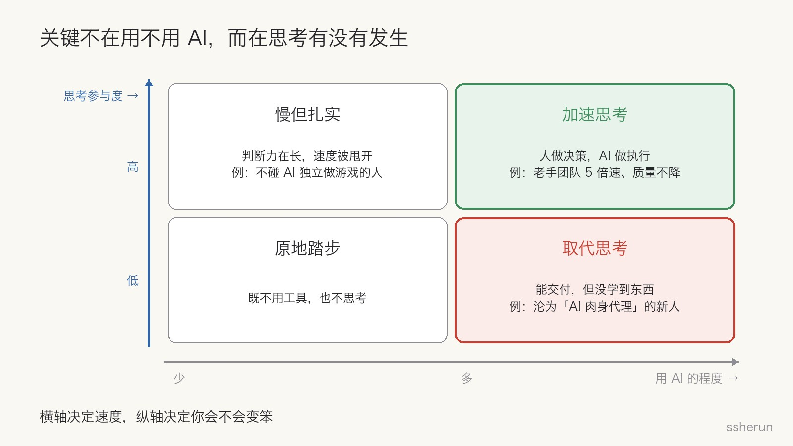
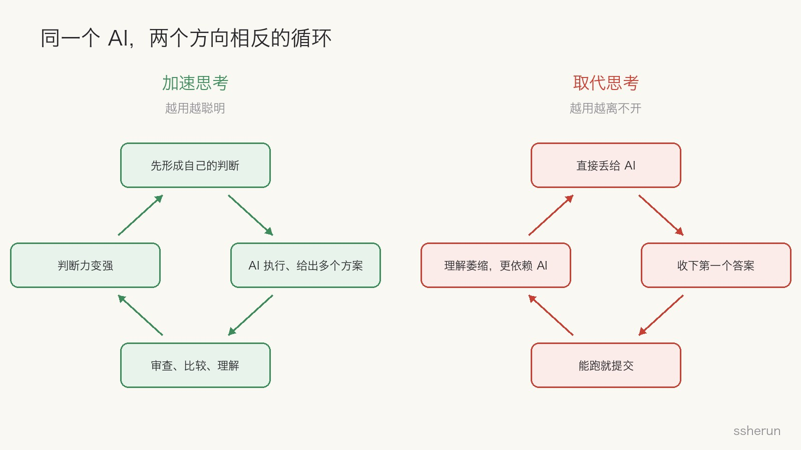
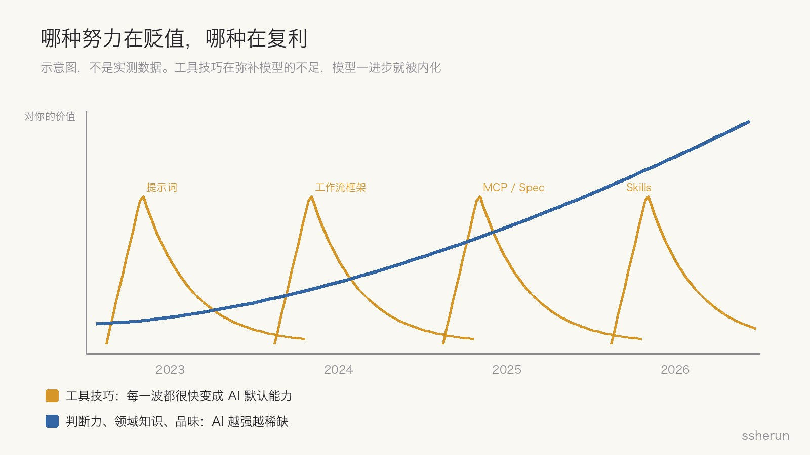

> 讨论来源：
> - V2EX：[相比 AI 的能力，觉得更可怕是它进步的速度、变化的幅度](https://www.v2ex.com/t/1246322)（21 楼）
> - Reddit r/gamedev：[AI models have caught up with Unity dev. My insights as someone with 30 years of experience.](https://www.reddit.com/r/gamedev/comments/1wo5asm/)
> - V2EX：[感觉程序员行业有点死了](https://www.v2ex.com/t/1246421)（75 楼）

这两周读到的三篇讨论，情绪几乎一样：恐慌。

一位做了 30 年开发的游戏工作室老板写道：「我问过的每个人都觉得自己在变笨、注意力在流失。我也是。」

V2EX 上有人说，为了用好 AI 做的所有努力，很快都变成了 AI 的默认能力，「连『努力』本身都变得不那么正当」。另一个帖子标题直接是：「感觉程序员行业有点死了。」

那么，人类智力是不是此刻已经锁死了？

我的看法是：**关键的区别不在于「你是否使用了人工智能」，而在于你是用它来加速思考，还是取代思考。**

## 三篇讨论各说了什么

### 30 年老兵：速度 5 倍，但所有人都在变笨

Reddit 发帖人有 30 年软件开发经验，开了一家做工业模拟和培训应用的工作室。他过去一直看不上 AI 写代码，直到四五个月前。他列了十几条观察，其中几条最扎心：

- 开发速度几乎一夜之间提升了约 5 倍。
- **质量没有下降，因为我们都是有经验的开发者，不让 AI 决定项目结构和设计模式。**
- 没有乐趣，没有成就感，所有进展都归功于 AI。
- **没有新人的位置**：每次尝试带新人，他们都变成 AI 的「肉身代理」，什么都没学到。
- **用 AI 写代码的人什么都学不到。要理解代码，就得写代码，而现在没人在写。**
- 我已经无法正确估算一个任务的工作量。

评论区的高赞补充更值得看。点赞 723 的一条说：比「学不到」更糟的是，**AI 会提升你的自信，你甚至注意不到自己没在学习**——「我用一个新框架，很容易就能交付代码，但完全不觉得自己熟练了。」

一位 AAA 工作室的 20 年老手说：最好的开发者都极度疲惫，整天同时调度多个 Agent，只做高层设计和架构决策。以前写代码这种「体力活」能让大脑休息，现在只剩最累的那部分。

还有一条讲得很细：以前写游戏设置菜单，你会琢磨鼠标灵敏度该用滑块还是交互演示、会不会影响菜单速度、和系统设置怎么叠加。现在一句提示词就生成菜单，**这些细节根本没被想过**。

### V2EX #1246322：可怕的不是能力，是速度

楼主的经历很典型：23 年打磨提示词，24 年研究 LangChain、Dify 做工作流，25 年研究 MCP 和编程 Spec，26 年做 Skills。

他的焦虑是：**每一轮努力的成果，很快都变成了 AI 的默认能力**；反而是那些 AI 有啥就用啥的人，过得更轻松。如果 AI 的进步无法预期，人就会对长期努力保持谨慎。

评论区有一句很冷：「人类还没做好准备接受自己的平庸。」也有一句很清醒：「这让长期主义者知道，世界不围绕他们的计划运转。」

### V2EX #1246421：程序员行业有点死了

楼主是独立开发者，以前靠上架 app 养家，最近半年收入快跌没了。75 楼的回复两极分化：

- 一位完全不懂 app 开发的人，每天零散一小时，用 AI 做出了一个 app（♥7）；
- 但另一位说，身边几个不会代码的人上架了 app，刚开始意气风发，**最近一打听全死了**：不知道运营，不知道推广（♥6）；
- 还有人给了一个公式：收入 = X ×（Y1 + Y2 + …），X 是写代码的能力，Y 是设计、沟通、计划等其他能力，**现在 X 无限趋近于 1**。

## 三篇其实在说同一件事

把三篇放在一起看，同一个工具在不同人手里，结局完全相反：

- Reddit 那个老手团队，速度 5 倍、质量不降——因为**架构和设计模式由人决定**，AI 负责执行。这是加速思考。
- 同一个团队里的新人，变成 AI 的肉身代理，什么都没学到。这是取代思考。
- V2EX 上一位回复者说，他会看文档和实施总结，让另一个模型交叉 review，「在做的过程中逐渐积累经验和直觉」；他甚至说自己的表达方式就是从 LLM 那里学的：按关键点梳理，不能一大坨。这是加速思考。
- 一句话做出 app、不懂运营、三天就死。这是取代思考，只不过被取代的是「想清楚做什么、卖给谁」。

**区别从来不在用不用 AI，而在思考有没有发生。** 横轴决定你有多快，纵轴决定你会不会变笨。

## 「锁死」真正的机制

如果智力真的会被锁死，机制大概是这样三层：

**认知卸载。** 理解来自亲手做。Reddit 原帖那句「要理解代码，就得写代码」说的就是这个。把产出交给 AI，理解的过程也一起交出去了。

**自信错觉。** 这是最危险的一层。AI 让你很快就能交付，交付带来自信，自信掩盖了「其实没学会」。你不会觉得自己在变笨，直到某天出了问题，你发现自己定位不了。

**探索被跳过。** 设置菜单那个例子说明，被取代的不只是打字，还有「在各种可能性之间来回比较」的那段思考。那些让产品显得用心的小细节，正是在这段思考里产生的。

所以我不认为是 AI 让人变笨。**是人主动放弃了让自己变聪明的那段过程。** 它是选择，不是宿命。

两个循环的方向相反：加速思考是「先有判断 → AI 执行并给出多个方案 → 审查比较 → 判断力变强」，越用越聪明；取代思考是「直接丢给 AI → 收下第一个答案 → 能跑就提交 → 理解萎缩 → 更依赖 AI」，越用越离不开。

## 「努力不再正当」吗

V2EX 楼主的焦虑，我觉得对了一半。

**会贬值的是工具技巧**：提示词套路、工作流框架、某个 Agent 的配置方法。它们本来就是在弥补模型的不足，模型一进步就被内化。楼主四年追的东西，恰好都属于这一类，所以他感受到的折旧特别剧烈。

**会复利的是判断力**：领域知识、品味、定义「做什么」的能力。Reddit 一位 20 年老手说得很直白：「写代码从来不是难点，难的是规划、架构、可读可维护。」V2EX 那个公式也说明了同一件事：X 趋近于 1 之后，收入全靠 Y。

「努力不再正当」，是把这两种努力混为一谈了。**追工具的努力在贬值，锻炼思考的努力在升值。**

## 真正的锁死风险在新人

个人可以选择加速思考，行业层面的风险更难办：**新人的成长通道正在断裂。**

如果新人从第一天起就用 AI 取代思考，他们永远长不成能做架构决策的老手。而现在的老手正在流失：Reddit 原帖说同龄人大多计划提前退休，点赞最高（841）的评论是：「老手会因为无聊和缺乏成就感离开，新人又无法在新工作流里成长。未来十年会非常痛苦。」

十年后，谁来判断 AI 的产出对不对？

还有一层更远的担心：如果没人再探索新语言、新架构，技术就会停在现有数据的平均水平。模型学的是已经存在的东西，**人的发散思考反而会更值钱**。

## 加速思考也有代价：更累

这一点不能回避。加速思考意味着人只剩下最耗脑的决策部分，没有了「写代码时顺便休息」的缓冲。

用 AI 加速思考的人，需要主动设计自己的节奏：决策集中处理、留出低强度时间、不要同时调度太多 Agent。否则不是变笨，而是被累垮。

## 检查清单：我是在加速思考，还是在取代思考

- [ ] 问 AI 之前，我有没有先形成自己的判断或草稿？
- [ ] 关键决策（架构、取舍、做什么不做什么）是我做的，还是 AI 默认给的？
- [ ] 不看 AI 的解释，我能复述这次的产出吗？出错时我能定位吗？
- [ ] 我让 AI 扩展选项，还是直接收下第一个答案？
- [ ] 做完这次，下次遇到类似问题我会判断得更快吗？
- [ ] 我的时间花在追工具技巧上，还是花在领域知识和判断力上？
- [ ] 带新人时，是「解释清楚才合并」，还是「能跑就合并」？

## 几个具体做法

1. **先想后问。** 先写下自己的方案，再让 AI 挑战它，而不是先问 AI 再顺着走。
2. **让 AI 出三个方案并说明取舍。** 主动找回被跳过的那段探索。
3. **关键部分亲手做或逐行读。** 核心模块、陌生领域的第一遍，宁可慢一点。
4. **把 AI 当陪练，而不是代笔。** 让它追问你、找你论证的漏洞。
5. **给新人定一条规则：解释不清就不合并。** 用 AI 可以，但要过「讲给人听」这一关。
6. **把时间投给会复利的东西。** 领域知识、品味、定义问题的能力，而不是下一个框架的用法。

人类智力不会因为 AI 而锁死。会被锁死的，是那些把思考整个外包出去的人。**AI 是杠杆，杠杆放大的是你本来就有的东西；如果你什么都不想，它放大的就是零。**

## 相关文章

- [[ai-fatigue-truth-10x-workload|AI让你效率翻倍？醒醒吧，你的工作量已经是过去的10倍了]]
- [[chatgpt-critical-thinking-students|ChatGPT 让答案更好，批判性思维让想法更宽]]
- [[judge-dev-ability-in-ai-era|人人都用 AI 之后，怎么判断程序员能力高低？]]
- [[good-tech-not-making-money|技术好不代表能赚钱：创业路上最常见的错误]]
