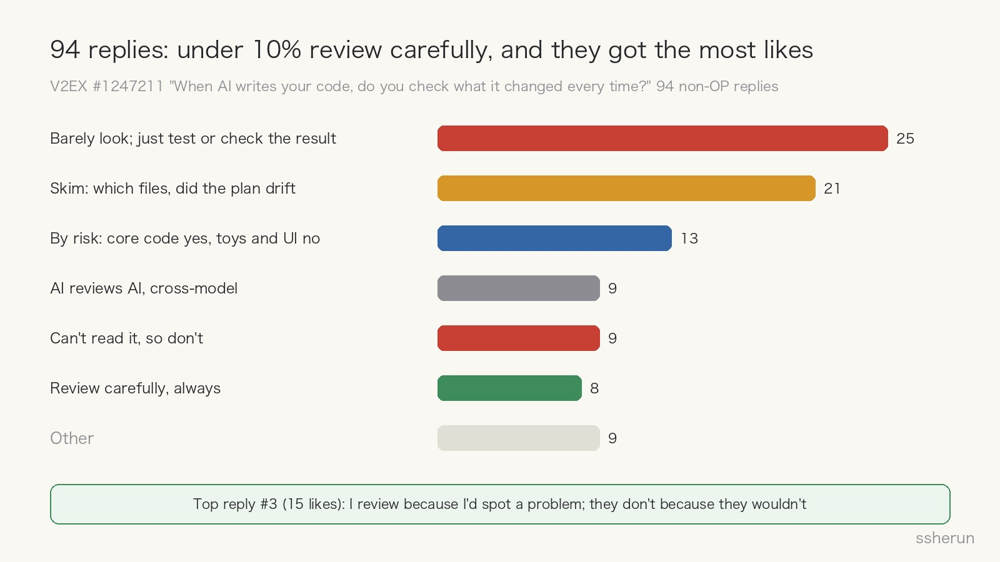
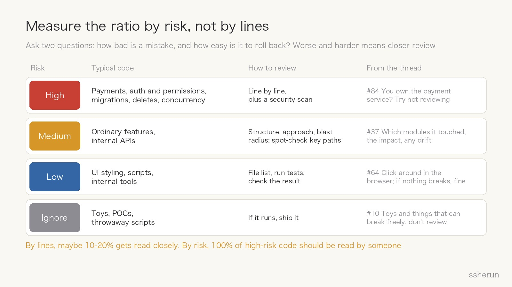
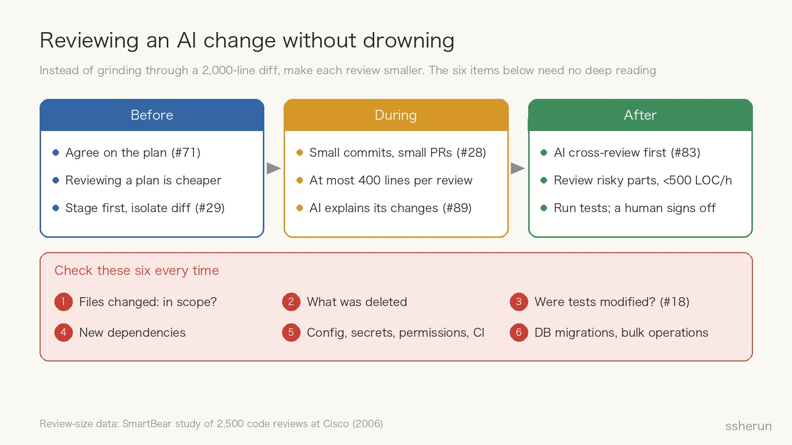

> Source discussion: [When AI writes your code, do you check what it changed every time?](https://www.v2ex.com/t/1247211) (V2EX, 96 replies)

A V2EX user asked a question many developers face every day: after AI changes your code, do you read the diff line by line, or try the feature and commit if it works?

A few lines is fine. A change across a dozen files is exhausting to read. But skip it entirely, and you worry it quietly changed something it shouldn't have.

Underneath, this is a question of proportion: **how much AI-written code should you actually review?**

## The comments: fewer than one in ten review carefully

Leaving out the OP's 2 replies, the 94 others split by main practice:

- **25 barely look; they just test or check the result.** #86 describes a common arc: "At first I watched closely, then I glanced occasionally, and now I don't look at the code at all, I only do acceptance."
- **21 skim**: which files changed, whether the structure is right, whether the plan drifted.
- **13 go by risk**: production, company, and core code get reviewed; toy projects and front-end code don't.
- **9 have AI review AI**, or cross-check with several models.
- **9 can't read it, so they don't.** #21 put it most painfully: "If you can read it, you can choose not to. If you can't, you have no choice."
- **Only 8 review carefully.**

Yet the most-liked reply in the thread, #3 (15 likes), came from that small group:

> Of course I review it. Don't rush to ship; pour a cup of tea and read it slowly. Some people say they never look, and there's no need to compete. **I review because if there's a problem, I'd spot it. They don't because if there's a problem, they wouldn't.**

## "Do you review?" is really three questions

The disagreement in the thread breaks down into three different issues.

**First, can you keep up?** #85 says that reviewing properly, one day's generated code would take a week to read, and since AI arrived, the time allotted for tasks has been squeezed hard.

That isn't an excuse. A SmartBear [code review study](https://smartbear.com/learn/code-review/best-practices-for-peer-code-review/) of a Cisco team, covering 2,500 reviews and 3.2 million lines, found that **reviewers' ability to find defects drops sharply beyond 200 to 400 lines per review, and going faster than about 500 lines an hour misses a significant share of defects.** An AI diff touching a dozen files and over a thousand lines is already beyond what human review handles well.

**Second, can you understand it?** #21 says if you can't read it, you can't review it. But #3 and #82 turn that around. #82: "If you don't read it now, you won't be able to read it later." #53 says without reading, you soon forget what the project even looks like. #55 says the business changes fast, and if you don't read the code you won't know how to change it next time. **Not reading makes you less and less able to read.**

**Third, who's responsible when it breaks?** #8 says they don't review their reports' code because the report takes the blame, but when AI-written code breaks, can you tell your manager the AI wrote it? #9 replied sharply: if your reports' mistakes have nothing to do with you, why not optimize you away? #27 reviews anything going to production, "because if it breaks, my pay gets docked."

## The data: AI means more code, not automatically safer code

Two sets of numbers are worth reading together.

Google's [DORA 2024 report](https://cloud.google.com/blog/products/devops-sre/announcing-the-2024-dora-report) surveyed 39,000 professionals and found that each 25% increase in AI adoption was associated with 3.4% better code quality and 3.1% faster code review, but **7.2% lower delivery stability**. The report's explanation: fundamentals like small batches and robust testing haven't become less important because of AI.

Veracode's [2025 GenAI Code Security Report](https://www.veracode.com/blog/genai-code-security-report/) tested more than 100 models and found that **in 45% of cases the generated code introduced an OWASP Top 10 vulnerability**; defenses against cross-site scripting failed 86% of the time. More striking: **newer and larger models were not meaningfully more secure.**

Both datasets are dated, and models keep improving. But they make one point: a functional test proves code runs. It doesn't prove the code is secure or stable.

The thread has a real lesson too. #63: "I used to not look, and then changes caused several serious production incidents. Now I review, and run a few more rounds of AI review."

## My answer: measure the ratio by risk, not by lines

There's no fixed review ratio. To decide how closely to read a piece of code, ask two questions: **how bad is a mistake, and how easily can you roll it back?**

- **High risk**: payments and money, authentication and permissions, data migrations and deletion, security-sensitive input handling, concurrency, public APIs, changes to existing core logic. **Read it line by line**, ideally with a security scan on top. As #84 put it: "Put in charge of the company's payment service, try not reviewing."
- **Medium risk**: ordinary features, internal APIs. Check the structure, approach, and blast radius; spot-check the key paths; make sure tests cover it. That's #37's approach: leave detailed logic to tests, but look at which modules changed, how wide the impact is, and whether anything drifted.
- **Low risk**: UI styling, scripts, internal tools. Look at the file list, run the tests, check the result. #64 says for front-end code, click around in the browser; if nothing breaks, it's fine.
- **Ignore**: toy projects, POCs, throwaway scripts. If it runs, that's enough.

By lines, maybe only 10 to 20 percent gets read closely. By risk, **100% of high-risk code should be read by someone**. That ratio is my own rule of thumb, not research data, but it's more realistic than "read everything" and safer than "read nothing."

## Six things to check every time

Whatever the tier, six things are worth checking on every change. They're cheap and don't require understanding the implementation:

1. **Which files changed**, and whether anything is outside the task's scope. This alone catches the OP's fear that AI "quietly changed something it shouldn't have."
2. **What was deleted.** Removed code often hides more risk than added code.
3. **Whether tests were modified.** #18 admitted: "At first I reviewed, then I couldn't keep up, so I let it make the tests self-consistent too." If AI changes the tests to make them pass, "tests pass" proves nothing.
4. **New dependencies.** Every new dependency is a supply-chain entry point.
5. **Config, secrets, permissions, CI.** Were any touched?
6. **Database migrations, data deletion, bulk operations.**

## Making diffs reviewable beats grinding through them

If people can only review a few hundred lines at a time effectively, then rather than grinding through a 2,000-line diff, make each review smaller:

- **Agree on the plan before any code.** #71 aligns on the change plan first, then just checks the result didn't drift; #47 only checks requirement understanding, the plan, and test coverage. Reviewing a plan is far cheaper than reviewing code.
- **Stage before letting AI edit.** #29 stages previous changes first, so the diff contains only this change.
- **Small commits, small PRs.** #28 has AI split work into fine-grained commits and keeps each PR to a few files, then scans each diff for smells.
- **Have AI explain what it changed and why.** Reading an explanation is faster than reading code; ask about anything unclear (#41, #89).
- **Let AI do the first review; humans take the high-risk points.** #83 has Claude's code reviewed by GPT or DeepSeek; #80 lets AI review first and only reads the open issues it raises. Models from different vendors are less likely to share the same mistakes, which is my inference, but someone still has to judge the AI's findings and sign off.

## One test

#65 offered a useful test. Since efficiency and fully understanding every detail can't coexist, #65 confirms just two things:

> 1. I still have control over the project.
> 2. The code as a whole will converge over time.

If both answers are yes, reading a bit more or less is fine. If either starts to waver, it's time to stop and read more.

## Closing

How much AI-written code should you review? **The file scope and those six items, every time. High-risk code, 100%, line by line. Ordinary features, structure and approach. Low-risk code, the result.** Then use small PRs, agreed plans, and AI cross-review to shrink how much there is to read.

#3's line is worth rereading: people who don't review often aren't confident, they just wouldn't spot a problem anyway. Reviewing code isn't only about finding bugs. It's how you stay able to understand your own project.

## Related posts

- [[what-can-programmers-still-do|What can programmers still do now that AI writes code?]]
- [[judge-dev-ability-in-ai-era|When Everyone Uses AI, How Do You Judge a Developer?]]
- [[github-malware-cracked-software|GitHub has malware too: one download, every account lost]]
