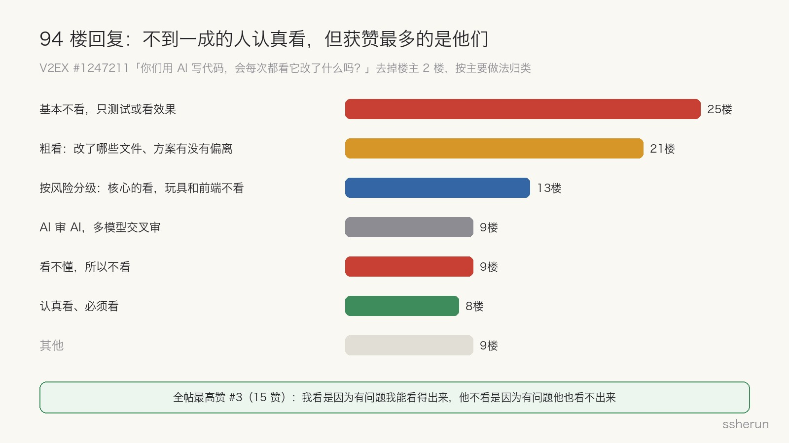
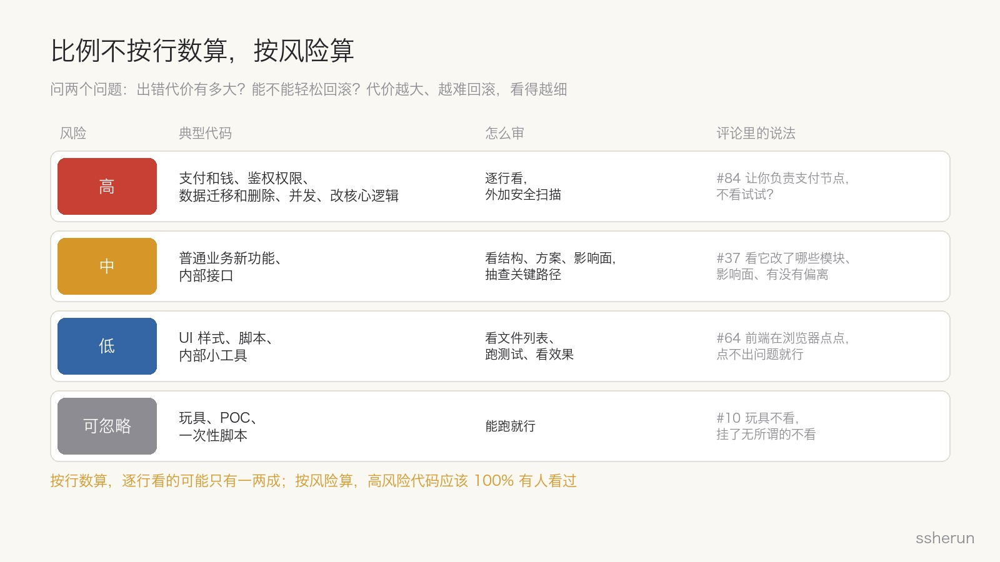
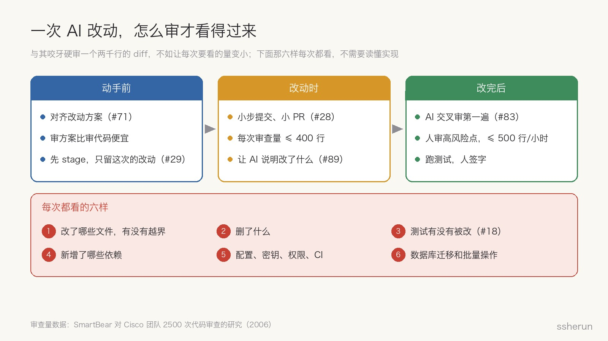

> 讨论来源：[你们用 AI 写代码，会每次都看它改了什么吗？](https://www.v2ex.com/t/1247211)（V2EX，96 楼）

一位 V2EX 用户问了一个很多人每天都在面对的问题：让 AI 改完代码，你会逐行看 diff，还是功能试一下没问题就提交？

只改几行还好。一次改十几个文件，看着就费劲。可完全不看，又怕它顺手改了不该改的地方。

这背后其实是一个比例问题：**AI 写的代码，到底该审多少？**

## 评论区：不到一成的人认真看

去掉楼主的 2 楼，94 楼回复按主要做法分：

- **25 楼基本不看，只测试或看效果。** #86 的变化很典型：「最开始盯着看，然后变得偶尔瞅一眼，最后开发完全不看，只验收。」
- **21 楼粗看**：看改了哪些文件、结构对不对、方案有没有偏离。
- **13 楼按风险分级**：生产、公司、核心逻辑的看，玩具和前端不看。
- **9 楼让 AI 审 AI**，或者多个模型交叉审。
- **9 楼看不懂，所以不看。** #21 说得最扎心：「看得懂可以选择不看，看不懂只能不看。」
- **只有 8 楼认真看。**

但全帖获赞最多的，恰恰是认真看的 #3（15 赞）：

> 看是肯定要看的，不要急着交付，倒杯茶慢慢看。有的人说我从不看，这个没必要攀比。**我看是因为如果有问题我能看得出来，他不看是因为如果有问题他也看不出来。**

## 「看不看」其实是三个问题

这个帖子里的分歧，拆开是三件不同的事。

**第一，看得过来吗？** #85 说，认真看的话，一天生成的代码够看一周；用了 AI 之后，任务的工时也被压缩得厉害。

这不是借口。SmartBear 对 Cisco 一个团队做过一项[代码审查研究](https://smartbear.com/learn/code-review/best-practices-for-peer-code-review/)，覆盖 2500 次审查、320 万行代码，结论是：**单次审查超过 200 到 400 行，发现缺陷的能力就明显下降；速度超过每小时 500 行，会漏掉相当一部分缺陷。** 一个改了十几个文件、上千行的 AI diff，本来就超出了人眼审查的有效范围。

**第二，看得懂吗？** #21 说看不懂只能不看。但 #3 和 #82 把这句话翻了过来：#82 说「现在不看，将来看不懂」；#53 说不看的话，过段时间就忘了这个项目长什么样；#55 说业务变得快，不看以后就不知道怎么改。**不看，会让你越来越看不懂。**

**第三，出事谁负责？** #8 说不看下属的代码，是因为出了问题下属背锅；可 AI 写的代码出了问题，能跟领导说都是 AI 写的吗？#9 回得更狠：下属出问题跟你没关系，那把你优化掉也没问题？#27 说上线代码会看，「毕竟出了问题会被扣工资」。

## 数据：AI 让代码变多，但没有让它自动变安全

两组数据值得放在一起看。

Google 的 [DORA 2024 报告](https://cloud.google.com/blog/products/devops-sre/announcing-the-2024-dora-report)调查了 3.9 万名从业者，发现 AI 采用率每提高 25%，代码质量提升 3.4%、代码审查速度提升 3.1%，但**交付稳定性下降 7.2%**。报告的解释是：小批量提交、健全的测试这些基本功，没有因为 AI 而变得不重要。

Veracode 的 [2025 年 GenAI 代码安全报告](https://www.veracode.com/blog/genai-code-security-report/)测试了 100 多个模型，**45% 的情况下，模型生成的代码引入了 OWASP Top 10 级别的安全漏洞**；跨站脚本的防护失败率高达 86%。更值得注意的是，**更新、更大的模型，在安全上并没有明显变好。**

这两组数据都有时效性，模型一直在进步。但它们说明一件事：功能测试能证明代码「能跑」，证明不了它「安全」「稳定」。

帖子里也有真实的教训。#63 说：以前不看，结果修改功能在生产环境出了几次严重问题，现在会看，还会多跑几轮 AI review。

## 我的答案：比例不按行数算，按风险算

审核比例不是一个固定数字。判断一段代码要看多细，只需要问两个问题：**出错的代价有多大？能不能轻松回滚？**

- **高风险**：支付和钱、鉴权和权限、数据迁移和删除、安全相关的输入处理、并发、对外接口、改已有的核心逻辑。**逐行看**，最好再加一道安全扫描。#84 说得好：「让你负责公司的支付节点，不看试试？」
- **中风险**：普通业务功能、内部接口。看结构、方案和影响面，抽查关键路径，确认有测试覆盖。#37 的做法就是这样：细节逻辑交给测试，但要看它改了哪些模块、影响面多大、有没有偏离。
- **低风险**：UI 样式、脚本、内部小工具。看文件列表、跑测试、看效果。#64 说前端在浏览器里点点，点不出问题就行。
- **可忽略**：玩具项目、POC、一次性脚本。能跑就行。

按行数算，真正逐行看的可能只有一两成；但按风险算，**高风险代码应该 100% 有人看过**。这个比例是我的经验判断，不是研究数据，但它比「全看」现实，也比「全不看」安全。

## 每次都该看的六样东西

不管哪一档，有六样东西每次都值得看。它们成本很低，不需要读懂实现：

1. **改了哪些文件**，有没有越出这次任务的范围。楼主怕的「顺手改了不该改的地方」，靠这一步就能发现。
2. **删了什么。** 被删掉的代码，往往比新增的更容易藏雷。
3. **测试有没有被改。** #18 说得很坦白：一开始看，后来跟不上，「于是连同测试也让它自洽了」。如果 AI 为了让测试通过而改了测试，「测试通过」就什么也证明不了。
4. **新增了什么依赖。** 每一个新依赖都是一个供应链入口。
5. **配置、密钥、权限、CI** 有没有被动。
6. **数据库迁移、数据删除、批量操作。**

## 让 diff 变得可审，比咬牙硬审更有效

既然人眼一次只能有效审几百行，与其咬牙硬审一个两千行的 diff，不如让每次要审的量变小：

- **动手前先对齐方案。** #71 说，动手之前先对齐改动方案，写完看没偏离设想就行；#47 只看需求理解、执行方案和测试覆盖。审方案比审代码便宜得多。
- **先 stage 再让 AI 改。** #29 的做法：先把之前的改动 stage 起来，diff 里就只剩这次的改动。
- **小步提交、小 PR。** #28 要求 AI 拆成很细的 commit，一个 PR 不改很多文件，点开 diff 扫一眼没有坏味道就行。
- **让 AI 说明它改了什么、为什么。** 看解释比看代码快，看不懂的地方追问（#41 #89）。
- **AI 交叉审第一遍，人看高风险点。** #83 让 Claude 写的代码交给 GPT 或 DeepSeek 审；#80 让 AI 先审，自己只看审核意见里的开放问题。不同厂商的模型错误更不容易重合，这是我的推断；但 AI 审核的结论，仍然要有人判断、有人签字。

## 一个判断标准

#65 给了一个很好用的标准：效率和完全搞懂细节不可兼得，所以只确认两件事：

> 1. 我依然可以对项目掌控；
> 2. 代码整体上会在未来收敛。

如果这两条都答「是」，看多看少都还好；如果有一条开始答不上来，就该停下来，多看一点了。

## 写在最后

AI 写的代码该审多少？**文件范围和那六样东西，100% 看；高风险代码，100% 逐行看；普通业务看结构和方案；低风险看效果。**再用小 PR、先对齐方案、AI 交叉审，把每次要看的量降下来。

#3 那句话值得再读一遍：不看的人，往往不是因为自信，而是因为就算有问题，他也看不出来。审代码的意义，不只是找 bug，也是让自己一直看得懂自己的项目。

## 相关文章

- [[what-can-programmers-still-do|程序员还能做啥？AI 接走了写代码，剩下的才是大头]]
- [[judge-dev-ability-in-ai-era|人人都用 AI 之后，怎么判断程序员能力高低？]]
- [[github-malware-cracked-software|GitHub 里也要注意病毒：一次破解版下载，丢掉全部账号]]
