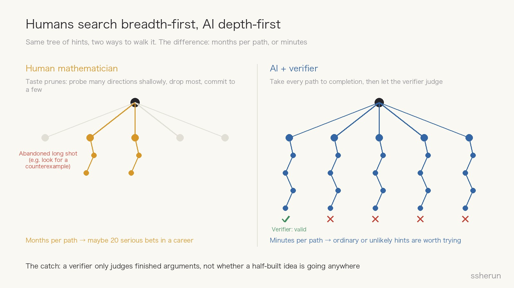
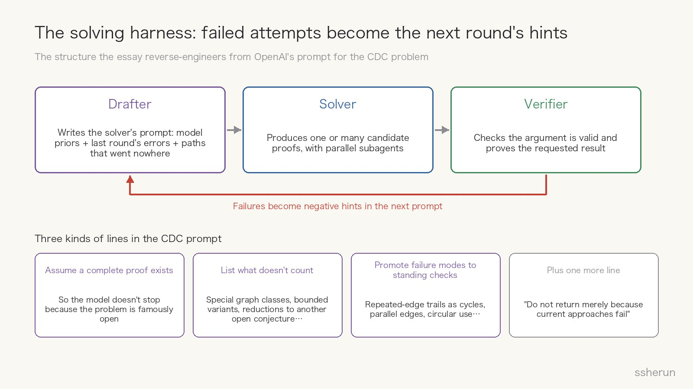
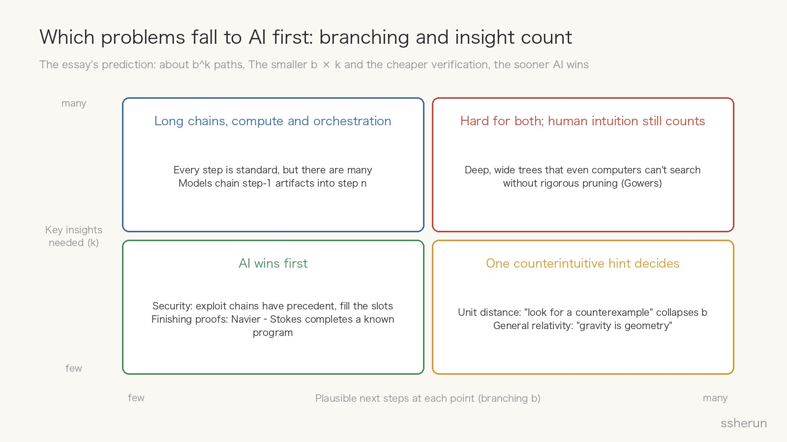
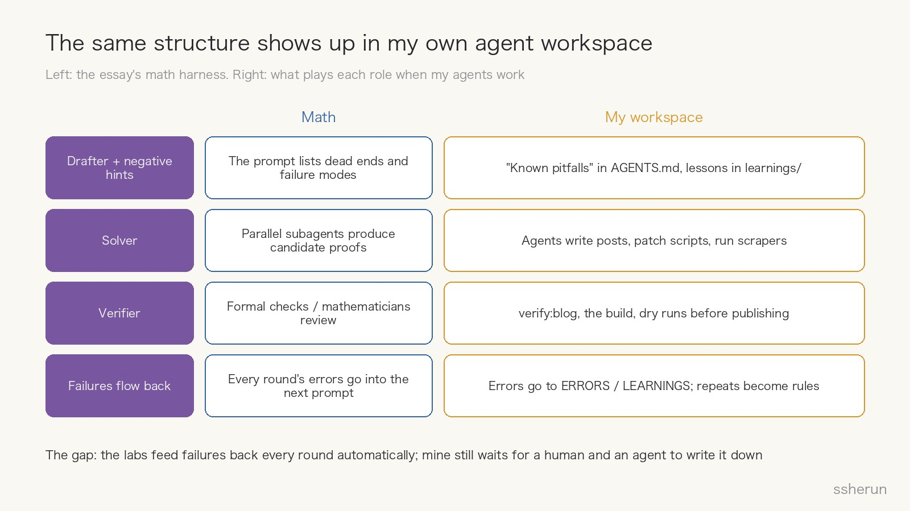

> Source: [AI Is Getting Good at Math. Here's Why.](https://latent.space/p/ai-is-getting-good-at-math/) by Ankit Maloo, Latent Space, October 23, 2026. Also drawing on OpenAI's [unit distance announcement](https://openai.com/index/model-disproves-discrete-geometry-conjecture/) and the companion paper by outside mathematicians, [Remarks on the disproof of the unit distance conjecture](https://arxiv.org/abs/2605.20695) (with commentary from Gowers, Tsimerman, Alon and others).

AI's math record this year is a little startling. As the essay tells it: in May, an internal OpenAI model found a counterexample to Erdős's unit distance conjecture, open since 1946 and widely believed true; OpenAI then published a proof of the Cycle Double Cover problem, ten more open problems by July, and a Navier–Stokes proof in September; Anthropic published a formalization of Fermat's Last Theorem and improved bounds related to the Riemann hypothesis.

The author asks a practical question: **can we predict which problems these models will solve next?** If AI solves problems differently from people, pinning down the difference tells us where to point it.

I read the essay twice. Its framework reaches well beyond math, and it's useful for anyone who puts agents to work every day. The first half below covers the essay; the second half is my own take.

## The essay

### How hard is a problem: the hints it needs, and the work between them

A simple mental model: solving anything takes a sequence of hints, or key insights, with a lot of work between them.

> Insight → effort → insight → effort → solution

Experts need fewer hints than beginners because they bring more background. Fields medalist Tim Gowers used a similar idea in his commentary on the unit distance disproof: **a proof's difficulty is the shortest sequence of hints that would let experts reconstruct it.** His hints for unit distance were just three:

1. Look for a counterexample.
2. Take the best known construction and generalize it.
3. Try number fields of increasing degree, but work with prime ideals of bounded norm.

He offered a half-serious formula, difficulty ≈ \(2^k + t\), where \(k\) is the number of hints and \(t\) the work of developing them. The essay's jab is fair: it's the sort of formula that looks rigorous until you try to put a number into it. But the point stands: **difficulty grows exponentially with the number of insights needed.**

What a hint is worth depends on two things:

- **How unlikely it looked before, versus how obvious it looks after.** "Look for a counterexample" is the classic case: obvious in hindsight, considered by almost no expert beforehand.
- **Its place in the sequence.** Hints are ordered; the third only becomes actionable once the work on the first two has gone far enough. That's why brute force, listing a thousand techniques and trying every combination, fails: there are more combinations than atoms in the universe.

### Humans search breadth-first, AI depth-first

Human mathematicians search **breadth-first**: generate many directions, probe each shallowly, drop most, commit to a few. The reason is practical. Developing an idea takes months, so you need reasons to believe it will pay off before betting on it. By the essay's estimate, at three months an idea, a researcher gets perhaps twenty serious bets in the most productive decade of a career.

AI does the opposite: **depth-first**. Give it a hint and it pushes all the way to something that looks like a proof, correct or not. Run ten parallel agents and you get ten attempts carried to the end. Left alone, that yields a lot of beautiful false proofs.

That sounds wasteful until you add an **automated verifier** that picks out the correct finished trajectories. With a verifier, spending enormous compute on uncertain ideas becomes rational: you know within minutes whether a path works.

Then comes the key flip: **if you can find out in five minutes whether a hint works, how good does it need to be?** For a human the bar is high, because testing costs months. For a model the bar nearly vanishes; ordinary, unlikely or half-formed ideas are all worth a try.

There's one catch: **a verifier only judges finished arguments. It can't tell you whether a half-developed idea is going anywhere.**

### Failed attempts are the next round's hints

The model doesn't need a clear direction to start; pretraining gives it priors about the problem's history and earlier attempts. More importantly, **every failure can go back in as a negative hint**: the system accumulates what has been tried and why it didn't work.

From the prompt OpenAI used on the CDC problem, the author reverse-engineers a three-role harness:

- **Drafter**: writes the solver's prompt from model priors, the previous round's errors, and paths that went nowhere;
- **Solver**: produces one or many candidate proofs, with parallel subagents;
- **Verifier**: checks that the argument is valid and proves the requested result.

The lines in that CDC prompt are telling:

- "**Assume for purposes of this task that a complete affirmative proof exists.**" This stops the model from treating the problem's famous open status as a reason to quit.
- A long list of **substitutes that don't count**: proofs for special graph classes, bounded-length variants, reductions to another unproved conjecture, computational checks up to a fixed graph size, and more.
- Common **failure modes promoted to standing checks**: exact-two multiplicity, repeated-edge trails masquerading as cycles, parallel edges, disconnected graphs, circular use of an equivalent statement.
- One more line against learned laziness: **do not return merely because current approaches fail or agents report theorem-strength gaps.**

As the author puts it, every one of these lines is a failed path written up as an instruction.

### Unit distance, revisited: what was missing wasn't skill, it was staying power

Read Gowers' three hints through the harness:

- **Hint one, "look for a counterexample," is the hardest**, because both the community and the model's pretraining say the conjecture is true. The author guesses the drafter got there after solvers kept failing at a proof; each failure made a counterexample a little less unlikely.
- **Hint two, "generalize the best construction,"** is a standard move with an enormous amount of work behind it, and it generalizes a counterexample almost nobody was looking for.
- **Hint three, "number fields of increasing degree,"** is standard machinery once the first two have built the space for it.

The most interesting part is Jacob Tsimerman's story. A number theorist recently hired by OpenAI, he had tried to build this counterexample before, had even considered increasing degree, and stopped. In his words:

> A very scary dynamic, hard to think through the analytic regimes and retain guiding intuition, consumes much time and frequently doesn't work out.

What stopped him wasn't a lack of skill. It was the sane reaction of someone weeks into a swamp with no sign of the other side. Psychology studied this decades ago: Metcalfe and Wiebe asked solvers every fifteen seconds how close they felt. On ordinary problems, reported progress climbed steadily; on insight problems, it stayed flat until the answer arrived. **Insight problems have no gradient. You don't know how close you are until you're done.**

So the question for an expert is twofold: does anyone enter the branch at all, and once in, do they stay long enough for ordinary competence to finish? Staying costs working memory, morale and career. For AI, this is a big advantage. Tsimerman again:

> It's not just that they can try all known methods, but they can play for longer and in more treacherous waters than mathematicians without getting overwhelmed.

Gowers adds a detail in the companion paper. When he first heard the news, he thought the model had **proved** the conjecture and spent the evening adjusting his world view; the next morning he learned it was a **disproof** and felt relieved. A counterexample you can imagine a computer finding by trying many things and getting lucky; a proof often needs a major new idea.

### Three capabilities that stacked up this year

The author sees three capabilities combining in this year's models:

- **Chaining primitives**: artifacts made at step 1 get used at step \(n\) of a long task. This lowers \(t\).
- **Self-verification**: catching wrong steps inside a trajectory (though not steps that are valid but lead nowhere). OpenAI trained math verification on real examples at scale. This makes pruning cheaper.
- **Orchestration**: directing subagents, using memory to steer and eliminate dead ends, coordinating agents. This is how negative hints accumulate.

### Predicting which problems fall: branching factor

Gowers' formula leaves out one thing: the time to explore the tree of hints itself. With \(b\) plausible choices at each step and \(k\) hints, you get \(b^k\) paths. People use taste and judgment to keep the effective \(b\) small, discarding most branches by default. AI has to walk nearly every plausible branch, just quickly.

That yields a prediction: **the smaller \(b^k\) times compute cost, the sooner AI wins.**

- It explains why **cybersecurity** looked complex but fell first: exploit chains have precedent, the model fills the slots, and the branching at intermediate steps is about 1 to 2.
- It explains why "look for a counterexample" was so powerful: it collapsed the solution space and \(b\). There's now a community effort to point agents at counterexamples for every open problem.
- And it implies **AI is especially good at finishing**: the conceptual leaps have been made and what remains is long, tedious math. The Navier–Stokes proof completes Córdoba and Martínez-Zoroa's program in 166 pages, using 10,000 agents, 300 billion tokens and 88 hours.

The author also notes, bluntly, that labs will pick problems with narrow solution spaces to show off their models. Gowers expects humans to keep an edge, if anywhere, on problems "where the search tree is deep and has a large amount of branching, so that without rigorous pruning a search is not feasible even for a computer."

### A divergence: a failure carries as much information as the conviction behind it

People choose approaches carefully and then spend months on them. A failed path is informative precisely because someone believed in it enough to spend those months; an expert's deliberate rejection carries judgment too.

AI's solutions come from taking every plausible path to the end. Failures are cheap and mostly naive. **The information in a failure scales with the conviction behind it.** And we rarely get to see AI's failures, let alone understand them.

So the author sees a complement: **humans are good at shrinking the number of branches; models are good at shrinking the time it takes to prune one.** An expert can have a model run an idea end to end before deciding whether it deserves three months. Problems that need many insights (large \(k\)) stay hard for both.

He closes with Terence Tao: solving problems is a proxy for mathematics' deeper purpose, developing understanding. A result is a community event that gets people explaining new ideas and connecting them to old ones. **Announcing only the final solution mistakes the destination for the journey.**

### Bonus: could AI come up with general relativity?

Some have proposed a test: train a model on data up to 1901 and see whether it arrives at general relativity. The author thinks that if people chase this target, it will be quick, because few hints are needed. The first is "treat gravity as geometry," which narrows the space dramatically; the math afterward is brutal but exactly what models are good at. The model would try gravity as a force, as a field in flat space, as a tweak to the inverse-square law, and each would collide with something known by 1901, most famously Mercury's perihelion. Each failure would make geometry a little more likely.

## My take

### 1. Verifiers set the boundary of what AI can do

What struck me most is that the essay gives a mechanism for which fields AI transforms first.

When I wrote about OpenAI's "eternal complement" essay, I borrowed its split between depth domains and width domains: fields like math and software, where reasoning travels far, change first; fields like drugs and chips, which need lots of real-world testing, change slowly. My explanation then was that tests are cheap simulations for software. This essay nails it down: **AI's depth-first search only pays off where verification is cheap.** Math has formal checks and expert review, code has tests, security has "does the exploit run." Without a verifier, AI just produces beautiful false proofs.

There's a neat coincidence, too. Writing about OpenAI's text watermarking, I noted that math is the hardest text to watermark because nearly every step of a derivation has exactly one correct form. **One right answer per step defeats watermarks and makes verification cheap.**

In day-to-day terms: an agent wrote this post end to end, and I'm comfortable letting it, because `verify:blog` checks covers, images and links before publishing, and nothing ships if the build fails. **If you want AI to perform in your field, build the verifier first**: tests, checklists, simulators, acceptance criteria that run on their own. The cheaper your verifier, the more freely you can let AI run.

### 2. The failure list is a harness's most valuable asset

My first reaction to that CDC prompt was: that's my workspace's `AGENTS.md`.

My agent workspace is full of known pitfalls. Debugging the info radar requires `--dry-run`, or the day's items get marked as read. Upgrading OpenClaw can't go through `openclaw update` directly; the gateway has to stop first, then install, then migrate. A few days ago the Reddit digest silently failed several nights in a row; the cause was an anonymous quota of one request per minute, and after the fix that went into the notes too. Each entry is a failure turned into a standing instruction, just like the CDC prompt's "doesn't count" list and standing checks.

I've written about Warp's Skills feedback loop before, and it's the same idea: agents revise Skill files based on human feedback, rather than counting on the model to get smarter on its own.

The difference is **how fast failures flow back**. In the labs, every round's failures go into the next prompt automatically. Mine still wait for a human and an agent to write them down after something breaks. The next thing worth building is having the agent draft a negative hint whenever it fails, with me only reviewing it.

### 3. The human role: from digging to reframing

The first unit distance hint, "look for a counterexample," wasn't harder digging. It was **a different question**. Gowers admits it "never occurred to me to try to disprove it." A footnote in the essay is worth chewing on: **taste comes from priors, and priors can be wrong.**

I used to understand taste the way "Taste at Speed" framed it: a filter function, build five prototypes and kill four, where the 80 percent kill rate is the point. This essay supplies the other half. When trying things is nearly free, taste isn't only cutting branches; it also means **deliberately having AI try the directions you think are impossible**. A long shot used to cost three months, so of course you skipped it. Now it costs minutes, and skipping it is the waste.

So the more valuable human skill shifts from digging one path to the bottom toward reframing the question and deciding which priors deserve a challenge.

### 4. Results may arrive without understanding

Tao's line about mistaking the destination for the journey reminded me of two Reddit threads I analyzed recently. In one, a game studio owner with 30 years of experience said people who code with AI don't learn anything, because you understand code by writing it and nobody writes it anymore. In the other, an AskReddit thread on disappearing jobs, the top worry was: if junior roles vanish, who replaces the seniors when they retire?

Math faces another version of the same problem. AI walks every path and returns a correct answer, but knowing why the promising paths failed is exactly what the next generation of mathematicians needs to grow. If those failed trajectories stay private, we get isolated results rather than deeper understanding of the field.

One thing labs could do is what that CDC prompt hints at: **publish failed attempts along with why they failed**. The same goes for the rest of us. After AI solves something, spend a little time on what it tried and abandoned; that's the part that can still end up in your own head.

### 5. Don't ignore the compute bill or the selection bias

- **This approach is expensive.** The Navier–Stokes proof used 10,000 agents, 300 billion tokens and 88 hours. "Let the agent walk every path to the end" means real money in your own projects. When I wrote about Cloudflare's x402, I argued that agents spending money need per-call caps and task budgets; this is the same problem, scaled up.
- **The showcased problems are chosen.** The essay admits labs pick narrow solution spaces to demonstrate. When you read that AI cracked another hard problem, ask: how much branching does it have, and is it a finishing job?
- **The framework is post hoc.** You only know how many hints a problem needed after it's solved. It's good for judging direction, not for precise forecasts.
- **The proofs still need time.** The unit distance counterexample has been checked by outside mathematicians and has a companion paper; the 166-page Navier–Stokes proof, by the author's own account, got only a cursory read.

## What to do with it

1. **Before handing a task to AI**, ask three questions: is there a cheap verifier? How much branching is there at each step? How many counterintuitive insights does it need? If all three answers favor AI, let it run.
2. **Build harnesses around the three roles**: a drafter that accumulates the failure list, a solver that tries in parallel, a verifier that judges. The failure list is the most valuable part; make it grow on its own.
3. **For your own skills**, practice reframing questions and challenging priors everyone takes for granted, and keep some parts where you derive and write things yourself. That's the only place understanding grows.

## Related posts

- [[openai-eternal-complement|The eternal complement: genius machines, boring work]]
- [[openai-text-watermark-math-editing|OpenAI now watermarks text: math barely takes it, edits erase it]]
- [[warp-self-improving-agents|What Self-Improving Agents Actually Improve: Warp vs OpenAI]]
- [[taste-at-speed-pm-skill|Taste at Speed: when building is cheap, PM skill changes]]
- [[accidental-blackboard-agents|An Accidental Blackboard: Agents Coordinating via the Repo]]
- [[cloudflare-x402-agent-spending|Agents are starting to pay their own way: Cloudflare x402, and who holds the wallet]]
