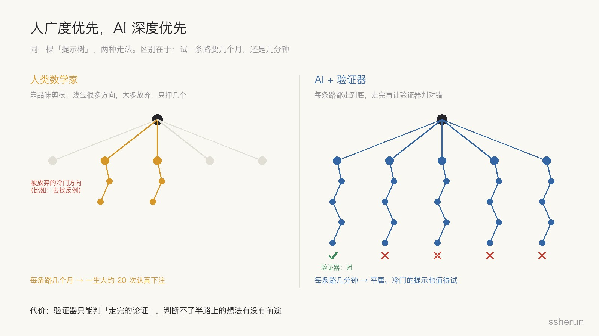
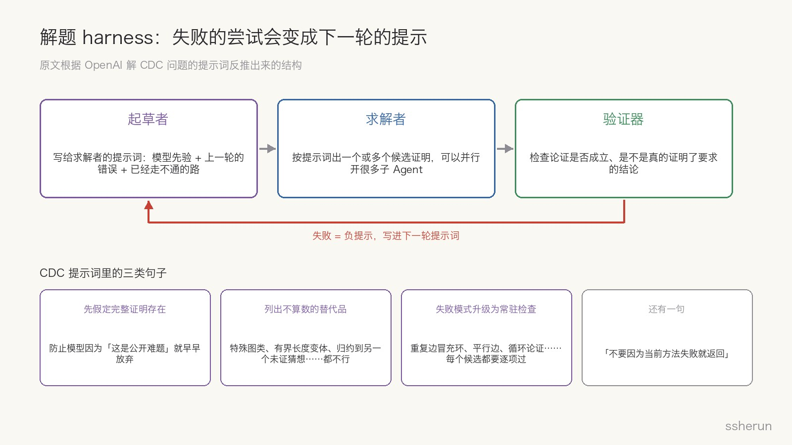
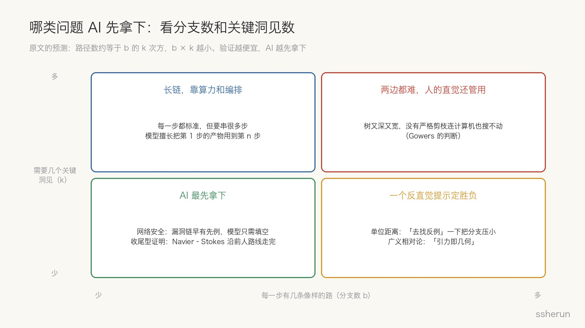
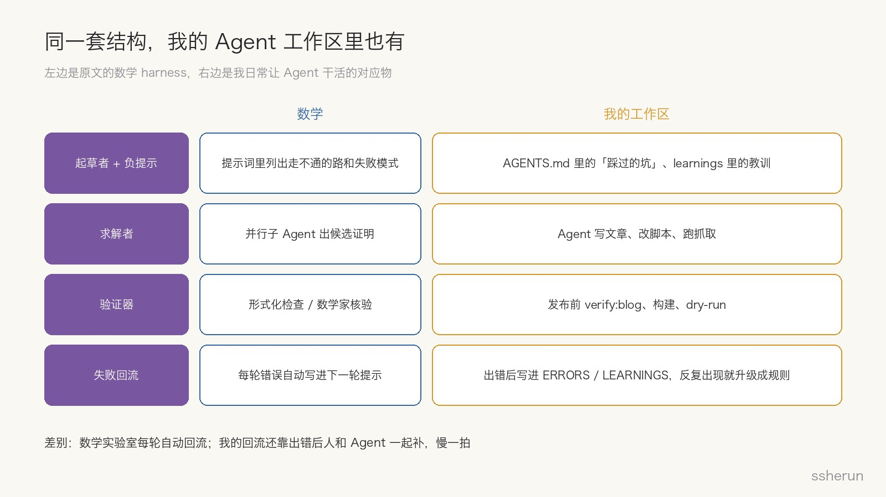

> 原文：[AI Is Getting Good at Math. Here's Why.](https://latent.space/p/ai-is-getting-good-at-math/)，Ankit Maloo，Latent Space，2026-10-23。另参考 OpenAI 的[单位距离猜想公告](https://openai.com/index/model-disproves-discrete-geometry-conjecture/)和外部数学家的伴随论文 [Remarks on the disproof of the unit distance conjecture](https://arxiv.org/abs/2605.20695)（Gowers、Tsimerman、Alon 等人的点评）。

今年 AI 在数学上的战绩有点吓人。按原文的梳理：5 月，OpenAI 的内部模型给 Erdős 1946 年提出的单位距离猜想找到了反例，这个问题悬了 80 年，几乎所有人都以为它是对的；之后 OpenAI 又发了 CDC（圈双覆盖）问题的证明，7 月前再解了十道公开难题，9 月是一份 Navier–Stokes 相关的证明；Anthropic 那边发了费马大定理的形式化，以及黎曼猜想相关的界的改进。

作者关心的问题很实际：**能不能预测 AI 下一个会解出什么题？**如果 AI 解题的方式和人不一样，找出这个差别，就知道该把它往哪儿用。

这篇文章我读了两遍，觉得它的框架不只适用于数学，对每天让 Agent 干活的人也很有用。前半部分讲原文，后半部分是我自己的看法。

## 先讲原文

### 题有多难：需要几个提示，提示之间要下多少功夫

一个很朴素的模型：解任何题，都需要一串「提示」（关键洞见），提示之间是大量的功夫。

> 洞见 → 下功夫 → 洞见 → 下功夫 → 解出来

专家需要的提示比新手少，因为背景知识多。Fields 奖得主 Gowers 在点评单位距离反例时用了类似的想法：**一个证明有多难，就看专家需要多短的一串提示才能把它重建出来。**他给单位距离写的提示只有三条：

1. 去找反例；
2. 把已知最好的构造推广；
3. 试一串次数越来越高的数域，但只用范数有界的素理想。

他还给了一个半开玩笑的公式：难度约等于 \(2^k + t\)，\(k\) 是提示的条数，\(t\) 是展开这些提示要下的功夫。原文作者的吐槽很到位：这种公式在你试着往里填数字之前看起来都很严谨。但意思是对的：**难度随需要的洞见数指数增长。**

一个提示值多少，取决于两件事：

- **事前看起来多不像、事后看起来多显然。**单位距离的「去找反例」就是典型：事后看理所当然，事前几乎没有专家往这儿想。
- **它在序列里的位置。**提示是有顺序的，第三条只有在前两条的功夫做够了之后才用得上。所以「把一千种数学技巧列出来挨个组合」这种暴力法行不通，组合数比宇宙里的原子还多。

### 人广度优先，AI 深度优先

人类数学家的搜索方式是**广度优先**：想出很多方向，每个浅浅试一下，放弃大多数，只押几个。原因很现实：展开一个想法要好几个月，下注之前得有理由相信它能走通。按原文的估算，三个月一个想法，一个研究者最高产的十年里大概只有二十次认真下注的机会。

AI 正好反过来，是**深度优先**：给它一个提示，它就一路推到底，给出一个看起来像样的证明，对不对另说。并行开十个 Agent，就得到十个推到底的尝试。放任不管，你会得到很多「漂亮的错误证明」。

这听起来很浪费，直到你加上一个**自动验证器**，把推完的路线里对的挑出来。有了验证器，在不靠谱的想法上砸大量算力就变得理性了：几分钟就知道一条路行不行。

于是关键的翻转出现了：**如果五分钟就能知道一个提示管不管用，这个提示需要多好？**对人来说门槛很高，因为试错要几个月；对模型来说门槛几乎消失，平庸的、冷门的、刚冒出来的想法都值得一试。

但有一个代价：**验证器只能判「走完的论证」，判断不了半路上的想法有没有前途。**

### 失败的尝试，就是下一轮的提示

模型不需要一个明确的方向才能开工，预训练已经给了它关于这个问题历史和前人尝试的先验。更重要的是，**每一次失败都可以作为「负提示」喂回去**：系统不断积累「哪些路已经走过、为什么不通」。

作者从 OpenAI 解 CDC 问题时用的提示词里，反推出一个三角色的 harness：

- **起草者**：写给求解者的提示词，内容来自模型先验、上一轮的错误、以及已经走不通的路；
- **求解者**：按提示词出一个或多个候选证明，可以并行开很多子 Agent；
- **验证器**：检查论证是否成立、是不是真的证明了要求的结论。

那份 CDC 提示词里的句子很能说明问题：

- 「为了这次任务，**先假定完整的肯定性证明存在**。」防止模型因为「这是公开难题」就早早放弃。
- 一长串**不算数的替代品**：特殊图类的证明、有界长度的变体、归约到另一个未证明的猜想、只验证到某个图规模……都不行。
- 把常见的**失败模式升级成常驻检查**：每个候选都要检查是否恰好覆盖两次、是否有重复边冒充环、平行边、断开的图、循环论证……
- 还有一句专门对付「学来的偷懒」：**不要因为当前方法失败、或者子 Agent 报告还有定理级的缺口，就返回。**

作者说，这里的每一行，都是一条失败的路被写成了一条指令。

### 复盘单位距离：差的不是能力，是撑下去

用 harness 的视角回看 Gowers 的三条提示：

- **第一条「去找反例」最难**，因为数学界和模型的预训练先验都认为猜想是对的。作者推测，起草者最可能是在求解者一次次证明失败之后，才转向找反例的。每失败一次，找反例就变得不那么离谱一点。
- **第二条「推广已知构造」**是标准动作，但工作量巨大，而且推广的是一个几乎没人在找的反例。
- **第三条「次数递增的数域」**，在前两条把空间搭好之后，就是标准工具。

最有意思的是 Jacob Tsimerman 的故事。他是数论专家，最近加入了 OpenAI，之前就试过构造这个反例，也想到过递增次数，然后停下了。他的原话是：

> 这是一个非常吓人的动态，很难在分析的各种区间里保持指引方向的直觉，非常耗时，而且经常走不通。

拦住他的不是能力，而是一个理智的人在沼泽里走了好几周、看不到对岸时的正常反应。心理学几十年前就研究过这个：Metcalfe 和 Wiebe 每 15 秒问一次解题者「你觉得离答案还有多远」。普通题目上，大家报告的进展稳步上升；而在需要顿悟的题目上，这个感觉一直是平的，直到突然解出来。**顿悟型问题没有梯度，你不知道自己离答案多近。**

所以对专家来说，问题是双重的：有没有人走进这个分支？走进去之后，能不能撑到普通的功力把活干完？撑下去的成本是工作记忆、士气和职业生涯。而对 AI 来说，这恰恰是巨大的优势。Tsimerman 自己也说：

> AI 的优势可能不只是能试遍所有已知方法，而是能在更凶险的水域里玩得更久，而不被压垮。

Gowers 在伴随论文里还讲了一个细节：他第一次听说时，误以为模型**证明**了这个猜想，整晚都在调整世界观；第二天才知道是**反证**，反而松了一口气。因为一个反例，可以想象成计算机试了很多东西、某一刻碰巧撞上了；而一个证明，往往需要一个全新的大想法。

### 今年模型多了三样能力

作者认为，今年的模型叠加了三种能力：

- **串联原语**：第 1 步造出来的东西，能在长任务的第 \(n\) 步用上。这降低了 \(t\)。
- **自我验证**：在轨迹内部就能抓住写错的步骤（抓不住那种语法正确但走不通的步骤）。OpenAI 专门用大规模真实样本训练了数学验证。这让剪枝更便宜。
- **编排**：指挥子 Agent、用记忆引导方向、排除错路、协调多个 Agent。负提示就是这样积累起来的。

### 预测哪道题先倒：看分支数

Gowers 的公式漏了一样东西：探索提示树本身要花的时间。每一步有 \(b\) 个像样的选择，需要 \(k\) 个提示，就是 \(b^k\) 条路径。人靠品味和判断把有效的 \(b\) 压得很小，大多数分支默认就丢掉了；AI 几乎每条像样的分支都得走，只是走得快。

于是有了一个预测：**\(b^k\) 乘以算力成本越小的问题，AI 越先拿下。**

- 这解释了为什么**网络安全**看起来复杂却最先倒：漏洞链早有先例，模型只需要填空，中间步骤的分支数大概只有 1 到 2。
- 也解释了「去找反例」为什么这么强：它一下子把解空间和 \(b\) 都压小了。现在已经有社区在组织 Agent 给所有公开难题找反例。
- 还有一个推论：**AI 特别擅长「收尾」**，也就是关键的概念跳跃已经有人做了，剩下的是繁琐复杂的计算。Navier–Stokes 那份证明沿着 Córdoba 和 Martínez-Zoroa 的路线走完，篇幅 166 页，用了 1 万个 Agent、3000 亿 token、88 个小时。

作者还有一句很直白的话：实验室会挑解空间窄的问题来展示自己的模型。Gowers 则认为，如果人类还在哪儿保有优势，那就是「搜索树又深又宽、没有严格剪枝连计算机也搜不动」的问题。

### 一个分歧：失败的信息量，取决于背后的信念

人类挑方法很谨慎，然后花几个月在上面。一条失败的路之所以有价值，恰恰因为有人足够相信它、为它花了几个月；专家明确拒绝某条路，这个拒绝本身也带着判断。

AI 的解答来自把每条像样的路都走完，失败很便宜，大多数很幼稚。**失败里的信息量，和背后的信念成正比。**而且我们很少能看到 AI 的失败，更别说理解它为什么失败。

所以作者认为人和 AI 是互补的：**人擅长减少分支，模型擅长缩短剪掉一条分支的时间。**专家可以在决定是否投入三个月之前，先让模型把一个想法端到端跑一遍。但需要很多洞见的问题（\(k\) 很大），对两边都难。

他最后引用了陶哲轩：解题只是数学更深目的的代理，那个目的是发展我们的理解。一个结果是一次社区事件，让人解释新想法、把它和旧想法连起来。**只公布最终答案，是把目的地错当成了旅程。**

### 彩蛋：AI 能想出广义相对论吗？

有人提过一个测试：用 1901 年以前的数据训练模型，看它能不能想出广义相对论。作者的看法是，如果大家专门冲这个目标，会很快。因为它需要的提示不多：第一个就是「把引力当几何」，这一下就把解空间压窄了；之后的数学极难，但恰好是模型擅长的。模型会先试「引力是力」「平直空间里的场」「改一改平方反比律」，每个都撞上 1901 年已知的事实（最有名的是水星近日点进动），每失败一次，「几何」就更可能一点。

## 我的看法

### 一、验证器才是 AI 能力的边界

这篇文章最打动我的，是它给「AI 在哪些领域先成熟」提供了一个机制解释。

前几天写 OpenAI《永恒的互补》时，我借用过它的「深度型 / 广度型」分法：数学、软件这种靠推理就能走很远的领域先被改写，药物、芯片这种要大量实证的领域慢得多。当时我的解释是「软件的测试就是廉价的模拟」。这篇文章把这一点说透了：**AI 的深度优先搜索，只有在有便宜验证器的地方才划算。**数学有形式化检查和专家核验，代码有测试，网络安全有「漏洞能不能跑通」。没有验证器的地方，AI 只会产出「漂亮的错误证明」。

还有一个巧合：写 OpenAI 文本水印时我记过，数学类文本最难打水印，因为推导的每一步几乎只有一个正确写法。**每一步只有一个正确答案，既让水印失效，也让验证变得便宜。**

落到日常：这篇博客就是 Agent 端到端写出来的，我敢放手，是因为发布前有 `verify:blog` 检查封面、配图和链接，构建不过就推不上去。**想让 AI 在你的领域发力，先造验证器**：测试、检查清单、模拟器、能自动跑的验收标准。验证器有多便宜，你就能让 AI 跑多野。

### 二、失败清单是 harness 最值钱的资产

看到 CDC 那份提示词的时候，我第一反应是：这不就是我工作区里的 `AGENTS.md` 吗？

我的 Agent 工作区里有很多「踩过的坑」：信息雷达调试必须加 `--dry-run`，不然当天的条目会被标成已读；OpenClaw 升级不能直接跑 `openclaw update`，要先停网关、再装、再迁移；前几天 Reddit 热点连续几天没推送，查出来是匿名额度每分钟只给一次，修好之后也写进了备忘。每一条都是一次失败被写成了一条常驻指令，和 CDC 提示词里「不算数的替代品」「常驻检查」是一回事。

我之前写过 Warp 的 Skills 反馈环，也是同一个思路：Agent 根据人类的反馈去改 Skill 文件，而不是指望模型自己变聪明。

差别在于**回流的速度**。数学实验室每一轮的失败都自动进入下一轮提示词；我的回流还要靠出了错之后，人和 Agent 一起补，慢一拍。下一步值得做的，是让 Agent 出错之后自动起草一条负提示，我只负责审。

### 三、人的位置：从「挖」变成「换问题」

单位距离的第一个提示「去找反例」，不是更努力地挖，而是**换了一个问题**。Gowers 坦白说：「我从来没想过要去反证它。」原文脚注里有句话很值得琢磨：**品味来自先验，先验可能是错的。**

我以前理解的品味，是 Taste at Speed 那篇说的「过滤函数」：做 5 个原型砍 4 个，80% 的淘汰率才是重点。这篇文章让我补上了另一半：在试错几乎免费的时候，品味不只是砍分支，还包括**主动让 AI 去试你觉得不可能的方向**。以前一个冷门方向要赌三个月，你当然不试；现在它只要几分钟，不试反而是浪费。

所以人更值钱的能力，会从「把一条路挖到底」，转向「把问题换一种问法」和「决定哪些先验值得被挑战」。

### 四、结果有了，理解可能没了

陶哲轩那句「把目的地错当成旅程」，让我想起前几天分析的两个 Reddit 帖子。一个是做了 30 年开发的游戏工作室老板说：用 AI 写代码的人学不到东西，因为理解代码要靠写，而现在没人写了。另一个是 AskReddit 上关于哪些工作会消失的讨论，高赞的担忧是：初级岗位没了，资深的人退休之后谁来接？

数学界面对的是同一个问题的另一个版本。AI 把每条路走完，给出一个对的答案，但「为什么那些看起来很有希望的路走不通」这类知识，恰恰是下一代数学家成长需要的。如果这些失败轨迹不公开，我们得到的是一个个孤立的结果，而不是对领域更深的理解。

我觉得实验室能做的一件事，是像那份 CDC 提示词一样，**把失败的尝试连同原因一起公开**。对普通人也一样：用 AI 解决问题之后，至少花点时间看看它试过、放弃过哪些路，这是唯一还能留在自己脑子里的东西。

### 五、别忽略算力账和选择偏差

- **这套打法很贵。**Navier–Stokes 那份证明用了 1 万个 Agent、3000 亿 token、88 小时。「让 Agent 把每条路都走到底」，在你自己的项目里意味着真金白银。前几天写 Cloudflare x402 时，我写过 Agent 花钱需要单笔上限和任务预算，这里是同一个问题的放大版。
- **展示的题是挑过的。**原文自己也承认，实验室会挑解空间窄的问题来展示。看到「AI 又解了一道难题」时，先问一句：这道题的分支多不多、是不是收尾型？
- **框架是事后解释。**需要几个提示，只有解出来之后才知道。它适合用来判断方向，不适合用来精确预测。
- **证明本身还要时间检验。**单位距离的反例已经有外部数学家核验并写了伴随论文；而 166 页的 Navier–Stokes 证明，原文作者自己也说只是「粗读」。

## 可以怎么用

1. **判断一个任务适不适合交给 AI**，先问三个问题：有没有便宜的验证器？每一步的分支多不多？需要几个反直觉的洞见？三个答案都对 AI 友好，就大胆放手。
2. **搭 harness 时照着这三个角色来**：起草者负责积累失败清单，求解者负责并行试，验证器负责判对错。最值钱的是失败清单，要让它自动增长。
3. **个人能力上**，练「换个问法」的能力，敢于挑战大家都默认的先验；同时保留一部分自己亲手推、亲手写的环节，理解只会长在那里。

## 相关文章

- [[openai-eternal-complement|OpenAI《永恒的互补》：天才机器多半在干无聊的活]]
- [[openai-text-watermark-math-editing|OpenAI 给文本加水印了：数学几乎打不上，改几个词就失效]]
- [[warp-self-improving-agents|Agent「自我改进」到底改进什么？Warp Skills 环 vs OpenAI 黑板]]
- [[taste-at-speed-pm-skill|Taste at Speed：当构建成本趋近于零，PM 的核心技能变了]]
- [[accidental-blackboard-agents|意外黑板：多 Agent 如何用仓库互相协调]]
- [[cloudflare-x402-agent-spending|Agent 开始自己掏钱：Cloudflare x402，谁来管钱包]]
