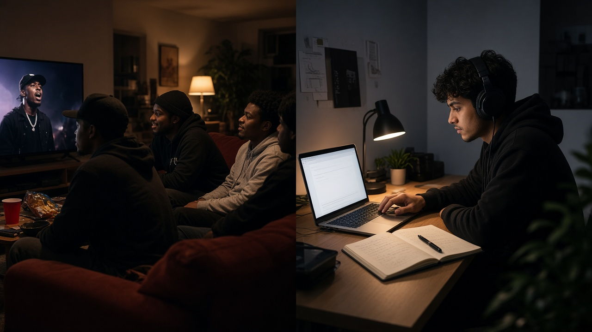

> Source: [siuser小伟 · X Article](https://x.com/_HIT_SZ_/status/2122174130892238951) (2026-11-16). Most numbers via Glasser pay-per-query into Semrush / Ahrefs / Similarweb — about **$0.77** for the whole write-up.

The hackathon theme was **AI rap video**. Build a site that generates rap videos with AI, check ~65 keywords — and the odd result: **search looks thin, yet competitors clearly charge money.** The gap isn’t “can video sell?” It’s **where users enter**.

## 1. Volume sits on the side path, not on “make a video”

| Keyword | US monthly search (approx.) | Read |
|---|---|---|
| rap video | 1,900 | SERP ≈ YouTube MVs → people **watch** |
| rap music video | 1,300 | Same |
| how to make a rap music video | 30 | Long-tail almost empty |
| bpm finder / key finder / tap tempo | 60.5k / 40.5k / 27.1k | Music utilities, an order of magnitude larger |
| rap name / lyrics generator | 8.1k / 6.6k | Text tools; intent skews **use** |
| ai rap video generator | ~30 | Almost no door for “video generator” |

Cheapest intent test: **Google it and read page one.** Video wall = watch; tool sites = use; articles = learn. “It monetizes” points at freebeat (~830k visits/mo, $4.99/week) and musicwave ($9.99–$49.99 subs, still rising) — just not through `rap video`.

## 2. Two competitors, one pattern: free tool → paid video

| Site | Scale (author’s read) | US search door | Product |
|---|---|---|---|
| musicwave.ai | Tens–100k+/mo sitewide; US organic only ~2.8k | `/bpm-and-key-finder` ~22.9% of US traffic; playlists; `suno ai alternative` | Bundles ElevenLabs / MiniMax / Mureka into a sub; video on the top tier |
| freebeat.ai | ~830k/mo sitewide; US organic ~67k | Rap / AI Lyrics Generator pages = half+ of US search | Lyrics first, then nudge to video; Trustpilot ~1.4 (weekly billing, failed gens still bill) |

v1 looking only at musicwave’s **US** organic screamed “2,715 pages failed.” Similarweb / an SEO agent showed the US is under ~20%, with 12 languages — **sitewide first, then country**.

Benchmarks on the utility side: musicca (metronome alone ~1.22M searches), tunebat (one page eats bpm+key), muted.io (solo music-theory tools, internal links, backlinks from teaching blogs / FMHY-class directories). Counterexamples: high DR, low traffic; near-zero pure visualizer sites.

## 3. Four data traps that bend the plan

| Trap | Example | Fix |
|---|---|---|
| Add synonyms | key finder + keyfinder as two | Often one Google group — count once |
| One country only | musicwave US ~2.8k vs sitewide ×10s | Similarweb: sitewide, then geo |
| One KD source | tap tempo KD 0 vs 35–46 | Open SERP: big brands / exact-match domains are hard |
| 10× source gaps | suno ai alternative 260 vs 3,050 | Dual-source any number that steers the plan |

Treat third-party estimates as **order of magnitude**. The author published every Glasser run link for replay.

## 4. The locked plan

1. **Direction:** free tools for music makers; rap as a section; AI video charged later.  
2. **Pages:** a few thousand monthly searches, KD ≲20; browser-side tools first (no GPU yet).  
3. **Billing:** credit packs + auto-refund on failed gens; no weekly auto-renew (learn from freebeat’s hate).  
4. **Locales:** RU / ES with real local queries, not machine-translated clones.  
5. **Links:** muted.io path → free-tool directories + music teaching blogs.  
6. **Prove it:** four weeks — any page in top 10? If not, GPU pages are just burn.

**One line:** ship AI rap video if you want — but enter through lyrics, names, BPM: people already creating. Finish the lyric, nudge to video, charge at the video step.

## Related posts

- [[geo-vs-seo-same-or-separate|GEO vs SEO]]
- [[gary-illyes-google-search-timelines|How long Google crawl / index / serve takes]]
- [[overseas-product-zero-cost-cold-start|Zero-cost cold start for overseas products]]
