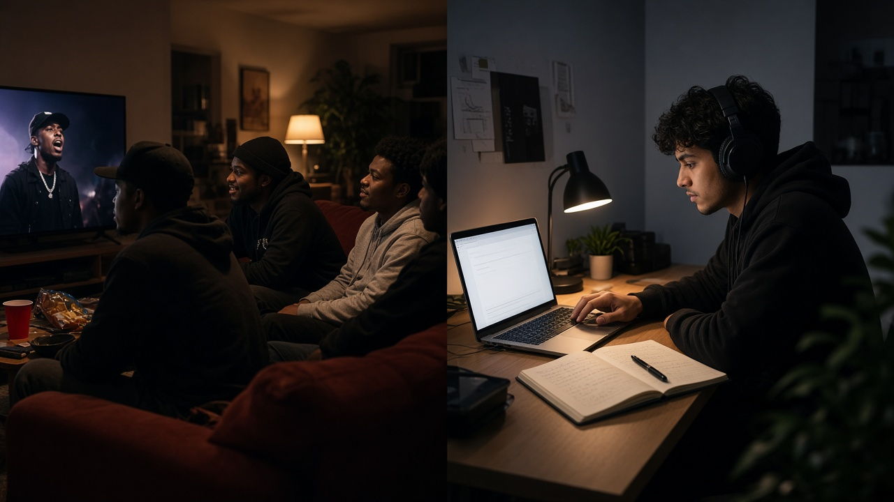

> 来源：[siuser小伟 · X Article](https://x.com/_HIT_SZ_/status/2122174130892238951)（2026-11-16）。数据多经 Glasser 按次查 Semrush / Ahrefs / Similarweb，全文查询约 **$0.77**。

黑客松主题是 **AI rap video**。作者想做「AI 生成说唱视频」的站，先查了 65 个相关词——然后发现：**感觉没什么人搜，但竞品就是能出单。** 差在哪？不在视频卖不卖得出去，而在**用户从哪进来**。

## 1. 量在旁路，不在「做视频」

| 词 | 美国月搜（约） | 读法 |
|---|---|---|
| rap video | 1,900 | 首页几乎全是 YouTube MV → 来**看** |
| rap music video | 1,300 | 同上 |
| how to make a rap music video | 30 | 长尾几乎没量 |
| bpm finder / key finder / tap tempo | 60.5k / 40.5k / 27.1k | 音乐小工具，量级大一个数量级 |
| rap name / lyrics generator | 8.1k / 6.6k | 文字工具，意图偏**用** |
| ai rap video generator | ~30 | 直做视频词几乎没入口 |

意图怎么判最便宜：**自己去 Google 搜，看第一页是什么。** 视频墙 = 来看；工具站 = 来用；文章 = 来学。标题里的「能出单」，指的是 freebeat（全站约 83 万访问、按周 $4.99）和 musicwave（订阅 $9.99–$49.99、流量还在涨）确实在收钱——只是入口不是 `rap video`。

## 2. 两家竞品的共同点：免费工具 → 收费视频

| 站 | 量级（作者口径） | 美区搜流怎么进来 | 产品形态 |
|---|---|---|---|
| musicwave.ai | 全站数万～十几万/月；美自然搜仅 ~2.8k | `/bpm-and-key-finder` 约占美流量 22.9%；另有歌单文、`suno ai alternative` | 打包 ElevenLabs / MiniMax / Mureka 等成订阅；视频在最贵档 |
| freebeat.ai | 全站 ~83 万/月；美自然 ~6.7 万 | Rap / AI Lyrics Generator 两页合计占美搜一半+ | 写完歌词再导去做视频；Trustpilot ~1.4（骂周扣费、失败扣点） |

第一版只看 musicwave 的**美国**自然搜，会误判「2,715 页铺失败了」；Similarweb / SEO agent 复核后发现美占比不到两成，还有 12 语种——**先看全站，再看国家**。

旁路标杆还有 musicca（节拍器一词月搜约 122 万）、tunebat（一页吃 bpm+key）、muted.io（个人民乐理工具、互相链、外链来自教学博客与 FMHY 类收录）。反例：权重高但流量矮的站，以及几乎为零的纯可视化站。

## 3. 四个会让方案跑偏的数据坑

| 坑 | 例子 | 改法 |
|---|---|---|
| 同义词相加 | key finder + keyfinder 当两次 | Google 常算一组，只计一次 |
| 只看单一国家 | musicwave 美区 ~2.8k vs 全站大几十倍 | Similarweb 先全站后国家 |
| KD 只信一家 | tap tempo 一边 KD=0，一边 35–46 | 自己搜第一页：大站 / 同名词站难抢 |
| 来源差十倍 | suno ai alternative 260 vs 3,050 | 重要数至少两个来源对打；对不上就标出 |

第三方估算看**量级**即可；作者把每轮 Glasser Run 链放在文末，可复现。

## 4. 可照着走的定稿

1. **方向**：音乐创作者免费工具站；rap 做栏目；AI 视频后置收费。  
2. **选页**：月搜过几千、KD ≲20；浏览器端工具优先（暂不上 GPU）。  
3. **收费**：点数包 + 失败退点；不做按周自动扣（学 freebeat 被骂的点）。  
4. **小语种**：俄 / 西，用当地真搜词，不机翻硬上。  
5. **外链**：学 muted.io → 免费工具收录站 + 音乐教学博客。  
6. **验证**：四周看有没有页进前十；没排名就上 GPU 页面纯烧钱。

**一句话**：AI rap video 可以做，但入口用歌词、起名、BPM 这类「已经在创作」的免费工具——写完再引到视频，再在视频那一步收钱。

## 相关文章

- [[geo-vs-seo-same-or-separate|GEO 和 SEO 是一回事吗？]]
- [[gary-illyes-google-search-timelines|Gary Illyes：爬取/索引/呈现要多久]]
- [[overseas-product-zero-cost-cold-start|出海产品低成本冷启动]]
