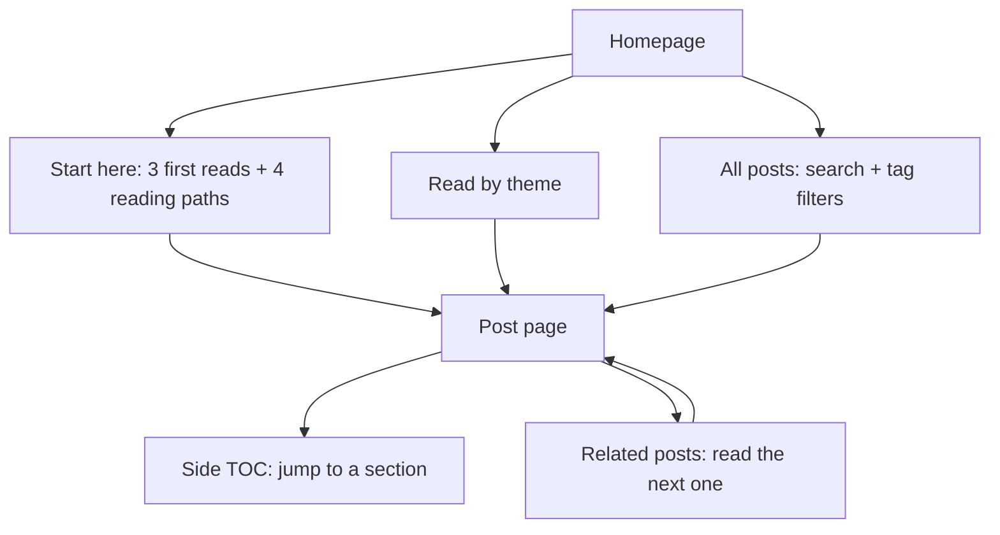

When this blog reached its 106th post and roughly 180,000 Chinese characters of body text, I did something I should have done earlier: **instead of writing something new, I checked whether what I had already written was easy to read.**

The answer stung a little. Writing more does not mean reading better, and more posts made things harder to find. This post records what the checkup found, what changed, and the judgments behind the changes.

## What the checkup found

Data first, opinions second. The numbers that stood out:

| Problem | Data | Consequence |
|---|---|---|
| One tag covering half the site | "Thinking" was on 49 of 106 posts, about 46% | Opening that tag was the same as opening every post; filtering stopped working |
| Thin short posts | The 10 shortest averaged under 750 characters | Readers finished them with nothing to take away |
| Missing links | 3 posts had no related-posts section; 3 English versions used an inconsistent heading for it | Each post was a dead end with no next step |
| No entry for newcomers | The homepage was a plain chronological list | First-time visitors had no idea where to start |
| Long posts without a TOC | Ten posts run past 3,000 characters | Reaching a specific section meant scrolling all the way |

There was also a quiet little bug: the homepage referenced a CSS variable, `--bg`, that did not exist, so the background had been falling back to the browser default all along. Invisible in light mode, obvious after switching themes. Problems like this never surface unless you run a check.

## The reader side: easy to find, easy to keep reading

Every change came from one question: **can a first-time reader find a post they want within five minutes, and keep reading from there?** Along that path, each stop got one addition:

On the actual pages:

- **Homepage**: a stats strip (posts, words, themes, languages), entries grouped by theme, and six featured posts. Featured cards now put the image on top and the title below; the cover already prints the title, and another text layer on top only adds clutter.
- **"Start here" page**: new. Three first reads plus four reading paths (agents, product, career, models), four posts each, ordered so one theme builds on itself.
- **Post list**: a search box (press `/` to focus it) and tag filters, synced to the URL so a result like "Agent tag, searching claude" can be shared directly. Grouping moved from years to months; 103 of the 106 posts are from this year, so grouping by year grouped nothing.
- **Post page**: a floating TOC on wide screens that highlights the current section; `#` anchors next to headings for sharing a passage; tables wrapped in a horizontally scrollable container so they no longer break the layout on phones; captions added to images automatically.
- **Footer**: from one line of copyright to three columns: site navigation, RSS, and entry points for agents.

## The content side: splitting a tag and deepening posts

**The tag split** followed one simple rule: "Thinking" stays only on posts that actually argue a view or a method. Posts about model capability moved to LLM, posts about agents to Agent, posts about SEO and crawlers to engineering and tools. 24 posts were retagged, "Thinking" dropped from 49 posts to 25, and the tag page works as a filter again.

Covers print the tags, so every retagged post needed a recomposed cover: 24 posts, Chinese and English, 48 images. That kind of work belongs to a script; a human only spot-checks.

**Deepening** came with one constraint: **no padding, only additions readers can use directly.** In practice that meant three forms:

| Form | Example |
|---|---|
| Comparison tables | Troubleshooting: "symptom → real cause → fix" |
| Flow diagrams | Which checkpoints a request passes through; how to triage a ticket |
| Checklists | Pre-launch checks, a four-week validation board, an interview task you can use as-is |

The 10 shortest posts grew from 7,415 to 11,577 Chinese characters of body text, about 56% more. Length was never the goal; every addition had to answer one question: after reading this paragraph, can the reader go and do something with it right away?

## The side facing agents

Since the [very first post](/en/blog/hello-world/), this blog has aimed to be agent-friendly. The checkup tidied up those entry points too:

- The footer lists `llms.txt`, `llms-full.txt`, RSS, and the sitemap, easy to find for people and agents alike
- Replace the trailing `/` of any post URL with `.md` to get a plain-text version
- The [hidden-link trap](/en/blog/bot-trap-invisible-link/) keeps counting crawlers that ignore the rules

People read pages, agents read text. Both use the same content through different doors.

## A few lessons

1. **Tags are filters for readers, not moods for the writer.** While writing, every post felt like it had some "thinking" in it. Readers click a tag to narrow things down, and a tag on almost half the posts no longer narrows anything.
2. **A start page helps newcomers more than homepage polish.** However nice the homepage looks, it is still a chronological list. One "Start here" page tells people which three posts to read first.
3. **Checks should catch omissions.** The `verify:blog` step in the publishing flow checks covers, tags, and cross-links. After these changes it went from 5 lingering warnings to zero, not because the rules got looser but because the gaps were actually filled.
4. **Looking back is harder than writing forward.** A new post feels like an accomplishment; tidying old ones is a pile of small, fiddly edits. But those small places are exactly where readers get stuck.

The next checkup will probably come around post 200.

## Related posts

- [[hello-world|An agent-friendly blog]]
- [[bot-trap-invisible-link|Hidden-link bot trap on a static site]]
- [[dual-entry-human-agent-design|Two product entrances: design for humans and agents]]
- [[gary-illyes-google-search-timelines|Gary Illyes: how long crawling, indexing, and serving take]]
