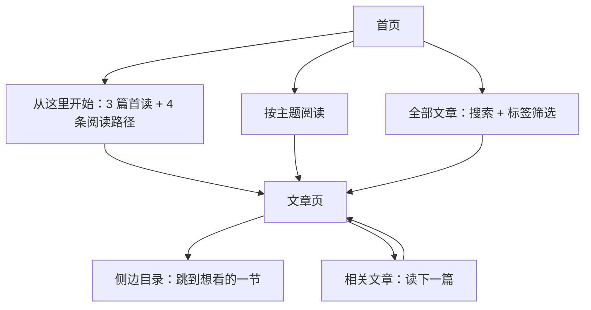

这个博客写到第 106 篇、中文正文累计约 18 万字的时候，我做了一件早该做的事：**不写新东西，先回头看看已经写的东西好不好读。**

结论有点扎心：写得多，不等于好读；文章多了，反而更难找。这篇记录这次体检查出了什么、改了什么，以及改动背后的几条判断。

## 体检查出的问题

先跑数据，再下判断。几个最刺眼的数字：

| 问题 | 数据 | 后果 |
|---|---|---|
| 一个标签挂满半个站 | 「思考」挂在 49 / 106 篇上，约 46% | 点进这个标签等于看全部文章，筛选失效 |
| 短文太薄 | 最短的 10 篇平均不到 750 字 | 读者点进来，读完没有能带走的东西 |
| 互链缺口 | 3 篇没有「相关文章」，另有 3 篇英文版的相关文章标题写法不统一 | 读完一篇就是终点，没有下一步 |
| 新读者没入口 | 首页只有按时间排的列表 | 第一次来的人不知道从哪篇读起 |
| 长文没目录 | 有 10 篇超过 3000 字 | 想跳到某一节只能一路滚 |

还有一个藏得很深的小 bug：首页引用了一个不存在的 CSS 变量 `--bg`，背景色一直靠浏览器默认值兜底。浅色模式下看不出来，换个主题才露馅。这类问题不跑一遍检查，永远不会被发现。

## 读者这一侧：让人找得到、读得下去

改动的出发点只有一个：**一个第一次来的读者，五分钟内能不能找到一篇想读的文章，并顺着读下去。** 顺着这条路径，每一站补一个东西：

具体落到页面上：

- **首页**：加了数据条（文章数、字数、主题数、语言），按主题分组的入口，以及 6 篇精选。精选卡片改成图在上、标题在下——封面图本身就印着标题，再叠一层文字只会更乱。
- **「从这里开始」页**：新增。3 篇首读，加上 Agent、产品、职业、模型四条阅读路径，每条 4 篇，按顺序读能把一个主题串起来。
- **文章列表**：加了搜索框（按 `/` 直接聚焦）和标签筛选，筛选条件同步到网址，可以直接分享「Agent 标签下搜 claude」这样的结果。分组从按年改成按月——106 篇里有 103 篇是今年写的，按年分组等于没分。
- **文章页**：宽屏右侧悬浮目录，滚动时高亮当前章节；标题旁加了 `#` 锚点方便分享段落；表格包了一层可以横向滚动的容器，手机上不再撑破版面；配图自动带图注。
- **页脚**：从一行版权信息变成三栏：站点导航、RSS 和给 Agent 用的入口。

## 内容这一侧：标签拆分和扩写

**标签拆分**的规则很简单：「思考」只留给真正在讲观点和方法论的文章。讲模型能力的落到 LLM，讲智能体的落到 Agent，讲 SEO 和爬虫的落到工程和工具。24 篇文章被重新打标签，「思考」从 49 篇降到 25 篇，标签页终于又能当筛子用了。

封面图上印着标签，所以每改一篇的标签，就要重新合成一次封面——24 篇、中英两版，一共 48 张。这种活交给脚本，人只负责抽查。

**扩写**给自己定了一条约束：**不灌水，只补能直接用的东西。** 具体是三种形态：

| 形态 | 例子 |
|---|---|
| 对照表 | 排查表：「现象 → 真正原因 → 怎么处理」 |
| 流程图 | 一个请求经过哪些关卡、一张工单该怎么排 |
| 清单 | 上线前自查项、四周验证看板、一道可以直接用的面试题 |

最短的 10 篇，中文正文从 7415 字扩到 11577 字，增加约 56%。字数不是目标，但每一处新增都要回答一个问题：读者看完这一段，能不能马上拿去做点什么。

## 给 Agent 的那一面

这个博客从[第一篇](/blog/hello-world/)起就有个目标：对 Agent 友好。体检时顺手把这部分的入口也理了一遍：

- 页脚直接列出 `llms.txt`、`llms-full.txt`、RSS 和 Sitemap，人和 Agent 都能一眼找到
- 每篇文章把网址末尾的 `/` 换成 `.md` 就能拿到纯文本版本
- [隐链陷阱](/blog/bot-trap-invisible-link/)继续计量不守规矩的爬虫

人看页面，Agent 读文本，两边用同一份内容，只是入口不同。

## 几条体会

1. **标签是给读者的筛子，不是给作者的情绪。** 写的时候觉得每篇都有「思考」，但读者点标签是为了缩小范围。一个标签覆盖近一半文章，就已经失去了意义。
2. **导读页比首页设计更能帮新读者。** 首页再漂亮，也只是按时间排的列表；一页「从这里开始」直接告诉人先读哪三篇。
3. **校验要能挡住遗漏。** 发文流程里的 `verify:blog` 会检查封面、标签和互链。这次改完，它从 5 条遗留警告变成零警告——不是因为规则放松了，而是遗漏真的补上了。
4. **回头看比往前写更难。** 新文章写完就有成就感，整理旧文章只有一堆琐碎的小改动。但读者遇到的，恰恰是这些小地方。

下一次体检，大概在写到 200 篇的时候。

## 相关文章

- [[hello-world|做一个对 Agent 友好的博客]]
- [[bot-trap-invisible-link|隐链捕 Bot：静态站上的改法]]
- [[dual-entry-human-agent-design|产品的两个入口：为什么 AI 时代要同时为人类和 Agent 设计]]
- [[gary-illyes-google-search-timelines|Gary Illyes：爬取、索引、呈现要多久]]
