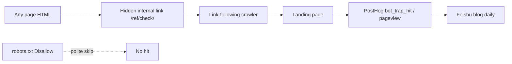

> Source: [Blunt Banhammer Blocks Basic Bots Ballistically](https://shkspr.mobi/blog/2026/11/blunt-banhammer-blocks-basic-bots-ballistically/) (Terence Eden, Nov 2026)

Hobby site OpenBenches.org shoved 2.5TB in a month — not fame, AI crawlers chewing images. Eden built **B⁶**: no UA heuristics, no geo, no warning. Touch the trap, get banned.

## The original five steps

1. Directory `/honeypot/` with PHP that rewrites `.htaccess`  
2. `robots.txt`: `Disallow: /honeypot/`  
3. **Every page** gets a link humans can’t see or tab to (ZWJ text + `display:none`)  
4. Any request to the honeypot appends that IP to the ban block  
5. Banned IPs get 402 forever after

Polite bots read robots and stay out; humans almost never click; greedy link-followers walk in. One week: 400+ IPs banned, daily transfer ~216GB → ~25GB — **over 80% cut**.

Caveats he lists: useful bots that ignore robots get collateral damage; rotating IPs re-ban; huge `.htaccess` lists may add parse cost; smarter bots may skip `display:none` or paths named honeypot. Blunt. Effective.

## Why I can’t copy the ban layer

This blog is on **GitHub Pages**: static files, no PHP, no origin `.htaccess` bans.  
So the goal shifts: **measure how many agents chase a hidden internal link**, then decide whether to put a real hammer on a CDN/Worker later.

## What shipped here

| Eden | This site |
|---|---|
| `/honeypot/` + PHP ban writer | `/ref/check/` static page (not named honeypot) |
| `.htaccess` IP ban | **No ban** — measure only |
| Touch → die | PostHog: `bot_trap_hit` + `$pageview` on that path (JS + 1×1 pixel) |
| No ops report | Feishu blog daily gains a “Bot trap” section |

Mechanics:

- `robots.txt` Disallow `/ref/check/`  
- Every `Footer` hides `<a aria-hidden href="/ref/check/">‍</a>`  
- Landing page is `noindex`, with a note that humans aren’t banned  
- Daily job queries 7-day trap hits; all-zero still shows “armed”

### Chart: who steps in

## How to read the number

- **Caught:** crawlers that parse HTML, follow `<a href>`, and load enough of the page to hit the pixel or analytics.  
- **Missed:** extractors that grab main text, ignore hidden links, skip images/JS — they may still burn bandwidth without appearing in the trap count.  
- **Humans:** vanishingly unlikely; if they land, they see a note, not a 402.

So “N trap hits” in the daily is a **lower bound**: how many badly behaved agents openly enter a Disallow zone. Not total bots, not “robot share of readers.”

## Takeaway

Eden’s trick is incentive-compatible: good crawlers stay clean; bad ones self-select; humans feel nothing.  
Static hosts can’t copy the ban layer, but they can copy the **sensor** — make the invisible link a probe, then choose how hard to swing. Counts here start showing up on the next blog daily.

## Related posts

- [[china-ml-research-volume-reddit|100 papers as an undergrad? Reddit on China ML volume]]
- [[geo-vs-seo-same-or-separate|Is GEO really separate from SEO?]]
- [[ai-era-clarity-matters|The scarcest skill in the AI era: saying things clearly]]
