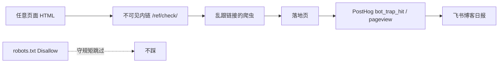

> 原文：[Blunt Banhammer Blocks Basic Bots Ballistically](https://shkspr.mobi/blog/2026/11/blunt-banhammer-blocks-basic-bots-ballistically/)（Terence Eden，2026-11）

业余站点 OpenBenches.org 一个月吐了 2.5TB。不是突然火了，是 AI 爬虫在狂舔图片。作者做了个叫 **B⁶** 的钝器：不看 UA、不看国家、不给警告——踩到陷阱就封。

## 原文方法（五步）

1. 建目录 `/honeypot/`，里面放会改 `.htaccess` 的 PHP  
2. `robots.txt` 写上 `Disallow: /honeypot/`  
3. **每个页面**塞一条人眼看不见、无障碍树也进不去的链接（零宽字符 + `display:none`）  
4. 谁请求了 honeypot，就把 IP 写进 `.htaccess` 的封禁段  
5. 之后该 IP 一律 402

守规矩的 bot 读了 robots 不会来；人几乎点不到隐链；乱跟全站链接的寄生虫自己送上门。作者跑一周封了 400+ IP，日流量从约 216GB 掉到约 25GB——**砍八成以上**。

他也把边界说清楚了：有用的爬虫若无视 robots 会被误伤；bot 换 IP 会反复封；`.htaccess` 列表太长可能有点开销；智能一点的 bot 可能跳过 `display:none` 或叫 honeypot 的路径。钝，但是有效。

## 我为什么不能照抄封禁

本站跑在 **GitHub Pages**：纯静态，没有 PHP，也改不了源站 `.htaccess` 去 ban IP。  
所以目标改成：**先看清楚有多少东西在乱跟隐链**，再谈要不要上 CDN / Worker 做真封禁。

## 本站的改法（已上线）

| 原文 | 本站 |
|---|---|
| `/honeypot/` + PHP 写封禁 | `/ref/check/` 静态页（名字不叫 honeypot） |
| `.htaccess` 封 IP | **不封**，只计量 |
| 访问即死 | PostHog：`bot_trap_hit` + 该路径 `$pageview`（JS + 1×1 像素） |
| 无日报 | 博客飞书日报多一节「Bot 隐链陷阱」 |

实现要点：

- `robots.txt`：`Disallow: /ref/check/`  
- 全站 `Footer` 藏 `<a aria-hidden href="/ref/check/">‍</a>`（零宽字符，`display:none`）  
- 落地页 `noindex`，并说明：人若误入不会被封  
- 日报脚本查近 7 日陷阱命中次数与主体数；全 0 时也会显示「已布防」

### 图：谁会踩中

## 计量口径（别过度解读）

- **能抓住**：会解析 HTML、跟着 `<a href>` 走，并且会加载页面（进而打到像素或跑到 Analytics）的爬虫。  
- **抓不住**：只扒正文、不跟隐链、不加载图片/JS 的纯抽取器——它们仍可能吃带宽，只是不出现在陷阱计数里。  
- **人误点**：理论上极难；真进了也只是看到说明页，不会 402。

所以日报上的「踩陷阱 N 次」是 **下限信号**：有多少不合格爬虫愿意公开闯 Disallow 区。不是全站 bot 总量，更不是「读者里有多少机器人」。

## 我怎么看

Eden 这套漂亮在 **激励相容**：好爬虫遵守协议不受影响；坏人自己撞枪口；正常人默认无感。  
静态站抄不了封禁层，但抄得了 **探测层**——先让隐链成为传感器，再决定要不要上边缘封禁。  

如果你也在 GH Pages / 对象存储上挂站，不妨先布一条 Disallow 隐链，看一周数据，再决定锤多重。本站的计数会从下一份博客日报开始出现。

## 相关文章

- [[china-ml-research-volume-reddit|本科生百篇论文？Reddit 谈中国 ML 产量]]
- [[geo-vs-seo-same-or-separate|GEO 和 SEO 是一回事吗]]
- [[ai-era-clarity-matters|AI 时代最稀缺的能力：把话说清楚]]
