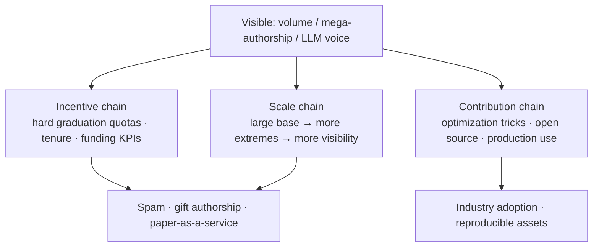
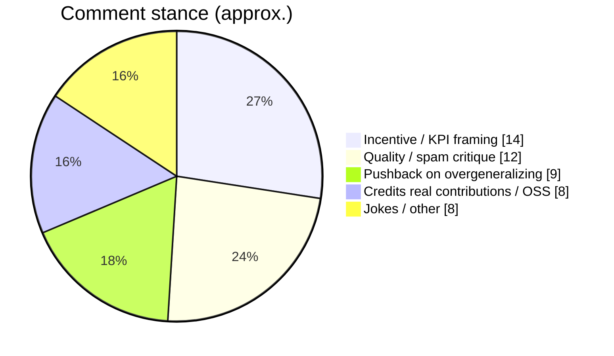

> Source: [Can we talk about the ML research coming from China? [D]](https://www.reddit.com/r/MachineLearning/comments/1xteym8/can_we_talk_about_the_ml_research_coming_from/) (r/MachineLearning, ~161 upvotes / 55 comments; 51 scraped)

The OP says they’re not trying to bash Chinese researchers — but the curiosity is sharp: ML output from China (especially researchers based in China) looks “defying common sense.” Undergrad/grad trajectories with 100–200 papers; a paper a week not unheard of; Scholar profiles packed with submissions; coauthor lists in the dozens or hundreds on benchmarks/surveys. Work clusters in LLM/multimodal space — thin on novel math, thick on experiments (sometimes ~100 pages). Run the prose through ChatGPT/Claude and suspicious sections light up, yet pieces still land at ICLR/AAAI. They wonder about an insular publishing/hiring stack (jobs advertised on Xiaohongshu / Douyin / Bilibili) and whether “scratch each other’s back” networks mint credentials.

Flair is `[D]`. The thread goes wide — paper mills, Sturgeon’s law, a Guangzhou PhD, “Zhang et al.” jokes. Here’s the map.

## What the fight is actually about

The fake question is “Can Chinese people do research?” The real stack is three layers:

1. **Incentives:** graduation, tenure, and funding settled in paper counts and venue tiers;  
2. **Scale:** a huge system makes universal sins — spam, gift authorship, LLM drafting — more visible;  
3. **Filters:** serious readers already ignore PDF nationality and look for weights, code, reproducibility.

### Chart 1: one observation, three explanation chains

## Camps in the comments (51)

### 1. Institutions, not magic

The top long comment (physics undergrad in Russia years ago) names the mechanism: publish-to-graduate + pay tied to impact factor → everyone on every paper, boss on every paper → “a paper every few days” is arithmetic. Someone notes Western labs gift-authorship bosses too.

People inside/near the system get concrete:

- Guangzhou PhD: top schools often want **multiple top-tier papers** to graduate; tenure has the same counting; first author may do 80%+ of the work and still feel forced to add non-contributors.  
- Ordinary master’s programs: four papers (mixed size) crammed into the last two years of a three-year track.  
- C9 master’s: annual review, bottom 10% re-reviewed — fail and you master-out or leave. Pressure like “tenure track on steroids.”

The thread’s shorthand: **benchmaxxing** — bureaucrats score people on metrics; academics chase funding and prestige with the same yardstick.

### 2. Quality: scatter-guns, fake ablations, engineering cosplay

Not just “many” — “how many”:

- Old pattern: same work, new name/equipment, resubmitted years later;  
- Newer pattern: distillation-style tricks to lift numbers, then sell a useless “novel module,” sloppy ablations, stale baselines;  
- Review side: an undergrad ICLR submission withdrawn — profile showed six more withdrawals;  
- Lab rant (US lab, ~90% Chinese students): ChatGPT for ideas, analysis, experiments, code, figures, lab-meeting decks — presenting work they don’t understand.

Others stress papers from Chinese researchers **abroad** are often strong — the variable is local incentives and filters, not bloodline.

### 3. Pushback: don’t narrate outliers as the mean

“Can you name one person you actually know with 100 papers/year?” One commenter says ~30 is the max they’ve seen with heavy advising + 996. Zhihu/X examples of “100+ as a PhD / 200 LLM papers, 24 accepted” get posted; the counter is immediate: going viral proves an **outlier**, not “undergrad normal.” A Nature piece on other countries’ mills gets linked too.

AI detectors eat crow on-thread: someone fed a zero-AI paper and got 73% “AI-generated.” The “they only prompt” charge doesn’t survive a broken detector.

### 4. Contribution: Sturgeon’s law + real shipments

“Junk paper mills are everywhere; Chinese academia’s scale just makes them more visible.” Production’s filter is colder:

> We look at the weights repo and reproducible code. No code — the PDF gets ignored, whatever flag is on it.

And yet: Chinese ML **does** ship optimization techniques that became industry defaults; not only DeepSeek flagships, but a lot of solid open source. Sturgeon’s law shows up: **when 90% is crap, a larger total still yields a larger absolute 10%.**

Someone who’s worked both sides: no hive mind; nepotism may be worse than in the US; **the Chinese median feels stronger, the top 1% is on par**; the same pressure squeezes out both shady and genuine work.

### Chart 2: comment mass (manual rough cut, 51)

## My take

Merge the OP’s confusion with the thread’s teardown and a steadier line is:

1. **“A paper a week” is first an incentive hack**; LLMs only accelerate an old disease. RedNote-style write/publish/authorship packages are an industry shape, not Oriental mystique.  
2. **Narrating outliers as “Chinese researchers”** is unfair and useless for reviewing. Large base → more extremes → more timeline surface area.  
3. **Real contribution and spam can both be true.** Denying either makes the conversation dumb.  
4. **Personal filter:** venue acceptance ≠ trust; hundred-page experiment dumps without code/weights get downranked by default; clear repos and honest ablations earn a second look — then talk institutions.  
5. **If you build products:** chase the 10% that became industrial habit and open tooling, don’t emotionally race PDF volume.

Science is in a content-inflation phase — the thread’s word is enshittification. The fix isn’t a different flag; it’s **changing the settlement metrics**, and readers voting harder with reproducibility.

## A domestic echo the next day

The same week, a V2EX fall-recruit thread mirrored this post: paper (venues, internships, Agents) looks elite until token/prefill/KV follow-ups land — half-understood, anxious and accelerating. Abroad asks “how can output be this high?”; at home you see what that height looks like across the interview table. Paired write-up: [[paper-arms-race-reddit-v2ex|Two sides of the paper arms race]].

## Related posts

- [[paper-arms-race-reddit-v2ex|Two sides of the paper arms race: Reddit × V2EX]]
- [[geo-vs-seo-same-or-separate|Is GEO really separate from SEO?]]
- [[ai-era-clarity-matters|The scarcest skill in the AI era: saying things clearly]]
- [[judge-dev-ability-in-ai-era|How to judge coding ability in the AI era]]
- [[selling-software-still-a-business-ai-vibe|Is selling software a fake problem now?]]
