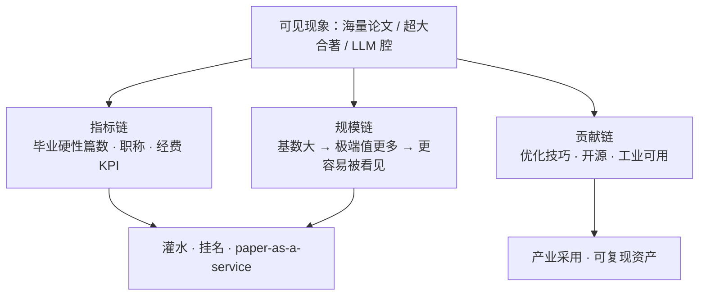
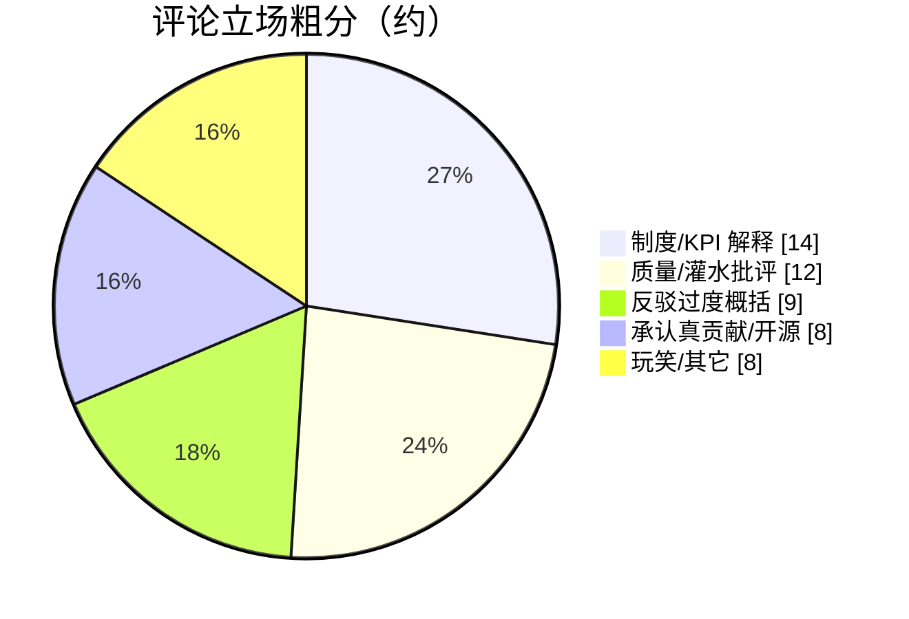

> 讨论来源：[Can we talk about the ML research coming from China? [D]](https://www.reddit.com/r/MachineLearning/comments/1xteym8/can_we_talk_about_the_ml_research_coming_from/)（r/MachineLearning，约 161↑ / 55 评；抓取整理 51 条）

楼主声明「不是想黑中国研究者」，但好奇心很冲：近几年国内（尤其常驻中国）的 ML 产出「违背常识」——本科/研究生阶段上百篇、一周一篇不稀奇；Google Scholar 随手一翻就是海量投稿；合著者几十上百（benchmark/survey 尤甚）。内容偏 LLM/多模态，数学推导少、实验极厚，有时近百页；丢进 ChatGPT/Claude 常标出可疑段落，却仍进了 ICLR/AAAI。他怀疑：除了相对封闭的发表与招聘生态（小红书/抖音/B 站招人），是否还有「互相背书」的圈子。

帖子带 `[D]` 讨论标。楼里吵得很开——从 paper mill 到 Sturgeon 定律，从广州博士到「Zhang et al.」。下面按立场整理。

## 楼里在争什么

伪问题是「中国人会不会做研究」。真问题是三层叠在一起：

1. **激励**：毕业/职称/经费用论文数与顶会档位结算；  
2. **规模**：体量大，把全球都有的灌水、挂名、LLM 代写放大到更显眼；  
3. **筛选**：工业界与认真读者早已不靠 PDF 国籍，而靠权重、代码、可复现。

### 图 1：同一现象，三条解释链

## 派系整理（51 条评论）

### 1. 制度派：不是魔法，是 KPI

最高赞长评（俄物理背景）把机制说透：毕业要篇数、老师按影响因子拿钱 → 组内互挂、老板必挂 →「几天一篇」是算术，不是天才。有人补：西方实验室也挂老板，只是形式不同。

国内在读/经历过的人说得更具体：

- 广州博士：顶尖学校毕业常要 **多篇顶会/顶刊**，职称同样卡篇数；一作干八成活，仍常感觉必须挂非贡献者。  
- 普通高校硕士：三年里后两年为毕业挤出大小论文四五篇。  
- C9 硕：每年考核、末位 10% 复审，不过就退学/转硕——压力「像开了激素的 tenure」。

楼里把这套概括成 **benchmaxxing**：官僚用指标评人，学术用指标抢经费与声望。

### 2. 质量派：scatter-gun、假消融、工程贴牌

不止「多」，还有「怎么多」：

- 老梗：同一工作改名换设备、隔几年再投一遍；  
- 新梗：蒸馏等工程手段抬分，再卖一个「新模块」，消融糊弄、基线陈旧；  
- 审稿侧：本科生一作投 ICLR 后撤稿，点进主页发现还撤了六篇；  
- 实验室吐槽（美国、组里九成中国学生）：从想法到 PPT 全 ChatGPT，组会讲自己不懂的结果。

另有人强调：海外华人组的文章往往扎实——问题不在血统，在**当地激励与筛选**。

### 3. 反驳派：别把异常值写成常态

有人追问：你真认识一年百篇的人吗？自己见过的顶多约 30 篇（带很多学生 + 996）。知乎/ X 上「本硕百篇、LLM 投中 24 篇」的个案被贴出来，反方立刻说：上热搜恰恰说明是**离群值**，不是「本科生常态」。另有人贴 Nature 旧闻：别国也有类似灌水故事。

AI 检测器也被当场打脸：有人把自己「零 AI」旧文丢进检测器，报 73% 生成——「润色英文」指控站不住，工具本身不可靠。

### 4. 贡献派：Sturgeon 定律 + 真东西在出货

「Junk paper mills 到处都有，只是中国学术体量让它们更可见。」产业读者的过滤器更冷：

> 我们看的是权重仓库和可复现代码。没代码的 PDF，不管旗子是谁，直接忽略。

同时：中国 ML **确实在贡献**现在变成工业标配的优化技巧；也不只 DeepSeek 旗舰，大量扎实开源。Sturgeon 定律被搬出来：**90% 都是垃圾时，总量越大，那 10% 的绝对数量也越大。**

有在中美两边待过的人给更细的画像：没有「蜂群意识」；人情/近亲繁殖可能比美国更重；**中位数很强，顶端 1% 与全球对齐**；高压同时挤出可疑研究和真研究。

### 图 2：楼内观点重心（人工粗分，51 条）

## 我怎么看

把楼主的「困惑」和楼里的拆解合读，比较稳的结论是：

1. **「一周一篇」首先是指标套利**，LLM 只是把旧病加速到新量级；小红书上的「代发/代写/挂名套餐」是产业形态，不是神秘东方学。  
2. **把离群值写成「中国研究者」全体**——既不公平，也无助于审稿。体量大 → 极端值多 → 更容易冲进你的时间线。  
3. **真贡献与灌水可以同时为真**。否认其一，都会让讨论变蠢。  
4. **个人过滤器**：顶会录用 ≠ 可信；无代码/无权重的「百页实验」默认降权；有可跑仓库与清晰消融的，再谈国籍与机构。  
5. **对做产品的人**：该追的是那 10% 里变成工业习惯的技巧与开源，而不是在情绪上和 PDF 产量赛跑。

科学确实在经历一层「内容通胀」——楼里叫它 enshittification of science。解药不是换国旗，是**改结算指标**，以及读者侧更狠地用可复现投票。

## 隔天的国内回声

同一周，V2EX 一篇秋招面试帖成了这篇的镜像：纸面（顶会、实习、Agent）很强，往 token/prefill/KV 一追就碎——似懂非懂，一边心虚一边加速。国外在问「怎么可能这么高产」，国内在演「高产之后坐到对面长什么样」。对照整理见 [[paper-arms-race-reddit-v2ex|纸面军备的两边]]。

## 相关文章

- [[paper-arms-race-reddit-v2ex|纸面军备的两边：Reddit × V2EX]]
- [[geo-vs-seo-same-or-separate|GEO 和 SEO 是一回事吗]]
- [[ai-era-clarity-matters|AI 时代最稀缺的能力：把话说清楚]]
- [[judge-dev-ability-in-ai-era|AI 时代怎么判断一个人会不会写代码]]
- [[selling-software-still-a-business-ai-vibe|卖软件成伪命题了？]]
