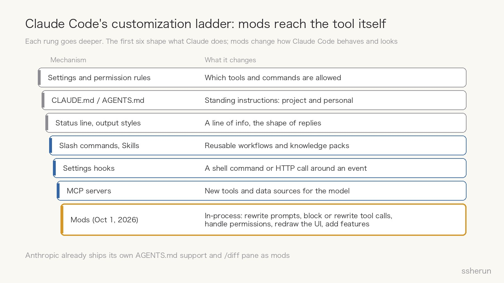
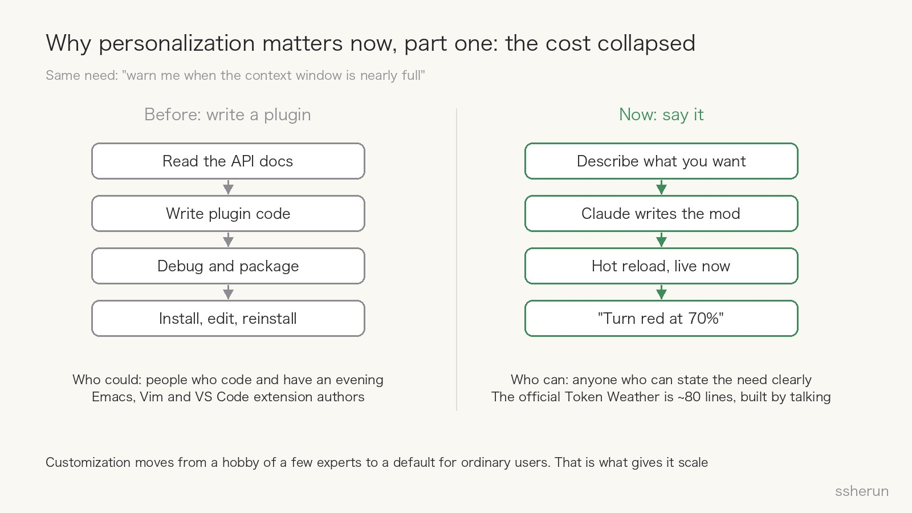
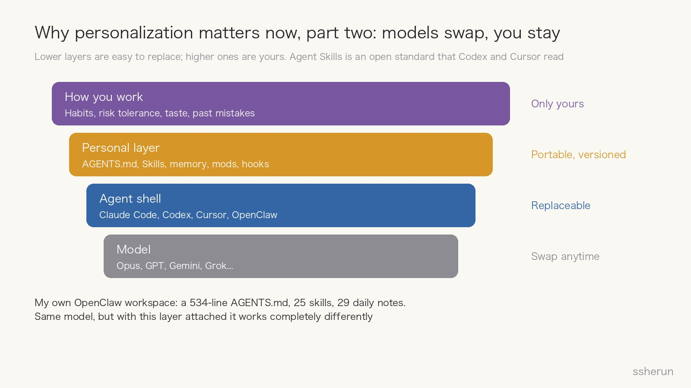
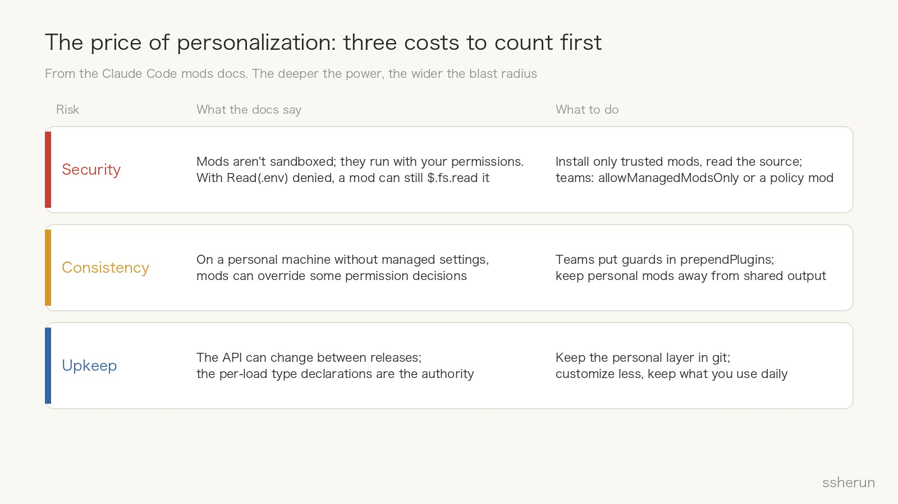

> Source: [Anthropic's mods let you change Claude Code's look and behavior](https://thenewstack.io/anthropic-claude-code-mods-plugins/) (The New Stack, Oct 2 2026)
> Official: [Getting started with Claude Code mods](https://claude.dev/blog/getting-started-with-claude-code-mods/), [Mods docs](https://code.claude.com/docs/en/plugins/mods/overview)

On October 1, Claude Code creator Boris Cherny announced mods on X, with a line I expect to be quoted a lot:

> Each person works differently, so there's no reason why everyone should have an identical Claude experience.

A mod is a small JavaScript or TypeScript function that hooks into events inside Claude Code. It can rewrite a prompt before it reaches the model, block or rewrite a tool call, handle permission requests, replace part of the interface, or add an entirely new feature. You package it as a plugin, and others can install it in three commands.

On the surface this is an advanced customization feature for power users. I think it signals something bigger: **in the AI era, personalization becomes important, and it is turning into the real competitive edge for AI tools.**

## How deep mods go

Claude Code was already customizable, but everything you could change sat outside the tool itself.

- Settings and permission rules decide which tools are allowed;
- `CLAUDE.md` / `AGENTS.md` hold standing instructions;
- The status line and output styles tweak the display;
- Slash commands and Skills package reusable workflows;
- Settings hooks run a command around an event;
- MCP connects new tools to the model.

All of these shape what Claude does. **Mods are the first to change how Claude Code itself behaves and looks.** They run in-process and stay alive for the whole session, so they can keep state, update the UI live, launch processes, and add commands.

One detail says a lot: Anthropic's own `AGENTS.md` support and `/diff` pane are already built as mods, with source in the Claude Code repository. In other words, **Claude Code is becoming a small core plus a replaceable layer of mods**, and official features and user customizations use the same mechanism.

## Reason one: the cost of customization collapsed

The most important sentence about mods isn't in the API docs. It opens Anthropic engineer Addy Osmani's getting-started post:

> You don't need to learn the API to try one. Run `claude`, then describe the mod you want. Allow hot reload when it asks, and the mod shows up when the turn ends.

Take the need "warn me when the context window is nearly full":

- **Before**, you read the plugin API, wrote code, debugged, packaged, installed, and repeated for every tweak. The people who did this wrote Emacs Lisp, Vim script or VS Code extensions and were willing to spend an evening on it.
- **Now**, you state the need, Claude writes the mod, and hot reload applies it immediately. Not quite right? Say "turn red at 70%" or "add the cost at the end" and the UI changes. That is how the official Token Weather example works: it goes from Clear to Showers to Storm as the context fills, in about 80 lines.

Personalization was always valuable, but it was expensive, so only a few experts got it. **AI turns reshaping the tool into something you can do in plain language.** Customization moves from a hobby of the few to a default for ordinary users, and for the first time it has scale.

## Reason two: models swap, your personal layer stays

The second reason is longer-term.

An AI working environment has roughly four layers:

1. **The model**: Opus, GPT, Gemini, Grok. A new generation every few months; you switch to whichever works best.
2. **The agent shell**: Claude Code, Codex, Cursor, OpenClaw, all racing each other.
3. **The personal layer**: your `AGENTS.md`, Skills, memory, mods and hooks.
4. **How you work**: habits, risk tolerance, taste, past mistakes.

The lower the layer, the easier it is to replace. The higher, the more it is yours.

More importantly, the personal layer is becoming portable across tools:

- Agent Skills became an open standard in December 2025; Codex and Cursor both support it, and Cursor reads `.claude/skills/` directly;
- Codex stores your personal instructions in a global `AGENTS.md`;
- Claude Code implements `AGENTS.md` support as a mod.

So **what follows you is not a particular model or tool but the layer you've built up.** The stronger and more alike models become, the more that layer is worth relative to them.

I'm an example. My OpenClaw workspace has a 534-line `AGENTS.md`, 25 skills and 29 daily notes. They cover:

- which language to reply in, and to lead with the conclusion;
- which route to take for fetching WeChat articles;
- the blog publishing workflow and diagram conventions;
- every mistake made along the way, like the three rules I added today about OpenClaw upgrades needing to run outside the gateway process.

Same model, but with this layer attached it works completely differently. Switch to a stronger model and the layer still applies. Lose the layer and even the strongest model has to be taught from scratch.

## Reason three: an agent acting for you has to fit you

Third: AI no longer just answers questions. It runs commands, edits files and calls APIs on your behalf. **A tool that acts has to fit its user's risk tolerance.**

The official mod examples are really about control:

- **Blast Radius** holds a risky shell command, shows what it would change, and lets you proceed or cancel;
- **Replay Theater** steps through the edits Claude made in a turn one diff at a time, for reviewing the way you like;
- On launch day, a developer built a mod that passes credentials to Claude without leaving the secret in the conversation history.

Some people are cautious and want to confirm every command. Others want speed and only look at the final diff. A one-size default disappoints both. **Here personalization isn't a skin. It makes the agent follow your rules.**

## Consumer AI is on the same path

This isn't just a developer-tool trend. ChatGPT's settings already include:

- personality presets for tone and style;
- characteristics that tune warmth, formatting and emoji separately;
- memory that can reference past conversations;
- opt-in Computer History on macOS, which turns activity across apps into memories.

From the terminal to the chat box, both ends are heading the same way: **the same model capability, delivered the way each person works.**

## The price: three costs to count first

The deeper the personalization, the bigger the cost. The mods docs are candid about it:

**Security**

- Mods aren't sandboxed; they run with the installing user's permissions.
- The docs' own example: even with `Read(.env)` denied, a mod can still read that file with `$.fs.read` or start a program that does.
- Installing an unknown mod means running unknown code on your machine. Anthropic recommends installing only from trusted publishers and reading the source first.

**Consistency**

- On Team or Enterprise plans, or machines with managed settings, the built-in `sec-default` guard loads ahead of every user mod and by default stops them from overriding deny rules. Admins can also allow only the organization's mods.
- On an ordinary personal machine, mods can override some permission decisions.
- When everyone on a team has their own behavior, output and review standards drift apart.

**Upkeep**

- The API can change between releases; the type declarations written at each load are the authority.
- The more you customize, the more breaks on upgrade. Over time that becomes personalization debt.

My rule: **customize as little as possible and keep only what you use daily; keep the personal layer in git; don't install unfamiliar mods.**

## My take

**First, AI tools will shift from all-in-one to a small core plus a customization layer plus a sharing marketplace.** Browsers did it with extensions, games with mod communities. Claude Code building official features as mods is the clearest sign of this direction.

**Second, competition will move from the strongest model to the best fit for me.** Model capability will converge. The difference will be who connects to your personal layer most smoothly, learns it fastest, and makes it easiest to carry around.

**Third, the personal layer should belong to the user, not be locked to one vendor.** Skills and `AGENTS.md` becoming open standards is good. If personal layers ever live only in one vendor's cloud with no export, that is the new lock-in.

**Fourth, for most people the best investment isn't chasing the newest model but steadily building up your own rules, workflows and preferences.** They work across models, tools and years, and they grow more valuable with use.

## How to start

1. **Write an `AGENTS.md` first**: reply language, code style, common commands, things it must never do. Half an hour is enough.
2. **Turn repeated corrections into rules**: correct the AI on the same thing twice and it goes into `AGENTS.md`; do the same workflow three times and it becomes a skill.
3. **Use mods for visibility and guardrails**: a context-usage readout, a gate in front of risky commands. These pay off most with the least risk.
4. **Put the personal layer in git**: every change is tracked, and it moves with you across machines and tools.
5. **Only install mods whose source you understand**: for a shared mod, have Claude read it first and tell you which events it hooks and which capabilities it calls.

## Closing

The old saying goes that a craftsman must first sharpen his tools, and it assumed everyone used the same tools. What changes in the AI era is that **anyone can reshape the tool to fit themselves with a sentence.**

Models will keep getting stronger, and more alike. What sets people apart is whether you've taught them how you work, and kept it.

## Related posts

- [[anthropic-skills-lessons|Lessons from hundreds of Skills inside Anthropic]]
- [[warp-self-improving-agents|What Self-Improving Agents Actually Improve: Warp vs OpenAI]]
- [[cli-ai-revival|CLI: the command-line revival in the AI era]]
- [[openclaw-eight-month-rollercoaster|OpenClaw's Eight Months: From Viral to Nobody Cares]]
