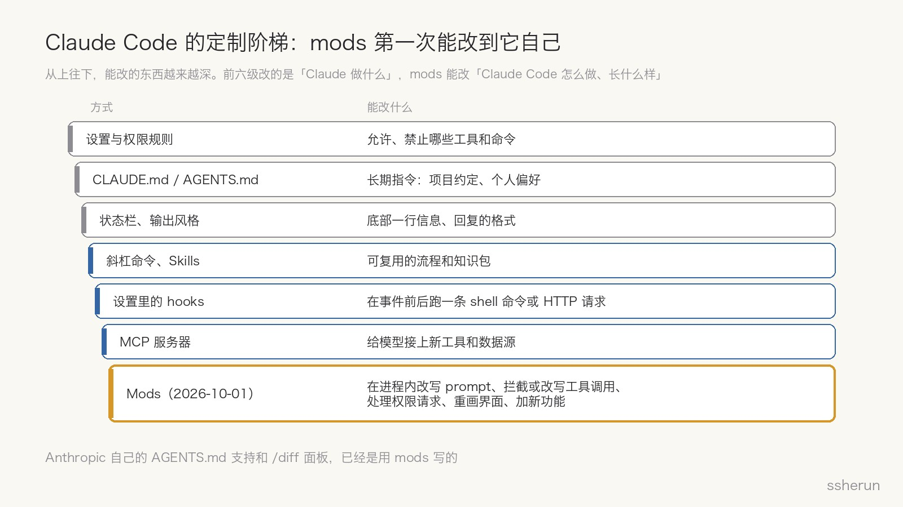
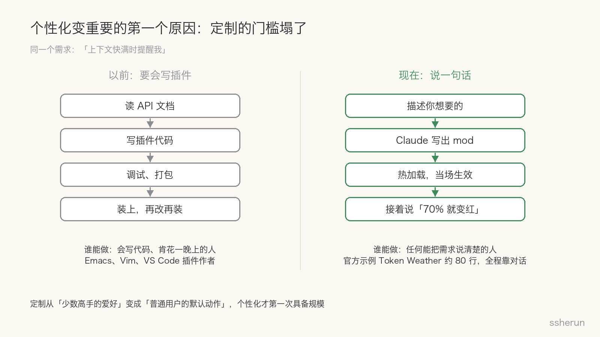
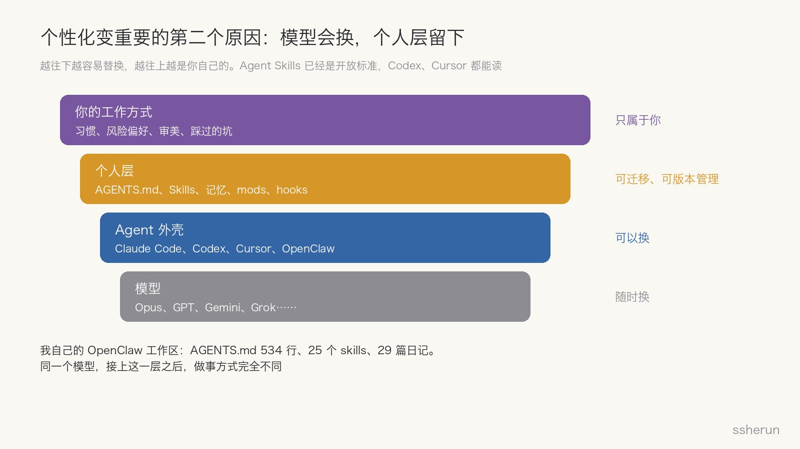
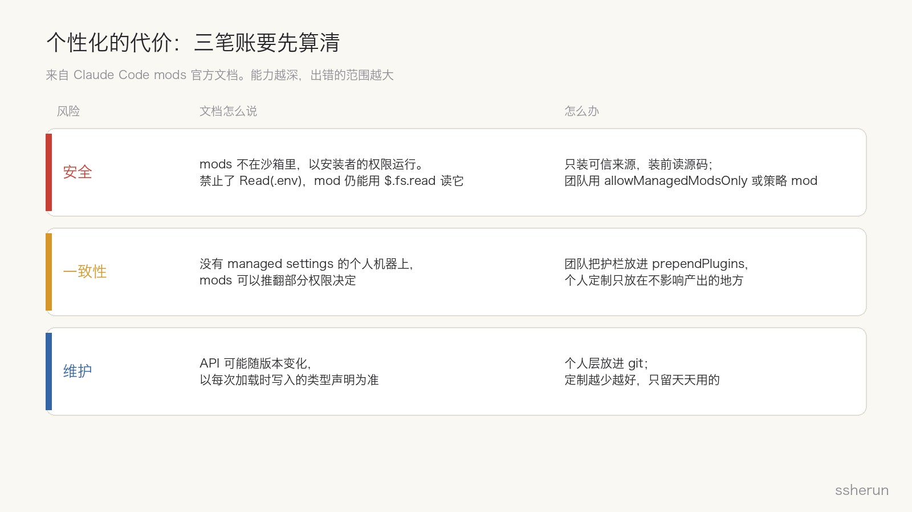

> 原文：[Anthropic's mods let you change Claude Code's look and behavior](https://thenewstack.io/anthropic-claude-code-mods-plugins/)（The New Stack，2026-10-02）
> 官方：[Getting started with Claude Code mods](https://claude.dev/blog/getting-started-with-claude-code-mods/)、[Mods 文档](https://code.claude.com/docs/en/plugins/mods/overview)

10 月 1 日，Claude Code 的作者 Boris Cherny 在 X 上宣布了 mods，说了一句我觉得会被反复引用的话：

> 每个人的工作方式都不一样，所以没理由让所有人用一模一样的 Claude。

mods 是一小段 JavaScript 或 TypeScript 函数，挂在 Claude Code 内部的事件上。它可以在 prompt 发给模型之前改写它，可以拦截或改写一次工具调用，可以替你处理权限请求，可以替换界面的一部分，也可以加一个全新的功能。写好之后打包成插件，别人三条命令就能装上。

表面上看，这是一个给极客玩的高级定制功能。但我认为它释放了一个更大的信号：**AI 时代，个性化会变得重要，而且会成为 AI 工具真正的竞争点。**

## mods 能改到多深

Claude Code 原本就能定制，但能改的东西都在「外面」。

- 设置和权限规则，决定能用哪些工具；
- `CLAUDE.md` / `AGENTS.md`，写长期指令；
- 状态栏和输出风格，调整显示；
- 斜杠命令和 Skills，封装可复用的流程；
- 设置里的 hooks，在事件前后跑一条命令；
- MCP，给模型接上新工具。

这些改的都是「Claude 做什么」。**mods 第一次能改「Claude Code 本身怎么做、长什么样」。**它在进程内运行，整个会话期间一直活着，能记住状态、实时更新界面、启动进程、加命令。

有个细节很说明问题：Anthropic 自己的 `AGENTS.md` 支持和 `/diff` 面板，已经是用 mods 写的，源码就放在 Claude Code 仓库里。也就是说，**Claude Code 正在变成「一个小内核 + 一层可替换的 mods」**，官方功能和用户定制用的是同一套机制。

## 原因一：定制的门槛塌了

mods 最关键的一句话，不在 API 文档里，而在 Anthropic 工程师 Addy Osmani 的入门文章开头：

> 你不需要先学 API。运行 `claude`，描述你想要的 mod，允许热加载，这一轮结束 mod 就出现了。

拿「上下文快满时提醒我」这个需求来说：

- **以前**，你得读插件 API、写代码、调试、打包、装上，改一点再重来一遍。能这么干的，基本是会写 Emacs Lisp、Vim 脚本或 VS Code 插件、愿意花一晚上折腾的人。
- **现在**，你把需求说清楚，Claude 写出 mod，热加载当场生效。不满意就接着说「70% 就变红」「末尾加上花费」，界面跟着变。官方示例 Token Weather 就是这么来的：根据上下文占用，从「晴」到「阵雨」再到「风暴」，大约 80 行。

个性化一直都有价值，只是过去成本太高，只有少数高手享受得到。**AI 把「改造工具」本身变成了一件可以用自然语言完成的事。**定制从少数人的爱好，变成了普通用户的默认动作，个性化第一次具备了规模。

## 原因二：模型会换，个人层留下

第二个原因更长远。

把一个 AI 工作环境拆开看，大致有四层：

1. **模型**：Opus、GPT、Gemini、Grok，几个月就换一代，哪个好用切哪个；
2. **Agent 外壳**：Claude Code、Codex、Cursor、OpenClaw，也在互相追赶；
3. **个人层**：你的 `AGENTS.md`、Skills、记忆、mods、hooks；
4. **你的工作方式**：习惯、风险偏好、审美、踩过的坑。

越往下越容易替换，越往上越是你自己的。

更重要的是，个人层正在变得可以跨工具迁移：

- Agent Skills 在 2025 年 12 月成了开放标准，Codex 和 Cursor 都支持，Cursor 还直接读 `.claude/skills/` 目录；
- Codex 把你的个人指令存在全局 `AGENTS.md` 里；
- Claude Code 用 mods 实现了 `AGENTS.md` 支持。

这意味着，**真正跟着你走的不是某个模型或某个工具，而是你沉淀下来的那一层。**模型越强、越同质化，这一层的相对价值就越高。

我自己就是例子。我的 OpenClaw 工作区里，`AGENTS.md` 已经写到 534 行，还有 25 个 skills、29 篇工作日记。里面写的是：

- 回复用什么语言、先说结论；
- 抓微信公众号文章该走哪条路；
- 发博客的流程和配图规范；
- 每次踩过的坑，比如今天刚补上的「OpenClaw 升级必须脱离网关进程」那三条。

同一个模型，接上这一层之后，做事方式完全不同。换一个更强的模型，这一层照样能用；丢了这一层，再强的模型也得从头教起。

## 原因三：Agent 替你动手，就必须贴合你

第三个原因：AI 已经不只是回答问题，而是在替你执行命令、改文件、调接口。**动手的工具，必须贴合使用者的风险偏好。**

官方举的几个 mod 例子，其实都在讲控制权：

- **Blast Radius**：执行危险的 shell 命令前先拦下来，展示会改动什么，再让你选继续还是取消；
- **Replay Theater**：把一轮里 Claude 做的修改一个 diff 一个 diff 地回放，适合按自己的习惯审查；
- 发布当天就有开发者做了一个 mod，把凭证传给 Claude，但不让密钥留在对话记录里。

有人谨慎，希望每条命令都确认；有人求快，只想看最后的 diff。一刀切的默认值，注定让两边都不满意。**个性化在这里不是换皮肤，而是让 Agent 按你的规矩办事。**

## 消费端也在走同一条路

这不只是开发者工具的趋势。ChatGPT 的设置里已经有：

- 个性预设，决定语气和风格；
- 特征微调，可以单独调热情程度、格式、emoji 用量；
- 记忆，可以引用过去的对话；
- macOS 上可选开启的「电脑使用历史」，把你在各个应用里的活动变成记忆。

从命令行到聊天框，两端在往同一个方向走：**同样的模型能力，按每个人的方式交付。**

## 代价：三笔账要先算清

个性化越深，代价也越大。mods 的官方文档写得很坦白：

**安全**

- mods 不在沙箱里，以安装者的权限运行。
- 文档举的例子：即使你禁止了 `Read(.env)`，mod 仍然可以用 `$.fs.read` 读这个文件，或者启动一个程序去读。
- 装一个来路不明的 mod，等于在本机跑一段陌生代码。官方建议只装可信来源，装前读源码。

**一致性**

- 在 Team、Enterprise 计划或者有托管配置的机器上，内置护栏 `sec-default` 会排在所有用户 mod 前面，默认不让它们推翻 deny 规则。管理员还能设成只允许组织自己的 mod。
- 但在普通个人机器上，mods 可以推翻部分权限决定。
- 团队里每人一套行为，产出和评审口径也会分叉。

**维护**

- API 可能随版本变化，以每次加载时写入的类型声明为准。
- 定制越多，升级时坏得越多，慢慢就成了「个性化债务」。

我的原则是：**定制越少越好，只留天天用的；个人层放进 git；陌生 mod 不装。**

## 我的判断

**第一，AI 工具的形态会从「大而全」变成「小内核 + 定制层 + 分享市场」。**浏览器靠扩展、游戏靠 mod 社区，都走过这条路。Claude Code 用 mods 写官方功能，就是这个方向最明确的信号。

**第二，竞争点会从「谁的模型最强」转向「谁最贴合我」。**模型能力会逐渐趋同，差异会体现在：谁能把用户的个人层接得最顺、学得最快、迁移得最方便。

**第三，个人层应该属于用户，而不是被某一家锁住。**Skills 和 `AGENTS.md` 走向开放标准是好事。如果有一天个人层只能存在某一家的云端、不能导出，那就是新的锁定。

**第四，对普通人来说，最值得投资的不是追最新的模型，而是持续沉淀自己的规则、流程和偏好。**这些东西跨模型、跨工具、跨年份都有效，而且越用越值钱。

## 怎么开始

1. **先写一份 `AGENTS.md`**：回复语言、代码风格、常用命令、绝对不能做的事。半小时就够。
2. **把重复纠正变成规则**：同一件事纠正 AI 两次，就写进 `AGENTS.md`；同一个流程做了三次，就封装成 skill。
3. **用 mods 补「可见性」和「护栏」**：比如上下文占用提示、危险命令拦截。这两类收益最高、风险最低。
4. **把个人层放进 git**：每次改动都有记录，换电脑、换工具都能带走。
5. **只装看得懂源码的 mod**：别人分享的 mod，先让 Claude 读一遍，告诉你它监听了哪些事件、调用了哪些能力。

## 写在最后

以前我们说「工欲善其事，必先利其器」，默认大家用的是同一把器。AI 时代的变化是：**每个人都可以用一句话，把器改成最适合自己的样子。**

模型会越来越强，也会越来越像。真正拉开差距的，是你有没有把自己的工作方式教给它，并且留下来。

## 相关文章

- [[anthropic-skills-lessons|Anthropic 数百个 Skills 的经验：九大类型与写好 Skill 的秘诀]]
- [[warp-self-improving-agents|Agent「自我改进」到底改进什么？Warp Skills 环 vs OpenAI 黑板]]
- [[cli-ai-revival|CLI：AI 时代的命令行复兴]]
- [[openclaw-eight-month-rollercoaster|OpenClaw 八个月过山车：从意外爆红到「无人问津」]]
