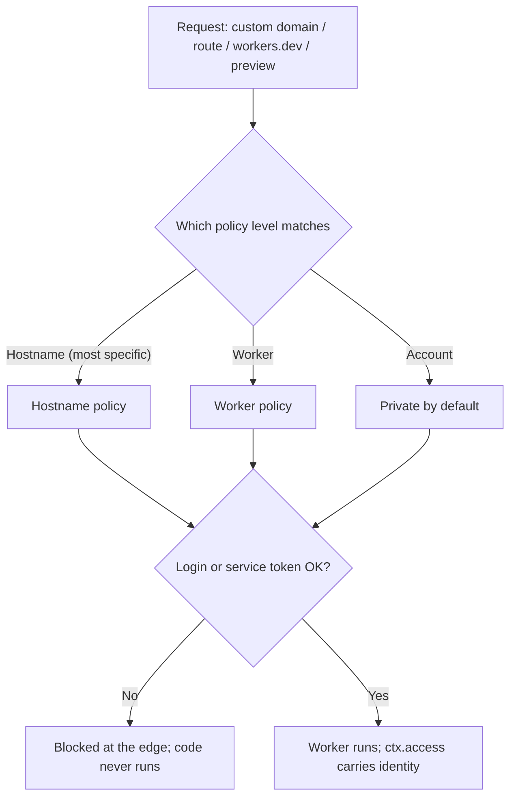

AI has made it trivial for PMs, designers, and ops folks to vibe-code an internal tool and deploy it to the public Internet. Fast iteration is great. Accidentally exposing half-baked apps or company data is not.

[Cloudflare's announcement](https://blog.cloudflare.com/workers-protected-by-access/) — **Access for Workers** — is basically: **attach your company login gate to the Worker, not to every developer's memory.**

## The old pain: you locked hostnames, not apps


Previously, Cloudflare Access lived at the **hostname** level. Every custom domain, route, workers.dev subdomain, and preview URL needed its own policy. Add a domain and forget to update Access? **Wide open.**

Preview URLs are the worst offender — each deploy can mint a new URL, and the faster you ship, the more leak windows you create.


## The new model: policy follows the Worker

You can now bind Access **directly to a Worker** (or flip a account-wide default):

- Doesn't matter how traffic arrives — custom domain, route, workers.dev, preview — **authenticate first, then hit your code**
- Protect **preview only**, or **every hostname**
- **Account-wide private by default** for all current and future Workers; bypass per Worker when something should stay public

Priority: **hostname > Worker > account** (most specific wins).

## What developers should care about: `ctx.access`

Before: parse JWTs, verify signatures, extract claims yourself. Now, with Access enabled, every authenticated request carries `ctx.access`:

```js
export default {
  async fetch(request, env, ctx) {
    if (!ctx.access) {
      return new Response("Access required", { status: 403 });
    }
    const identity = await ctx.access.getIdentity();
    const email = identity?.email ?? "unknown";
    return new Response(`Hello, ${email}`);
  }
};
```

Get `email`, `name`, and `groups` for personalization, authorization, or audit. Agents can use **service tokens**.

Local dev doesn't require deploy-and-sign-in every time — mock identity in `wrangler.jsonc`:

```json
{
  "access": {
    "dev": {
      "aud": "my-app",
      "identity": { "email": "admin@company.com" }
    }
  }
}
```

## Internal platforms: one lock on the dispatch Worker


With **Workers for Platforms**, set Access once on the **dispatch Worker** and every app in the namespace is private by default. Cloudflare open-sourced [internal-sites-template](https://github.com/cloudflare/templates/tree/main/internal-sites-template) — drag-and-drop deploys that stay behind login. Good fit for "everyone can vibe, not everyone gets the public Internet."

## Why this shipped now: FL2

This isn't just product packaging. In the old stack (FL1, NGINX + Lua), Access ran before Worker logic. Targeting individual Workers required splitting **routing from execution** — risky when products share mutable pipeline state.

**FL2**, Cloudflare's Rust-based modular edge proxy, uses strict phased modules with compile-time dependency checks. That made Worker-scoped Access a safe, gradual rollout instead of a scary NGINX surgery.

## Practical playbook

| Scenario | Suggestion |
|----------|------------|
| Company-wide internal vibe tools | Account default private; bypass only public production sites |
| Preview leaks only | Lock previews; keep production hostnames open |
| Solo side project, team-only beta | Single Worker + IdP — cheaper than rolling OAuth |
| Agents / automation | Service tokens |

## How a request actually flows

Put the rules together and a request goes roughly like this:



The last two boxes are the point: **a request that fails never reaches your code.** That is much safer than writing `if (!user) return 401` in the code, where one forgotten route is a leak.

## Easy ways to get it wrong

**1. A gate is not authorization.** Access answers "is this person in the company?", not "may they delete this record?". You still need in-app role checks, and the `groups` in `ctx.access` are there for exactly that.

**2. Callbacks and webhooks get locked too.** Payment callbacks, GitHub webhooks, and third-party form posts will never go through your company SSO. Before flipping account-wide private, list the Workers that receive outside callbacks and plan each one: bypass it, switch it to a service token, or split it into its own Worker.

**3. Service tokens are secrets.** Keep tokens for agents and CI in Secrets, issue one per purpose, and rotate them. Never put them in code or the repo for convenience.

**4. Mock identities stay local.** The `dev` identity in `wrangler.jsonc` is a development convenience. Before shipping, confirm it only applies locally so "everyone is admin" never reaches production.

## Pre-launch checklist

| Check | How to confirm |
|-------|----------------|
| Account is private by default | Create an empty Worker, open its workers.dev URL, expect a login |
| Preview URLs are locked | Deploy any preview and open it in a private window |
| Public sites are explicitly bypassed | List every Worker that must be public and confirm each one |
| Outside callbacks still arrive | Use the provider's "send test webhook" button |
| Code double-checks `ctx.access` | Search the entry handler; return 403 when it is missing |

## Bottom line

Vibe coding removed the "who can deploy" barrier. **Secure-by-default** has to move at product speed, not developer discipline. Access for Workers upgrades zero trust from "configure hostnames" to "configure apps" — a real ops win for anyone on Workers/Pages.

**Docs:** [Cloudflare Access for Workers](https://developers.cloudflare.com/workers/configuration/cloudflare-access/)

## Related posts

- [[hello-world|An agent-friendly blog]]
- [[cli-ai-revival|CLI: the command-line revival in the AI era]]
- [[self-host-mail-server-local-llm-antispam|Self-host a mail server in 2026]]
- [[x-3-open-source-tools-autoclip-cloud-mail-open-lovable|Three open-source tools from X]]
