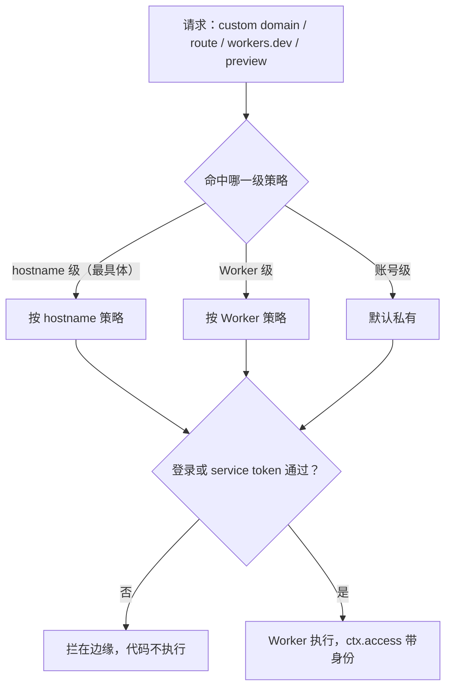

AI 让产品、运营、设计都能「vibe code」出一个能用的内部工具，点几下就部署到公网。爽是爽，安全团队的头也大了：**任何员工都能把半成品或内部数据意外暴露在互联网上。**

[Cloudflare 这篇官方博文](https://blog.cloudflare.com/workers-protected-by-access/) 推出的 **Access for Workers**，核心就一件事：**把公司登录门禁直接挂在 Worker 上，而不是让每个开发者自己记得给每个域名加锁。**

## 旧方案的坑：锁的是域名，不是应用


以前要在 **hostname 级别** 配 Cloudflare Access。Worker 挂了多少个 custom domain、route、workers.dev 子域、预览 URL，就要分别想着加策略。新加一个域名忘了配？**直接裸奔。**

预览环境尤其危险——每次 `wrangler deploy` 或 Pages preview 都可能生成新 URL，开发迭代越快，泄露窗口越多。

## 新方案：策略跟着 Worker 走

现在可以把 Access 策略**直接绑到 Worker 本身**（或账号级一键全开）：

- 请求从哪进来无所谓——custom domain、route、workers.dev、preview——**先进 Access，再进你的代码**
- 可选 **仅保护 preview**，或 **所有 hostname 全保护**
- **账号级默认私有**：当前 + 未来所有 Worker 创建即受保护；需要公开的单个 Worker 可 bypass

策略优先级：**hostname > Worker > 账号**（最具体的赢）。

## 开发者最该关心的：`ctx.access`

以前要在 Worker 里自己解析 JWT、验签、抽 claims。现在 Access 开启后，每个已认证请求都带 `ctx.access`：

```js
export default {
  async fetch(request, env, ctx) {
    if (!ctx.access) {
      return new Response("Access required", { status: 403 });
    }
    const identity = await ctx.access.getIdentity();
    const email = identity?.email ?? "unknown";
    return new Response(`Hello, ${email}`);
  }
};
```

`email`、`name`、`groups` 直接拿，做个性化、权限、审计都方便。Agent 场景还支持 **service token**。

本地开发也不用每次 deploy 再登录——`wrangler.jsonc` 里 mock 身份即可：

```json
{
  "access": {
    "dev": {
      "aud": "my-app",
      "identity": { "email": "admin@company.com" }
    }
  }
}
```

## 内部平台：dispatch Worker 一把锁


如果你用 **Workers for Platforms** 给员工搭「内部部署平台」，在 **dispatch Worker** 上设一次 Access，namespace 里所有子应用默认私有。Cloudflare 还开源了 [internal-sites-template](https://github.com/cloudflare/templates/tree/main/internal-sites-template)，拖拽部署 + 默认加锁，适合「人人能 vibe，但不能人人能公网访问」。

## 底层为什么现在才做得顺：FL2

这不是纯产品包装。旧架构（FL1，NGINX + Lua）里 Access 跑在 Worker 逻辑之前，要知道「请求要去哪个 Worker」就得把 **routing 和 execution 拆开**——牵一发动全身。

新 **FL2**（Rust 模块化边缘代理）用严格分阶段模块 + 编译期检查依赖，才把「按 Worker 粒度加 Access」安全地推进去。基础设施到位，产品才敢喊「一键」。

## 值得怎么用

| 场景 | 建议 |
|------|------|
| 公司全员 vibe 内部工具 | 账号级默认私有，生产公开的单站 bypass |
| 只有预览怕泄露 | 仅 preview 加锁，生产域名保持公开 |
| 个人 side project 团队内测 | 单 Worker 加 Access + IdP，比自建 OAuth 省事 |
| Agent / 自动化访问 | service token |

## 一个请求到底怎么走

把上面的规则串起来，一个请求进来大致是这样：



关键在最后两格：**没通过的请求连你的代码都碰不到**。这比在代码里写 `if (!user) return 401` 安全得多——后者只要有一个路由忘了写就漏。

## 几个容易踩的坑

**1. 门禁不等于权限。** Access 回答的是「你是不是公司的人」，不回答「你能不能删这条数据」。应用内的角色判断还得自己做，`ctx.access` 里的 `groups` 正好拿来用。

**2. 回调和 webhook 会被一起锁住。** 支付回调、GitHub webhook、第三方表单推送都不会走公司 SSO。账号级一键全开之前，先盘点哪些 Worker 要接外部回调，为它们单独规划：放行、换 service token，或者拆成独立 Worker。

**3. service token 也是密钥。** 给 Agent 和 CI 用的 token 要放进 Secrets，按用途分开发，定期轮换。不要为了省事写进代码或仓库。

**4. 本地 mock 身份只能留在本地。** `wrangler.jsonc` 里的 `dev` 身份是为了开发方便，上线前确认它只作用于本地，别把「人人都是 admin」带进生产。

## 上线前自查清单

| 检查项 | 怎么确认 |
|--------|----------|
| 账号是否默认私有 | 新建一个空 Worker，访问 workers.dev 地址，应被要求登录 |
| 预览 URL 是否加锁 | 随便部署一个 preview，用无痕窗口打开 |
| 公开站点是否显式 bypass | 列出所有需要公网访问的 Worker，逐个确认 |
| 外部回调是否可达 | 用第三方平台的「发送测试回调」功能验证 |
| 代码里是否兜底检查 `ctx.access` | 搜一下入口函数，缺失时返回 403 |

## 小结

Vibe coding 把「谁能部署」的门槛打没了，**默认安全态**必须跟着产品走，不能靠开发者记忆。Access for Workers 把零信任从「配域名」升级成「配应用」，对跑 Workers/Pages 的团队是实打实省事故、省运维的配置项。

**文档：** [Cloudflare Access for Workers](https://developers.cloudflare.com/workers/configuration/cloudflare-access/)

## 相关文章

- [[hello-world|做一个对 Agent 友好的博客]]
- [[cli-ai-revival|CLI：AI 时代的命令行复兴]]
- [[self-host-mail-server-local-llm-antispam|2026 自建邮件服务器教程]]
- [[x-3-open-source-tools-autoclip-cloud-mail-open-lovable|X 上三款开源神器]]
