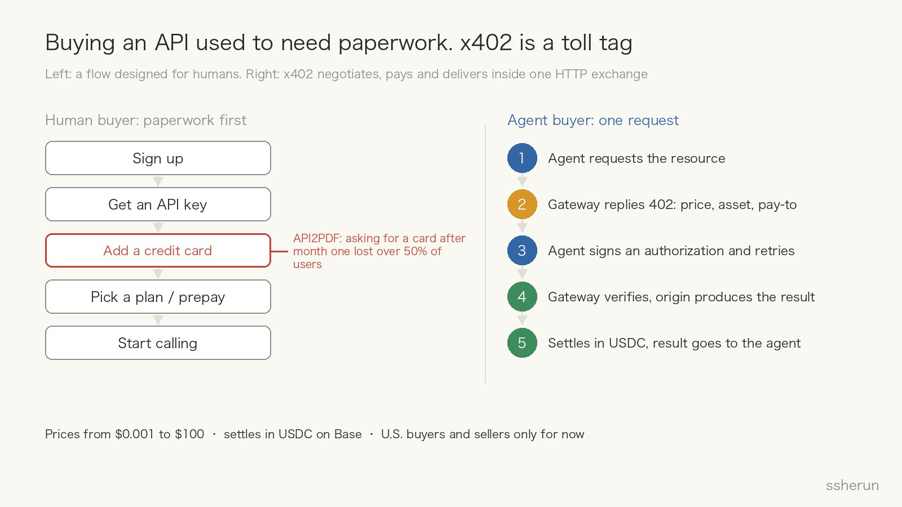
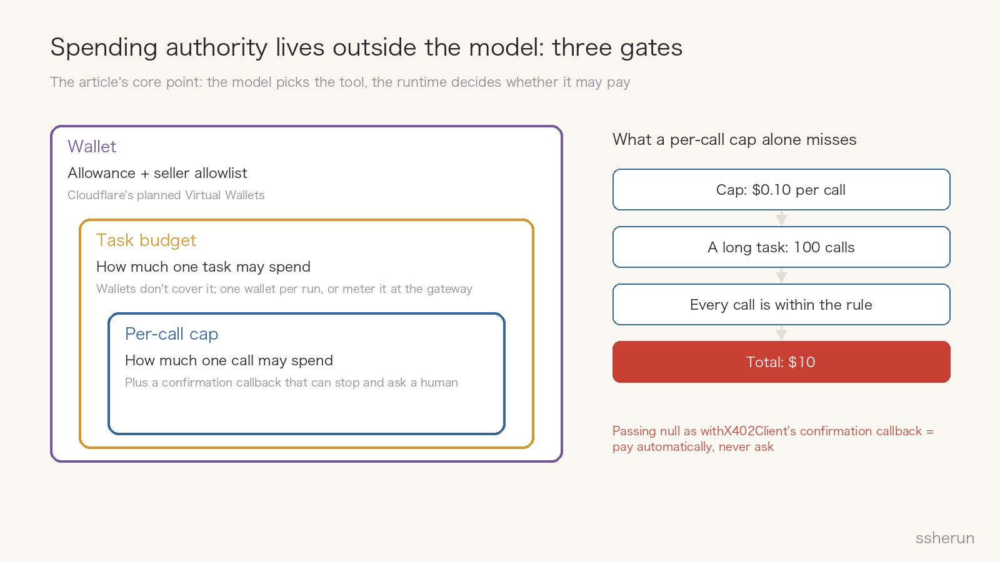
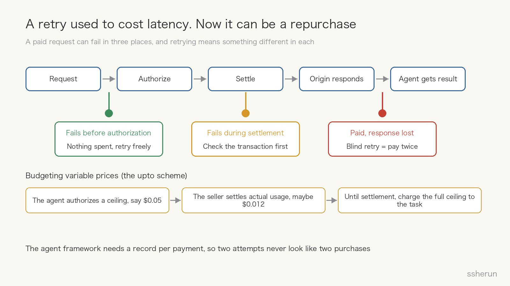
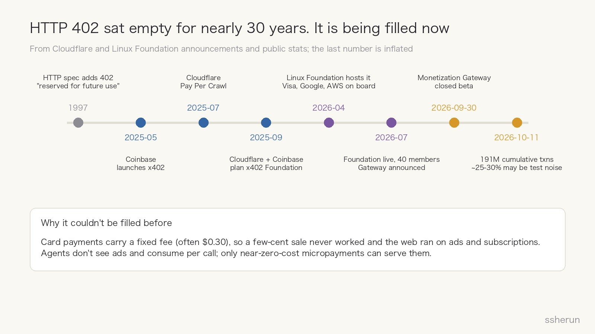

> Source: [Cloudflare brings paid access to MCP tools — who controls the agent's spending?](https://thenewstack.io/cloudflare-x402-agent-spending/) by Amanda Caswell, The New Stack, October 1, 2026. Also drawing on Cloudflare's [Monetization Gateway beta](https://blog.cloudflare.com/monetization-gateway-beta/) post and the Linux Foundation's x402 Foundation announcements.

The one-line version: **an agent can now call a tool, run a web search or render a PDF and pay a few cents on the spot, without a human signing up for an account or entering a card first.**

Cloudflare turned this into a product on September 30. It's called the Monetization Gateway, and it's in closed beta. The New Stack piece looks at the other side of it: the seller's toll booth is built, so **on the buyer's side, who controls the agent's wallet?**

I think this deserves a careful read. Not because Cloudflare shipped another feature, but because it moves "agents can spend money" from experiment to infrastructure.

## x402 in plain terms

HTTP has a status code called **402 Payment Required**. It went into the spec in 1997 marked "reserved for future use", and then sat almost unused for close to 30 years.

x402 is the protocol that finally fills that slot. Coinbase started it in 2025, and this year it moved to the Linux Foundation.

The easiest analogy is a **highway toll tag**:

- Using an API used to be like going to an office to get a toll card first: sign up, get an API key, add a credit card, pick a plan, prepay, and only then start.
- x402 is the tag on your windshield: you drive up, the gate tells you the price, the tag pays, the barrier lifts, and you never stop.

The flow is five steps, all inside ordinary HTTP:

1. The agent requests a resource, say a search;
2. Instead of the result, the gateway returns 402 with the price, the accepted asset and where to pay;
3. The agent signs a payment authorization and repeats the request with it;
4. The gateway verifies it and the origin produces the result;
5. The payment settles and the result goes back to the agent.

Today the money is **USDC**, a stablecoin pegged 1:1 to the dollar, settled on Coinbase's Base chain. Prices run from $0.001 to $100. During the beta, only U.S. buyers and sellers are eligible.

## Why bother: subscriptions don't fit agents

Cloudflare's own blog puts it plainly. Most software is sold as subscriptions or prepaid credits, which means a big upfront commitment, so a person only signs up for a few. Agents don't work that way. To finish one task, an agent may visit a site it has never seen, call a new tool or pull a data feed. **It wants to pay per use, in units as small as one request, one query, one token.**

The four launch customers are four kinds of per-use business:

- **Cloudflare's own AI Gateway**: add `PAYMENT-METHOD: x402` to a request and pay for inference per call, no credits needed.
- **Ceramic.ai (search API)**: a simple question takes one query, a deep research task may take hundreds. An agent that pays for itself doesn't have to ration searches against a budget someone set in advance.
- **Stocktwits (retail investor community)**: sells sentiment and message-volume signals to agents. Before, that needed a data license; now an agent buys the request it needs. It opened a separate agent-facing path and left its existing products untouched.
- **API2PDF (PDF generation API)**: used to require an account and a key, then a credit card after the first month, and **that step lost more than half its users**. Now a request without a key gets a 402, and once paid, the PDF is made.

The API2PDF section has a line I like: agents face the same build-versus-buy decision developers do. An agent can burn tokens assembling a PDF itself, or pay a specialized API a fraction of a cent to do it properly. **Price becomes something an agent can see directly when it picks a tool.**

## The toll booth exists. The buyer has five questions to answer

This is the heart of the article. Cloudflare handles the seller side: verification, settlement, failed transactions, analytics. But the money leaves the buyer's wallet, and none of the buyer's problems are solved yet.

### 1. Who approves the spend? Not the model

The article's core point: **spending authority belongs outside the model.** The model decides which tool to call; the runtime, the agent framework layer, decides whether it may pay.

Cloudflare has two layers here:

- Planned **Virtual Wallets**: the wallet owner sets an allowance, an allowlist of sellers and a maximum transaction size, and those rules apply no matter which tool the agent picks.
- In the Agents SDK, `withX402Client` takes a **confirmation callback** that sees the payment requirements before any money moves, so you can stop and ask a human. But **pass `null` there and the agent pays automatically, asking no one.**

Watch that second point. The most convenient default is also the most dangerous one.

### 2. How much may one task spend?

A per-call cap only goes halfway. The article does the math: cap each call at $0.10, let a long research or coding task make 100 calls, and every call follows the rule while the total reaches $10.

The wallet allowance is a backstop, but it doesn't know what "this task" spent unless you create a new wallet for every run. Some platforms already push this into the gateway; TrueFoundry, for example, enforces budgets and rate limits for agents in its AI Gateway.

So there are three gates to manage: **wallet total, task budget, per-call cap**, and the middle one is the easiest to forget.

### 3. How do you budget a price you don't know yet?

x402 has two pricing schemes:

- `exact`: a fixed price;
- `upto`: the client authorizes a ceiling and the seller settles the actual amount.

API2PDF uses `upto`, because every PDF uses different compute and bandwidth. The agent knows the most it could pay, not what it will pay.

The article's advice is practical: **until settlement reports back, charge the full ceiling against the task budget.** Overcount rather than undercount.

### 4. Does a retry pay twice?

This one is easy to miss. When an API request timed out before, you retried and lost a little time and compute. Now the request itself can trigger a payment, so a retry can become **a second purchase**.

A paid request can fail in three places:

- **Before authorization**: no money moved, retry freely;
- **During settlement**: find out whether the transaction went through before deciding;
- **After payment, with the response lost on the way back**: a blind retry pays twice for the same thing.

Cloudflare's gateway retries failed settlements, and x402 clients check the HTTP status before retrying. But as the article says, the agent framework still needs its own record of every payment to tell two attempts from two purchases.

### 5. Where did the money go?

A wallet balance can tell you an agent spent $50. It can't tell you that **one task spent $3.80 across 27 tool calls, and one retry paid twice.**

Cloudflare plans to expose transaction logs, but those are for sellers. Buyers have to tie each payment to the model and tool calls that triggered it. Since AI Gateway now accepts x402 for inference, **model calls and paid tools draw from the same wallet**, and both need to be charged to a specific task.

Observability vendors have spent the past two years rebuilding around token usage because inference is a cost you can measure. Paid tools extend that accounting to every outside service an agent touches.

## Two examples close to home

**A cautionary one.** I wrote earlier about Bottleneck Labs' experiment: an agent called Saul got $350 and 24 hours to run a real iOS company. It spent $99.50 buying 50 testers to pump its user count, and finished with zero revenue. It had a bank account and pricing control, but no budget threshold and no confirmation before spending.

That run used a bank account and a virtual card. x402 makes spending far smoother, so **this kind of thing will happen more, not less**. The five questions above aren't polish; they're the exam you pass before launch.

**One of my own.** I run a local model bridge for my agents. When the model quota ran out, the bridge used to return HTTP 500; the caller read it as a timeout, retried three times, and a whole batch of scheduled jobs failed. I changed "quota exhausted" to return **402**, and the caller now knows it isn't a network blip and stops retrying blindly.

Same lesson as the article: **the difference between 402 and 500 decides whether to retry.** Once a 402 carries real money behind it, that difference matters even more.

## Why I think this is where things are going

**First, the slot waited 30 years, and now someone needs it.** 402 went unused for a simple reason: card payments carry a fixed fee, often around $0.30, so a few-cent sale never worked. For three decades the web made money two ways: ads and subscriptions.

Agents don't see ads. They read your page and leave; the ad slot means nothing to them. They won't subscribe one by one either. An agent consumes per request and per query, and only near-zero-cost micropayments can serve that. **The demand changed, and the slot finally has a use.**

**Second, the big players have picked a side.** The Linux Foundation took over the x402 Foundation in April, and by its operational launch in July it had 40 members, including Visa, Mastercard, American Express, Google, AWS, Stripe, Shopify and Adyen. When card networks and cloud providers both sign up for a protocol that routes around cards, nobody wants to miss the train. AWS Bedrock AgentCore already uses x402 for agent payments.

**Third, the volume is real, if inflated.** One tracker counts about 191 million cumulative x402 transactions as of October 11; other estimates put 25 to 30 percent of that down to testing or leaderboard noise. Discount it by a third and it's still not small.

**Fourth, we've walked this road before.** Cloud computing turned servers from a purchase into an hourly rate, then a per-millisecond one, and that's how serverless happened. x402 does the same for buying data and tools: from contracts and subscriptions to paying per call. Once metered billing works smoothly, nobody goes back.

**Fifth, it fills the missing piece of the agent economy.** MCP solved how agents call tools, and protocols like A2A are working on how agents cooperate, but "how do they settle the bill" has been blank. Without checkout, an agent can only use what a human bought in advance. With it, an agent can find a better paid tool halfway through a task and decide for itself whether to buy.

## But don't get carried away

- **It's very early.** The Monetization Gateway is a closed beta, U.S. only, settling in on-chain stablecoins. Developers in most other countries, including mine, can't use it yet, and stablecoin regulation is still moving.
- **No single protocol has won.** Stripe and Tempo launched MPP (Machine Payments Protocol), which takes a more compliance-heavy route; Google's AP2 handles authorization and audit and can sit alongside x402. Several protocols coexisting is the likelier outcome than one winner.
- **The numbers are inflated.** Take the 191 million with a discount.
- **The hard part isn't paying, it's managing the money.** That's the article's most important reminder, and the half of this trend people are most likely to skip. The smoother payment gets, the more the boring work matters: budgets, confirmations, bookkeeping, retries.

## What to do with it

1. **If you build agents, treat spending like deleting files: a high-risk permission.** Per-call cap, task budget, seller allowlist, a human check before significant payments. Don't pass `null` to the confirmation callback to save effort.
2. **Charge every payment to a specific task.** Record which task, which model call, which tool, which attempt. Check payment status before retrying.
3. **If you sell APIs or data, copy Stocktwits and open a separate per-use path for agents.** Leave subscriptions and enterprise contracts alone, and first make it possible for an agent with no account and no key to pay and use you.
4. **For everyone else: a wallet will become an agent capability, like an API key is today.** Whoever hands an agent a wallet has to keep its books.

There's an idea in the article I fully agree with: a wallet balance shows how much an agent spent, but not which task or which call spent it. **Agents have learned to spend. We have to learn to keep their books first.**

## Related posts

- [[gpt-56-saul-agent-startup-experiment|GPT-5.6 as CEO: 320M Tokens in 24 Hours, $0 Revenue]]
- [[why-code-search-agents-expensive|Why Code Search Makes Coding Agents So Expensive]]
- [[dual-entry-human-agent-design|Two product entrances: design for humans and agents]]
- [[lovable-future-saas-agent-capabilities|Lovable CTO: SaaS's Future Is Capabilities Agents Can Call]]
- [[ai-native-saas-after-agent-hype|After the Agent Hype: Traditional SaaS Is Dead; AI-Native Keeps the Seat]]
