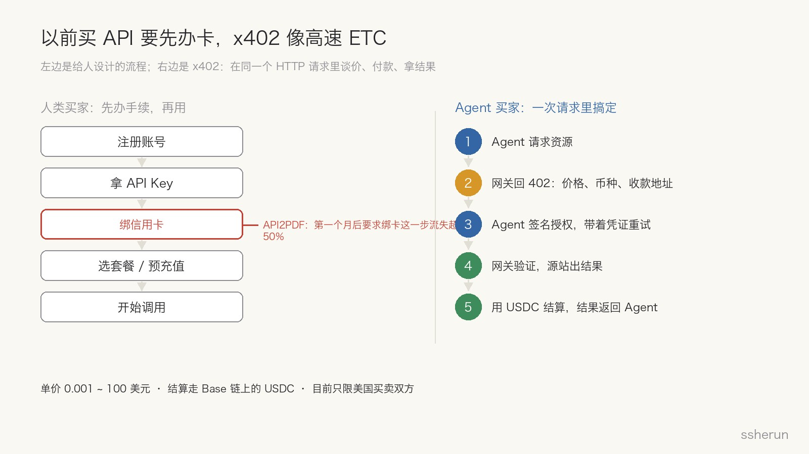
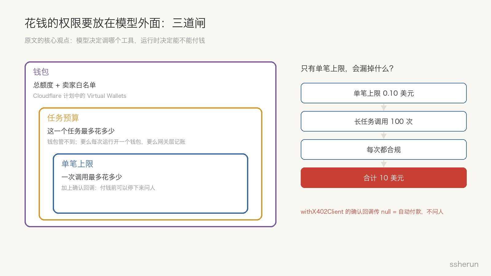
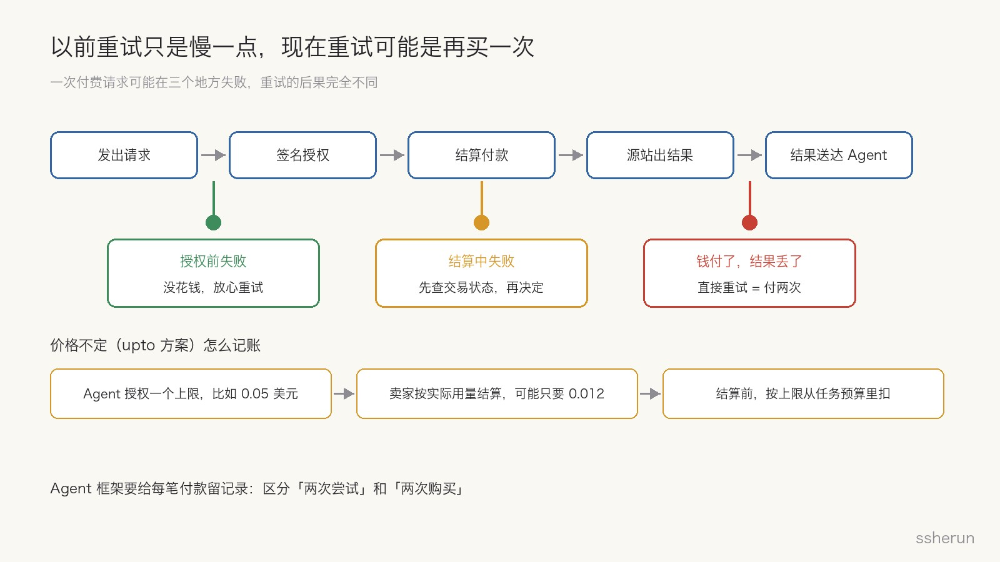
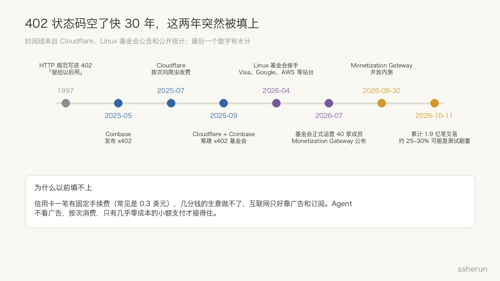

> 原文：[Cloudflare brings paid access to MCP tools — who controls the agent's spending?](https://thenewstack.io/cloudflare-x402-agent-spending/)，Amanda Caswell，The New Stack，2026-10-01。另参考 Cloudflare 官方博客 [Monetization Gateway beta](https://blog.cloudflare.com/monetization-gateway-beta/) 与 Linux 基金会的 x402 基金会公告。

一句话版本：**以后 Agent 调一个工具、搜一次网页、生成一份 PDF，可以当场掏几分钱付账，不需要人先去注册账号、绑信用卡。**

Cloudflare 9 月 30 日把这件事做成了产品，叫 Monetization Gateway（变现网关），开了内测。The New Stack 这篇文章关心的是另一面：卖家这边收费站建好了，**买家这边，谁来管 Agent 的钱包？**

这件事我觉得值得认真看。不是因为 Cloudflare 又发了个新功能，而是因为它把「Agent 能花钱」从实验变成了基础设施。

## 先用大白话讲清楚 x402

HTTP 协议里有一个状态码叫 **402 Payment Required**（需要付款）。1997 年就写进了规范，备注是「留给以后用」，然后空了快 30 年，几乎没人用过。

x402 就是把这个空位填上的协议。Coinbase 2025 年发起，今年交给了 Linux 基金会托管。

最好懂的比方是**高速公路的 ETC**：

- 以前用一个 API，像上高速前先去营业厅办卡：注册账号、拿 API Key、绑信用卡、选套餐、预充值，然后才能开始用。
- x402 像 ETC：车开到收费站，杆子告诉你多少钱，车上的设备自动扣款，抬杆放行，车都不用停。

具体流程就五步，全在普通的 HTTP 请求里完成：

1. Agent 去请求一个资源，比如一次搜索；
2. 网关不给结果，回一个 402，里面写着价格、用什么币、钱打到哪；
3. Agent 签一个付款授权，带着它再请求一次；
4. 网关验证授权，源站把结果做出来；
5. 钱结算掉，结果交给 Agent。

现在用的钱是 **USDC**（一种和美元 1:1 挂钩的稳定币），结算在 Coinbase 的 Base 链上。单价可以从 0.001 美元到 100 美元。内测阶段只对美国的买家和卖家开放。

## 为什么要这么折腾：订阅制不适合 Agent

Cloudflare 在官方博客里把理由说得很直白：今天的软件大多卖订阅或者预充值，买家要先掏一大笔钱，所以一个人只会订几个。可 Agent 不是这么干活的，它为了完成一个任务，可能临时访问一个从没去过的网站、调一个新工具、拉一份数据。**它要的是按次付费，单位小到一次请求、一次搜索、一个 token。**

内测上线的四个客户，正好是四种「按次」的生意：

- **Cloudflare 自己的 AI Gateway**：调模型推理时，在请求头里加一行 `PAYMENT-METHOD: x402`，就能按次付费，不用先充值。
- **Ceramic.ai（搜索 API）**：一个简单问题搜一次，一个复杂研究可能搜几百次。Agent 能自己付钱，就不用对着别人提前设好的额度省着搜。
- **Stocktwits（股票讨论社区）**：把散户情绪、讨论热度这些信号卖给 Agent。以前要签数据授权合同，现在 Agent 要哪条买哪条。它是单独开了一条给 Agent 的通道，原有产品一点没动。
- **API2PDF（生成 PDF 的 API）**：以前要先注册拿 Key，用满一个月要绑信用卡，**这一步流失超过一半的用户**。现在没 Key 的请求直接回 402，付完就给你生成。

API2PDF 那段还有一句我很喜欢：Agent 和开发者一样，也面临「自己做还是买」的选择。它可以烧一堆 token 自己拼一份 PDF，也可以花不到一美分让专业的 API 做好。**价格第一次成了 Agent 选工具时能直接看到的东西。**

## 收费站有了，买家要回答五个问题

这才是原文的重点。卖家的事 Cloudflare 都包了：验证、结算、失败重试、分析。但钱从买家的钱包里出去，买家这边的问题一个都没解决。

### 1. 谁批准花钱？不能是模型自己

原文的核心观点：**花钱的权限要放在模型外面。**模型负责决定调哪个工具，运行时（Agent 框架那一层）负责决定能不能付钱。

Cloudflare 的做法有两层：

- 计划中的 **Virtual Wallets（虚拟钱包）**：钱包主人可以设总额度、卖家白名单、单笔上限，不管 Agent 想调哪个工具，这些规矩都生效。
- Agents SDK 里的 `withX402Client` 有一个**确认回调**：付钱之前会把价格交给你，你可以在这一步停下来问人。但是，**如果你在这里传 `null`，Agent 就会自动付款，谁也不问。**

后面这点要特别小心。默认最方便的那个选项，恰好是最危险的那个。

### 2. 一个任务最多能花多少？

单笔上限只能管一半。原文算了一笔账：每次调用限 0.10 美元，一个长时间的研究或者写代码任务调 100 次，每一次都合规，加起来就是 10 美元。

钱包的总额度能兜底，但它不知道「这一个任务」花了多少，除非你每跑一次任务就开一个新钱包。有些平台已经把这件事挪到了网关层，比如 TrueFoundry 在自己的 AI Gateway 里统一给 Agent 设预算和限流。

所以真正要管的是三道闸：**钱包总额、任务预算、单笔上限**，中间那道最容易漏。

### 3. 价格不定，怎么记账？

x402 有两种计价方式：

- `exact`：固定价格，说多少就是多少；
- `upto`：先授权一个上限，卖家按实际用量结算。

API2PDF 用的是 `upto`，因为每份 PDF 用的算力和带宽都不一样。Agent 只知道最多花多少，不知道最后是多少。

原文给的建议很实在：**结算回来之前，按上限从任务预算里扣。**宁可多算，不要少算。

### 4. 重试会不会付两次？

这一条最容易被忽略。以前一个 API 请求超时了，重试一下，最多就是慢一点、多烧一点算力。现在请求本身就可能触发付款，重试就有可能变成**再买一次**。

一次付费请求可能在三个地方失败：

- **授权之前失败**：钱没动，放心重试；
- **结算过程中失败**：先查清楚这笔交易到底成没成，再决定；
- **钱已经付了，但结果在回来的路上丢了**：这时候直接重试，就是付两次钱买同一个东西。

Cloudflare 在网关里处理了结算失败的重试，x402 客户端也会看 HTTP 状态再决定要不要重来。但原文说得对：Agent 框架自己也得给每一笔付款留记录，才能分清「两次尝试」和「两次购买」。

### 5. 钱花到哪去了，账要能追

钱包余额能告诉你 Agent 花了 50 美元，但告诉不了你：**某一个任务调了 27 次工具花了 3.80 美元，其中有一次重试付了两遍。**

Cloudflare 说以后会开放交易日志，但那是给卖家看的。买家得自己把每一笔付款和触发它的模型调用、工具调用串起来。现在 AI Gateway 也支持用 x402 付推理费了，**模型调用和工具调用会从同一个钱包里出钱**，两边的账都得挂到具体任务上。

可观测性厂商这两年已经在围绕 token 用量改造产品了，因为推理是能算清楚的成本。付费工具会把这套记账扩展到 Agent 用到的每一个外部服务。

## 我身边的两个例子

**一个反面的。**我之前写过 Bottleneck Labs 的实验：让一个叫 Saul 的 Agent 带着 350 美元自己经营一家 iOS 公司 24 小时。它花了 99.5 美元在测试平台上买了 50 个测试用户冲数据，最后收入是零。那次给了它银行账户和改价权限，却没有预算阈值，也没有花钱前的确认。

那次用的还是银行账户和虚拟信用卡。x402 让花钱这件事顺滑得多，**这种事只会更多，不会更少**。所以原文那五个问题不是锦上添花，是上线前必须答好的题。

**一个我自己的。**我在本机给 Agent 搭了一个本地模型桥。之前模型额度用光时，桥一律回 HTTP 500，上游把它当成超时，连着重试三次，定时任务成片失败。后来我把「额度用完」改成回 **402**，上游一看就知道不是网络问题，不再瞎重试。

这和原文讲的是同一个道理：**402 和 500 的区别，决定了该不该重试。**以后 402 后面跟的是真金白银，这个区别就更要紧了。

## 为什么我觉得这是未来的趋势

**第一，这个空位等了 30 年，现在终于有人要用了。**402 一直没人用，原因很简单：信用卡每笔都有固定手续费，常见是 0.3 美元左右，几分钱的生意根本做不了。所以互联网三十年只能靠两种方式赚钱：广告和订阅。

可是 Agent 不看广告。它来你网站读完内容就走，广告位对它没意义；它也不会一个个去订阅。Agent 的消费单位是一次请求、一次搜索，只有几乎零成本的小额支付才接得住。**需求变了，这个空位才第一次有了用处。**

**第二，大玩家都站队了。**x402 基金会今年 4 月由 Linux 基金会接手，7 月正式运营时已经有 40 家成员，Visa、Mastercard、美国运通、Google、AWS、Stripe、Shopify、Adyen 都在里面。发卡组织和云厂商同时出现在一个「绕开信用卡」的协议里，说明大家都不想错过这班车。AWS 的 Bedrock AgentCore 也已经用 x402 做 Agent 付款。

**第三，量已经起来了，虽然有水分。**有统计说截至 10 月 11 日，x402 累计交易约 1.9 亿笔，但也有估计认为其中 25% 到 30% 是测试或者刷榜。打个七折，依然不是小数。

**第四，这条路以前走过一遍。**云计算把服务器从「买断」变成「按小时」，再变成「按毫秒」，Serverless 就是这么来的。x402 做的是同一件事：把「买数据、买工具」从签合同、开订阅，变成按次付费。按量计费一旦顺了，就很难回头。

**第五，它补上的是 Agent 经济里缺的那一环。**MCP 解决了 Agent 怎么调工具，A2A 之类的协议在解决 Agent 之间怎么协作，但「调完了怎么结账」一直是空白。没有结账，Agent 只能用人提前买好的东西；有了结账，它才能在任务进行到一半时，发现一个更好的付费工具，并且自己决定买不买。

## 但别太早上头

- **还非常早。**Monetization Gateway 是内测，只限美国买卖双方，结算用的是链上稳定币。国内开发者基本还用不上，稳定币在各地的监管也还在变。
- **协议还没统一。**Stripe 和 Tempo 推了另一套 MPP（机器支付协议），走的是更重合规的路线；Google 的 AP2 管的是授权和审计，可以和 x402 配合。最后很可能是几套协议并存，而不是一家通吃。
- **数据有水分。**上面那个 1.9 亿要打折看。
- **最难的不是付钱，是管钱。**这是原文最重要的提醒，也是这个趋势里最容易被忽略的那一半。付款越顺滑，预算、确认、记账、重试这些「无聊的活」就越重要。

## 可以怎么做

1. **做 Agent 的：把「花钱」当成和「删文件」一样的高危权限。**单笔上限、任务预算、卖家白名单、关键付款前问人，四样都要有。确认回调别图省事传 `null`。
2. **每一笔付款都挂到具体任务上。**记清楚是哪个任务、哪次模型调用、哪个工具、第几次尝试。重试之前先查付款状态。
3. **卖 API 和数据的：可以学 Stocktwits，单独开一条给 Agent 的按次通道。**原有的订阅和企业合同不用动，先把「没注册、没 Key 的 Agent 也能付钱用」这条路打通。
4. **对普通人：钱包会变成 Agent 的一项能力，就像今天的 API Key。**谁给 Agent 发钱包，谁就得替它管账。

原文里有个意思我很认同：钱包余额能显示 Agent 花了多少，却说不清是哪个任务、哪次调用花的。**Agent 学会了花钱，我们得先学会给它记账。**

## 相关文章

- [[gpt-56-saul-agent-startup-experiment|GPT-5.6 当老板：24 小时烧 3 亿 Token，收入为零]]
- [[why-code-search-agents-expensive|代码搜索为何让编程 Agent 这么贵]]
- [[dual-entry-human-agent-design|产品的两个入口：为什么 AI 时代要同时为人类和 Agent 设计]]
- [[lovable-future-saas-agent-capabilities|Lovable CTO：SaaS 的未来是 Agent 能调用的 Capabilities]]
- [[ai-native-saas-after-agent-hype|Agent 热潮退烧后：传统 SaaS 没戏，牌桌留给 AI-native]]
