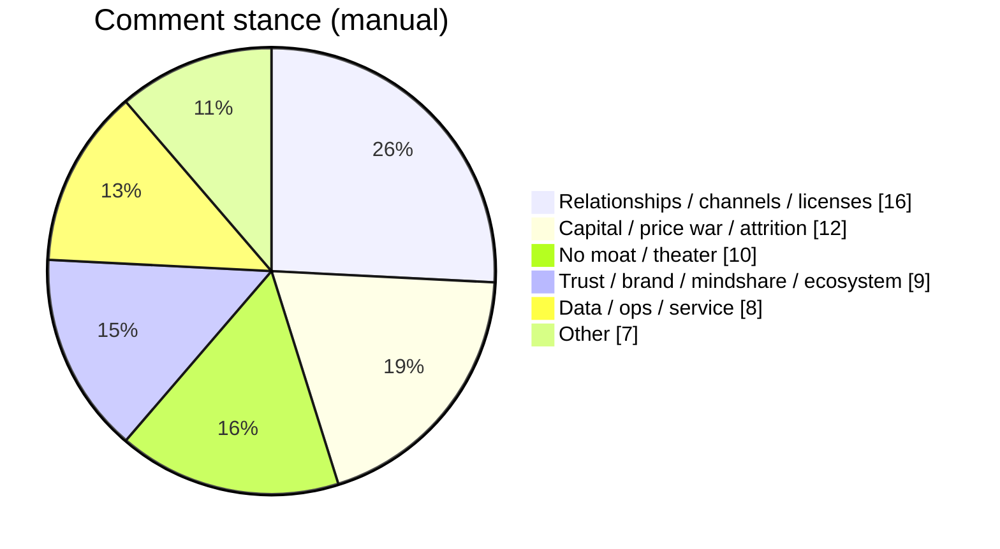

> Source: [未来公司的护城河是什么](https://www.v2ex.com/t/1256139) (V2EX, ~6210 views / 62 replies)

The OP quotes two celebrity lines: Dario — the moat is **data AI hasn’t trained on**; Tencent’s Yao Shunyu — **not the foundation model, the application layer**. Then a guess: construction, elder care, personal care, healthcare, education, dining get hit less — so what’s left for software, internet, embedded?

Across 62 comments, almost nobody defends “the model itself.”

## What the thread actually repeats

### 1. Relationships / channels / resources (loudest)

The densest one-liner:

> Past, present, future — the moat was always relationships, channels, resources. Before AI, tech counted as half a moat; now it doesn’t.

Licenses, politics-business ties, circles, local gatekeepers, compliance thresholds — bulk hardware and app-store listing as examples: play small and you’re ignored; scale up and someone makes “the top” notice you. Long-time internet folks see offline junk services still mint money and feel worldview whiplash — **product thinking doesn’t map onto relationship monetization**.

### 2. Capital = starve you out

“The moat is money.” Raise, buy users, underprice rivals, wait for death. Food delivery, ride-hailing, mega sales get named on loop. Sharper take: these narratives are **executive job insurance** — Tencent blocked so many companies and Douyin still rose.

### 3. Trust / mindshare / ecosystem

Coca-Cola; boredom opens Douyin; first reflex for contact is WeChat. Consumer side summarized as **mindshare occupation**. Ecosystems are hard to clone short-term — a time gap, not an eternal wall.

### 4. Data + service + “someone to take the fall”

Software isn’t valuable; what you guard is service, vertical exclusive data, and accountability when things break. Business know-how, product × ops, supply chain also show up. A Palantir-flavored paraphrase: let customers run open models on **their** data servers — data stays on the client side.

### Chart: rough cut of 62

## Cold water on “low-shock” industries

- “Education won’t hold.”  
- “No absolute moat — why only you?”  
- “Moat my ass… the more you obsess over guarding, the worse the company.”  
- Closing blade: if the moat pretends to be a castle, walls fall — **offense is the best defense**.

Someone offers three realistic paths: stay in the front row (hard); businesses AI barely touches but can still use AI for leverage (hard to get rich); price war (what most firms will choose).

## My take

Merge Dario, Yao, and the thread:

1. **“Untrained data” and “app layer” aren’t false — the floor says they’re incomplete.** Data has to mean vertical exclusivity and customer trust; app layer has to mean distribution, ops, and liability.  
2. **Tech drops from “half a moat” to “a ticket.”** Same ruler as the “selling software is fake” / “software is worthless” threads: what’s devalued is copyable implementation, not commerce itself.  
3. **For indie builders:** the stronger vibe coding gets, the sharper the moat question — clones don’t steal your channel, mindshare, or “who do I call when it breaks.”  
4. **Don’t buy absolute-moat theater.** Ecosystem and mindshare are time gaps; capital is a war of attrition; relationships are old-world hard currency. The steadier move is **continuous offense** (shipping cadence, distribution, trust) — not fantasizing about a river that never fills.

## Related posts

- [[selling-software-still-a-business-ai-vibe|Is selling software a fake problem now?]]
- [[software-not-valuable-ai-era|Is software worthless in the AI era?]]
- [[indie-product-promotion-hard-truths|Why indie product promotion is hard]]
- [[bot-trap-invisible-link|Invisible links that catch bots]]
