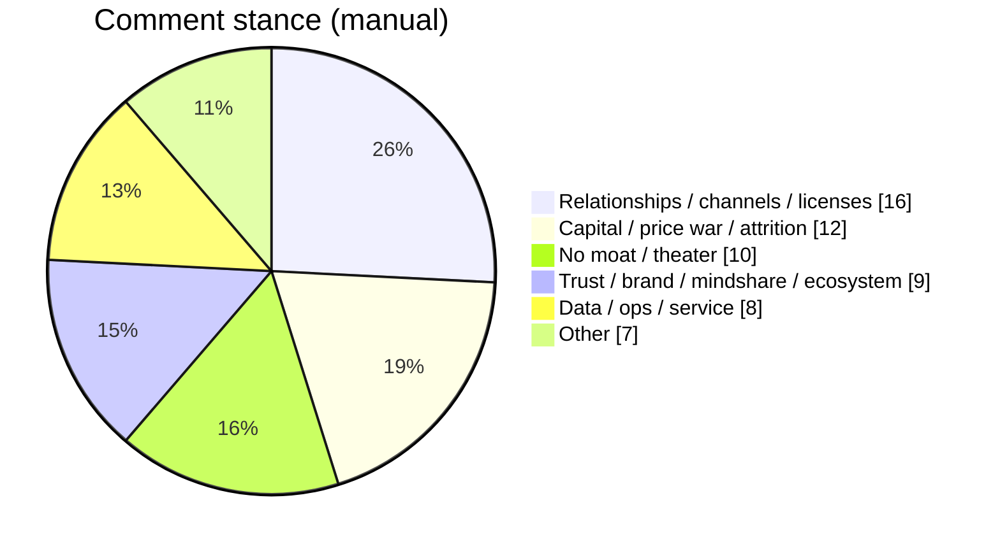

> Source: [未来公司的护城河是什么](https://www.v2ex.com/t/1256139) (V2EX, ~6210 views / 62 replies)

The OP quotes two celebrity lines: Dario — the moat is **data AI hasn’t trained on**; Tencent’s Yao Shunyu — **not the foundation model, the application layer**. Then a guess: construction, elder care, personal care, healthcare, education, dining get hit less — so what’s left for software, internet, embedded?

Across 62 comments, almost nobody defends “the model itself.”

## What the thread actually repeats

### 1. Relationships / channels / resources (loudest)

The densest one-liner:

> Past, present, future — the moat was always relationships, channels, resources. Before AI, tech counted as half a moat; now it doesn’t.

Licenses, politics-business ties, circles, local gatekeepers, compliance thresholds — bulk hardware and app-store listing as examples: play small and you’re ignored; scale up and someone makes “the top” notice you. Long-time internet folks see offline junk services still mint money and feel worldview whiplash — **product thinking doesn’t map onto relationship monetization**.

### 2. Capital = starve you out

“The moat is money.” Raise, buy users, underprice rivals, wait for death. Food delivery, ride-hailing, mega sales get named on loop. Sharper take: these narratives are **executive job insurance** — Tencent blocked so many companies and Douyin still rose.

### 3. Trust / mindshare / ecosystem

Coca-Cola; boredom opens Douyin; first reflex for contact is WeChat. Consumer side summarized as **mindshare occupation**. Ecosystems are hard to clone short-term — a time gap, not an eternal wall.

### 4. Data + service + “someone to take the fall”

Software isn’t valuable; what you guard is service, vertical exclusive data, and accountability when things break. Business know-how, product × ops, supply chain also show up. A Palantir-flavored paraphrase: let customers run open models on **their** data servers — data stays on the client side.

### Chart: rough cut of 62

| Camp | What the floor said | Indie takeaway |
|---|---|---|
| Relationships / channels / licenses | Always was relationships; tech was half a moat at best | Clones don’t steal distribution or local turf |
| Capital / attrition | Moat = money; price war until rivals die | Don’t confuse fundraising theater with product moat |
| No moat / theater | Obsessing over walls makes worse companies; offense is defense | Don’t buy “absolute castle” |
| Trust / mindshare / ecosystem | Coke, Douyin, WeChat-as-default | Time gap, not forever |
| Data / service / liability | Vertical exclusive data + someone to call when it breaks | Data must land as trust and responsibility |

## Cold water on “low-shock” industries

- “Education won’t hold.”  
- “No absolute moat — why only you?”  
- “Moat my ass… the more you obsess over guarding, the worse the company.”  
- Closing blade: if the moat pretends to be a castle, walls fall — **offense is the best defense**.

Someone offers three realistic paths: stay in the front row (hard); businesses AI barely touches but can still use AI for leverage (hard to get rich); price war (what most firms will choose).

## My take

Merge Dario, Yao, and the thread:

| Misread | Steadier read |
|---|---|
| “Untrained data / app layer” = enough | Floor says incomplete: exclusivity, distribution, liability |
| Tech is still half a moat | More like a **ticket**; what’s devalued is copyable implementation |
| Stronger vibe = automatic moat | Channel, mindshare, “who do I call” don’t clone |
| Absolute-moat theater | Ecosystem is a time gap; capital is attrition; steadier = continuous offense |

## Related posts

- [[selling-software-still-a-business-ai-vibe|Is selling software a fake problem now?]]
- [[software-not-valuable-ai-era|Is software worthless in the AI era?]]
- [[indie-product-promotion-hard-truths|Why indie product promotion is hard]]
- [[bot-trap-invisible-link|Invisible links that catch bots]]
