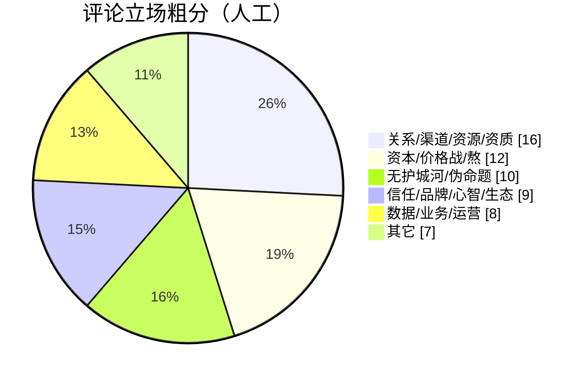

> 讨论来源：[未来公司的护城河是什么](https://www.v2ex.com/t/1256139)（V2EX，约 6210 浏览 / 62 回复）

楼主抛出两句「名人口径」：Dario 说护城河是**还没被 AI 吃进去的数据**；腾讯姚顺雨说**不在大模型，在应用层**。又猜建筑、养老、个护、医疗、教育、餐饮冲击较小——那软件、互联网、嵌入式还剩什么可护？

62 楼里，几乎没人帮「模型本身」说话。

## 楼里真正高频的答案

### 1. 关系 / 渠道 / 资源（最响）

最高密度的一句话几乎是：

> 过去、现在、未来的护城河一直都是关系、渠道、资源。AI 崛起以前，技术算半个；现在不存在了。

资质、官商、圈子、地头蛇、合规门槛——批量硬件与 App 上架被拿来当例子：小打小闹不管你，一大就有人让「上层专注到你」。做久了互联网的人，突然看见线下垃圾服务照样赚钱，三观被冲击——**产品思维对不上关系变现**。

### 2. 资本 = 熬死你

「护城河就是钱。」拉投资、买用户、低价干对手，等对手死。外卖、网约车、大促被反复点名。有人说得更刺：这些说法是**高管保位借口**——腾讯防了这么多公司，不还是让抖音起来了？

### 3. 信任 / 心智 / 生态

可口可乐；无聊就刷抖音；加联系人第一反应是微信。toC 被概括成**心智占领**。生态难短期复制，给你一段时间差——但不是永续绝对城墙。

### 4. 数据 + 服务 +「背锅」

软件不值钱；护的是服务、垂直独家数据、出了事有人扛。业务 know-how、产品力 × 运营、供应链也被提到。PLTR 老板口径被转述成：让客户用开源模型搭自己的数据服务器——**数据在客户侧**。

### 图：62 条粗分

## 楼主那几个「冲击小」的行业，被泼了冷水

- 「教育守不住吧。」  
- 「没有绝对的护城河，凭什么就你会别人不会？」  
- 「护个鸡毛……越刻意去搞，公司越垃圾。」  
- 收束句很锋利：护城河若假装自己是城堡，城墙总会塌——**进攻才是最好的防守**。

也有人给三条现实路径：一直站前排（难）；跟 AI 没关系但用 AI 提效（挣钱难）；打价格（多数公司会卷这个）。

## 我怎么看

把 Dario / 姚顺雨 / 楼里三方合读：

1. **「未训练数据」和「应用层」都不假，但楼里认为不够。** 数据要落到垂直独占与客户信任；应用层要落到分发、运营与责任。  
2. **技术从「半个护城河」降到「门票」。** 和「卖软件伪命题」「软件不值钱」那几帖是同一把尺子：贬的是可复制的实现，不是整条商业。  
3. **对独立开发者：** vibe 越强，护城河问题越尖锐——仓库克隆不了你的渠道、心智和「出了事找谁」。  
4. **别买「绝对护城河」叙事。** 生态与心智是时间差；资本是消耗战；关系是旧世界的硬通货。更稳的动作是**持续进攻**（产品节奏、分发、信任积累），而不是幻想挖一条永远灌不满的河。

## 相关文章

- [[selling-software-still-a-business-ai-vibe|卖软件成伪命题了？]]
- [[software-not-valuable-ai-era|AI 时代软件不值钱了吗]]
- [[indie-product-promotion-hard-truths|独立产品推广难在哪]]
- [[bot-trap-invisible-link|隐链捕 Bot]]
