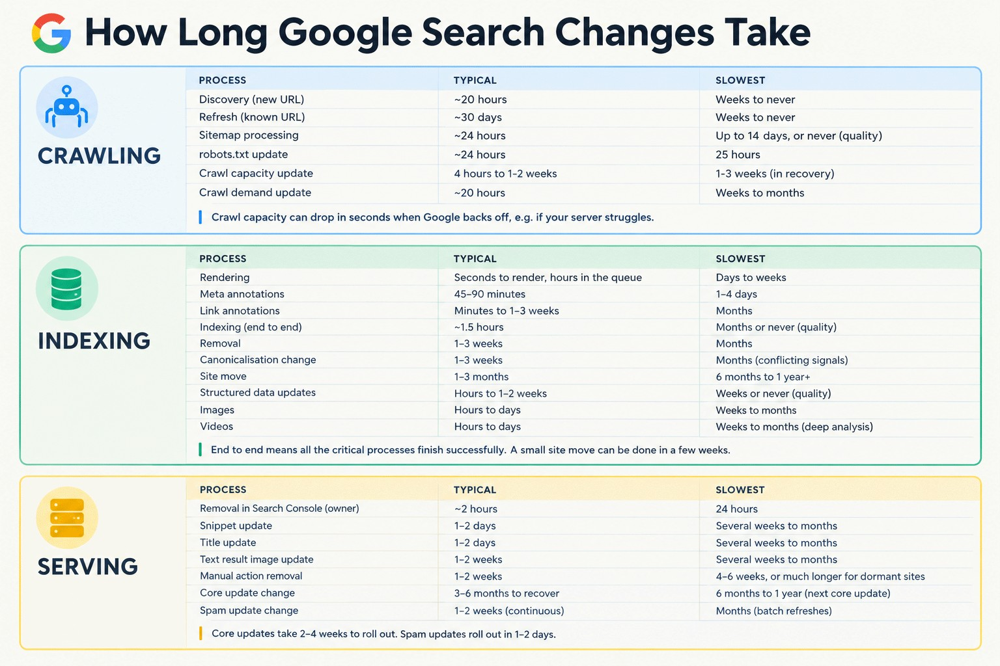
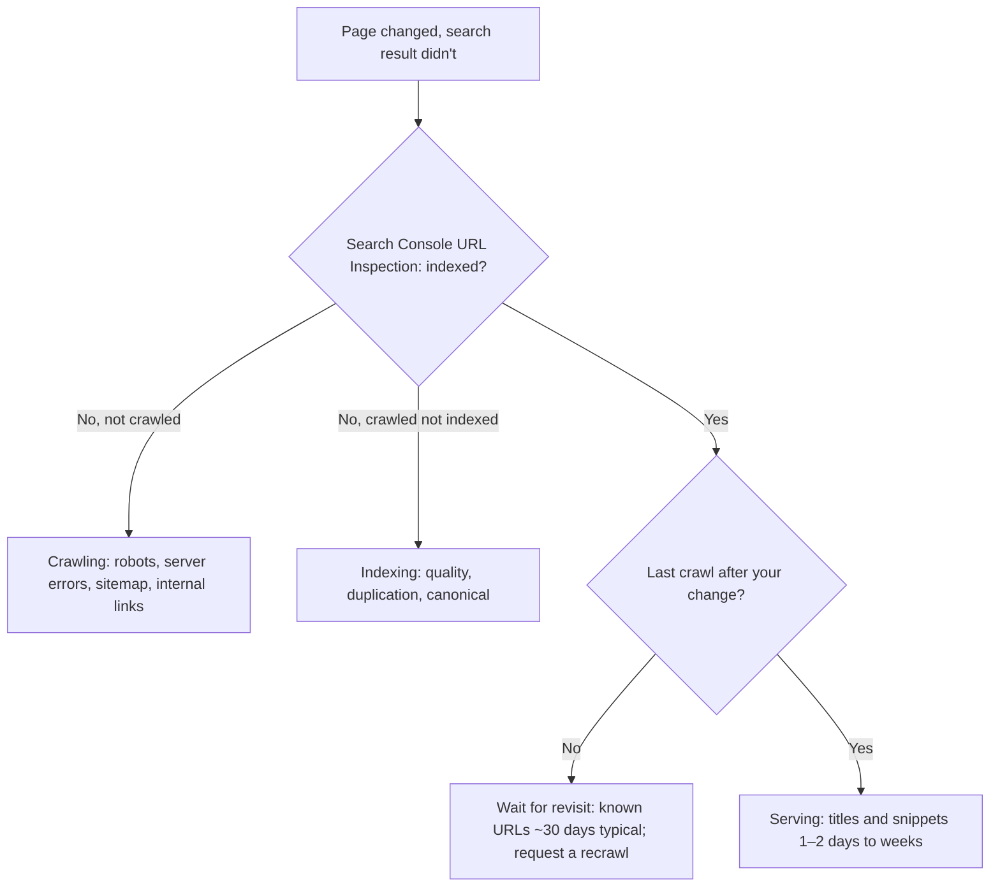

“I changed the title yesterday—why hasn’t Google updated?” Usually Google is not broken. You are mixing **three clocks**, and ignoring that they **stack**.

[Barry Schwartz on Search Engine Roundtable](https://www.seroundtable.com/google-crawling-indexing-serving-data-42225.html) (2026-10-05) covered Gary Illyes’ internal timelines from Europe’s **Google Search Central Live Deep Dive**: Typical vs Slowest per process (a fastest column was mentioned on stage; public write-ups center these two). John Campbell (We Are Roast) called it the highlight of the day; Neil McCarthy shared as well.

Gary later told Barry the key caveat: **this was an exercise to see if the audience could relate to numbers pulled internally into the slides**—not a public SLA.

## 1. Two caveats before the tables

| Caveat | Meaning | Practical takeaway |
|---|---|---|
| Linked processes | No crawl → no index; upstream delay stacks | “~1.5h end to end” ≠ “homepage in 1.5h after Inspect” |
| Not an SLA | Internal analysis + room calibration | Typical is magnitude; Slowest often quality / conflict veto |

Pick the layer first:

| Layer | Symptom | Check first |
|---|---|---|
| Crawling | Long “Discovered – not indexed” / crawl cliffs | robots, capacity, server errors, sitemap |
| Indexing | Crawled but not indexed, or canonical thrash | quality, duplicates, rendering, structured data |
| Serving | Indexed, but title / snippet / image stale | snippet cache, manual actions, core / spam updates |

## 2. Crawling: discovery can be fast; revisits are often slow

| Process | Typical | Slowest |
|---|---|---|
| Discovery (new URL) | ~20 hours | Weeks to never |
| Refresh (known URL) | ~30 days | Weeks to never |
| Sitemap processing | ~24 hours | Up to 14 days, or never (quality) |
| robots.txt update | ~24 hours | 25 hours |
| Crawl capacity update | 4 hours to 1–2 weeks | 1–3 weeks (in recovery) |
| Crawl demand update | ~20 hours | Weeks to months |

Notes:

1. **~20 hours for a new URL** is discovery—not ranking.  
2. When the server struggles, **crawl capacity can drop in seconds**; recovery follows the capacity-update row.

Known-URL refresh at ~**30 days** Typical explains most “I edited the copy” tickets.

## 3. Indexing: end-to-end can be fast; conflicts stretch into months

| Process | Typical | Slowest |
|---|---|---|
| Rendering | Seconds to render, hours in the queue | Days to weeks |
| Meta annotations | 45–90 minutes | 1–4 days |
| Link annotations | Minutes to 1–3 weeks | Months |
| Indexing (end to end) | ~1.5 hours | Months or never (quality) |
| Removal | 1–3 weeks | Months |
| Canonicalisation change | 1–3 weeks | Months (conflicting signals) |
| Site move | 1–3 months | 6 months to 1 year+ |
| Structured data updates | Hours to 1–2 weeks | Weeks or never (quality) |
| Images | Hours to days | Weeks to months |
| Videos | Hours to days | Weeks to months (deep analysis) |

- **~1.5 hours end to end** assumes critical paths complete.  
- **Canonical / Removal** live in weeks; conflicts push into months.  
- **Site move** Typical 1–3 months; a *small* move can settle in weeks.  
- Images / Videos run separate clocks.

## 4. Serving: owner removals are fast; core updates are slow

| Process | Typical | Slowest |
|---|---|---|
| Removal in Search Console (owner) | ~2 hours | 24 hours |
| Snippet update | 1–2 days | Several weeks to months |
| Title update | 1–2 days | Several weeks to months |
| Text result image update | 1–2 weeks | Several weeks to months |
| Manual action removal | 1–2 weeks | 4–6 weeks, or much longer (dormant sites) |
| Core update change | 3–6 months to recover | 6 months to 1 year (next core update) |
| Spam update change | 1–2 weeks (continuous) | Months (batch refreshes) |

- A **core update** rolls out over ~**2–4 weeks**; the recovery *feeling* often takes **3–6 months**.  
- A **spam update** rolls in ~**1–2 days**.  
- SC owner removal (~2h) ≠ “new snippet after title edit” (days to months).

## 5. Misread vs better read

| Misread | Better read |
|---|---|
| ~1.5h end to end → ranks tomorrow | Still stack discovery / refresh, quality, serving cache |
| Stale SERP after edit = Google broken | Known-URL refresh ~30d; serving has its own clock |
| Site move in one weekend | Months typical; conflicts can run a year+ |
| Core-update bounce next week | Recovery often quarterly; slow path = next core |
| Sitemap submit guarantees inclusion | Slowest includes `never (quality)` |

**Quality vetoes** show up on sitemap, indexing, and structured-data Slowest rows: waiting has no compound interest—fix crawlability, uniqueness, and content signals.

## 6. Triage for "why hasn't it updated yet?"

Most tickets land in the two bottom-right boxes: the page was indexed long ago and Google either has not fetched the new version yet, or fetched it and the serving layer has not caught up. Neither is a failure. Find the box first, then decide whether to wait or dig.

"Request indexing" only nudges the crawl step. It does nothing for the quality judgment or serving caches after it, so don't expect it to speed up every clock at once.

## 7. Set review times by change type

The tables above, translated into "when to look again, and when to worry":

| Change | First check | Escalate after |
|---|---|---|
| New post | ~1 day, to see if it was discovered | Two weeks undiscovered: check sitemap and internal links |
| Title / description edit | 2–3 days | Weeks unchanged: check whether Google rewrote it, or the page wasn't recrawled |
| Canonical change / page merge | 1–3 weeks | Months of flip-flopping: look for conflicting signals |
| Site move | 1–3 months | Unstable after six months: audit redirects and old-URL signals one by one |
| Traffic drop after a core update | 3–6 months for recovery | Wait for the next core update; change content, not tech |

The value of this table is **managing expectations**. Put the review date in the ticket and most "is Google broken?" follow-ups never happen.

## Related posts

- [[geo-vs-seo-same-or-separate|GEO vs SEO]]
- [[chatgpt-cite-bing-pageone-overlap|Only ~25% of ChatGPT citations sit on Bing page one]]
- [[bot-trap-invisible-link|Invisible link traps: crawlers and humans see different pages]]
