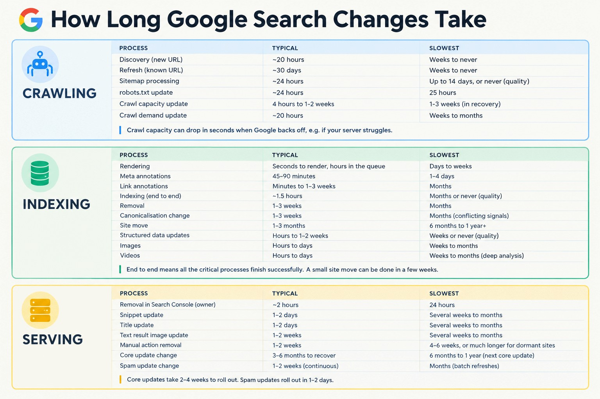

「改完标题第二天怎么还不更新？」这类工单，多半不是 Google「坏了」，而是把**三条不同时钟**当成了一条——而且忽略了它们会**串联叠加**。

[Barry Schwartz 在 Search Engine Roundtable](https://www.seroundtable.com/google-crawling-indexing-serving-data-42225.html)（2026-10-05）整理了欧洲 **Google Search Central Live Deep Dive** 上 Gary Illyes 放出的内部对照：每个进程有 Typical / Slowest（现场还提过 fastest；公开报道以这两列为主）。John Campbell（We Are Roast）称这是当日亮点；Neil McCarthy 亦有转发。

Gary 事后对 Barry 补了一句关键 caveat：**这是一次 exercise——看观众能否 relate 到内部抽进幻灯片的数字**，不是对外承诺的服务等级。

## 1. 先吃进两条 caveat，再看表

| Caveat | 含义 | 对你意味着什么 |
|---|---|---|
| 进程挂钩 | 未 crawl 就不能 index；上游延迟堆到下游 | 「端到端 ~1.5h」不等于「提交后 1.5h 上首页」 |
| 非 SLA | 内部分析 + 场子体感校准 | Typical 是量级，Slowest 常含质量/冲突否决 |

排障时先定层，再选行：

| 层 | 现象 | 优先查 |
|---|---|---|
| Crawling | 长期「已发现-尚未编入索引」/ 抓取掉崖 | robots、容量、服务器错误、sitemap |
| Indexing | 抓到了但不收录，或 canonical 乱跳 | 质量、重复、渲染、结构化数据 |
| Serving | 已收录但标题/摘要/配图仍旧 | 摘要缓存、手动操作、核心/垃圾更新 |

## 2. Crawling：发现可以快，回访往往慢

| Process | Typical | Slowest |
|---|---|---|
| Discovery (new URL) | ~20 hours | Weeks to never |
| Refresh (known URL) | ~30 days | Weeks to never |
| Sitemap processing | ~24 hours | Up to 14 days, or never (quality) |
| robots.txt update | ~24 hours | 25 hours |
| Crawl capacity update | 4 hours to 1–2 weeks | 1–3 weeks (in recovery) |
| Crawl demand update | ~20 hours | Weeks to months |

两点实操：

1. **新 URL ~20 小时**是发现时钟，不是排名时钟。  
2. 服务器一抖，**crawl capacity 可在数秒内被主动降下来**；恢复走「容量更新」那一行（小时到数周）。

已知 URL 刷新 Typical ~**30 天**——解释了大量「文案改了 SERP 不变」的误判。

## 3. Indexing：端到端可以很快，冲突会拖成月

| Process | Typical | Slowest |
|---|---|---|
| Rendering | Seconds to render, hours in queue | Days to weeks |
| Meta annotations | 45–90 minutes | 1–4 days |
| Link annotations | Minutes to 1–3 weeks | Months |
| Indexing (end to end) | ~1.5 hours | Months or never (quality) |
| Removal | 1–3 weeks | Months |
| Canonicalisation change | 1–3 weeks | Months (conflicting signals) |
| Site move | 1–3 months | 6 months to 1 year+ |
| Structured data updates | Hours to 1–2 weeks | Weeks or never (quality) |
| Images | Hours to days | Weeks to months |
| Videos | Hours to days | Weeks to months (deep analysis) |

读法：

- **~1.5 hours end to end**：关键路径都跑通时的量级。  
- **Canonical / Removal** 以周计；信号打架进月。  
- **Site move** Typical 1–3 个月；小站有时几周能稳住——规模与冲突决定档位。  
- 图/视频另开时钟；视频深分析更慢。

## 4. Serving：站长移除很快，核心更新很慢

| Process | Typical | Slowest |
|---|---|---|
| Removal in Search Console (owner) | ~2 hours | 24 hours |
| Snippet update | 1–2 days | Several weeks to months |
| Title update | 1–2 days | Several weeks to months |
| Text result image update | 1–2 weeks | Several weeks to months |
| Manual action removal | 1–2 weeks | 4–6 weeks, or much longer (dormant sites) |
| Core update change | 3–6 months to recover | 6 months to 1 year (next core update) |
| Spam update change | 1–2 weeks (continuous) | Months (batch refreshes) |

补充：

- **Core update** 本身滚动约 **2–4 周**；「恢复感」常要 **3–6 个月**。  
- **Spam update** 滚动约 **1–2 天**；连续扫描下 Typical 1–2 周有感。  
- SC 站长移除（~2h）与「改标题后摘要变了」（天到月）不是一类请求。

## 5. 误读对照表

| 误读 | 更稳的读法 |
|---|---|
| 端到端 ~1.5h → 明天就有排名 | 还要叠发现/回爬、质量、呈现缓存 |
| 改了文案还不更新 = Google 坏了 | 已知页刷新 ~30d；呈现层另有时钟 |
| 搬家一个周末迁完 | Site move 月级起；冲突可到一年+ |
| 核心更新下周必反弹 | 恢复感常按季度；慢则等下次核心更新 |
| sitemap 提交了就一定进 | Slowest 含 `never (quality)` |

**质量否决**反复出现在 sitemap、索引、结构化数据的 Slowest：时间没有复利，要改的是可抓性、唯一性和内容信号。

## 相关文章

- [[google-search-changes-timeline|Google 搜索变更要等多久：一张表说清]]
- [[geo-vs-seo-same-or-separate|GEO 和 SEO 是一回事吗？]]
- [[chatgpt-cite-bing-pageone-overlap|ChatGPT 引用里只有约 25% 在 Bing 首页]]
