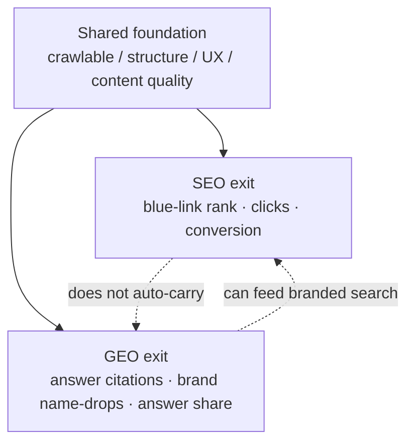
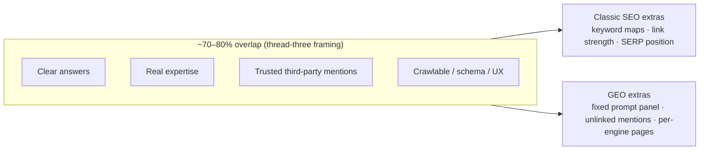
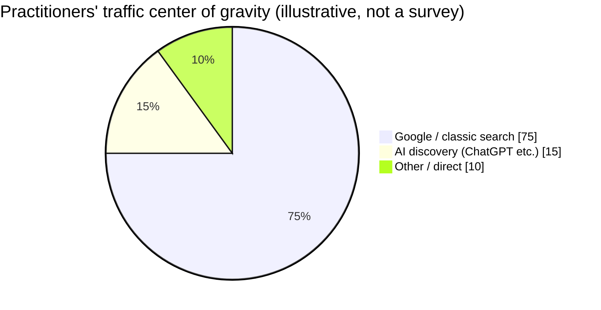
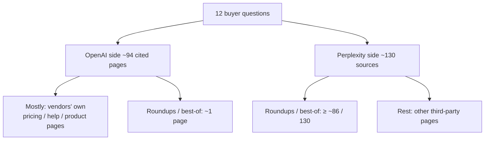
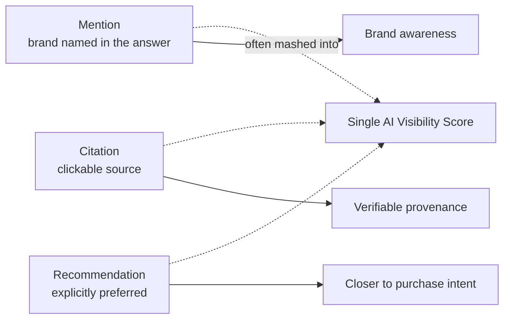
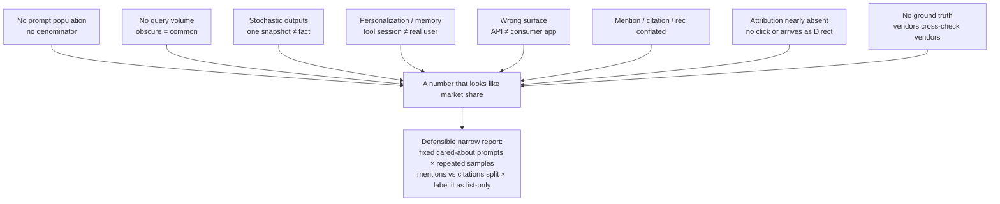
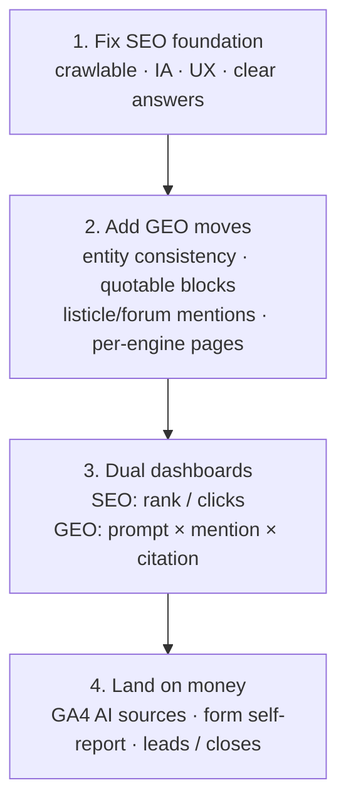

> Sources:
> - [Not sure if GEO actually separate from SEO?](https://www.reddit.com/r/seogrowth/comments/1xsuplz/not_sure_if_geo_actually_separate_from_seo/) (r/seogrowth, ~4 upvotes / 17 comments)
> - [What's actually working for you in SEO right now?](https://www.reddit.com/r/SEO_LLM/comments/1xsinnw/whats_actually_working_for_you_in_seo_right_now/) (r/SEO_LLM, ~13 upvotes / 10 comments)
> - [Is GEO actually a new discipline, or just good SEO with a new name?](https://www.reddit.com/r/aeo/comments/1xrbs5h/is_geo_actually_a_new_discipline_or_just_good_seo/) (r/aeo, ~9 upvotes / 32 comments)

Someone posted in an SEO growth sub: they’re not sure whether **GEO (Generative Engine Optimization)** is actually a discipline separate from SEO.

Small thread. Clear fight. One side: GEO is traditional SEO done properly. The other: the technical base overlaps, but what you win has changed — from “where do I rank?” to “do I get written into the answer?”

Two neighbors joined: r/SEO_LLM asks what’s actually working; r/aeo asks almost the same question, then digs into **how you sell it, how you measure it, and which pages each engine eats**. Read all three and the theory, field notes, and measurement traps line up.

### Chart 1: one supply chain, two exits

## Two camps (thread one)

### Camp A: GEO ≈ SEO done right (loudest)

The top lines are almost the same sentence:

- “GEO is mostly just traditional SEO done properly.”
- “GEO is Organic SEO, period.”
- “Half the GEO strategies are just SEO basics with a new label.”
- “People love inventing new acronyms just to sell the same old fundamentals.”

The longer version: every time SEO “dies,” someone was gaming the algorithm without a foundation; Google takes out the trash; panic follows; agencies invent AEO / GEO / AIO to sell fear.

A sharper technical take: GEO is mostly a **rebrand of semantic SEO + digital PR**. Clean entity structure, solid schema, brand mentions on authoritative third-party sites — you’re already doing “GEO.”

### Camp B: same base, different outcome (worth keeping)

This side doesn’t say SEO is useless. It says **intentional choices diverge**:

1. **Different prize:** SEO earns a ranked position; GEO earns a citation inside a written answer.  
2. **Different metrics:** Rank and clicks won’t tell you if ChatGPT / Perplexity / AI Overviews named you.  
3. **Off-site weights shifted:** One shop reported doing only technical fixes, structure, and clean content — AI visibility for a B2B client went from 0 to ~18, and they became the 2nd most mentioned brand on tracked prompts. What felt *new* was consistent brand info on directories and listing sites.  
4. **Overlap, not identity:** One comment claimed ~**80%** of sources AI assistants cite are *not* in Google’s top 10 for the same prompt. Another anecdote: ChatGPT recommended a law firm; Googling “truck accident lawyer Denver” put that firm near the bottom of page five.

Their one-liner: **LLMs aren’t search engines.** They lean on search in part, but the weighting recipe differs.

### Chart 2: big overlap ≠ the same job

## My take: stop arguing “new discipline”; argue which funnel you optimize

Merge the camps and the fake question is “Is GEO separate from SEO?” The real one is:

| | Classic SEO | GEO / AI visibility |
|---|---|---|
| Goal | Blue-link rank, clicks | Being written into generated answers |
| Success signal | Position, traffic, conversion | Citation rate, brand mention, answer share |
| Shared base | Crawlability, structure, UX, content quality | Same |
| Extra levers | Internal links, backlinks, keyword maps | Quotable passages, entity consistency, authoritative third-party mentions, platform split |

That matches a direction I’ve kept in notes before: search is drifting from ten blue links toward one answer; what GEO prioritizes is content that can be **understood, extracted, and cited** — not a religion that voids SEO.

Public research rhymes with the thread’s intuition: brand mentions often correlate more strongly with AI visibility than raw backlinks; domain overlap across AI platforms is low — so “top 3 on Google” does not automatically mean “ChatGPT names you.”

So:

- “GEO is pure scam” — too hot. The measurement object really changed.  
- “GEO is a brand-new field; old SEO is dead” — also too hot. Without the foundation, answer engines still can’t see you.  
- Steadier line: **GEO is SEO retargeted for answer engines, plus extra weight on entities, off-site consistency, and citability** — neither magic rebrand nor parallel universe.

## Thread two: what’s actually working

The r/SEO_LLM post skips “is GEO a new field?” and asks “what are you living on?” The consensus is blunt and useful:

1. **Google is still the main traffic driver.** Several practitioners said almost the same thing: Google remains the biggest source; ChatGPT and other AI tools show up, but as a smaller slice — more **discovery channel** than replacement.  
2. **Most strategy didn’t flip:** backlinks, search intent, topical authority, useful content, clear site structure still matter. One person said the clearest add-on is **using schema more**, plus planning **article series** instead of one-off weekly posts — builds depth and removes topic panic.  
3. **What changed is how content is structured:** fewer generic keyword piles; more **direct answers to specific questions**, original insight, topical clusters. One commenter credited that style with ChatGPT mentions.  
4. **Off-site is more than backlinks:** brand mentions on relevant third-party sites, communities, and niche listicles keep coming up; local shops still lean on Google Business Profile + local SEO — a ChatGPT-sourced lead is nice, but advisors care more about calls and customers than mention vanity metrics.  
5. **Measure down to leads:** a practical GA4 path — Traffic acquisition → Session source → search `chatgpt` / `perplexity` / `copilot` / `gemini`, then inspect landing pages (often how-to and comparison). Add a “how did you hear about us?” field — people often discover you in an AI answer, then return days later via Google or typed URL, and GA4 never joins the two.

### Chart 3: traffic weight (field sketch from the thread)

One line: thread two answers thread one’s fake question with field data — **not “abandon SEO”; “the SEO foundation still feeds you, and the AI exit needs its own writing, tracking, and proof.”**

## Thread three (r/aeo): don’t spin a new service until you admit how dirty the numbers are

r/aeo asks almost the same question, but comments sound like client diligence: **new discipline? how do you sell it? how do you measure it?**

The majority answer is isomorphic:

- **Extension, not revolution** — many put overlap at ~70–80%; keep GEO under SEO strategy with **its own report line and experiments**, don’t rush a separate retainer.  
- **Three real differences:** ① you can appear in an answer with **zero visit**; ② **unlinked brand mentions** (forums, reviews, roundups) weigh more; ③ **engines cite different page types**, so a win on one doesn’t auto-carry.  
- **Selling:** only break it out when the work actually changes — chasing review/forum mentions, not relabeling old content. Verticals can diverge hard (healthcare compliance was named); horizontal industries look more like SEO.

### Chart 4: same buyer questions, different pages per engine

One commenter ran 12 buyer questions as a snapshot (OpenAI via API, not the ChatGPT app — treat as illustrative):

Same comment draws a sharper split: **mention ≠ citation**. With search on, the model named 54 brands and cited the brand’s site for 47; with search off it named 59 and cited **none** — memory can say a name without giving a source. Dashboards that blend both into one “AI visibility score” lie.

### Chart 5: three events, don’t mash into one score

### Chart 6: why the metrics are dirty — eight estimand problems

One commenter listed eight reasons most “AI visibility / share of voice” numbers **describe your invented prompt list, not the market**:

The skeptics finish; the pragmatists agree: don’t call it market share. Promise only — **the questions the client actually cares about, run several times, log mention vs citation separately, watch competitors appear and pages start getting cited**. Revenue tie-back is the weakest link; GA4 source dimensions plus a “how did you hear about us?” field still patch the hole.

## A practical split (for people drowning in acronyms)

### Chart 7: a workflow you can run this week

1. **Fix the SEO foundation first:** crawlable, clear IA, page experience, content that states answers. The B2B case in thread one moved AI visibility mostly with that; thread two confirms Google is still the main engine.  
2. **Add GEO-specific moves:** entity consistency across site / directories / wiki-like pages, short extractable answer blocks, authoritative third-party mentions and listicle presence, platform-by-platform citation checks (AI Overviews ≠ ChatGPT ≠ Perplexity); prefer topical series over scattershot keyword posts; respect engine skew (OpenAI leaning on first-party product pages, Perplexity leaning on listicles).  
3. **Split dashboards, land on money:** keep rank/click for SEO; GEO uses “fixed cared-about prompts × repeated samples × mention/citation split” — and say aloud that it only describes that list; verify AI landings in GA4 by source; patch attribution with a form self-report; watch leads and closes, not mention dashboards alone.  
4. **Ignore acronym racketeering:** “Learn GEO or die / old SEO is worthless” usually sells fear. “Change nothing” ignores the citation funnel. Thread three adds: don’t carve the same work into a “GEO service” for another retainer — unless the deliverable actually changed.

The first OP asked whether GEO and SEO are separate. The best answer in that thread is the compromise said clearly:

> The technical base is shared — crawlability, structured data, experience still matter. The outcome is different — a good ranking does not carry over on its own.

Thread two adds the street version:

> Google still feeds you; AI is already a discovery door — write more like answers, earn off-site mentions, and prove it with leads, not a new religion.

Thread three adds the cold version:

> Most “AI visibility” isn’t market share; at best it’s a sampled log of the prompts you care about — and mentions still aren’t citations.

Not a new religion. Same content supply chain — **with one more exit that has to be measured on its own (and the measurement is dirty).**

## Related posts

- [[ai-era-clarity-matters|The scarcest skill in the AI era: saying things clearly]]
- [[indie-product-promotion-hard-truths|Why indie product promotion is hard]]
- [[when-average-people-feel-ai|When will average people actually feel AI]]
- [[selling-software-still-a-business-ai-vibe|Is selling software a fake problem now?]]
