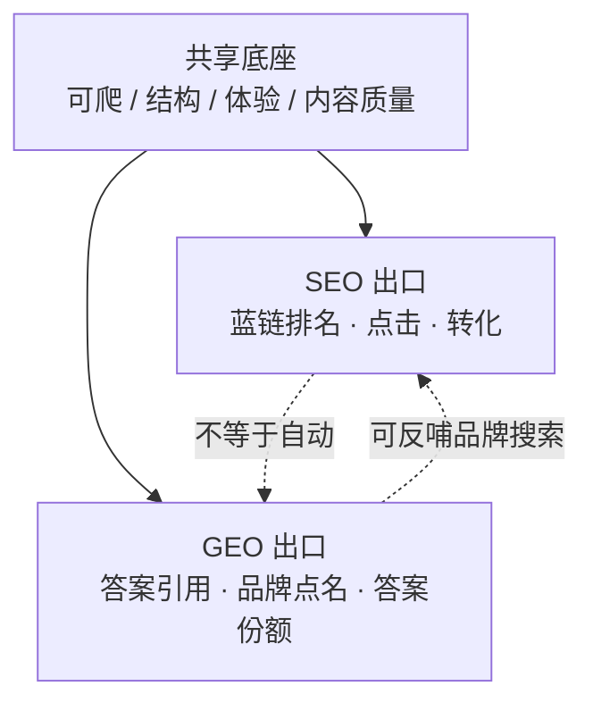
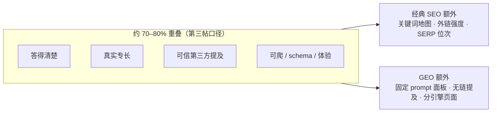
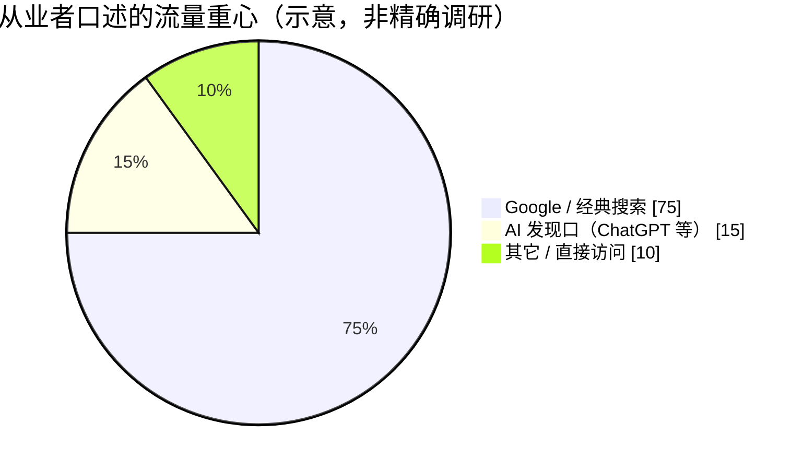
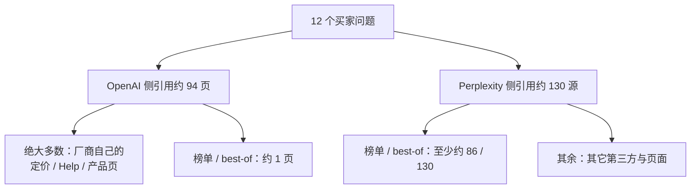
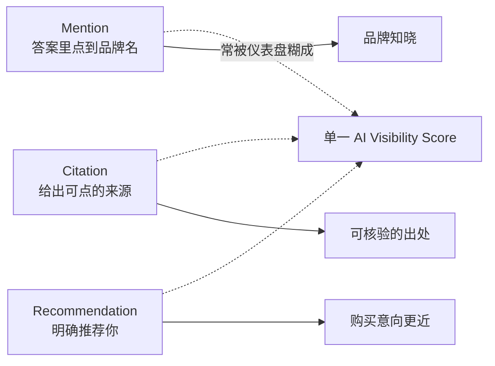
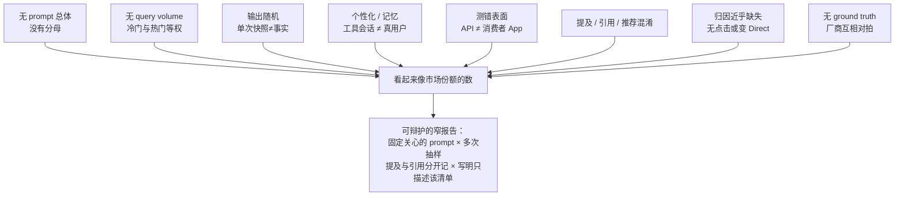
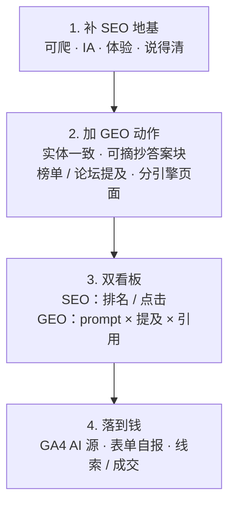

> 讨论来源：
> - [Not sure if GEO actually separate from SEO?](https://www.reddit.com/r/seogrowth/comments/1xsuplz/not_sure_if_geo_actually_separate_from_seo/)（r/seogrowth，约 4↑ / 17 评）
> - [What's actually working for you in SEO right now?](https://www.reddit.com/r/SEO_LLM/comments/1xsinnw/whats_actually_working_for_you_in_seo_right_now/)（r/SEO_LLM，约 13↑ / 10 评）
> - [Is GEO actually a new discipline, or just good SEO with a new name?](https://www.reddit.com/r/aeo/comments/1xrbs5h/is_geo_actually_a_new_discipline_or_just_good_seo/)（r/aeo，约 9↑ / 32 评）

有人在 SEO 增长版发帖：自己不太确定，**GEO（Generative Engine Optimization）到底是不是独立于 SEO 的新学科**。

帖子不大，但楼里吵得很清楚。一边说：GEO 就是把传统 SEO 做对了。另一边说：技术底座重叠，但你要赢的东西已经变了——从「排到第几」变成「会不会被写进答案里」。

隔壁又接了两帖：r/SEO_LLM 问「现在什么真的管用」；r/aeo 几乎同题，但把**怎么卖、怎么量、不同引擎吃什么页面**吵得更细。三帖合读，理论、现场、计量陷阱都能对上。

### 图 1：一条供应链，两个出口

## 楼里两派（第一帖）

### 派 A：GEO ≈ 做好的 SEO（人数多、语气狠）

最高频原话几乎同义反复：

- 「GEO is mostly just traditional SEO done properly.」
- 「GEO is Organic SEO, period.」
- 「Half the GEO strategies are just SEO basics with a new label.」
- 「people love inventing new acronyms just to sell the same old fundamentals.」

有人补机制：每次 SEO「死了」，都是有人只调算法、不打地基；Google 清垃圾，留下恐慌，咨询公司再发明新缩写卖课。AEO / GEO / AIO 被当成同一拨恐吓营销。

也有更技术的版本：GEO 多半是 **语义 SEO + 数字 PR 换皮**——实体结构干净、schema 扎实、权威站有品牌提及，你其实已经在做「GEO」。

### 派 B：底座一样，结果不一样（更值得记）

反对派不是说「SEO 无用」，而是说 **故意做的取舍已经不同**：

1. **结果不同**：SEO 赚排名位次；GEO 赚答案里的引用（citation）。  
2. **计量不同**：排名和点击看不出你有没有被 ChatGPT / Perplexity / AI Overview 点名。  
3. **站外权重变了**：有人实测——只做技术修复 + 结构 + 干净内容，客户 AI 可见度从 0 到约 18，追踪 prompt 里品牌提及升到第 2；他们强调真正不一样的是 **目录站 / listing 上的品牌信息一致性**。  
4. **相关但不完全重合**：有人抛出经验——约 **80%** 被 AI 助手引用的来源，并不在 Google 同 query 的前 10；另有案例：ChatGPT 推荐一家律所，Google「truck accident lawyer Denver」把同一家排在第五页靠后。

一句话概括这派：**LLMs aren't search engines.** 它们会部分依赖搜索，但权重配方不同。

### 图 2：重叠很大，但不等于同一件事

## 我怎么看：别争「是不是新学科」，争「你优化的是哪条漏斗」

把两派合读，伪问题是「GEO 是否独立于 SEO」。真问题是：

| | 传统 SEO | GEO / AI 可见度 |
|---|---|---|
| 目标 | 蓝链排名、点击 | 被写进生成答案、被点名 |
| 成功信号 | 位次、流量、转化 | 引用率、品牌提及、答案份额 |
| 共享底座 | 可爬、结构化、体验、内容质量 | 同左 |
| 额外杠杆 | 内链、外链、关键词地图 | 可摘抄段落、实体一致、权威第三方提及、平台差异 |

这和我一直用的口径一致：搜索入口正从「十个蓝链」迁向「一段答案」；GEO 值得优先的事，仍是让内容**可被理解、可被抽取、可被引用**——不是另起炉灶否定 SEO。

行业侧也有硬信号（公开研究口径，便于对照楼里直觉）：品牌提及与 AI 可见度的相关性，往往强过单纯外链；不同 AI 平台引用的域名重叠很低——所以「只做 Google 前三」不会自动变成「ChatGPT 也提到你」。

因此：

- 说「GEO 全是骗局」——过激。计量对象真的变了。  
- 说「GEO 是全新学科、旧 SEO 作废」——也过激。没地基，答案引擎同样看不见你。  
- 更稳的表述：**GEO 是 SEO 在答案引擎场景下的目标重标定 + 站外/实体/可引用性加码**，不是换皮魔术，也不是平行宇宙。

## 第二帖：现在「管用」的到底是什么

r/SEO_LLM 那帖不问「GEO 算不算新学科」，问「你现在靠什么活着」。共识很钝、也更有用：

1. **Google 仍是主流量**。多位从业者原话几乎同义：Google 还是最大流量源；ChatGPT / 其它 AI 已出现，但仍是更小的一块，更像**发现渠道**，不是替代品。  
2. **策略大半没换**：外链、搜索意图、主题权威、真有用的内容、清晰站点结构——基础没废。有人说唯一明显加码的是 **schema 用得更多**，以及从「一篇一篇赶周更」改成**系列专题**，用来堆主题深度、也少想选题的压力。  
3. **变的是内容怎么写**：少堆泛关键词长文，多**直接回答具体问题**、加原创洞见、把话题做成深度簇。有人靠这种写法拿到了 ChatGPT 提及。  
4. **站外不止外链**：相关第三方站、社区、榜单/listicle 上的**品牌提及**被反复点名；本地生意则继续盯 Google Business Profile + 本地 SEO——有客户说「有人从 ChatGPT 找到我们并留下线索」，但顾问更在意电话和成交，不迷信提及数本身。  
5. **计量要落到线索**：有人给出可立刻做的 GA4 路径——流量获客报告里把维度切到 Session source，搜 `chatgpt` / `perplexity` / `copilot` / `gemini`，再点进落地页；常见被引用的是 how-to 和对比页。同时建议在表单加「你怎么知道我们的」——很多人先在 AI 答案里看见你，再过几天用 Google 或直接输网址回来，GA4 串不上这两段。

### 图 3：流量结构（楼里的现场图景）

一句话：第二帖在用现场数据回答第一帖的伪问题——**不是「要不要抛弃 SEO」；是「SEO 地基还在供血，AI 出口要另算、另写、另验」。**

## 第三帖（r/aeo）：别急着拆服务，先认清「量」有多脏

r/aeo 几乎是同一道题，但评论更像甲方会问的话：**算不算新学科？怎么卖？怎么量？**

楼里主流答案几乎同构：

- **扩展，不是革命**——多人口径是「70–80% 基本功重叠」；GEO 先挂在 SEO 策略下，**单独开一条报告和实验**，别急着当独立 retainer 卖。  
- **真正不一样的三块**：① 被写进答案却可能**零访问**；② **无链品牌提及**（论坛、评测、对比文）权重上升；③ **每个引擎吃的页面不同**，赢一边不自动赢另一边。  
- **卖法**：只有当你真在追评测站 / 论坛提及、而不是给旧内容换壳时，才值得单列；否则客户会识破「新标签、旧活」。垂直行业（有人提医疗合规）可能完全另一套——横业更像 SEO，竖业可能差很远。

### 图 4：同一批买家问题，两个引擎吃的页面不一样

楼里有人拿 12 个买家问题做快照（OpenAI 走 API，非 ChatGPT App，当作示意）：

同帖还有一组更刺的对照：**点名（mention）≠ 引用（citation）**。开搜索时，模型点了 54 个品牌、其中 47 个连回品牌站；关搜索后点了 59 个品牌、**引用归零**——记忆里能报名字，但不给你来源。仪表盘若把两者揉成一个「AI 可见度分」，会骗人。

### 图 5：三种事件，别合成一个分数

### 图 6：计量为什么脏——八个估参问题（楼里硬核反对派）

有人列了八条，说明多数「AI 可见度 / share of voice」**描述的是你自造的 prompt 清单，不是市场**：

反对派说完，务实派也认账：那就别叫市场份额。报告只承诺——**客户真正在乎的那批问题，跑若干次，分开记 mention / citation，用来看竞品何时冒头、哪篇开始被引**。绑收入是最弱的一环；GA4 源维度 +「怎么知道我们」表单，仍然是补洞手段。

## 可执行的拆法（给还在纠结缩写的人）

### 图 7：本周就能跑的工作流

1. **先把 SEO 地基补齐**：可爬、信息架构、页面体验、说得清的内容。楼里那家 B2B 客户几乎只靠这个就抬了 AI 可见度；第二帖也确认 Google 仍是主引擎。  
2. **再加 GEO 特有动作**：实体一致（官网 / 目录 / 百科口径对齐）、可摘抄的短答案块、权威第三方提及与榜单露出、按平台看引用（Google AI Overview ≠ ChatGPT ≠ Perplexity）；内容侧用系列专题替代散篇关键词文；认清 OpenAI 更吃自家产品页、Perplexity 更吃 listicle 这类**引擎差异**。  
3. **分开看板，落到钱**：SEO 看板继续看排名与点击；GEO 用「固定关心的 prompt × 多次抽样 × 提及/引用分列」——并写明这只描述该清单；用 GA4 源维度核对 AI 落地页；用表单自报发现路径补归因；最终盯线索与成交，别只盯提及仪表盘。  
4. **警惕缩写勒索**：谁跟你说「不会 GEO 就会死、旧 SEO 全废」，多半在卖恐惧。谁说「什么都不用改」，则忽略了 citation 漏斗。第三帖补充：别为了多收一笔 retainer 把同一套活拆成「GEO 服务」——除非交付物真的变了。

第一帖楼主问「到底分不分开」。楼里最好的答案其实是一句折中，但说透了：

> 技术底座共享，所以 crawlability、structured data、体验仍重要；结果不同，所以排名好不会自动变成被引用。

第二帖补了一句更接地气的：

> Google 还在供血；AI 已是发现口——写得更像答案、站外有提及、用线索验，而不是换宗教。

第三帖再补一句更冷的：

> 多数「AI 可见度」不是市场份额；最多是你关心的那批问题上的抽样日志——提及与引用还得拆开记。

这不是新宗教，是同一条内容供应链上，**多了一个必须单独计量（且计量本身很脏）的出口**。

## 相关文章

- [[ai-era-clarity-matters|AI 时代最稀缺的能力：把话说清楚]]
- [[indie-product-promotion-hard-truths|独立产品推广难在哪]]
- [[when-average-people-feel-ai|普通人什么时候会真正感受到 AI]]
- [[selling-software-still-a-business-ai-vibe|卖软件成伪命题了？会做饭≠饭店倒闭]]
