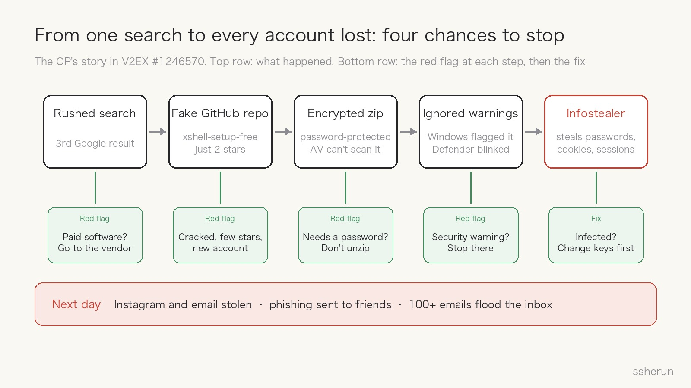
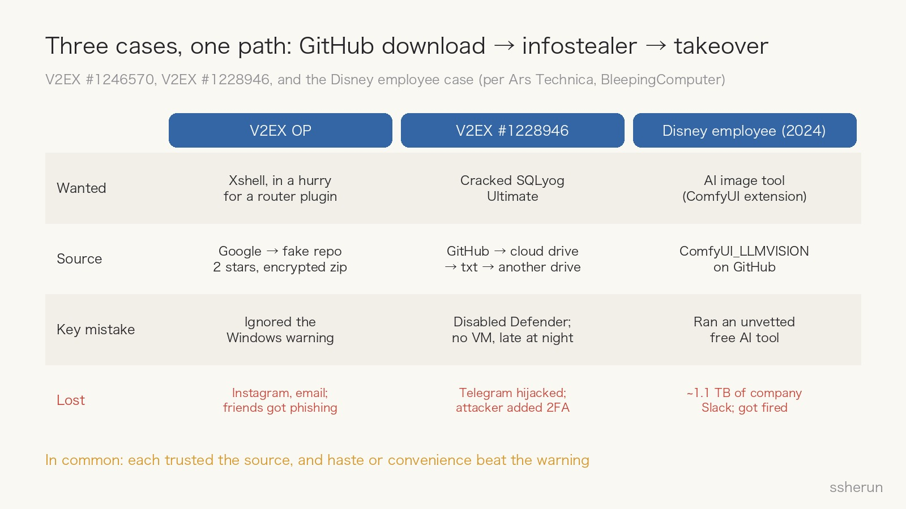
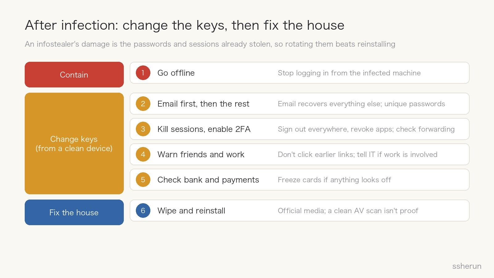

> Source discussion: [I never expected to get a trojan from downloading software on GitHub… lesson learned](https://www.v2ex.com/t/1246570) (V2EX, 58 replies)

A V2EX user wanted to install an ad-blocking plugin on their router, which meant connecting over SSH. They remembered Xshell from years ago, were in a hurry, searched Google, and clicked the third result.

It was a GitHub repo called `xshell-setup-free`. The archive was password-protected; they didn't think twice. Windows flagged it as dangerous; they installed it anyway. Defender flashed for a moment, then went quiet.

The next day, their Instagram, email, and other accounts were all stolen. The hijacked Instagram sent phishing links to every friend, and more than 100 junk emails poured into the inbox at once. They reported the repo to GitHub several times and heard nothing back.

In the thread they explained that they live abroad, don't work in IT, and **had always assumed GitHub was a safe site**.

That is exactly my point: **GitHub has malware too.**

## From one search to every account lost

Looking back, the chain had four red flags, any one of which should have been enough to stop:

1. **Commercial software on GitHub.** Commenters pointed out that Xshell's developer runs an [official download page](https://xshell.com/zh/all-downloads/), and it's free for personal use.
2. **A "free" build with only 2 stars.** The repo name had `free` and `setup` in it, and the account had little history.
3. **A password on the archive.** That isn't there to protect you. It's there so antivirus can't look inside.
4. **Security warnings.** Both Windows and Defender said something.

Reply #9 put it well: **all your everyday caution loses to one moment of haste.**

## The comments: half arguing, half reasoning

Of the 58 replies, 27 were from the OP. The other 31 fell roughly into these groups:

| View | Replies |
|------|---------|
| Mockery and arguing | 10 |
| Pointing out red flags: few stars, cracked, ignored warnings, official version is free | 9 |
| Same thing happened to me | 4 |
| Alternatives: other SSH clients, Windows' built-in OpenSSH | 4 |
| Fix: reinstall the OS | 2 |
| Other (haste, the Disney case) | 2 |

The useful ones:

- **#33**: Most malware today spreads through so-called cracked software. Use open source if it exists, or the official free version.
- **#26**: Windows now ships with an OpenSSH client. You don't need Xshell to reach a router.
- **#56**: Download from the official site first. If you break your arm, you go to a hospital no matter how urgent it is; you don't find someone in an alley to set it.
- **#44**, who had also been hit: "It felt like a virus as soon as it downloaded, but I wanted to give it a chance."

The second half of the thread turned into the OP trading insults with a few users. I understand the OP's anger, and I understand people thinking "how do you fall for that?" But one thing is worth saying: **when victims get mocked, the next person who gets hit stays quiet.** Security incidents need a post-mortem, not humiliation.

## Not a one-off: three cases, one path

**V2EX #1228946**: In July, another user wanted SQLyog Ultimate and found a cracked repo on GitHub. The download hopped from GitHub to Google Drive, then to a txt file, then to an exe on Dropbox. Double-clicking did nothing, and they didn't worry about it, since they'd turned Defender off long ago. Their Telegram account was then taken over: the attacker added two-factor authentication and changed the recovery email to a .ru address.

**The Disney employee**: The case mentioned in reply #28. According to [Ars Technica](https://arstechnica.com/ai/2025/05/man-pleads-guilty-to-using-malicious-ai-software-to-hack-disney-employee/) and [BleepingComputer](https://www.bleepingcomputer.com/news/security/hacker-nullbulge-pleads-guilty-to-stealing-disneys-slack-data/), in 2024 a Disney engineer downloaded `ComfyUI_LLMVISION`, an extension for an AI image tool, from GitHub. The malicious code stole credentials and login sessions from the engineer's password manager, and the attacker used them to get into Disney's Slack and leak about 1.1 TB, some 44 million messages. The attacker, Ryan Kramer (alias NullBulge), pleaded guilty in 2025, and the employee was fired. Kramer had also hidden the malicious code in files named after OpenAI and Anthropic.

What the three have in common: each trusted the source, and each let haste or convenience beat the warning.

## GitHub hosts code. It is not an app store

A lot of trust in GitHub comes from "this is where programmers hang out." But GitHub is fundamentally a **code hosting platform**. Anyone can sign up, create a repo, and upload an exe to Releases. There's no review like an app store's.

Attackers have turned it into a distribution channel:

- **Stars can be faked.** In 2024, Check Point found the [Stargazers Ghost Network](https://research.checkpoint.com/2024/stargazers-ghost-network/): more than 3,000 fake accounts that star, fork, and watch each other's repos so malicious ones look legitimate and popular. They distributed infostealers such as RedLine and Lumma. GitHub has taken down more than 1,500 of these repos since May 2024.
- **Encrypted archives exist to dodge scanning.** Neither antivirus nor GitHub's own detection can see inside a password-protected archive.
- **Redirect chains.** GitHub to a cloud drive, to a txt file, to another drive: every hop removes one layer of platform detection.

Why attackers like GitHub is simple: **the brand lowers people's guard, the domain's authority pushes fake repos to the top of search results, and hosting is free and reliable.** Put "free," "open source," and "cracked" together and you hit exactly the person who wants to save money and is in a hurry.

## What you actually get: an infostealer

This kind of malware usually doesn't wreck your computer. It goes after **your keys**: passwords and cookies saved in the browser, login sessions, password managers, session files from apps like Telegram, crypto wallets.

- **With a session token, the attacker needs neither your password nor your second factor.** That's why all of the OP's accounts fell on the same day, and why the Telegram account in #1228946 could be taken over directly.
- **Your account is used against your friends.** The account itself carries trust, so friends are more likely to click.
- **The 100+ emails** were probably "email bombing": a flood of sign-up and newsletter mail that buries the real security alerts and password-change notices. That's my inference; the OP didn't share the emails.
- **Personal machines connect to work.** In the Disney case, a password manager and a Slack session on a home computer were the keys to the company.

## Developers aren't safe either

Don't assume this only happens to people who aren't technical. The Disney victim was an engineer, and the bait was an AI tool extension.

The same risk shows up in npm and PyPI packages, VS Code extensions, ComfyUI nodes, and now **Agent Skills and MCP servers**. In the AI era we pull code from GitHub and hand it to agents to run more often than ever. Reading the code and checking the author and source before installing isn't paranoia anymore. It's basic hygiene.

## Checklist before you download

If any of these apply, stop:

- [ ] **Commercial software on GitHub**, with `crack`, `free`, `setup`, `full`, or a year in the repo name
- [ ] **Few stars**, or lots of stars but few issues or commits and a new account
- [ ] **Only an exe in Releases** or an external link in the README, with no source code
- [ ] **A password-protected archive**
- [ ] **Multiple redirects**: GitHub to a cloud drive, to a text file, to another drive
- [ ] **A security warning**, or instructions telling you to turn off antivirus first

What to do instead:

- Download from the **official site or an official app store**. For open source, reach the official repo **through the project's own website**, not a search result.
- Verify signatures and hashes when you can.
- Run anything you're unsure about in a **virtual machine or Windows Sandbox**.
- Look for a **free edition or an open-source alternative** first. For this job, the built-in `ssh` command was enough.

## After infection: change the keys, then fix the house

The OP asked: after a full antivirus scan, do I still need to reinstall the OS?

Yes, but **changing the keys is more urgent**. An infostealer's damage is the passwords and sessions it has already stolen, and reinstalling the OS doesn't revoke them. The order:

1. **Go offline**, and stop logging into anything from the infected machine.
2. **Change passwords from a different, clean device.** Start with email, because it's the recovery route for everything else; then social, payment, and work accounts, with a unique password for each.
3. **Sign out of all sessions and revoke third-party access**, then turn on two-factor authentication (an authenticator app or passkey, not SMS). Check whether email forwarding rules, recovery addresses, or phone numbers were changed.
4. **Warn friends** not to click links you sent earlier. If work accounts or devices are involved, **tell IT immediately**.
5. **Check bank and payment accounts**, and freeze cards if anything looks off.
6. **Wipe and reinstall** from official installation media. A clean antivirus scan doesn't prove nothing is left.

## Closing

GitHub is a great place, but its sense of safety is borrowed: it comes from the open-source community's reputation, not from platform review. **A repo being on GitHub doesn't make it trustworthy, and lots of stars don't make it safe.**

The real vulnerability is usually not technical. It's the moment of haste. Next time you're about to click "Run anyway," ask one question first: does this software have an official site?

## Related posts

- [[openai-daybreak-gpt-56-cyber-defense|The Defense Window Is Closing: Daybreak and GPT-5.6-Cyber]]
- [[agent-skills-hub|Agent Skills Hub: finding and managing good Skills]]
- [[software-not-valuable-ai-era|Is Software Worthless Now? Even Custom Work Commoditizes]]
