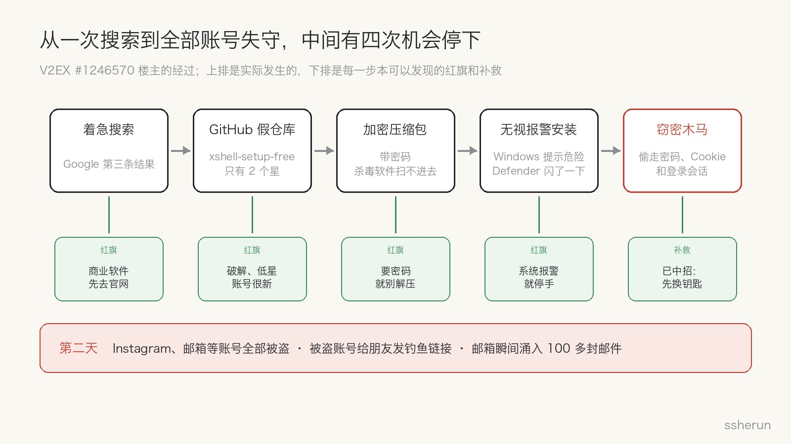
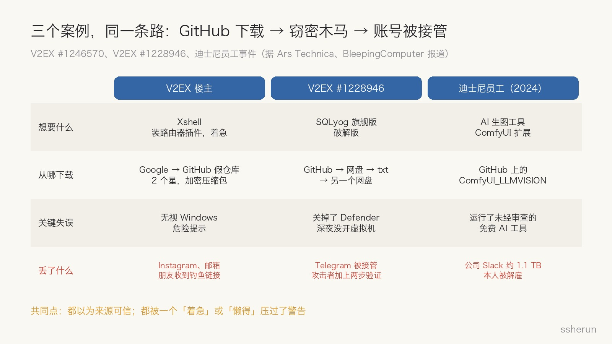
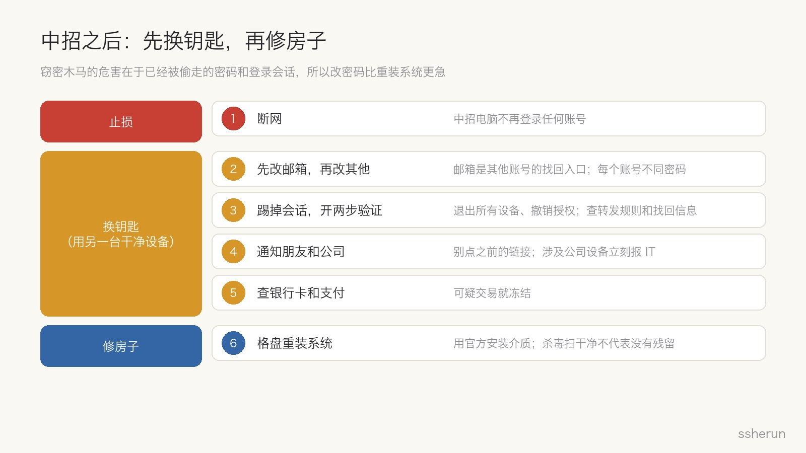

> 讨论来源：[没想到在 GitHub 下载软件还能中木马病毒…真的吃一堑长一智了](https://www.v2ex.com/t/1246570)（V2EX，58 楼）

一位 V2EX 用户想给路由器装个去广告插件，需要 SSH 连上去。他想起很久以前用过的 Xshell，着急，就在 Google 上搜了一下，点开第三条结果。

那是 GitHub 上一个叫 `xshell-setup-free` 的仓库。压缩包有密码，他没多想；Windows 提示这是危险软件，他硬着头皮装了；安装那一瞬间 Defender 跳了一下，又恢复了。

第二天，他的 Instagram 和各种账号、邮箱全部被盗。被盗的 Instagram 给他所有朋友发钓鱼链接，邮箱一瞬间涌进 100 多封乱七八糟的邮件。他向 GitHub 举报了好几次，没有回音。

他在帖子里说，自己常年在海外、不是 IT 从业者，**一直默认 GitHub 是个安全的网站**。

这正是我想说的：**GitHub 里也要注意病毒。**

## 从一次搜索到全部账号失守

回头看，这条链上有四个红旗，每一个都足够让人停手：

1. **商业软件出现在 GitHub 上。** 楼下有人指出，Xshell 开发商专门做了[官方下载页](https://xshell.com/zh/all-downloads/)，而且个人用户免费。
2. **「破解版」加上只有 2 个星。** 仓库名带 `free`、`setup`，账号也没什么历史。
3. **压缩包要密码。** 这不是为了保护你，是为了让杀毒软件扫不进去。
4. **系统报警。** Windows 和 Defender 都提醒过了。

评论区 #9 有一句话很准：**平日的千般小心，比不上偶然的一时情急。**

## 评论区：一半在骂，一半在讲道理

58 楼回复里，楼主自己占了 27 楼。剩下 31 楼，大致分成这几类：

| 观点 | 楼数 |
|------|------|
| 嘲讽、对骂 | 10 |
| 指出风险信号：低星、破解、无视警告、官网免费 | 9 |
| 同类经历 | 4 |
| 替代方案：别的 SSH 客户端、Windows 自带 OpenSSH | 4 |
| 补救：重装系统 | 2 |
| 其他（一时情急、迪士尼案例） | 2 |

有价值的几条：

- **#33**：大多数病毒现在都是通过所谓破解软件传播的；有开源用开源，或者用官方免费版。
- **#26**：Windows 现在自带 OpenSSH 客户端，连路由器根本不需要 Xshell。
- **#56**：下载软件首选官网。就像手摔断了，再急也只会去医院，不会私下找人接骨。
- **#44**，同样中过招的人：「下载下来就感觉像病毒，但想给它一个机会。」

帖子后半段基本变成了楼主和几位用户的对骂。我理解楼主的火气，也理解别人觉得「这都能中」。但有一点值得说：**受害者被嘲笑，下一个中招的人就不愿意说出来了。** 安全事件需要的是复盘，不是羞辱。

## 不是个例：三个案例，同一条路

**V2EX #1228946**：今年 7 月，另一位用户想要 SQLyog 旗舰版，找到 GitHub 上一个破解仓库。下载链接从 GitHub 跳到 Google Drive，再到一个 txt，再到 Dropbox 上的 exe。双击没反应，他也没在意，因为早就关掉了 Defender。之后他的 Telegram 被接管：攻击者给账号加上两步验证，把找回邮箱换成了一个 .ru 地址。

**迪士尼员工**：评论区 #28 提到的案子，据 [Ars Technica](https://arstechnica.com/ai/2025/05/man-pleads-guilty-to-using-malicious-ai-software-to-hack-disney-employee/) 和 [BleepingComputer](https://www.bleepingcomputer.com/news/security/hacker-nullbulge-pleads-guilty-to-stealing-disneys-slack-data/) 报道：2024 年，一名迪士尼工程师从 GitHub 下载了一个 AI 生图工具的扩展 `ComfyUI_LLMVISION`。里面的恶意代码偷走了他密码管理器里的凭据和登录会话，攻击者借此进入迪士尼的 Slack，泄露了约 1.1 TB、4400 万条消息。攻击者 Ryan Kramer（化名 NullBulge）2025 年认罪，这名员工被解雇。攻击者还把恶意代码藏在以 OpenAI、Anthropic 命名的文件里。

三个案例的共同点：都以为来源可信，都让「着急」或「懒得」压过了警告。

## GitHub 是托管平台，不是应用商店

很多人对 GitHub 的信任，来自「这是程序员用的地方」。但 GitHub 本质上是**代码托管平台**：任何人都能注册账号、建仓库、在 Releases 里上传 exe，没有应用商店那样的审核。

而攻击者已经把它用成了分发渠道：

- **星标可以刷。** Check Point 在 2024 年发现了一个叫 [Stargazers Ghost Network](https://research.checkpoint.com/2024/stargazers-ghost-network/) 的网络：3000 多个假账号互相加星、Fork、关注，让恶意仓库看起来正规、受欢迎。它们分发的是 RedLine、Lumma 等窃密木马。GitHub 从 2024 年 5 月起下架了 1500 多个这类仓库。
- **加密压缩包专门用来躲扫描。** 杀毒软件和 GitHub 自己的检测都看不到带密码压缩包里的内容。
- **跳转链。** GitHub 到网盘、到 txt、再到另一个网盘，每多跳一次，平台就少一层检测。

攻击者喜欢 GitHub，原因很简单：**品牌光环让人放松警惕，域名权重让假仓库排到搜索前几名，托管免费又稳定。**「免费」「开源」「破解」三个词放在一起，正好击中想省钱又着急的人。

## 中的是什么：窃密木马

这类木马通常不破坏电脑，它的目标是**偷钥匙**：浏览器里保存的密码、Cookie 和登录会话，密码管理器，Telegram 等客户端的会话文件，加密钱包。

- **拿到登录会话，就不需要密码，也绕过了两步验证。** 这解释了为什么楼主第二天所有账号同时失守，为什么 #1228946 的 Telegram 能被直接接管。
- **用你的账号骗你的朋友。** 账号本身就是信任，朋友更容易点开链接。
- **100 多封邮件**，很可能是「邮件轰炸」：用大量注册、订阅邮件淹没收件箱，让你看不到真正的安全提醒和改密通知。这是我的推断，楼主没有贴出邮件内容。
- **个人电脑会连到公司。** 迪士尼案里，家用电脑上的密码管理器和 Slack 会话，就是进入公司的钥匙。

## 开发者也不安全

别以为这只是「不懂技术的人才会中招」。迪士尼那位是工程师，中招的是一个 AI 工具扩展。

同样的风险出现在 npm 和 PyPI 包、VS Code 扩展、ComfyUI 节点里，现在还有 **Agent 的 Skills 和 MCP 服务器**。AI 时代，我们从 GitHub 拉代码交给 Agent 执行，比以往任何时候都频繁。装之前看一眼代码、确认作者和来源，已经不是洁癖，而是基本功。

## 下载前的检查清单

看到下面任何一条，先停下来：

- [ ] **商业软件出现在 GitHub 上**，仓库名带 `crack`、`free`、`setup`、`full` 或年份
- [ ] **星很少**；或者星很多，但 Issue、提交记录很少、账号很新
- [ ] **只有 Releases 里的 exe** 或 README 里的外链，看不到源码
- [ ] **压缩包有密码**
- [ ] **多次跳转**：GitHub 到网盘、到文本文件、再到另一个网盘
- [ ] **系统或杀毒软件报警**，或者教程让你先关掉杀毒软件

正确的做法：

- 从**官网或官方应用商店**下载；开源软件也要**从官网的链接**进入官方仓库，而不是搜索结果。
- 能校验签名和哈希就校验。
- 不确定的软件放到**虚拟机或 Windows 沙盒**里跑。
- 优先找**免费版或开源替代**。这次的需求，用系统自带的 `ssh` 命令就够了。

## 中招之后：先换钥匙，再修房子

楼主问：用杀毒软件全盘查杀了，还要不要重装系统？

要重装，但**更急的是换钥匙**。窃密木马的危害在于已经被偷走的密码和登录会话，重装系统不能让它们失效。顺序是：

1. **断网**，中招的电脑不再登录任何账号。
2. **用另一台干净的设备改密码**。先改邮箱，因为它是其他账号的找回入口；再改社交、支付、工作账号，每个账号用不同密码。
3. **退出所有登录会话、撤销第三方授权**，开启两步验证（优先用验证器应用或通行密钥，不用短信）。检查邮箱的转发规则、找回邮箱和手机号有没有被改。
4. **通知朋友**别点之前收到的链接；涉及公司账号或设备，**立刻报告公司 IT**。
5. **查银行卡和支付账户**，有可疑交易就冻结。
6. **格盘重装系统**，用官方安装介质。杀毒软件扫干净，不代表没有残留。

## 写在最后

GitHub 是好地方，但它的安全感是借来的：来自开源社区的信誉，而不是平台的审核。**仓库在 GitHub 上，不代表它值得信任；星多，不代表它安全。**

真正的漏洞往往不是技术，而是那一刻的「急」。下次想点「仍要运行」之前，先问一句：这个软件有没有官网？

## 相关文章

- [[openai-daybreak-gpt-56-cyber-defense|防御窗口收窄：OpenAI 扩展 Daybreak 与 GPT-5.6-Cyber]]
- [[agent-skills-hub|Agent Skills Hub：发现和管理优质 AI Agent Skills]]
- [[software-not-valuable-ai-era|AI 时代软件不值钱了？斩杀线以下会，定制也可能跟着贬]]
