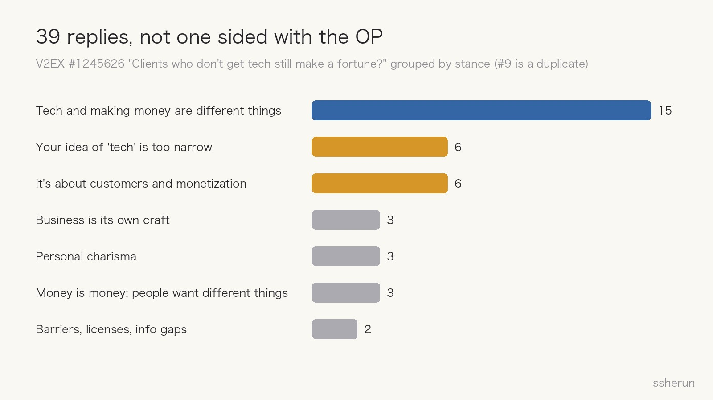
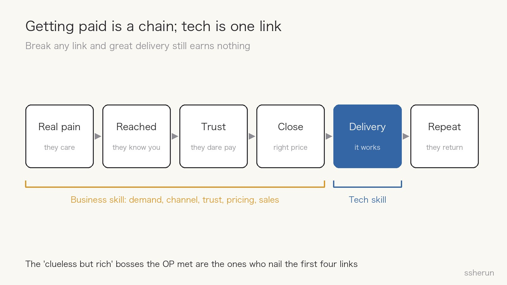

> Source: [Mostly tech folks here — ever notice many clients don't understand tech at all, yet make a fortune?](https://www.v2ex.com/t/1245626) (V2EX, 39 replies)

Someone who sells SaaS to all kinds of business owners posted a gripe on V2EX: "How does he not understand any of this, and still have customers paying him big money?"

Of 39 replies, not one took his side.

My view is simple: **good tech does not mean making money, and confusing the two is the most common mistake on the startup road.** The OP's puzzle is the wall nearly every technical founder hits.

## What the replies said

The top-voted reply (#1) is one line:

> If a tech person can't tell that tech and making money are two different things, the problem isn't just that he doesn't know how to make money.

The rest fall into a few groups:

- **Different things; tech may not even be worth much.** "If knowing tech made you rich, everyone on this site would be a local tycoon" (#3); "tech isn't even a necessary condition for making money" (#16).
- **Your idea of tech is too narrow.** Unclogging a drain for $200 takes skill too (#24); sales, drinking with clients, and reading people are skills (#35).
- **It's about customers and monetization.** "The world doesn't lack tech or workers. It lacks the ability to turn things into money: bosses and salespeople" (#22).
- **Business is its own craft.** There are dozens of kinds of smart — street smart, book smart, money smart. Those owners are money smart; you may not be (#10).

A few analogies stuck:

- **Screwdrivers and chainsaws (#17):** you can use every tool and support your family working for a furniture-factory owner; go solo, and you find you can't get money out of customers.
- **The monk in *Journey to the West* (#33):** the Monkey King and Sha Wujing have the skills — one carries the luggage, one fights. The monk rides a horse and does nothing, yet gets the most credit at the end.
- **Selling vs. building houses (#36):** a house that sells for millions, versus the laborers who built it.

The sharpest was #7's mirror: plenty of tech experts here — how many understand bookkeeping and tax filing? The accountants who keep their books see these tech founders the same way: "They don't even understand taxes, and they still make money?"

## Getting paid is a chain; tech is one link

#4 put the core most clearly: **making money means someone is willing to give you money.** Why they're willing varies; tech is one reason, often a minor one.

Unpack "willing to give you money" and you get a chain:

1. **Real pain:** they care about the problem.
2. **Reached:** they know you exist.
3. **Trust:** they dare to give you money.
4. **Close:** the price and timing are right.
5. **Delivery:** the thing works well.
6. **Repeat:** they come back.

Tech mostly affects link 5 — and customers often can't see delivery quality or compare it. Break any of the first four links and great delivery still earns nothing.

The "clueless but rich" bosses the OP met are the ones who nail the first four links. That isn't luck; it's a different craft.

## Why tech people fall into this most

### 1. Tech sits on the cost side; money comes from the revenue side

Tech decides how cheaply and how well you can build something. Making money depends on demand, channels, pricing, and trust. The former is sometimes necessary, never sufficient.

### 2. Using what you're good at to avoid what you're not

Writing code is controllable: feedback, debugging, no rejection. Meeting customers and selling are not: you get rejected, outcomes are uncertain.

So the classic technical-founder move is: **polish the product a bit more, add one more feature, then go sell.** Polishing never ends; selling is always next week. That avoidance is what #1 meant by "not just not knowing how to make money."

### 3. Treating your strength as the thing that matters most

The OP looks down on owners who don't get tech; the bookkeepers look down on tech founders who don't get taxes. Same structure. Every profession overrates its own craft's share in making money.

### 4. AI makes the mistake more expensive

AI pushes implementation cost toward zero, shrinking the premium on tech itself (see [[software-not-valuable-ai-era|Is Software Worthless Now?]]). An earlier V2EX thread, "has anyone made money with AI?", reached the same conclusion: the people making real money **already had a path**; AI just cut their labor costs. People without a path don't know how to make money with AI either.

The cheaper tech gets, the more the first four links are worth.

## Approaches I've seen work

Treat the first four links as a craft, instead of assuming "build it well and they'll come":

- **Pay for reach, and optimize for payment, not sign-ups.** Gefei's Google Ads lesson: with no organic traffic, buy it; don't set sign-up as the conversion goal — feed the algorithm actual paying behavior.
- **Validate demand and channel before writing code.** That's why the plan in [[first-principles-startup-review|a first-principles review]] fell apart.
- **When growth stalls, don't blame channels first.** In [[indie-product-promotion-hard-truths|why indie tools struggle to grow]], the community kept pointing to differentiation, trust, and switching cost — not a missing secret channel.

## A checklist for technical founders

Before writing the first line of code:

1. **Who pays?** Name a specific person or company, not "SMBs" or "developers."
2. **How do you reach them?** Where do your first 10 customers come from, and roughly what does each cost to acquire?
3. **Why would they trust you?** Case studies, endorsements, word of mouth, licenses, or you personally.
4. **How do they solve it today?** If you can't name the workaround, it doesn't hurt enough.
5. **What's the price, and will they pay now?** Can you collect first — presales, deposits, paid pilots — and build after?

Once you're running:

6. **Check your time split weekly:** hours talking to customers versus hours writing code. If the former stays near zero, you're using tech to avoid making money.
7. **Fill the gap or find a partner:** sales, channels, finance — someone must truly know at least one.
8. **Don't look down on non-technical people who make money:** the craft they have is exactly the one you lack.

Tech is one of the things that earns you a seat at the table, but the game is played by different rules. **The sooner you admit it, the less tuition you pay on the startup road.**

## Related posts

- [[indie-product-promotion-hard-truths|Why Indie Tools Struggle to Grow: Reasons a Community Kept Repeating]]
- [[first-principles-startup-review|First-principles review: a startup plan dies in 48 hours]]
- [[software-not-valuable-ai-era|Is Software Worthless Now? Even Custom Work Commoditizes]]
- [[programmer-35-crisis-and-self-rescue|The 35-year-old programmer crisis — and how to get out]]
