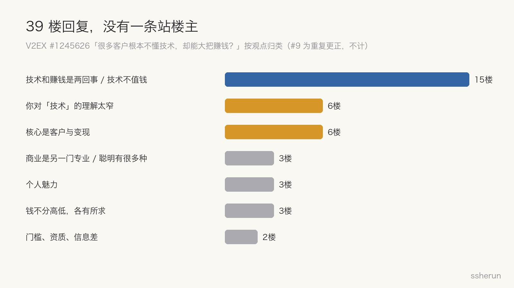
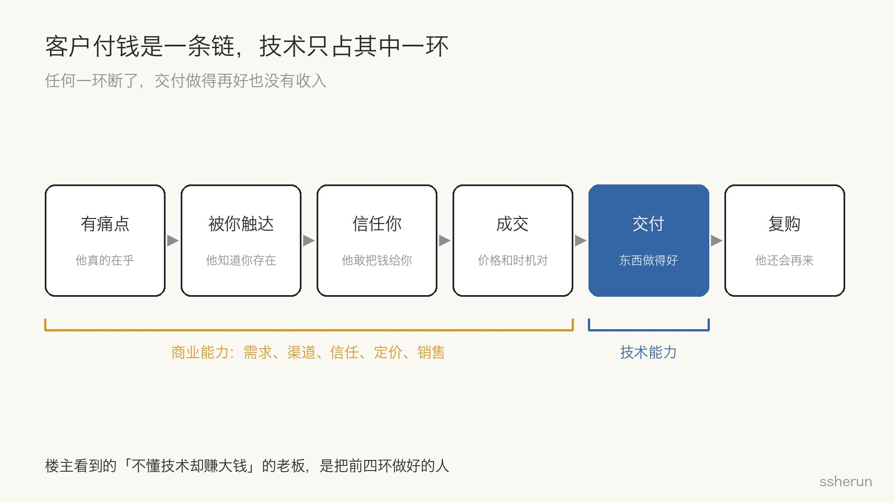

> 讨论来源：[这里技术向居多，有没有发现很多客户根本不懂技术，却能大把赚钱？](https://www.v2ex.com/t/1245626)（V2EX，39 楼）

一个经常给各种老板推销 SaaS 的人，在 V2EX 发帖吐槽：「他为什么这都不懂，还有顾客花大把钱买他的东西？」

39 楼回复，没有一条站他。

我对这个问题的看法很直接：**技术好不代表能赚钱，这是创业路上最常见的错误。** 楼主的困惑，几乎是每个技术人创业时都会撞上的那堵墙。

## 评论区怎么说

最高赞的一条（#1）只有一句话：

> 如果一个搞技术的人搞不清楚技术和赚钱是两件事，那他就不是单纯的不懂赚钱。

其余回复大致分成几类：

- **两回事，技术甚至不值钱。** 「如果懂技术就能赚钱，本站用户至少都是当地小富豪」（#3）；「技术甚至都不是赚钱的必要条件」（#16）。
- **你对技术的理解太窄。** 通一次下水道 200 美元，人家也有技术（#24）；销售、喝酒、情商都是技术（#35）。
- **核心是客户和变现。** 「这个世界不缺技术和工人，缺的是变现能力：缺老板，缺销售」（#22）。
- **商业是另一门专业。** 聪明至少有几十种，街头聪明、学术聪明、金钱聪明，这些老板有 money smart，你未必有（#10）。

几条比喻很传神：

- **改锥和油锯（#17）**：你会用各种工具，给家具厂老板打工养家；自己单干后才发现，从客户那里赚不到钱。
- **唐僧（#33）**：孙悟空、沙僧有技术，一个挑担一个当保镖；唐僧骑着马啥也不干，到了西天功劳最高。
- **卖房和盖房（#36）**：一套卖几百上千万的房子，对比盖房子的民工。

最扎心的是 #7 的镜像视角：站里技术大佬这么多，有几个懂记账和报税的逻辑？代账公司看这些开公司的技术大佬，也是同样的眼光：「连记账报税都不懂，这也能赚钱？」

## 客户付钱是一条链，技术只占其中一环

#4 把本质说得最清楚：**赚钱的本质是别人愿意把钱给你。** 至于为什么愿意，原因多种多样，技术只是其中之一，甚至是很不重要的之一。

把「别人愿意把钱给你」拆开，是一条链：

1. **有痛点**：他真的在乎这个问题。
2. **被你触达**：他知道你存在。
3. **信任你**：他敢把钱给你。
4. **成交**：价格和时机都对。
5. **交付**：东西做得好。
6. **复购**：他还会再来。

技术主要影响第 5 环，而且交付质量客户往往看不见，也不会去比较。前四环任何一环断了，交付做得再好也没有收入。

楼主看到的「不懂技术却赚大钱」的老板，就是把前四环做好的人。他们不是运气好，而是掌握了另一门手艺。

## 为什么技术人最容易犯这个错

### 1. 技术在成本端，赚钱在收入端

技术决定你能以多低的成本、多高的质量把东西做出来。赚钱取决于需求、渠道、定价、信任。前者有时是必要条件，但从来不是充分条件。

### 2. 用擅长的事回避不擅长的事

写代码是可控的：有反馈、能调试、不会被拒绝。见客户、做销售是不可控的：会被拒绝，结果不确定。

所以技术型创始人最常见的姿势是：**产品再打磨一下，功能再加一个，然后再去推。** 打磨永远没有尽头，推广永远在下周。#1 说的「不是单纯的不懂赚钱」，指的就是这种回避。

### 3. 把自己擅长的当成最重要的

楼主看不起不懂技术的老板，代账公司看不起不懂报税的技术大佬，是同一个结构。每个专业都会高估自家手艺在赚钱里的权重。

### 4. AI 让这个错误更贵

AI 把实现成本压向零，技术本身的溢价进一步缩水（见 [[software-not-valuable-ai-era|AI 时代软件不值钱了？]]）。之前 V2EX「有人用 AI 赚到钱了吗」那帖也是同样的结论：赚得多的都是**原本就有路子**的人，AI 只是帮他们砍掉了人力成本；没路子的人，用了 AI 也不知道怎么赚钱。

技术越便宜，前四环越值钱。

## 我见过的几种做法

把前四环当成手艺来做，而不是当成「产品做好了自然会来」：

- **花钱买触达，盯着付费而不是注册。** 哥飞投 Google Ads 的经验：没有自然流量，就直接买；转化目标别设成注册，要喂给算法真正付费的行为。
- **先验证需求和渠道，再写代码。** 这是 [[first-principles-startup-review|用 AI 做第一性原理审查]] 那个创业计划被推翻的原因。
- **推不动时别先怪渠道。** [[indie-product-promotion-hard-truths|独立产品为什么推不动]]里，社区反复提到的是差异化、信任和迁移成本，而不是缺一个神秘渠道。

## 给技术型创始人的检查清单

写第一行代码之前：

1. **谁付钱？** 说出一个具体的人或公司，而不是「中小企业」「开发者」。
2. **怎么触达他？** 第一批 10 个客户从哪来，单个获客成本大概多少。
3. **他凭什么信你？** 案例、背书、口碑、资质，还是你本人。
4. **他现在怎么解决？** 说不出现有的土办法，说明痛得不够。
5. **价格是多少，他愿意现在付吗？** 能不能先收钱（预售、定金、付费试点）再做。

做起来之后：

6. **每周算一次时间比例**：和客户对话的小时数，对比写代码的小时数。前者长期接近零，就是在用技术回避赚钱。
7. **补短板或找搭档**：销售、渠道、财务，至少有一样要有人真懂。
8. **别看不起不懂技术的赚钱者**：他们会的那门手艺，正是你缺的。

技术是让你有资格上桌的东西之一，但牌桌上比的是另一套规则。**越早承认这一点，创业路上少交的学费越多。**

## 相关文章

- [[indie-product-promotion-hard-truths|独立产品为什么推不动：社区里被反复提到的原因]]
- [[first-principles-startup-review|用 AI 做第一性原理审查：一个创业计划被推翻的 48 小时]]
- [[software-not-valuable-ai-era|AI 时代软件不值钱了？斩杀线以下会，定制也可能跟着贬]]
- [[programmer-35-crisis-and-self-rescue|35岁程序员危机与自救指南]]
