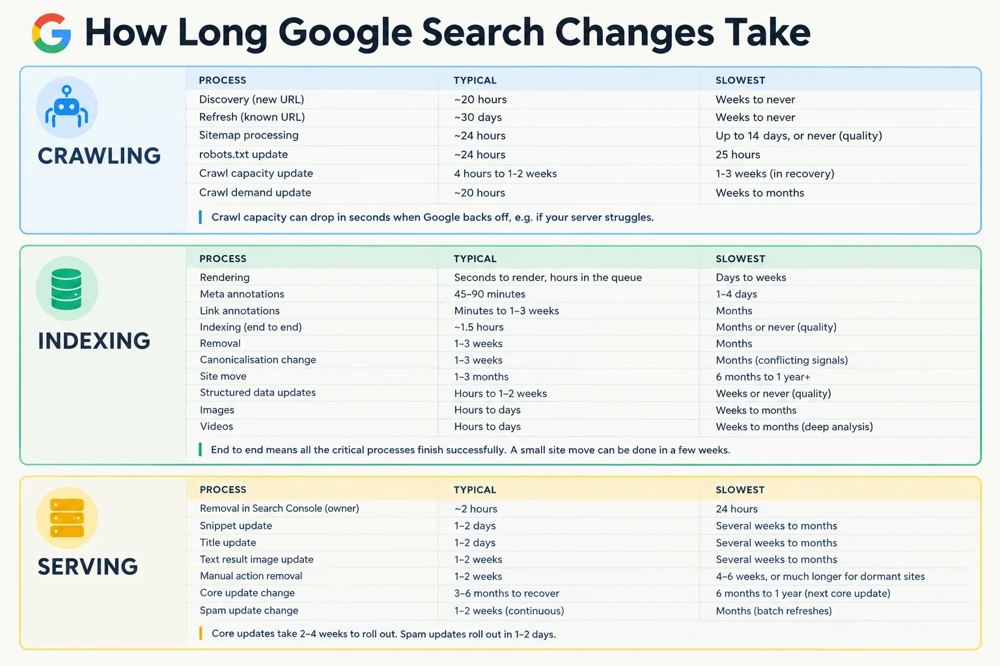

Day-two titles that still look old, a new URL that stays unindexed for a week, a site move that wobbles traffic for a quarter—usually you are not “waiting on Google.” You are mixing **three different clocks**.

The tables below follow the infographic *How Long Google Search Changes Take* (Crawling / Indexing / Serving). Numbers are **Typical vs Slowest** experience ranges, **not SLAs**. When Slowest says `never (quality)`, more calendar time alone will not clear a quality block.

## First: which layer are you stuck in?

| Layer | What you see | Check first |
|---|---|---|
| Crawling | Long “Discovered – currently not indexed” / crawl-stats cliffs | robots, capacity, server errors, sitemap |
| Indexing | Crawled but not indexed, or canonical thrash | quality, duplicates, rendering, structured data |
| Serving | Indexed, but title / snippet / image still stale | snippet cache, manual actions, core / spam updates |

## 1. Crawling: discovery can be fast; revisits are often slow

| Process | Typical | Slowest |
|---|---|---|
| Discovery (new URL) | ~20 hours | Weeks to never |
| Refresh (known URL) | ~30 days | Weeks to never |
| Sitemap processing | ~24 hours | Up to 14 days, or never (quality) |
| robots.txt update | ~24 hours | 25 hours |
| Crawl capacity update | 4 hours to 1–2 weeks | 1–3 weeks (in recovery) |
| Crawl demand update | ~20 hours | Weeks to months |

Two practice notes:

1. **~20 hours for a new URL** is the *discovery* clock—not “rank in 20 hours.”  
2. When the server struggles, **crawl capacity can drop in seconds** as Google backs off. Recovery follows the capacity-update row (hours to weeks)—not a browser refresh mental model.

Known-URL refresh at ~**30 days** Typical explains a huge share of “I changed the copy, why isn’t Google updated?” tickets.

## 2. Indexing: end-to-end can be fast; conflicts stretch into months

| Process | Typical | Slowest |
|---|---|---|
| Rendering | Seconds to render, hours in the queue | Days to weeks |
| Meta annotations | 45–90 minutes | 1–4 days |
| Link annotations | Minutes to 1–3 weeks | Months |
| Indexing (end to end) | ~1.5 hours | Months or never (quality) |
| Removal | 1–3 weeks | Months |
| Canonicalisation change | 1–3 weeks | Months (conflicting signals) |
| Site move | 1–3 months | 6 months to 1 year+ |
| Structured data updates | Hours to 1–2 weeks | Weeks or never (quality) |
| Images | Hours to days | Weeks to months |
| Videos | Hours to days | Weeks to months (deep analysis) |

How to read it:

- **End to end ~1.5 hours** assumes critical paths complete—not “URL Inspection = homepage in 1.5 hours.”  
- **Canonical / Removal** live in weeks; conflicting signals push into months.  
- **Site move** Typical is 1–3 months; Slowest reaches a year+. The chart note still allows a *small* move to settle in a few weeks—scale and conflict pick your bucket.  
- Images / Videos run on separate clocks; deep video analysis is slower.

## 3. Serving: owner removals are fast; core updates are slow

| Process | Typical | Slowest |
|---|---|---|
| Removal in Search Console (owner) | ~2 hours | 24 hours |
| Snippet update | 1–2 days | Several weeks to months |
| Title update | 1–2 days | Several weeks to months |
| Text result image update | 1–2 weeks | Several weeks to months |
| Manual action removal | 1–2 weeks | 4–6 weeks, or much longer (dormant sites) |
| Core update change | 3–6 months to recover | 6 months to 1 year (next core update) |
| Spam update change | 1–2 weeks (continuous) | Months (batch refreshes) |

Rollout windows:

- A **core update** itself rolls out over about **2–4 weeks**; the *recovery feeling* often takes **3–6 months**, or until the next core update.  
- A **spam update** rolls in about **1–2 days**; under continuous scanning, Typical impact is 1–2 weeks; batch refreshes can take months.

SC owner removal (~2 hours) and “title change → new snippet” (days to months) are not the same request class—one is a control-plane tool, the other is result cache + recompute.

## 4. Priority checklist

| Goal | More realistic clock | Wrong expectation |
|---|---|---|
| Emergency sensitive URL takedown | SC removal ~2h | Wait for natural 30-day revisit |
| robots / crawl unblock | ~24h | Same-day ranking lift |
| Get a new post discovered | Discovery ~20h typical | Stable ranking that same day |
| Refresh old title / snippet | Serving from 1–2 days; slow path weeks–months | “Just flush the cache” |
| Merge duplicates / change canonical | From 1–3 weeks | Overnight |
| Full domain / site move | From 1–3 months | One weekend |
| Recover after a core update | 3–6 month scale | Flip next week |

**Quality vetoes** show up again on sitemap, indexing, and structured-data Slowest rows: `never (quality)`. Waiting has no compound interest there—fix crawlability, uniqueness, and content signals.

## Related posts

- [[geo-vs-seo-same-or-separate|GEO vs SEO: three Reddit threads that cut through the noise]]
- [[chatgpt-cite-bing-pageone-overlap|Only ~25% of ChatGPT citations sit on Bing page one]]
- [[bot-trap-invisible-link|Invisible link traps: crawlers and humans see different pages]]
