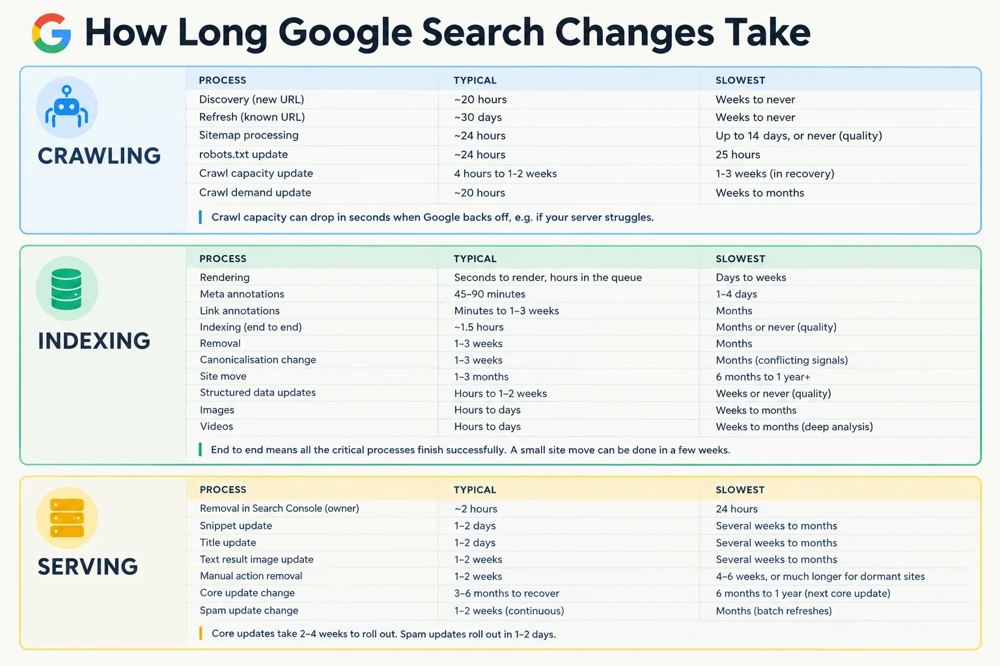

改标题第二天还没变、新页面一周还不收录、搬家三个月流量还在晃——多数不是「Google 坏了」，而是你把**三条不同的时钟**当成了一条。

下面这张对照来自信息图 *How Long Google Search Changes Take*（Crawling / Indexing / Serving）。数字是 **Typical vs Slowest** 的经验区间，**不是 SLA**；Slowest 里反复出现的 `never (quality)`，意思是时间够了信号仍不够。

## 先问：卡在哪一层？

| 层 | 你看到的现象 | 优先查 |
|---|---|---|
| 爬取 Crawling | Search Console 长期「已发现-尚未编入索引」/ 抓取统计掉崖 | robots、容量、服务器错误、sitemap |
| 索引 Indexing | 抓到了但不收录，或 canonical 乱跳 | 质量、重复、渲染、结构化数据 |
| 呈现 Serving | 已收录但标题/摘要/配图仍是旧的 | 摘要缓存、手动操作、核心/垃圾更新 |

## 1. Crawling：发现可以快，回访往往慢

| Process | Typical | Slowest |
|---|---|---|
| Discovery (new URL) | ~20 hours | Weeks to never |
| Refresh (known URL) | ~30 days | Weeks to never |
| Sitemap processing | ~24 hours | Up to 14 days, or never (quality) |
| robots.txt update | ~24 hours | 25 hours |
| Crawl capacity update | 4 hours to 1–2 weeks | 1–3 weeks (in recovery) |
| Crawl demand update | ~20 hours | Weeks to months |

两点实操：

1. **新 URL 的「约 20 小时」**是发现时钟，不是「20 小时后必有排名」。  
2. 服务器一抖，**crawl capacity 可在数秒内被 Google 主动降下来**；恢复要按「容量更新」那一行（小时到数周），别用「我刷新了页面」的心理时钟。

已知 URL 的刷新 Typical 约 **30 天**——这解释了大量「我改了文案怎么还不更新」的误判。

## 2. Indexing：端到端可以很快，冲突会拖成月

| Process | Typical | Slowest |
|---|---|---|
| Rendering | Seconds to render, hours in queue | Days to weeks |
| Meta annotations | 45–90 minutes | 1–4 days |
| Link annotations | Minutes to 1–3 weeks | Months |
| Indexing (end to end) | ~1.5 hours | Months or never (quality) |
| Removal | 1–3 weeks | Months |
| Canonicalisation change | 1–3 weeks | Months (conflicting signals) |
| Site move | 1–3 months | 6 months to 1 year+ |
| Structured data updates | Hours to 1–2 weeks | Weeks or never (quality) |
| Images | Hours to days | Weeks to months |
| Videos | Hours to days | Weeks to months (deep analysis) |

读法：

- **End to end ~1.5 hours**：指关键路径都跑通时的量级，不是「提交 URL 检查 = 1.5 小时上首页」。  
- **Canonical / Removal** 以周计；信号打架就进月。  
- **Site move** Typical 1–3 个月；Slowest 到一年+。图注也说：小站搬家有时几周就能稳住——规模与冲突决定你在哪一档。  
- Images / Videos 另开时钟；视频深分析更慢。

## 3. Serving：站长移除很快，核心更新很慢

| Process | Typical | Slowest |
|---|---|---|
| Removal in Search Console (owner) | ~2 hours | 24 hours |
| Snippet update | 1–2 days | Several weeks to months |
| Title update | 1–2 days | Several weeks to months |
| Text result image update | 1–2 weeks | Several weeks to months |
| Manual action removal | 1–2 weeks | 4–6 weeks, or much longer (dormant sites) |
| Core update change | 3–6 months to recover | 6 months to 1 year (next core update) |
| Spam update change | 1–2 weeks (continuous) | Months (batch refreshes) |

补充滚动窗口：

- **Core update** 本身滚动约 **2–4 周**；「恢复感」却常要 **3–6 个月**，慢则等到下一次核心更新。  
- **Spam update** 滚动约 **1–2 天**；连续扫描下 Typical 1–2 周有感，批处理刷新可拖到数月。

站长工具里的移除（~2 小时）和「改标题后摘要变了」（天到月）完全不是一类请求——前者是控制面，后者是结果缓存与重算。

## 4. 一张优先级清单

| 你想做的事 | 更现实的时钟 | 别用错的预期 |
|---|---|---|
| 紧急下架敏感 URL | SC 移除 ~2h | 等自然回爬 30 天 |
| 改 robots / 放开抓取 | ~24h | 当天排名起飞 |
| 让新文章被发现 | Discovery ~20h typical | 当天稳定排到词 |
| 改老文标题摘要 | Serving 1–2 天起，慢则数周月 | 「刷新缓存」口头禅 |
| 合并重复页 / 改 canonical | 1–3 周起 | 隔夜生效 |
| 整站换域搬家 | 1–3 个月起 | 一个周末迁完 |
| 核心更新后救流量 | 3–6 个月量级 | 隔周必反转 |

**质量否决**反复出现在 sitemap、索引、结构化数据的 Slowest：`never (quality)`。这时候加等待没有复利，要改的是可抓性、唯一性和内容信号。

## 相关文章

- [[geo-vs-seo-same-or-separate|GEO 和 SEO 是一回事吗？Reddit 三帖把话说穿了]]
- [[chatgpt-cite-bing-pageone-overlap|ChatGPT 引用里只有约 25% 在 Bing 首页]]
- [[bot-trap-invisible-link|隐形链接陷阱：爬虫与真实用户看到的不是同一页]]
