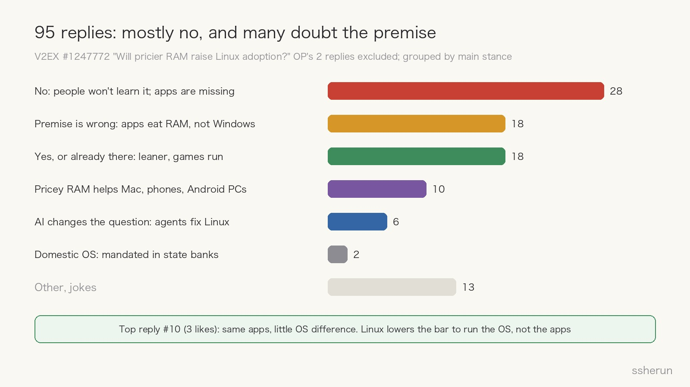
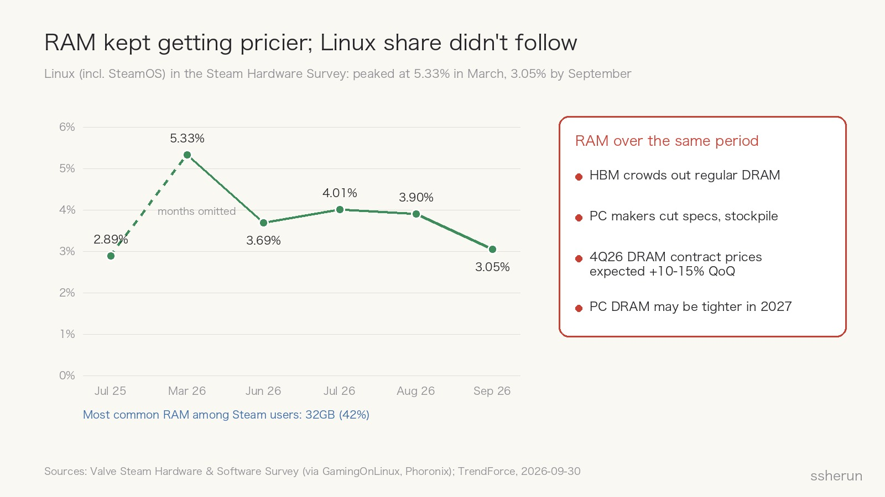
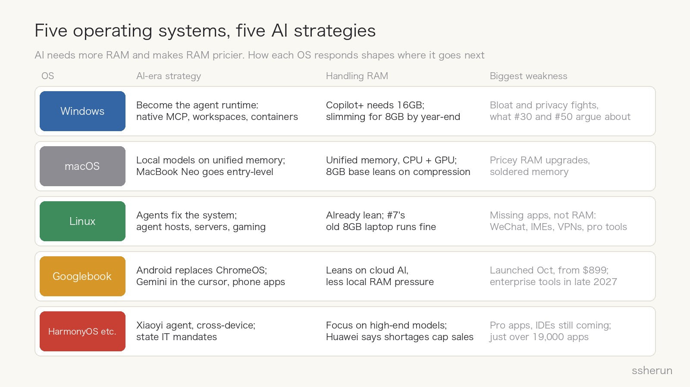
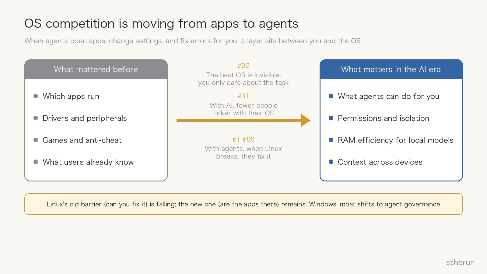

> Source discussion: [Will ever-pricier RAM raise Linux adoption?](https://www.v2ex.com/t/1247772) (V2EX, 97 replies)

During a holiday, a user on V2EX, a Chinese tech forum, dual-booted an old laptop with Windows 10 and Fedora and compared them:

- Idle after boot, Windows used 9GB of RAM; Linux used 5GB.
- During normal work (WPS Office, 60-plus browser tabs, QQ, WeChat, a proxy), Windows often sat at 13 to 15GB; Linux peaked at 9GB.

The conclusion seemed obvious: with 16GB, Windows needs an upgrade and Linux doesn't. As RAM gets pricier, upgrading later or never is better. **Will Linux desktop adoption rise as a result?**

There are two layers here. The first is the poster's question: will rising memory prices push people to Linux? The second is bigger: AI is making memory more expensive while demanding more of it. How will operating systems change in that world?

## The comments: mostly no, and many doubt the premise

Excluding the poster's own two replies, grouped by main stance:

- **No (28 replies).** Two reasons dominate: ordinary people won't learn a new OS to save a few hundred yuan (#72, #87), and the software isn't there. #4 nails it: when an app supports both platforms, the Linux version usually has fewer features. #95 says the first hurdle for ordinary Linux users is the input method editor.
- **The premise is wrong (18).** #30 says Windows itself barely eats RAM; Electron wrappers do. #34 says Linux only looks lean because it lacks equivalents of Windows apps, so less is running. #50 says Windows prefetches aggressively, and that memory is released when needed. The poster later admitted that "idle" Windows still had five or six browsers, Xunlei, QQ, WeChat, and WPS resident (#66).
- **Yes, or already there (18).** #7 moved a 2017 ThinkPad X1 with 8GB soldered RAM to CachyOS, which boots at 1.5GB. #56's 8GB Dell was nearly full at boot on Windows 11 and runs fine on Ubuntu. Several gamers have already switched.
- **Pricey RAM helps other platforms (10).** #57 says it will only boost Macs. #45 suggests Google's new Android laptops may suit ordinary users better. #78 says rising memory costs hit phones harder.
- **AI changes the question (6).** #1: if you don't game, moving to Linux is very comfortable; when something breaks, an agent fixes it. #83: people switch to Linux because AI tools work better there, not because RAM is expensive.

The most-liked reply was #10, from someone who has used Ubuntu for nearly 20 years. The observation is measured: under 4GB, a light Linux distro is clearly smoother. At 8GB or 16GB, running bloated apps like WPS, the difference fades. **Linux lowers the hardware bar for running the OS, not for running the apps.**

A side note: #65 posted a screenshot of an AI-generated analysis concluding that memory prices "contribute, but aren't the main driver." #69 joked that asking an AI once now counts as research.

## The data: RAM kept rising, Linux share didn't follow

Memory is definitely getting pricier. TrendForce's late-September report says HBM for AI servers keeps crowding out regular DRAM capacity, leaving supplier inventories very low. Conventional DRAM contract prices are expected to rise another 10% to 15% quarter-on-quarter in Q4. PC makers are cutting specs and stockpiling, because more capacity will shift to servers in 2027 and PC memory could get tighter.

Linux share didn't follow. In the Steam Hardware Survey, Linux (including SteamOS) rose from 2.89% in July 2025 to 5.33% in March 2026, then fell back to 3.05% by September. StatCounter's web-traffic figures briefly showed over 8% mid-year, then were revised back into the 4% to 5% range; the swings were linked to bot traffic and shouldn't be read as a turning point.

One more number worth noting: the most common RAM size among Steam users is now 32GB, at 42%. For them, Windows using an extra 4GB is no reason to switch. #25 adds that as a Linux user with 32GB, memory anxiety doesn't exist; the real obstacle is the development tools from big Chinese tech companies.

So my answer to the poster: **mostly no.** #29 put it best: pricey RAM only moves people who meet three conditions at once: price-sensitive, fluent in Linux, and already torn between the two systems. That overlap is small.

## What pricey RAM actually changes: vendors slimming down

The poster's intuition wasn't wrong; it just landed somewhere else.

In late July, Pavan Davuluri, head of Windows, publicly listed "memory optimization for 8GB and above" as a priority through the end of the year. The measures include a more efficient memory allocator, WinUI 3 tuning, and trimming Chromium and WebView2 overhead inside the OS. Windows Central reported that rising memory prices and competition from Apple's MacBook Neo are the main drivers.

The MacBook Neo, Apple's entry-level laptop launched in March, has an A18 Pro chip and 8GB of unified memory, starting at $599 ($499 for education). An 8GB Mac at that price forces Windows to confront the "8GB PCs lag at boot" problem.

That vindicates #5: pricey RAM won't make users switch OSes. It will make users close background apps, and push OS vendors to go on a diet.

## AI's memory squeeze: it needs more, and makes it pricier

Zoom out and AI poses a contradictory problem for operating systems.

On one side, AI **needs more memory**. Microsoft's hard floor for Copilot+ PCs is 16GB of RAM, a 40+ TOPS NPU, and 256GB of storage; a machine with a strong NPU but less than 16GB doesn't qualify. Running large models locally needs even more.

On the other side, AI **makes memory more expensive**. Data-center HBM takes the capacity, and consumer memory prices rise.

Those two forces collide, and each OS has a different answer.

## Five operating systems, five AI strategies

**Windows: from "where apps live" to "where agents work."** Microsoft has moved fast this year. Windows natively supports MCP (the standard protocol agents use to reach apps and tools), and apps can register capabilities as "agent connectors." Agent workspace gives an agent its own account and desktop, separate from the user's session. On October 7, Microsoft Execution Containers (MXC) became generally available, letting organizations define which files and networks agents can touch; GitHub Copilot, OpenAI Codex, OpenClaw, and others already support it. The same day, Microsoft said Copilot on Copilot+ PCs will gain local context, local actions, and local models. The weakness is the old one: bloat and privacy disputes, exactly what #30 and #50 argue about.

**macOS: a winner from local AI, and a loser from pricey RAM.** #46 calls unified memory foresight: CPU and GPU share one pool, which suits local models well. The MacBook Neo pushes the Mac into the entry-level market. But Apple's memory upgrades have never been cheap, and the memory is soldered, so when RAM costs rise, they flow into prices. #51 and #63 still argue whether "8GB equals 16GB" is real efficiency or an illusion propped up by compression and swap.

**Linux: AI is tearing down the old barrier, but not the new one.** Ordinary people used to fear Linux because they couldn't fix it when it broke. Now agents read logs, edit configs, and install drivers. #86 says Linux desktop really is smoother with AI agents, and with btrfs snapshots you can roll back mistakes. But AI can't solve what #10 pointed to: WeChat, input methods, clients' VPN apps (#85), big Chinese tech companies' dev tools (#25), and online games with anti-cheat (#48) won't grow Linux versions because agents exist.

**Googlebook OS: Android replaces ChromeOS.** This is the "Android PC from Google" #45 mentioned. Codenamed Aluminium, it launched on October 4, with the first five laptops starting at $899. Gemini is built into the mouse cursor, and phone apps run directly. It represents a different path: put AI in the cloud, keep local memory pressure low, and win ordinary users through the phone ecosystem. But it isn't cheap at launch, enterprise management features won't arrive until the second half of 2027, and existing Chromebooks will be supported until 2034.

**HarmonyOS and other domestic systems: policy plus ecosystem.** #43 reports that branches of a state-owned bank in Shandong now must use UnionTech's UOS. HarmonyOS PCs have passed 19,000 apps; shipments were 141,000 units in 2025, with about 1.4 million expected in 2026. Huawei's Xiaoyi assistant is also moving toward an "agent PC." But professional software and mainstream IDEs are still arriving, so for now it suits light office work and Huawei ecosystem users.

## The competition is moving from apps to agents

Put the five paths side by side and one trend stands out: **a layer of agents is forming between users and the operating system.**

People used to choose an OS by which apps it ran, whether drivers and peripherals worked, whether games played, and whether they already knew it. That was Windows' moat for decades.

In the AI era, agents open apps, change settings, and fix errors, so users touch the OS less and less. #92 says the best OS is invisible; you only care about the task. #31 says that with AI, fewer people tinker with operating systems or argue about which programming language is best. #81 offers a sharper example: family members used the GNOME desktop he installed for years and assumed it was a skinned Windows.

On that basis, competition shifts to four places:

1. **What agents can do for you:** how much of the system is exposed to agents, and whether apps connect.
2. **Permissions and isolation:** which files and networks agents can touch, and whether actions are traceable. Microsoft is furthest ahead here, aiming at enterprises.
3. **RAM efficiency for local models:** with memory getting pricier, how big a model and how many apps fit in the same RAM.
4. **Context across devices:** whether work continues across phone, laptop, and tablet. This is what Googlebook and HarmonyOS emphasize.

## My take

1. **Pricier RAM won't create a Linux desktop turning point.** The poster's direction is right; it is a favorable factor. But it drives vendors to slim down, not users to migrate.
2. **Linux will grow in ways you don't see.** Agent hosts, cloud sandboxes, and containers almost all run Linux, and Googlebook OS, like Android, sits on the Linux kernel. Ordinary people don't care what their OS is called, but more of what they use runs on Linux.
3. **Linux desktop growth depends on two things:** how low agents can push the cost of fixing the system, and when key apps arrive. The first is happening; the second depends on vendors, and AI can't help.
4. **Windows' moat is shifting, not disappearing.** It's moving from "all the apps are here" to "agents are most controllable here." As long as enterprise IT trusts that governance, Windows is more secure than many assume.
5. **The Mac will keep attracting heavy AI users, but price is its ceiling.** Unified memory suits local models, but when RAM gets pricier, so do Macs.

## Advice for anyone on an old 16GB machine

If, like the poster, you have an older 16GB machine:

- **Don't want to tinker:** try Windows LTSC, and disable unnecessary background apps and startup items (#14, #67, #68).
- **Developers who don't play anti-cheat games:** Linux is viable. Let an agent help configure it and keep btrfs snapshots as a safety net. Validate your workflow in a VM first (#80).
- **Buying a new machine:** check whether the RAM is soldered, and buy enough for the next three years up front.
- **Want to run models locally:** a Mac's unified memory, or a desktop with 32GB or more.

## Closing thought

The poster asked about RAM and Linux, but the thread exposes something bigger: the underlying logic of OS competition is changing.

Ordinary people avoided Linux because it was hard to use and because apps were missing. AI is solving the first problem, not the second. Meanwhile, Windows and macOS are redefining themselves with AI too. Over the next few years, what makes an OS good may no longer be which apps it runs, but how much agents can do for you on it.

## Related posts

- [[openclaw-deployment-guide|OpenClaw deployment guide: five setups]]
- [[self-host-mail-server-local-llm-antispam|Self-hosting email in 2026, with local LLM spam filtering]]
- [[windows-c-drive-cleanup-guide|A complete guide to cleaning a Windows C: drive]]
- [[what-can-programmers-still-do|What can programmers still do now that AI writes code?]]
