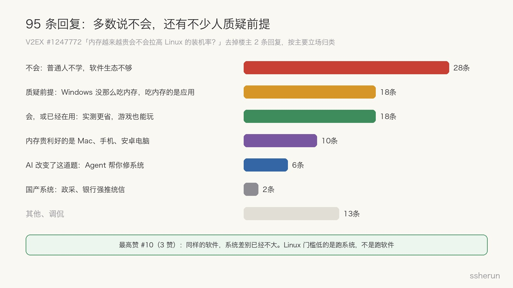
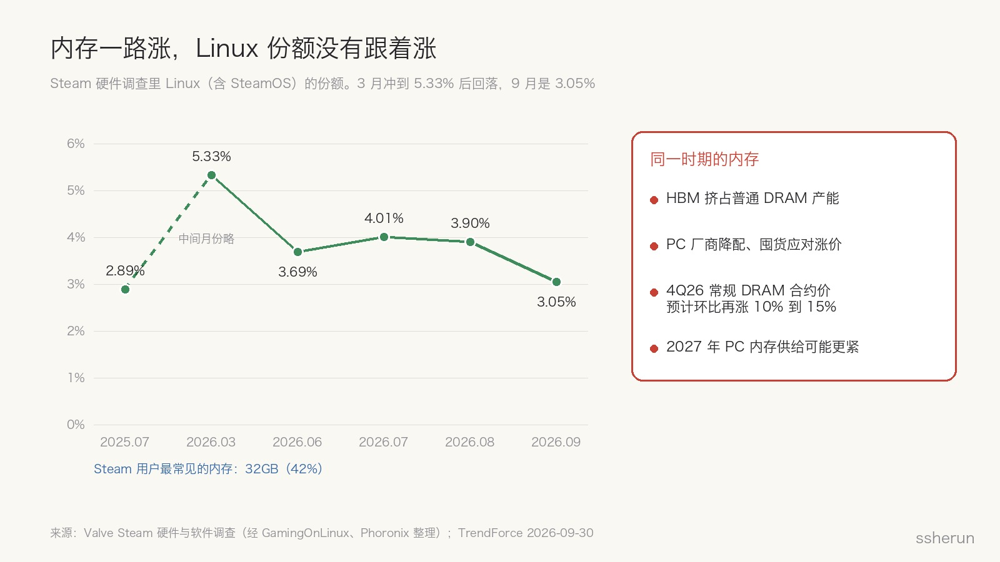
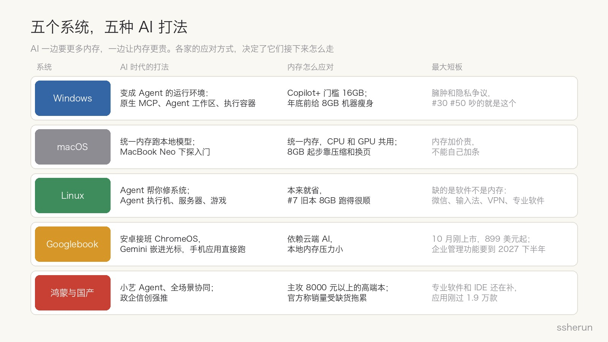
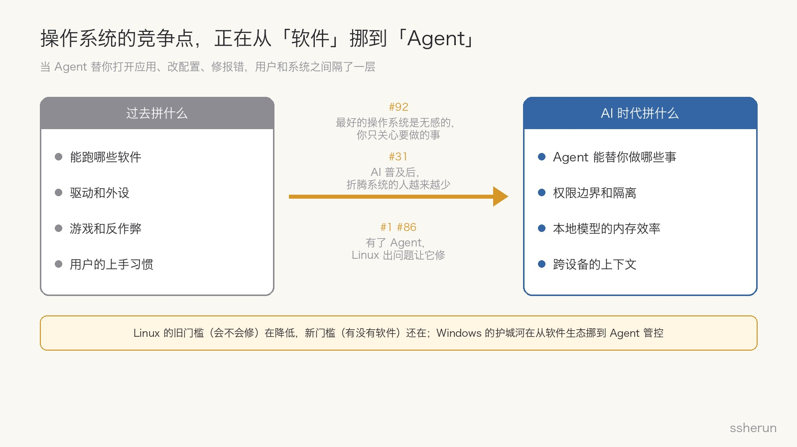

> 讨论来源：[内存越来越贵会不会拉高 Linux 的装机率？](https://www.v2ex.com/t/1247772)（V2EX，97 楼）

一位 V2EX 用户国庆闲着，给旧笔记本装了 Windows 10 和 Fedora 双系统，做了个对比：

- 开机什么都不干，Windows 占 9GB 内存，Linux 占 5GB；
- 日常干活（WPS、60 多个网页、QQ、微信、代理），Windows 经常在 13 到 15GB，Linux 最高 9GB。

他的推论很直接：同样 16GB 内存，Windows 下要考虑升级，Linux 下不用。内存越来越贵，能晚升就晚升，**Linux 桌面的装机率会不会因此提高？**

这个问题背后其实有两层。第一层是楼主问的：内存涨价会不会把人推向 Linux。第二层更大：AI 一边让内存变贵，一边又要更多内存，操作系统在这个时代会怎么变。

## 评论区：多数说不会，还有不少人质疑前提

去掉楼主自己的 2 条回复，按主要立场归类：

- **不会（28 条）**。理由集中在两点：普通人不会为了省几百块去学一个新系统（#72、#87），以及软件生态不够。#4 说得准，大部分软件同时支持两个平台的代价，是 Linux 版少功能；#95 说普通人用 Linux 的第一道关是输入法。
- **质疑前提（18 条）**。#30 说 Windows 自己不怎么吃内存，吃内存的是 Electron 套壳程序；#34 说 Linux 显得省，大多是因为上面没有对位的 Windows 软件，跑的东西少了；#50 说 Windows 预读取更积极，被占的内存需要时可以释放。楼主后来补充，他的 Windows「什么都不干」时其实常驻了五六个浏览器、迅雷、QQ、微信和 WPS（#66）。
- **会，或已经在用（18 条）**。#7 把 2017 年的 ThinkPad X1（板载 8GB）换成 CachyOS，启动只占 1.5GB；#56 的戴尔 8GB 本装 Win11 开机就快占满，装 Ubuntu 一切正常；好几位游戏玩家已经迁到 Linux。
- **内存贵利好的是别的平台（10 条）**。#57 说只会拉高苹果电脑的占有率；#45 提到 Google 新出的安卓电脑可能更适合普通人；#78 说内存涨价影响更大的是手机。
- **AI 改变了这道题（6 条）**。#1 说不玩游戏的话迁到 Linux 非常舒服，有啥问题找 Agent 就给修了；#83 说换 Linux 是因为用 AI 方便，不是因为内存贵。

全帖获赞最多的是 #10，一位用了快 20 年 Ubuntu 的用户。他的观察很克制：内存 4GB 以下时，小巧的 Linux 发行版确实更流畅；但到了 8GB、16GB，跑 WPS 这类臃肿软件，差别就不明显了。**Linux 对硬件要求低，是运行系统的门槛低，不是运行软件的门槛低。**

还有个小插曲：#65 贴了一段 AI 调研的截图，结论是内存涨价「有贡献，但不是主角」。#69 调侃：问一嘴 AI 就算做了一次调研。

## 数据：内存一路涨，Linux 份额没有跟着涨

内存确实在涨。TrendForce 9 月底的报告说，AI 服务器用的 HBM 持续挤占普通 DRAM 产能，供应商库存一直很低；第四季度常规 DRAM 合约价预计还要环比上涨 10% 到 15%。PC 厂商一边降配一边囤货，因为 2027 年更多产能会转向服务器，PC 内存可能更紧。

但 Linux 的份额没有跟着走。Steam 硬件调查里，Linux（含 SteamOS）从 2025 年 7 月的 2.89% 涨到 2026 年 3 月的 5.33%，之后就回落了，9 月是 3.05%。网页流量口径（StatCounter）年中一度报出 8% 以上，后来被修正回 4% 到 5% 的区间，波动和机器人流量有关，不能当作拐点。

另一个值得注意的数字：Steam 用户里最常见的内存配置已经是 32GB，占 42%。对这部分人来说，Windows 多占 4GB 根本不构成换系统的理由。#25 也说，32GB 内存的 Linux 用户不存在内存焦虑，真正的障碍是国内大厂的各种开发工具。

所以对楼主的问题，我的回答是：**基本不会**。#29 讲得最清楚：内存贵只会影响同时满足三个条件的人，对价格敏感、能熟练用 Linux、本来就在两个系统之间摇摆。这个交集很小。

## 内存贵真正推动的，是厂商自己瘦身

楼主的直觉并没有落空，只是落在了另一个地方。

今年 7 月底，微软 Windows 负责人 Pavan Davuluri 公开把「8GB 及以上机器的内存优化」列为到年底的重点工作，手段包括换用更高效的内存分配器、调优 WinUI 3、削减系统里 Chromium 和 WebView2 组件的开销。Windows Central 的报道提到，内存涨价和苹果 MacBook Neo 的竞争是两个主要推动力。

MacBook Neo 是苹果今年 3 月推出的入门本：A18 Pro 芯片、8GB 统一内存，599 美元起，教育价 499 美元。8GB 内存的 Mac 卖到这个价格，逼得 Windows 不得不面对「8GB 机器开机就卡」的问题。

这正好应验了 #5 的判断：内存贵不会让用户换系统，只会逼用户养成关后台的习惯，也逼系统厂商自己减肥。

## AI 的内存剪刀差：一边要更多，一边让它更贵

把视线拉远一点，会发现 AI 给操作系统出了一道矛盾的题。

一方面，AI **需要更多内存**。微软给 Copilot+ PC 定的硬门槛是 16GB 内存、40 TOPS 以上的 NPU 和 256GB 存储，NPU 再强、内存不到 16GB 也不算。本地跑大模型更吃内存。

另一方面，AI **让内存变得更贵**。数据中心的 HBM 抢走了产能，消费级内存只能涨价。

这两股力量撞在一起，各家操作系统给出了不同的答案。

## 五个系统，五种 AI 打法

**Windows：从「装软件的地方」变成「Agent 干活的地方」。** 微软这一年的动作很密集：Windows 原生支持 MCP（Agent 连接应用和系统工具的标准协议），应用可以把能力注册成「Agent 连接器」；Agent 工作区给 Agent 单独开一个账号和桌面，和用户的会话隔开；10 月 7 日，Microsoft 执行容器（MXC）正式上线，企业可以规定 Agent 能访问哪些文件和网络，GitHub Copilot、OpenAI Codex、OpenClaw 等已经支持。同一天微软还宣布，Copilot+ PC 上的 Copilot 将能读取本地上下文、在本机执行操作、调用本地模型。短板仍是老问题：臃肿和隐私争议，帖子里 #30、#50 吵的就是这个。

**macOS：本地 AI 的受益者，也是内存涨价的受害者。** #46 说统一内存是先见之明：CPU 和 GPU 共用一块内存，跑本地模型很合适。MacBook Neo 又把 Mac 推进了入门市场。但苹果的内存加价一向不便宜，而且焊死不能自己加条，内存成本一涨，最终都会传导到售价上。#51 和 #63 还在争论「8GB 等于 16GB」到底是真本事，还是靠压缩和换页撑出来的表象。

**Linux：旧门槛在被 AI 拆掉，新门槛还在。** 过去普通人怕 Linux，怕的是出了问题不会修。现在 Agent 能读日志、改配置、装驱动，#86 说有了 AI Agent 之后 Linux 桌面确实更丝滑了，再配合 btrfs 快照，改坏了也能回滚。但 #10 指出的问题 AI 解决不了：微信、输入法、客户的 VPN 客户端（#85）、国内大厂的开发工具（#25）、带反作弊的网游（#48），不会因为有了 Agent 就冒出 Linux 版。

**Googlebook OS：安卓接班 ChromeOS。** 这就是 #45 提到的「Google 新发的安卓电脑」。它的代号是 Aluminium，10 月 4 日正式发布，首批 5 款笔记本 899 美元起；Gemini 嵌进了鼠标光标，手机应用可以直接跑。它代表的是另一条路：把 AI 放在云端，本地内存压力小，靠手机生态吸引普通人。但它首发并不便宜，企业管理功能要到 2027 年下半年才来，现有 Chromebook 还要维护到 2034 年。

**鸿蒙和国产系统：政策和生态双轮驱动。** #43 说山东某国有银行网点已经强制使用统信 UOS。鸿蒙电脑的应用数量已经突破 1.9 万款，2025 年出货 14.1 万台，2026 年预计约 140 万台；小艺也在往「Agent PC」的方向走。但专业软件和主流 IDE 还在补，现阶段更适合轻办公和华为生态用户。

## 竞争点正在从「软件」挪到「Agent」

把五条路放在一起看，有一个共同的趋势：**用户和操作系统之间，正在隔上一层 Agent。**

过去选系统，看的是能跑哪些软件、驱动和外设全不全、游戏能不能玩、自己用不用得惯。这些是 Windows 几十年的护城河。

AI 时代，Agent 替你打开应用、改配置、修报错，用户越来越少直接碰系统。#92 说最好的操作系统是无感的，你只关心要做的事；#31 说 AI 普及以后，折腾系统、争论编程语言高下的人越来越少了。#81 讲了个更直接的例子：家里人用了几年他装的 GNOME，一直以为是美化过的 Windows。

在这个前提下，竞争点会挪到四个地方：

1. **Agent 能替你做哪些事。** 系统开放了多少能力给 Agent，应用有没有接入。
2. **权限边界和隔离。** Agent 能动哪些文件、能连哪些网络、出了事能不能追溯。微软在这一块走得最快，瞄准的是企业。
3. **本地模型的内存效率。** 在内存越来越贵的时代，同样的内存能跑多大的模型、同时开多少东西。
4. **跨设备的上下文。** 手机、电脑、平板之间能不能接着干，这是 Googlebook 和鸿蒙主打的方向。

## 我的判断

1. **内存涨价不会带来 Linux 桌面的拐点。** 楼主的方向没错，内存涨价确实是个有利因素，但它推动的是厂商瘦身，不是用户迁移。
2. **Linux 会以「看不见」的方式变多。** Agent 的执行机、云端沙箱、容器几乎都跑在 Linux 上；Googlebook OS 和安卓一样，底层就是 Linux 内核。普通人不在乎系统叫什么，但他们用的东西越来越多跑在 Linux 上。
3. **Linux 桌面的增长看两件事：Agent 能把「修系统」的成本降到多低，以及关键软件什么时候补齐。** 前者正在发生，后者取决于厂商，AI 帮不上。
4. **Windows 的护城河在迁移，而不是消失。** 从「软件都在这」挪到「Agent 在这里最可控」。只要企业 IT 认可这套管控，Windows 的地位比很多人想象的稳。
5. **Mac 会继续吸走 AI 重度用户，但价格是它的天花板。** 统一内存适合本地模型，可内存一涨，Mac 的售价也会跟着涨。

## 给 16GB 旧机用户的建议

如果你和楼主一样，手上是一台 16GB 的旧机：

- **不想折腾**：试试 Windows LTSC，关掉不需要的后台和开机自启（#14、#67、#68）。
- **开发者、不玩反作弊网游**：可以上 Linux，让 Agent 帮你配置，用 btrfs 快照兜底。先在虚拟机里验证一遍自己的工作流（#80）。
- **准备买新机**：先看内存是不是板载焊死的，按未来三年的需求一次买够。
- **想本地跑模型**：Mac 的统一内存，或者 32GB 起步的台式机。

## 写在最后

楼主问的是内存和 Linux，但这个帖子真正暴露的，是操作系统竞争的底层逻辑正在变化。

过去，普通人不用 Linux，是因为它难用，也因为软件不全。AI 正在解决前一个问题，却解决不了后一个。与此同时，Windows 和 macOS 也在用 AI 重新定义自己。未来几年，决定一个系统好不好用的，可能不再是它能跑哪些软件，而是 Agent 能在它上面替你做多少事。

## 相关文章

- [[openclaw-deployment-guide|OpenClaw 部署完全指南：5种方案任你选]]
- [[self-host-mail-server-local-llm-antispam|自建邮件服务器：docker-mailserver + rspamd + 本地 LLM 反垃圾]]
- [[windows-c-drive-cleanup-guide|Windows C盘清理完全指南：安全释放系统空间]]
- [[what-can-programmers-still-do|程序员还能做啥？AI 接走了写代码，剩下的才是大头]]
