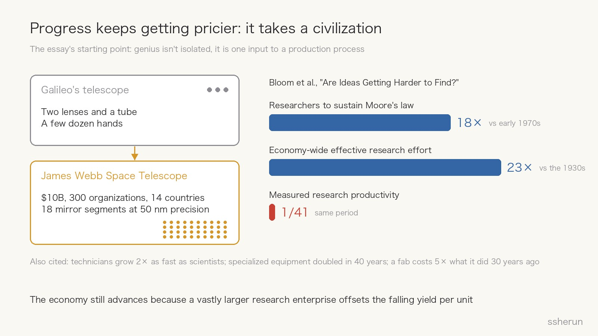
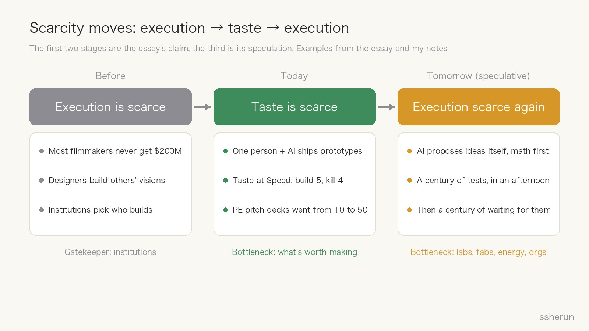
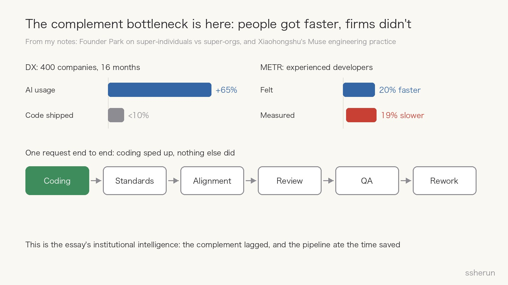
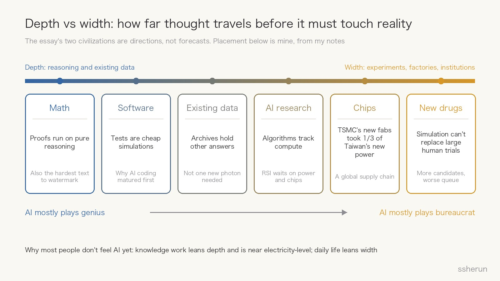

> Source: [The eternal complement](https://openai.com/index/the-eternal-complement/) by Hemanth Asirvatham and Elliott Mokski, OpenAI "Intelligence Age" platform, October 1, 2026. Authors' note: their views, not OpenAI's.

This is the first essay in the "next economy" series on OpenAI's new Intelligence Age platform. The title is poetic; the subtitle states the conclusion plainly: **genius machines might prove their greatest value doing monotonous work.**

My first reaction was that it offers a framework that ties together several notes already in my second brain: why people got faster with AI but companies didn't, why "virtual company" multi-agent setups usually fail, and why most people still don't feel AI in daily life. The essay first, then those additions.

## What the essay says

### Progress keeps getting more expensive

It opens with telescopes. Galileo widened our sight with two lenses and a tube, and a few dozen hands. The James Webb Space Telescope cost ten billion dollars and came from 300 organizations across 14 countries; its 18 mirror segments are engineered to 50 nanometer precision.

> It didn't just take brighter minds to see farther. It took a larger bureaucracy.

The numbers come from Nick Bloom and coauthors' well-known paper "Are Ideas Getting Harder to Find?":

- sustaining Moore's law takes more than 18 times as many researchers as in the early 1970s;
- since the 1930s, effective research effort rose 23-fold while measured research productivity fell by a factor of 41.

The economy still advances because a vastly larger research enterprise offsets the falling yield per unit.

### Ideas and execution are complements

Economists call two inputs complements when more of one raises the value of the other. A better telescope makes a good question more valuable, and a better question makes the telescope more valuable.

Some complements are physical: accelerators, energy, machinery. Others are invisible: laws, bureaucracy, funding, supply chains. The authors name the latter **institutional intelligence**, "the uncelebrated intelligence of execution."

My favorite line:

> We sometimes imagine superintelligence as a billion Einsteins. But a civilization of a billion Einsteins still needs most of them to mine the quarries and manage the accounting.

### Scarcity moves

The authors see three stages:

1. **Before, execution was scarce.** Most filmmakers never get two hundred million dollars to shoot their shot; most game designers spend their careers building other people's visions. Institutions decide who gets to build.
2. **Today, taste is scarce.** AI writes code, searches unfamiliar literature and turns sketches into prototypes, so one person can do what once took an organization. What's scarce is judgment: what's worth making, which question is worth asking, which of a thousand plausible directions to pursue.
3. **Tomorrow, execution may be scarce again.** Once AI proposes good ideas on its own (the authors think math is already showing signs), ideas arrive faster than infrastructure can absorb them.

### Two civilizations

The key variable: **how far thought can travel before it must make fresh contact with reality.**

- **Depth**: reasoning and existing evidence go a long way. Reality still has to be consulted, but radically economically: simulations rule out most options and only a few decisive experiments remain. The authors compare it to a jigsaw puzzle, easy at the start, easy at the end, hardest in the middle. Mendeleev predicting missing elements and the Standard Model predicting the Higgs decades early are both cases of the gaps telling you what belongs in them.
- **Width**: intelligence makes each consultation with reality cheaper but discovers many more reasons to consult it. Biology and new drugs are the archetype: simulation still can't replace large human trials, so more machine-generated candidates make empirical testing a bigger bottleneck.

The sharpest line in the width section:

> A superintelligence could design a century of experiments in an afternoon, then spend the century waiting for nature and machinery to follow through.

Hence the conclusion: on the width path, the superpower of superintelligence might not be genius but its **willingness to be the bureaucracy**. "Almost all machine intelligence would be deployed not to do the brilliant, but to do the boring."

The authors stress that both are directions, not forecasts.

## Addition one: the bottleneck is already visible inside companies

The essay works at the scale of civilizations, but complements failing to keep up is already happening in firms.

My second brain has a long Founder Park piece titled, roughly, "ChatGPT made everyone a super-individual but didn't make your company a super-organization." Its numbers:

- DX tracked 400 companies for 16 months: AI tool usage up 65%, code shipped up less than 10%;
- an NBER survey of 6,000 executives: over 80% saw no measurable productivity effect;
- in METR's experiment, experienced developers using AI were 19% slower while believing they were 20% faster.

Its diagnosis: individual output rose, but approvals, coordination and quality control stayed the same. **The bottleneck moved from "not producing enough" to "can't absorb it."** Xiaohongshu's Muse team reached the same conclusion: coding is one link in the chain, and standards checks, cross-role alignment, QA and rework eat back the time saved.

In the essay's terms, **institutional intelligence is the complement that lagged.** The Founder Park piece also has the classic analogy: factories installed electric motors in the 1890s and output barely moved for 30 years, until the 1920s, when someone redesigned the production line around electricity. "Genius designs the monument; institutions lay the stone" is the same story.

## Addition two: machines should be the bureaucracy, not imitate one

The essay ends by saying machine minds "must be bureaucrats too." That's easy to read as: let AI play each role in a company.

I think that's exactly the trap. My notes include a piece on why "virtual company" multi-agent setups usually fail: naming agents PM, architect, developer and tester and having them hand documents down the line like departments. The author's verdict:

> It solves a human bottleneck, not a model bottleneck.

Humans divide labor because attention is limited, expertise is siloed and switching is expensive. Copying that structure onto models adds a lossy handoff at every step.

Muse's answer looks much more like real institutional intelligence: every role shares one context, every turn runs programmatic checks, side-effecting actions pause for confirmation and are logged, and task state is stored in a structured, recoverable form.

So my reading is: **the institutional intelligence AI provides should live in shared context, verification, audit and rollback, not in copied departments and reporting lines.** A bureaucracy's value is getting a long chain of local actions right, not having many offices.

## Addition three: taste is scarce now, and judgment bandwidth breaks first

The essay says taste is today's scarce input. Two notes make that concrete.

One is "Taste at Speed": taste is a **filter function**, not an accelerator. The workflow it describes builds five prototypes for an idea, kills four, then writes the spec for the survivor; Anthropic tried hundreds of versions while prototyping Cowork. The 80% kill rate is the point. Without taste, speed just means doing the wrong thing faster.

The other is from the Founder Park piece: a private equity firm got 10 deals last year and 50 this year, each pitch deck polished by AI. Five times the noise, the same signal.

Together they show the prelude to the essay's "execution-starved tomorrow": **once ideas multiply, judgment bandwidth breaks first**, before labs and factories do. Taste isn't only picking well; it's also being willing to cut.

## Addition four: depth moves first, width moves slowly

The two civilizations are speculation about the future, but they're also a useful way to place today's fields. The chart above is my placement, based on my notes:

- **Math**: the essay calls it the purest depth domain. When I wrote about OpenAI's text watermarking last week, the technical report admitted detection is markedly weaker on math, because each step of a derivation has essentially one correct form and no word-choice randomness to borrow. "One correct answer per step" is exactly why reasoning can travel so far alone.
- **Software**: tests are cheap simulations, so you can consult reality often and fast. That may be why AI coding matured first.
- **Existing data**: the essay notes that archives recorded to answer one question may hold answers to many others, "without gathering a new photon." That's also why I keep a second brain: the material is already there; what's missing is time to understand it.
- **AI research itself**: in "An Alien Mind," OpenAI's chief scientist says algorithmic progress tends to track access to compute. Follow that through and **recursive self-improvement is itself a width process**: it waits on fabs, power and data centers.
- **Chips**: from my TSMC notes, Apple gave TSMC a whole generation of chips on condition that it commit nine billion dollars and 6,000 workers to new capacity; TSMC's new fabs consumed a third of Taiwan's new electricity.
- **New drugs**: the essay's own example. More candidates, longer queues for human trials.

The chart also explains what Nathan Lambert described in "When will average people feel AI's impact?": knowledge work is approaching electricity-level change while food, housing and transport have barely moved. **Knowledge work leans depth, daily life leans width, and they run on two different clocks.**

## Addition five: where people fit

The essay's last section gives three reasons human curiosity still matters: our duty to understand doesn't vanish because machines are smarter; even if we're worse at both kinds of intelligence, we may have a **comparative advantage** in frontier ideas; and variety has value in itself.

Two field examples from my notes fit:

- In a V2EX thread on AI and jobs, someone put it simply: "AI does AI's work, humans do human work, and humans have work because they're cheaper than AI." That's comparative advantage, folk version.
- In an interview with Chinese fan-translation crews, AI takes transcription, timing and first drafts, while people keep proofreading, typesetting taste and community. They don't fear AI because their goal is "let people understand what we love," not preserving the job steps.

My own experience matches. Most of what my agent workspace does every day is exactly the essay's boring work: scheduled fetching, pre-publish checks, rolling back a failed upgrade. What actually needs me is deciding what to write, what to cut and what to trust.

## My reservations

- **Where it's published.** One critique points out that the essay sits on the platform of a company that sells frontier intelligence, and "intelligence and execution are complements; execution is the bottleneck" suits that business. The authors' disclaimer helps, but keep it in mind.
- **The data is mostly solid.** Bloom et al.'s 18×, 23× and 1/41 match the paper; the technician, equipment and fab-cost figures are secondary citations.
- **The two civilizations can't be falsified.** The authors say so themselves. The most testable claim is the humblest one: once AI makes prototypes cheap, does the scarce skill shift to judging what's worth building? My notes already hold plenty of evidence that it does.
- **Institutional intelligence is treated as a black box.** The essay doesn't say where institutions actually get stuck. The cases above suggest the choke points are coordination, context handoffs, review and verification bandwidth, which are precisely the bureaucratic jobs AI can take on first, provided the process is redesigned around it.

## What to do with it

1. **Individuals: train taste.** Execution is cheap now. Prototype fast, cut most of it, and keep what you learn.
2. **Teams: put AI into the boring parts of the organization.** Review, alignment, verification, audit. Build shared context before adding more agents.
3. **When choosing a field, ask depth or width.** Depth domains (software, math, analyzing existing data) move fast and so does competition; width domains (biology, hardware, energy) move slowly, but the bottleneck is matter and organization, and selling the complements is the steadier business.
4. **Don't look down on boring work.** If the future leans width, that's where most of the value is. Machines will do it, and so will people.

The essay closes: "Our story to come—and the pace of its progress—depend on whether great minds need more of the world, or whether they do more with less." Inside today's companies, at least, the answer is already clear: build the other half of the world first.

## Related posts

- [[ai-organization-redesign|AI made people faster. Why didn't the company get stronger?]]
- [[muse-fast-code-slow-delivery|Code Is Fast, Delivery Isn't: Muse and One Context]]
- [[forceful-systems-fly-off-multi-agent-illusion|Why "virtual company" multi-agent setups usually fail]]
- [[taste-at-speed-pm-skill|Taste at Speed: when building is cheap, PM skill changes]]
- [[when-average-people-feel-ai|When Average People Feel AI: Electricity for Knowledge Work, a Rounding Error Outside]]
- [[openai-alien-mind|An Alien Mind: Alignment Unsolved—Don’t Scale Flat-Out]]
- [[hanhua-groups-least-afraid-of-ai|Why fan-translation crews may fear AI the least]]
