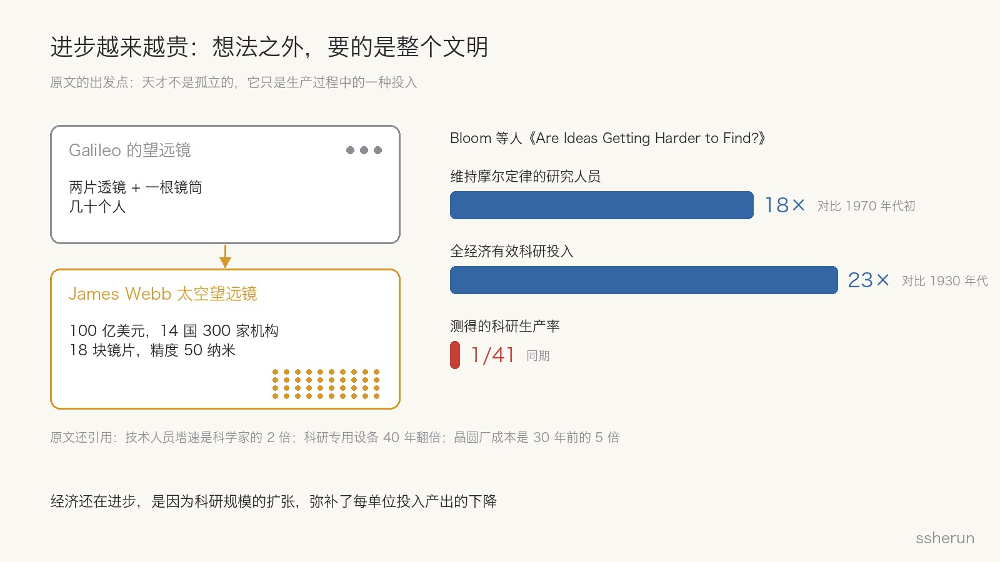
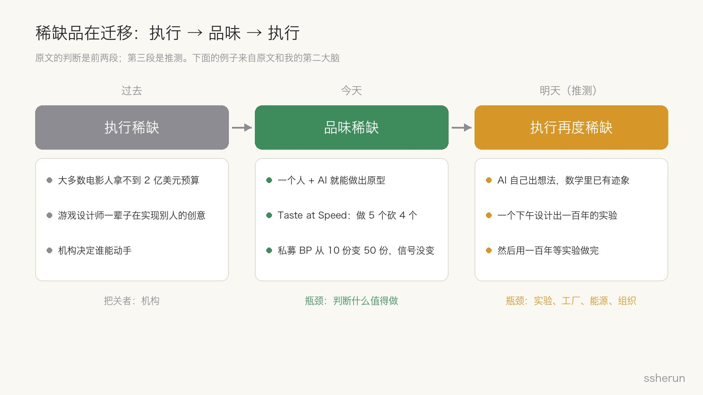
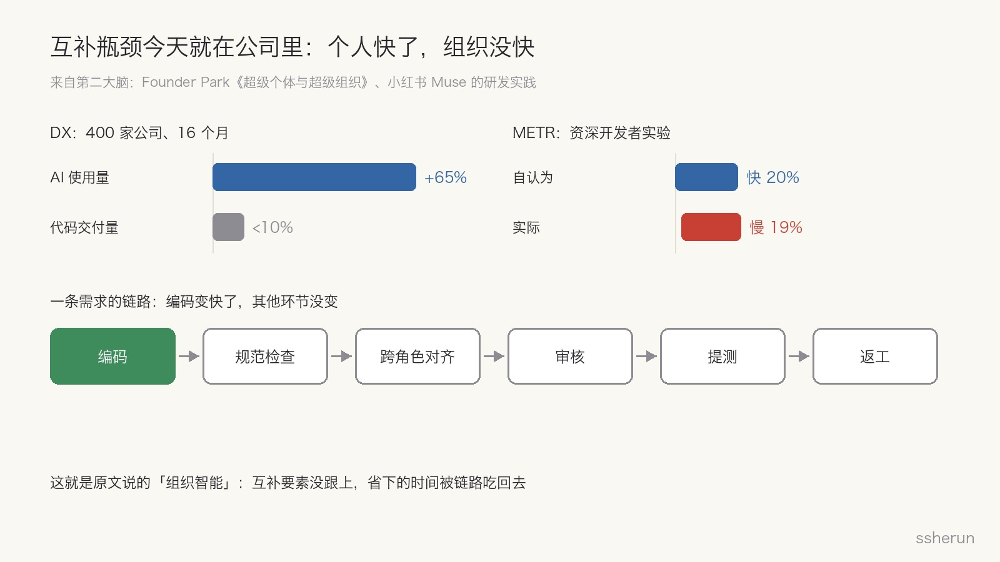
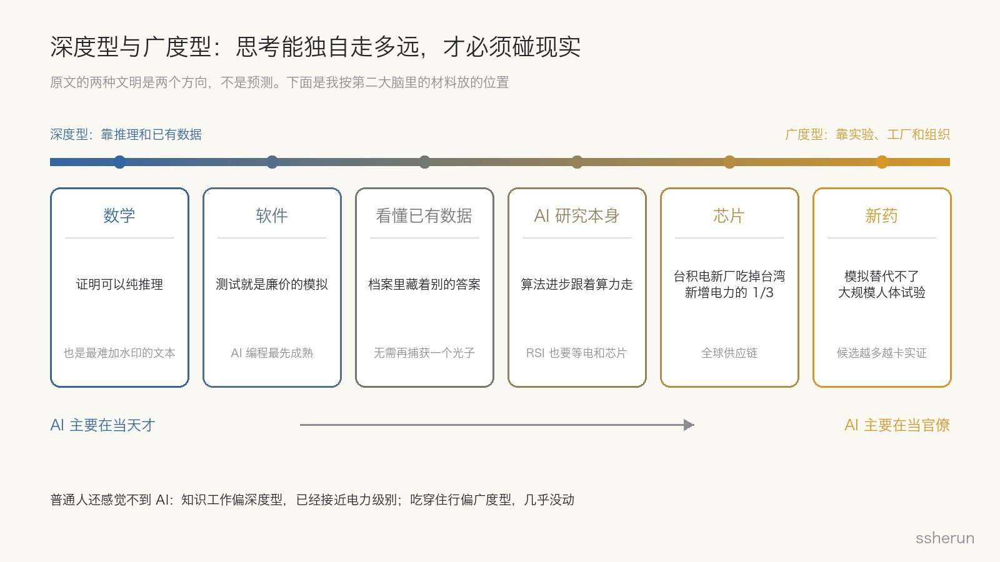

> 原文：[永恒的互补关系](https://openai.com/zh-Hans-CN/index/the-eternal-complement/)（英文版 [The eternal complement](https://openai.com/index/the-eternal-complement/)），Hemanth Asirvatham、Elliott Mokski，OpenAI「Intelligence Age」平台，2026-10-01。作者按：仅代表个人观点，不代表 OpenAI。

这是 OpenAI 新平台「Intelligence Age」上「下一代经济」系列的第一篇。标题很文艺，副标题把结论说得很直白：**天才般的机器，可能在单调的工作中体现出最大的价值。**

我读完的第一反应是，这篇文章给了一个很好用的框架，能把我第二大脑里散落的好几篇笔记串起来：为什么个人用 AI 变快了公司却没变快，为什么「虚拟公司式」多 Agent 大多会失败，为什么普通人到现在还感觉不到 AI。下面先讲原文，再讲这些补充。

## 原文在说什么

### 进步越来越贵

文章从望远镜讲起。Galileo 用两片透镜和一根镜筒拓宽了人类视野，几十个人就够了。James Webb 太空望远镜花了 100 亿美元，由 14 个国家的 300 家机构造出来，18 块镜片的加工精度是 50 纳米。

> 要看得更远，所需的不只是更聪明的头脑。还需要更庞大的组织管理体系。

数据来自 Nick Bloom 等人那篇著名的《Are Ideas Getting Harder to Find?》：

- 维持摩尔定律所需的研究人员，是 1970 年代初的 18 倍以上；
- 1930 年代以来，全经济的有效科研投入涨了 23 倍，测得的科研生产率却降到原来的 1/41。

经济还在进步，是因为科研规模的扩张弥补了每单位投入产出的下降。

### 想法和执行是互补品

经济学里，一种投入增加会提高另一种投入的价值，两者就互为补充。好望远镜让好问题更值钱，好问题也让望远镜更值钱。

有些互补要素是物质的：加速器、能源、设备。另一些看不见：法律、管理体系、融资、供应链。作者给后者起了个名字，叫**组织智能**（institutional intelligence），「一种鲜少受到赞颂的执行智慧」。

文章里我最喜欢的一句：

> 我们有时会把超级智能想象成十亿个 Einstein。但即便是由十亿个 Einstein 组成的文明，仍然需要其中的大多数去采石和管理账目。

### 稀缺品在迁移

作者认为稀缺品会经历三个阶段：

1. **过去，执行稀缺。**大多数电影人一辈子拿不到 2 亿美元去放手一试，大多数游戏设计师整个职业生涯都在实现别人的创意。机构决定谁能动手。
2. **今天，品味稀缺。**AI 能写代码、查陌生领域的文献、把草图变成原型，一个人就能做以前要一个组织才能做的事。稀缺的变成了判断：什么值得做，什么问题值得问，上千个可行方向里选哪个。
3. **明天，执行可能再度稀缺。**当 AI 自己也能提出好想法（作者说数学领域已有迹象），想法涌现的速度会超过基础设施的承接能力。

### 两种文明

关键变量是：**思想在必须再次接触现实之前，能独自走多远。**

- **深度型文明**：推理和已有数据就能走很远。向现实求证仍然需要，但会极其节省：模拟筛掉大部分可能，只做少数关键实验。作者用拼图打比方，开头容易、收尾也容易，中间最难；门捷列夫预言未发现的元素、标准模型提前几十年预言希格斯玻色子，都是「快拼完时空缺会自己说话」。
- **广度型文明**：智能让每次求证更便宜，却发现了更多需要求证的理由。生物和新药是典型，模拟还替代不了大规模人体试验，机器提出的候选越多，实证越成瓶颈。

广度型那一节有一句很狠的话：

> 超级智能可能在一个下午就设计出够做一百年的实验，然后用整整一百年，等待自然过程和机械设备将它们逐一完成。

于是结论是：如果走的是广度型这条路，超级智能的过人之处可能不是天才，而是**愿意承担组织管理工作**。「几乎所有机器智能都将被用于做枯燥的工作，而非展露才华。」

作者也强调，两种文明只是两个方向，不是预测。

## 补充一：这个瓶颈今天在公司里就看得见

原文讲的是文明尺度，但「互补要素跟不上」这件事，在公司里已经发生了。

我在第二大脑里整理过 Founder Park 的一篇长文，标题就是《ChatGPT 让所有人变成了超级个体，却没让你的公司成为超级组织》，里面有几组数据：

- DX 跟踪了 400 家公司 16 个月，AI 工具使用量涨了 65%，代码交付量只涨了不到 10%；
- NBER 调查 6000 名企业高管，超过 80% 说 AI 对生产力没有可测量的影响；
- METR 的实验里，用 AI 的资深开发者实际慢了 19%，却自认为快了 20%。

那篇文章的诊断是：个人产出提升了，审批、协作、质量把关还是老样子，**瓶颈从「做得不够」变成了「消化不了」**。小红书 Muse 团队的实践也是同一个结论：编码只是链路的一环，规范检查、跨角色对齐、提测、返工会把省下的时间吃回去。

用原文的话说，这就是**组织智能这个互补要素没跟上**。那篇文章还有个历史类比：1890 年代工厂换上电动机，之后 30 年产出几乎没变，直到 1920 年代有人按电力的逻辑重新设计生产线，红利才释放出来。原文说「天才设计丰碑，组织体系一石一砖地将其建起」，讲的是同一件事。

## 补充二：机器要当官僚，但别模仿人类官僚

原文的结尾说，机器的头脑「也必须成为组织管理者」。这句话很容易被理解成：那就让 AI 扮演公司里的各个角色。

我觉得这恰恰是坑。第二大脑里有一篇《力大砖飞：为什么虚拟公司式多 Agent 架构大多会失败》，批评的就是把 Agent 命名成 PM、架构师、开发、测试，让它们像部门一样层层交接文档。作者的判断是：

> 它解决的是人的瓶颈，不是模型的瓶颈。

人类需要分工，是因为注意力有限、专业壁垒高、切换成本大。照搬这套结构给模型，每多一次交接就多一次信息失真。

Muse 的解法反而更像原文说的「组织智能」：所有角色共享同一条上下文，每一轮都有程序化的检查，有副作用的操作要先暂停确认并记日志，任务状态结构化保存、可以恢复。

所以我的理解是：**AI 承担的组织智能，应该长在共享上下文、验证、审计和可回滚上，而不是复制部门和汇报线。**官僚的价值在于让一长串局部动作都做对，而不在于有几个科室。

## 补充三：品味是今天的稀缺品，判断带宽会先被挤爆

原文说今天的稀缺品是品味。第二大脑里有两份材料可以把这句话说得更具体。

一份是《Taste at Speed》：品味是一个**过滤函数**，不是加速函数。文章描述的新流程是一个想法先做 5 个原型、砍掉 4 个，再给幸存者写文档；Anthropic 做 Cowork 时，原型阶段试了数百个版本。80% 的淘汰率才是重点，没有品味，速度只意味着更快地做错事。

另一份还是 Founder Park 那篇里的例子：私募机构去年收到 10 个交易机会，今年 50 个，每份商业计划书都被 AI 精心打磨过。噪音多了 5 倍，信号没变。

两份放在一起，能看到原文「明天执行再度紧缺」的前奏：**想法变多以后，最先被挤爆的是判断的带宽**，然后才轮到实验和工厂。品味不只是会挑，还包括敢砍。

## 补充四：深度型先动，广度型慢

两种文明在原文里是关于未来的推演，但拿来给今天的领域排位置也很好用。上图是我按第二大脑里的材料放的：

- **数学**：原文说它是最纯粹的深度型。巧的是，前几天写 OpenAI 文本水印时，技术报告承认数学类文本的检测率显著更低，原因是推导的每一步几乎只有一个正确写法，没有选词的随机性可借。「每一步只有一个正确答案」，正是推理能独自走很远的原因。
- **软件**：测试就是廉价的模拟，可以大量、快速地向现实求证，这也许是 AI 编程最先成熟的原因。
- **看懂已有数据**：原文说科学档案里为回答一个问题而记录的观测，可能藏着许多其他问题的答案，「无须再捕获一个光子」。这也是我做第二大脑的理由：资料早就在那里，缺的是看懂它们的时间。
- **AI 研究本身**：OpenAI 首席科学家在《外星心智》里说，算法进步往往跟算力获取绑在一起。推下去，**递归自我改进本身也是广度型的**，它要等晶圆厂、电力和数据中心。
- **芯片**：台积电那篇笔记里有个细节，苹果把整代芯片交给台积电，前提是对方准备 90 亿美元建厂资金和 6000 名工人；台积电新增的晶圆厂吃掉了台湾新增电力的 1/3。
- **新药**：原文自己的例子，候选越多，越卡在人体试验。

这张图也解释了 Nathan Lambert 在《普通人何时能感受到 AI 冲击》里说的现象：知识工作侧已经接近电力级别，吃穿住行几乎没被改写。**知识工作偏深度型，日常生活偏广度型，两边走的是两套时钟。**

## 补充五：人的位置

原文最后一节给了人类三个理由：求知的责任不因机器更聪明而消失；即使两方面都不如机器，人在前沿智能上可能有**比较优势**；多样性本身有价值。

第二大脑里有两个现场例子能对上：

- V2EX 关于 AI 和就业的讨论里，有人说了一句很朴素的话：「AI 干 AI 的活，人类干人类的活，且人类有活干是因为比 AI 便宜。」这就是比较优势的民间版本。
- 汉化组那篇访谈里，听写、打轴、初翻交给 AI，校对、审美、社群留给人。他们不怕 AI，是因为目标是「让喜欢的东西被看懂」，不是保住工序。

我自己用 AI 的体感也一样。我的 Agent 工作区每天干的，大部分就是原文说的「无聊的活」：定时抓取信息、发布前校验、升级失败了回滚。真正需要我判断的，只是写什么、砍什么、信什么。

## 我对这篇文章的保留

- **发表的语境**。有评论指出，这篇文章发在一家卖前沿智能的公司平台上，「智能和执行互补，执行才是瓶颈」的叙事对它有利。作者按已经免责，但读的时候要记着。
- **数据大体可靠**。Bloom 等人的 18 倍、23 倍、1/41 与原论文一致；技术人员增速、设备使用、晶圆厂成本三项是二手引用。
- **两种文明不可证伪**。作者自己也承认只是方向。最可检验的反而是最朴素的那条：AI 降低原型成本之后，稀缺技能是否转向「判断什么值得做」。这条我在第二大脑里已经攒了不少正面证据。
- **组织智能被当成了黑箱**。原文没拆组织具体卡在哪。从上面的案例看，卡点主要是协调、上下文传递、审核和验证的带宽，而这些恰恰是 AI 可以最先承担的「官僚工作」，前提是先把流程按 AI 重新设计。

## 可以怎么做

1. **个人：练品味。**执行已经变便宜，快速做原型、大比例淘汰，把判断沉淀下来。
2. **团队：把 AI 放进组织里无聊的环节。**审核、对齐、验证、审计。先建共享上下文，再加 Agent 数量。
3. **选赛道时看深度还是广度。**深度型（软件、数学、分析已有数据）变得快，竞争也快；广度型（生物、硬件、能源）慢，但瓶颈在实物和组织，卖「互补要素」的生意更稳。
4. **别看不起无聊的活。**如果未来真的偏广度型，大部分价值就在那里，机器会去做，人也会继续做。

原文最后一句是：「我们未来的故事，以及进步的速度，取决于杰出的头脑是需要世界提供更多资源，还是能用更少的资源成就更多。」至少在今天的公司里，答案已经很清楚：先把世界的那一半建好。

## 相关文章

- [[ai-organization-redesign|AI 让员工变快了，为什么公司没变强？]]
- [[muse-fast-code-slow-delivery|AI 写得飞快，交付却没变快：小红书 Muse 与 One Context]]
- [[forceful-systems-fly-off-multi-agent-illusion|力大砖飞：为什么“虚拟公司式”多 Agent 架构大多会失败]]
- [[taste-at-speed-pm-skill|Taste at Speed：当构建成本趋近于零，PM 的核心技能变了]]
- [[when-average-people-feel-ai|普通人何时能感到 AI：圈内像电，圈外还是四舍五入]]
- [[openai-alien-mind|外星心智：对齐未解，不能全速扩模型]]
- [[hanhua-groups-least-afraid-of-ai|汉化组为何最不怕 AI：同好、脏活与「大家都能看」]]
