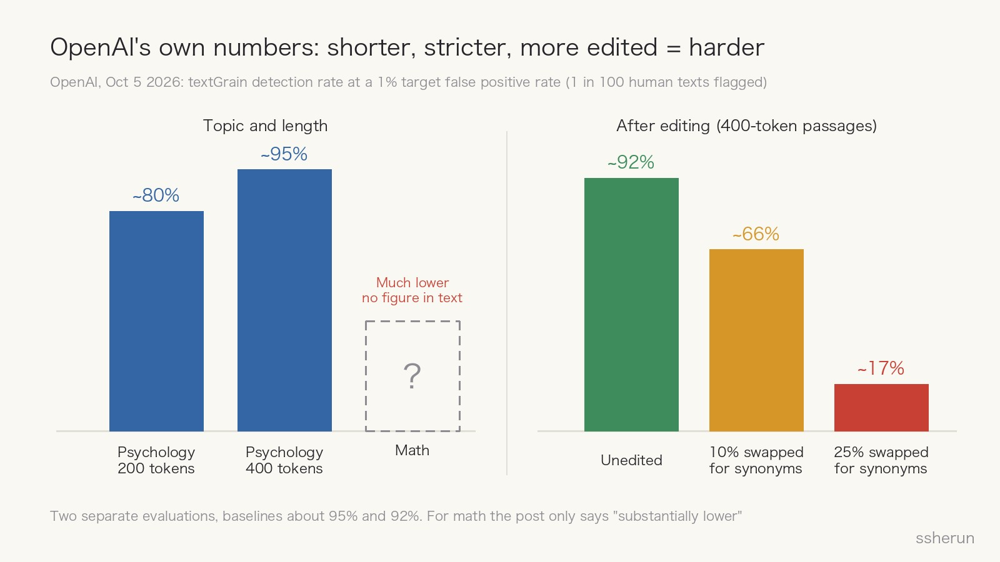
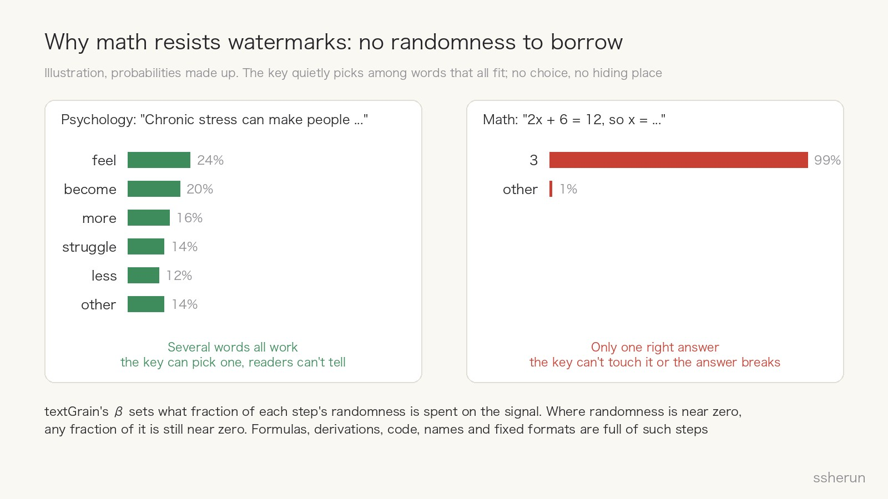
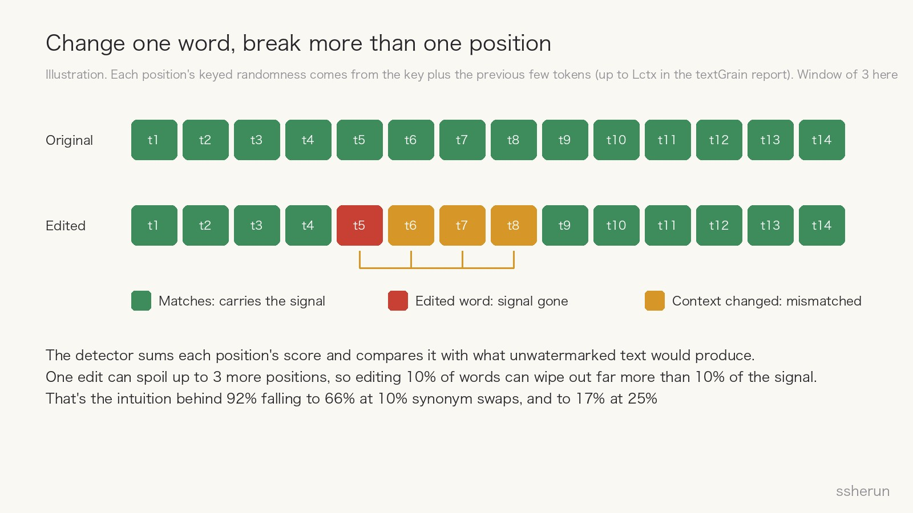
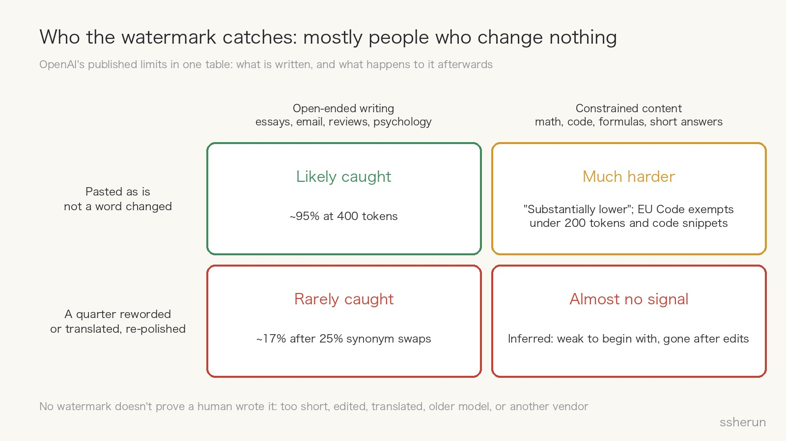

> Source: [Our approach to EU text provenance rules](https://openai.com/index/eu-text-provenance/) (OpenAI, Oct 5 2026)
> Technical report: [textGrain: Entropy-Calibrated Watermarking for Language Model Text](https://cdn.openai.com/pdf/e9508624-d767-41b6-a26d-e34ca798ada6/textgrain-entropy-calibrated-watermarking-for-language-model-text.pdf)

On October 5, OpenAI announced it would start watermarking text. The reason is simple: Article 50 of the EU AI Act has applied since August 2, and it requires generative AI providers to mark generated text in a machine-readable, detectable way.

The rollout has three parts:

- ChatGPT and Codex in the EU will add an invisible watermark to text output by default over the coming weeks;
- API customers worldwide can opt in; it is off by default;
- The detector is only available to approved researchers and organizations, not the public.

The most interesting thing in the announcement isn't that OpenAI is watermarking text. It's that OpenAI laid out the limits itself: **math is hard to watermark, and editing sharply reduces detection.** Neither is a tuning problem. Both follow from how text watermarks work.

## OpenAI's own numbers

All of these are at a 1% target false positive rate, meaning roughly 1 in 100 human-written passages would be wrongly flagged.

- **Length**: for psychology answers, about 80% of 200-token passages were detected, and about 95% of 400-token passages.
- **Topic**: detection was "substantially lower" for math. The post shows this only in a chart, with no number in the text, so I won't invent one.
- **Editing**: unedited 400-token passages were detected about 92% of the time. Swapping 10% of words for synonyms dropped that to 66%. Swapping 25% dropped it to 17%.

Put plainly: **a passage that was caught nine times out of ten is caught less than two times out of ten once a quarter of its words change.**

## Why math resists: no randomness to borrow

To see why, you need to know how a text watermark gets in.

A language model writes one token at a time. At each step it assigns probabilities to candidate words and samples one. A watermark **uses a secret key to quietly steer that sampling**: when several words fit, it nudges the choice toward one of them. Each word looks normal on its own, but across a passage the choices line up with the key statistically, and a detector holding the same key can measure that.

The catch is the phrase "when several words fit."

- In a psychology explanation, "Chronic stress can make people..." can continue with "feel," "become," "more," or "struggle." The model was going to pick among them at random anyway. The watermark borrows that randomness and readers notice nothing.
- In a math derivation, "2x + 6 = 12, so x =" can only continue with 3. The watermark can't touch it without breaking the answer.

The technical report makes this precise. textGrain uses a parameter β to cap what fraction of each step's randomness (its entropy) may be spent on the watermark, and shows that the dependence between word choice and key equals exactly the entropy removed. So **where a step's entropy is near zero, any fraction of it is still near zero, and so is the signal you can hide there.**

Derivations, formulas, code, names and fixed formats are full of near-zero-entropy steps. Fewer usable positions means less evidence per passage, and lower detection.

OpenAI's help center says it more bluntly: even unchanged wording does not guarantee a detectable watermark "in text with little room for different word choices." The EU Code of Practice simply exempts two categories: text under 200 tokens, and code snippets.

## Why small edits do so much damage: one word breaks a run

The second problem is editing. Swapping 10% of words costs 26 points of detection, which looks out of proportion. A detail in the technical report explains it.

At each position, textGrain derives its keyed randomness from the key plus the preceding few tokens. The detector recomputes that randomness position by position, checks whether the chosen word matches, sums the scores, and compares the total with what unwatermarked text would produce.

So changing one word breaks more than one position:

- the edited word no longer carries a signal;
- the next few positions now have a different context, so their randomness changes and their original signal no longer matches.

Editing 10% of words can wipe out far more than 10% of the scoring positions. If the total falls short of the threshold, the detector can only say "not detected." This is my intuitive reading of the mechanism. OpenAI didn't break the numbers down this way, but the direction is consistent.

There are also more thorough ways around it. Back in 2024 OpenAI admitted that "globalized tampering," such as translating and translating back or rewording with another model, makes the watermark "trivial to circumvent."

## Who actually gets caught

Put the limits in one table and the result is a little ironic:

- **Open-ended writing pasted as is**, such as essays, email and reviews: likely caught.
- **Constrained content pasted as is**, such as math, code and short answers: much harder, and code snippets don't even need a watermark under the EU Code.
- **Anything reworded by a quarter, translated, or polished by another model**: rarely caught.

The watermark mostly catches **people who paste a long ChatGPT answer word for word**. Anyone actually trying to hide AI use only needs to change a fifth to a third of the words.

OpenAI lists five things a watermark **cannot** tell you. Anyone planning to make decisions with it should read them:

1. It does not measure human contribution;
2. It does not establish ownership or responsibility;
3. It does not identify the user;
4. It does not verify accuracy;
5. **No detected watermark does not prove human authorship.** The text may be too short, edited or translated, or come from an unsupported model, a pre-watermark version, or another company.

## From 99.9% to 17%

There is a backstory.

In August 2024, the Wall Street Journal reported that OpenAI had a working text watermark that internal documents called "99.9% effective" when enough new text was generated, and that it had sat unreleased for about a year. Two numbers stood out:

- nearly 30% of loyal users said they would use ChatGPT less if it watermarked and a rival didn't;
- 69% believed anti-cheating technology would lead to false accusations.

OpenAI's public reasons at the time were that global rewording made it easy to circumvent, and that it could stigmatize non-native English speakers who use AI as a writing tool.

Two years later the watermark has shipped, not because of a technical breakthrough but because the law requires it. The rollout shows restraint everywhere:

- it is on by default only in the EU;
- the detector is not public;
- much of the announcement explains what the watermark can't tell you.

99.9% and 17% don't contradict each other. The first is the ideal case: long and untouched. The second is what happens after light edits in real use. **Publishing the real-world curve is far more useful than the 99.9% headline.**

## My take

**First, a watermark is a compliance tool, not a lie detector.** It answers a narrow question: does this text carry a statistical trace of an OpenAI model? It can't answer "is this cheating," "is this plagiarism," or "how much AI did this person use."

**Second, it is weakest exactly where people most want it.** Teachers most want to check math and programming homework, which carry the weakest signal. Code snippets are exempt in the EU altogether.

**Third, 1% false positives add up at scale.** A school that collects 10,000 human-written assignments a term would wrongly flag about 100 of them at 1%. That's why OpenAI isn't making the detector public, and it's the same risk I wrote about in the post on a 45-year-old paper being flagged as AI.

**Fourth, "not detected" carries almost no information.** Too short, edited, translated, another model: any one of these defeats it. Treating "not detected" as "human-written" is as risky as treating "detected" as "cheating."

**Fifth, text will always be the weakest layer of content provenance.** Images and audio can carry both C2PA metadata and a SynthID watermark, so the watermark survives when metadata is stripped. Plain text can't carry metadata, so it relies on the watermark alone, which in turn relies on randomness in word choice. The EU Code asks for at least two techniques but lets free-form text use one, which concedes the point.

The more meaningful direction is the one OpenAI mentions at the end: **telling AI assistance apart from AI authorship.** Almost any text today may have been touched by AI, so "is there an AI trace" is becoming the wrong question.

## What it means for you

**Teachers and reviewers**

- Don't treat a watermark result as evidence. At most it is a lead.
- For math and programming, assess the process: have students explain their reasoning aloud, derive on the spot, or fix a flawed solution. AI can't do these for them, and no detector is needed.

**Developers and API customers**

- If you serve the EU and need compliance, turn it on. The cost is close to zero: across eight benchmarks OpenAI saw little difference, for example 94.44% vs 93.94% on GPQA Diamond.
- But don't promise your users you can identify AI-generated content, especially if you generate code, where the signal is weak to begin with.

**Writers**

- Being flagged doesn't mean you plagiarized, and not being flagged doesn't make you safe.
- What actually proves your work is the process: drafts, version history, notes. No watermark can give you that.

## Closing

A text watermark hides its signal in the freedom of word choice. More freedom, more room to hide; less freedom, less room. Math has no freedom, so nothing fits. Editing redistributes the freedom, so the signal washes out.

The most honest thing OpenAI did here was publish that curve. Once you understand it, you won't expect too much from text watermarks: **they let people who comply prove it, but they can't stop people who want to hide.**

## Related posts

- [[ai-proof-human|When a 45-year-old paper is flagged as AI]]
- [[chatgpt-critical-thinking-students|ChatGPT Improves Answers; Critical Thinking Widens Ideas]]
- [[ai-code-review-ratio|How much AI-written code should you review? Go by risk]]
