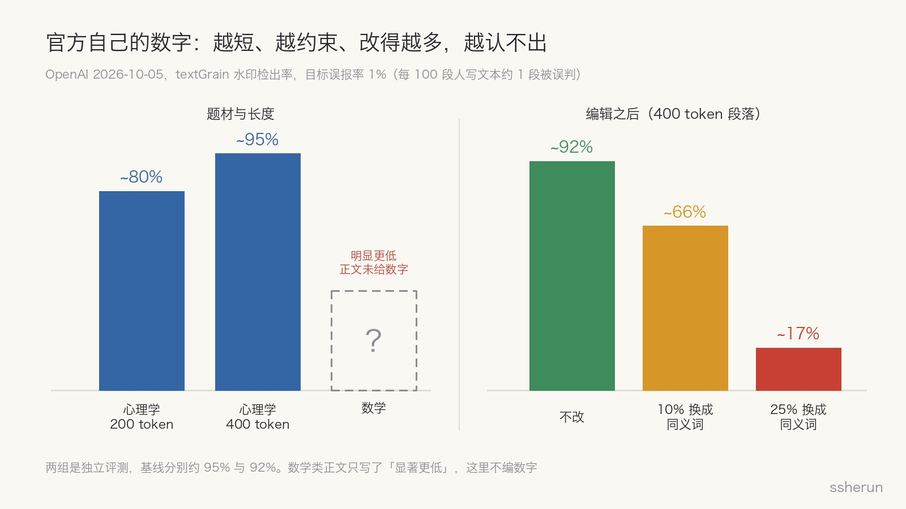
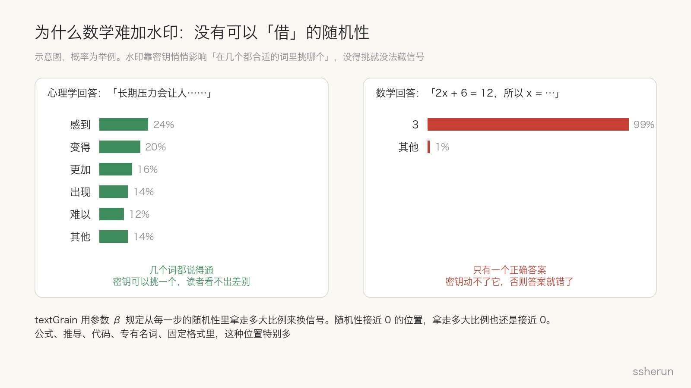
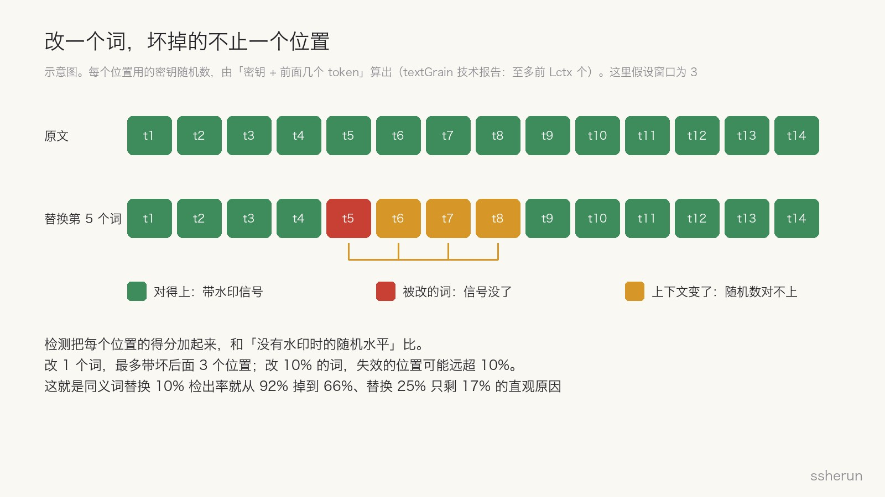
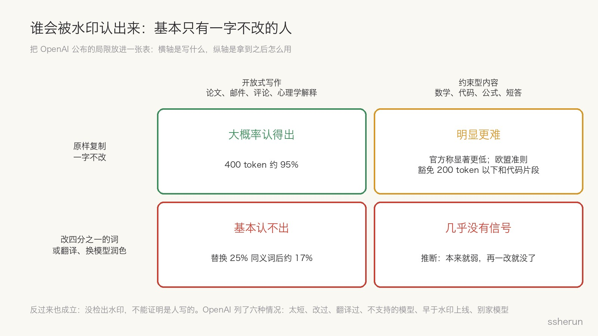

> 原文：[Our approach to EU text provenance rules](https://openai.com/index/eu-text-provenance/)（OpenAI，2026-10-05）
> 技术报告：[textGrain: Entropy-Calibrated Watermarking for Language Model Text](https://cdn.openai.com/pdf/e9508624-d767-41b6-a26d-e34ca798ada6/textgrain-entropy-calibrated-watermarking-for-language-model-text.pdf)

10 月 5 日，OpenAI 宣布开始给文本加水印。原因很直接：欧盟 AI 法案第 50 条从 8 月 2 日起适用，要求生成式 AI 的提供方把生成的文本标记成「机器可读、可检测」的形式。

具体安排有三条：

- 欧盟境内的 ChatGPT 和 Codex，未来几周默认在文本输出里加入看不见的水印；
- 全球 API 客户可以自己选择开启，默认关闭；
- 检测器只开放给经过审批的研究者和机构，不对公众开放。

这篇公告最值得看的，不是「OpenAI 也开始加水印了」，而是它自己把局限摊开了：**数学类内容很难加水印，编辑之后水印识别率会大幅下降。**这两点不是工程上还没调好，而是由水印的原理决定的。

## 官方自己的数字

以下数字都是在目标误报率 1% 的前提下测的，也就是每 100 段真人写的文本，大约有 1 段会被误判成带水印。

- **长度**：心理学类回答，200 token 的段落约 80% 能检出，400 token 约 95%。
- **题材**：数学类回答的检出率「显著更低」。原文只给了图，没在正文写具体数字，我这里也不编。
- **编辑**：400 token 的段落，原样约 92% 能检出；把 10% 的词换成同义词，降到 66%；换掉 25%，只剩 17%。

换句话说，**一段原本九成能认出来的文字，改掉四分之一的词，就只剩不到两成能认出来。**

## 为什么数学难打：没有随机性可以借

要理解这一点，得先知道文本水印是怎么藏进去的。

大模型写字，是一个 token 一个 token 地往外挑。每一步，模型都会给候选词分配概率，然后按概率随机抽一个。水印做的事情，是**用一个秘密密钥悄悄影响这次「随机抽」**：几个词都合适的时候，让它更倾向于挑某一个。单看每个词都很正常，但整段文字累积下来，选词会和密钥呈现出统计上的关联，检测器拿着同一把密钥就能算出来。

问题就出在「几个词都合适」这个前提上。

- 写心理学解释，「长期压力会让人……」后面接「感到」「变得」「更加」「难以」都说得通。模型本来就在几个词之间随机挑，水印借用这份随机性，读者看不出任何差别。
- 写数学推导，「2x + 6 = 12，所以 x =」后面只能是 3。水印不能动它，动了答案就错了。

OpenAI 的技术报告把这件事讲得很精确。textGrain 用一个参数 β 规定「最多从每一步的随机性（熵）里拿走多大比例来换水印信号」，报告证明，选词和密钥之间的关联强度，正好等于被拿走的那部分熵。这就意味着：**某一步的熵接近 0，拿走多大比例都还是接近 0，能藏的信号也就接近 0。**

数学推导、公式、代码、专有名词、固定格式，这类内容里熵接近 0 的位置特别多。能藏信号的位置少了，同样长度的文本累积的证据就少，检出率自然低。

OpenAI 的帮助中心说得更直白：即使一字不改，「在选词空间很小的文本里」也不保证能检出。欧盟的行为准则干脆直接豁免了两类内容：200 token 以下的文本，以及代码片段。

## 为什么改一点就掉很多：一个词坏掉一串

第二个问题是编辑。替换 10% 的词，检出率就掉了 26 个百分点，看起来不成比例。技术报告里的一个细节能解释它。

textGrain 在每个位置用到的密钥随机数，是由「密钥 + 前面若干个 token」算出来的。检测时，检测器用同样的方式把每个位置的随机数重新算一遍，看实际选的词和它对不对得上，然后把所有位置的得分加起来，跟「没有水印时的随机水平」比较。

所以改一个词，坏掉的不只是这一个位置：

- 被改的词本身不再带信号；
- 它后面几个位置的「前文」变了，算出来的随机数也变了，原来的信号对不上号。

改 10% 的词，失效的位置可能远远超过 10%。总分跨不过门槛，检测器就只能说「没检出」。这是我根据报告机制做的直观解释，OpenAI 没有这样拆解过那组数据，但方向是一致的。

还有比同义词替换更彻底的办法。OpenAI 在 2024 年就承认过：翻译成另一种语言再翻回来、让别的模型改写一遍，这类「全局改写」让水印「很容易被绕过」。

## 谁会被认出来

把这些局限放进一张表，结论有点讽刺：

- **原样复制的开放式写作**，比如论文、邮件、评论：大概率认得出。
- **原样复制的约束型内容**，比如数学、代码、短答：明显更难，代码片段在欧盟甚至不要求加。
- **改过四分之一、翻译过、换模型润色过**：基本认不出。

能被水印认出来的，主要是**直接把 ChatGPT 的长篇回答原样粘贴出去的人**。真正想隐藏 AI 痕迹的人，改两三成词就够了。

OpenAI 在公告里列了水印**不能**告诉你的五件事，我觉得每个想拿它做判断的人都该读一遍：

1. 不能衡量人贡献了多少；
2. 不能确定归属和责任；
3. 不能识别是谁生成的；
4. 不能判断内容是否属实；
5. **没检出水印，不能证明是人写的。**可能太短、改过、翻译过，可能来自不支持的模型、水印上线前的版本，也可能是别家的模型。

## 从 99.9% 到 17%

这件事有个前情。

2024 年 8 月，《华尔街日报》报道 OpenAI 早就做好了文本水印，内部文档称「生成足够多新文本时 99.9% 有效」，却压了一年没发。报道里有两个数字：

- 近 30% 的忠实用户说，如果 ChatGPT 加了水印而对手没加，他们会少用；
- 69% 的用户担心反作弊技术会导致误判。

OpenAI 当时的公开理由，是全局改写很容易绕过，而且可能污名化把 AI 当写作工具的非英语母语者。

两年后，水印上线了，但不是因为技术有了突破，而是因为法规要求。所以它的上线方式处处透着克制：

- 只在欧盟默认开启；
- 检测器不公开；
- 公告用大量篇幅讲「它不能告诉你什么」。

99.9% 和 17% 并不矛盾。前者是「足够长、没改过」的理想条件，后者是真实使用中稍微动一动的结果。**这次 OpenAI 把真实条件下的曲线公开了，这比 99.9% 有用得多。**

## 我的判断

**第一，水印是合规工具，不是测谎仪。** 它能回答的问题很窄：「这段文字里有没有 OpenAI 模型留下的统计痕迹」。它回答不了「这是不是作弊」「这是不是抄袭」「这个人用了多少 AI」。

**第二，它最弱的地方，恰恰是最多人想用它的地方。** 老师最想查的是数学作业和编程作业，而这两类恰好是信号最弱的，代码片段在欧盟甚至被豁免。

**第三，1% 的误报率放到规模上就不小。** 一所学校一学期收 1 万份真人写的作业，按 1% 算就有约 100 份会被误判。这正是 OpenAI 不公开检测器的理由，也是我之前写「45 年前的论文被判 AI 生成」时说的那种风险。

**第四，「没检出」几乎不含信息。** 太短、改过、翻译过、换了模型，任何一个都会让它失效。拿「没检出」当「人写的」，跟拿「检出了」当「作弊」一样危险。

**第五，文本注定是内容溯源里最弱的一层。** 图片和音频可以同时带 C2PA 元数据和 SynthID 水印，元数据被剥掉了还有水印兜底。纯文本没法携带元数据，只能靠水印，而水印又依赖选词的随机性。欧盟准则说要「至少两种技术」，唯独纯文本可以只用一种，本身就承认了这一点。

更有意义的方向，是 OpenAI 在公告结尾提的：**区分「AI 辅助」和「AI 代写」**。今天几乎每段文字都可能被 AI 碰过，「有没有 AI 痕迹」这个问题本身正在失去意义。

## 不同角色该怎么看

**老师和评审**

- 不要把水印检测结果当证据，最多当一条线索。
- 数学和编程作业改用过程性评估：口头讲解思路、现场推导、改一道有错的题。这些 AI 替不了，也不需要检测器。

**开发者和 API 客户**

- 有欧盟业务、需要合规，就打开水印，成本几乎为零。OpenAI 在 8 个基准上测过，加不加水印成绩差不多，GPQA Diamond 是 94.44% 对 93.94%。
- 但不要向你的用户承诺「我们能识别 AI 生成的内容」。尤其是代码生成类产品，信号本来就弱。

**写东西的人**

- 被检出不等于抄袭，没被检出也不等于安全。
- 真正能自证的是过程：草稿、版本历史、思路笔记。这些东西任何水印都给不了。

## 写在最后

文本水印本质上是在「选词的自由」里藏信号。自由越大，藏得越多；自由越小，藏得越少。数学没有自由，所以藏不进去；编辑重新分配了自由，所以信号会被冲掉。

OpenAI 这次最诚实的地方，是把这条曲线画了出来。看懂这条曲线，就不会对文本水印抱不切实际的期待：**它能让合规的人证明自己合规，但没法让想隐瞒的人无处可藏。**

## 相关文章

- [[ai-proof-human|糟糕！45年前的论文被判AI生成，人类该如何自证？]]
- [[chatgpt-critical-thinking-students|ChatGPT 让答案更好，批判性思维让想法更宽]]
- [[ai-code-review-ratio|AI 写的代码，该审多少？比例按风险算，不按行数算]]
