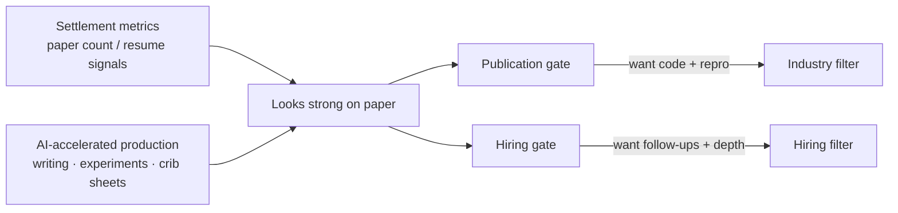

> The two threads:
> - Abroad: [Can we talk about the ML research coming from China?](https://www.reddit.com/r/MachineLearning/comments/1xteym8/can_we_talk_about_the_ml_research_coming_from/) (write-up: [[china-ml-research-volume-reddit|100 papers as an undergrad?]])
> - At home: [最近秋招陆陆续续面了一堆应届生，说点感受](https://www.v2ex.com/t/1256189) (~13k views / 123 replies)

One day apart, two communities argue two faces of the same thing.

Reddit side: **reviewer/peer confusion** — ML output from China (especially researchers based there) “defies common sense”: undergrad hundreds of papers, a paper a week, mega author lists, ~100-page experiment dumps, LLM-ish prose that still clears top venues.  
V2EX side: **an interviewer’s mixed feelings** — master’s candidates with CCF A, solid internships, fluent Agent/eval talk — “overall level is genuinely high”; then billing tokens, prefill/decode, KV cache — **half-understood, anxious and accelerating**.

One watches a **PDF arms race**. The other watches a **resume arms race**. Different currency. Same incentive shape.

## Side-by-side: where they rhyme

| | Reddit (publishing) | V2EX (campus hiring) |
|---|---|---|
| Surface signal | Count, venues, big authorship, thick experiments | First-author papers, two internships, Agent fluency |
| Puncture point | Fake ablations, scatter-guns, no runnable code | Billing / decode stages / KV go empty |
| Accelerator | LLM drafting, ghost pubs, authorship packages | GPT for exams/homework/grading, crib sheets, mock interviews |
| Institutional fuel | Graduation quotas, tenure, funding KPIs | Job arms race — pause to deepen = fall behind |
| Floor’s preferred filter | Weights and code, not flags | Dig the project / claimed scope; fight over “must they really understand?” |

Reddit’s top long comment makes it arithmetic: count KPIs → gift the boss → “a paper every few days.”  
V2EX’s densest rhyme: everyone **inputs frantically**, no time to stare at a wall and output — quick evil cultivation, no inner power.

Both sides also admit the dual: **pressure squeezes out real work and spam/packaging**. Reddit: strong median, aligned top, mills too. V2EX: “fine to start shipping” and “armed to the teeth on paper.”

### Chart: one supply chain, two gates

## The disagreements rhyme too

**On Reddit:** don’t narrate outliers as “Chinese researchers”; scale makes extremes visible; AI detectors are garbage.  
**On V2EX:** are the three questions basic or pedantic; knowing KV won’t cut TTFT on an API job; and — “your post is 100% AI too,” “dad energy.”

Nice symmetry: **production stacks signals with AI; evaluation writes takes with AI** — signals and meta-commentary inflate together. What’s scarce is “still there after two follow-ups.”

Someone on V2EX names hiring-signal failure: coding agents pull many people to an “average” level; vague knowledge can’t separate “shipped it” from “crammed it”; their company hasn’t had junior HC in three years. Reddit’s industry voice is colder: no weights repo, ignore the PDF.

Both filters collapse to one line:

> **Don’t trust paper density alone; trust what still holds when dug into.**

## What you only see when you read them together

Reddit alone slides into a mood piece about “their academic spam.”  
V2EX alone slides into “mean interviewer / anxious youth.”

Together:

1. **Not a civilization play — metric + AI acceleration, globally.** Reddit says mills exist everywhere; V2EX says school/society mismatch predates AI. China’s scale and fall-recruit density just make the crack louder.  
2. **The arms race runs from lab to labor market.** Same cohort: AI-stack papers into the CV, AI-stack crib sheets through the gate — at the hiring table, one systems question returns to “did you actually do it?”  
3. **“Real understanding” isn’t obsolete; the exam format is failing.** Standard answers get vacuumed into interview banks; stabler is digging the claimed scope, or demanding runnable evidence like industry does.  
4. **If you build products:** chase the reproducible 10%; when hiring, worship fewer venue lines, watch whether their own project story survives follow-ups.

The foreign thread asks “how can output be this high?”  
The domestic thread shows “what that high output looks like across the table.”  
Context for each other — not a verdict for either.

## Related posts

- [[china-ml-research-volume-reddit|100 papers as an undergrad? Reddit on China ML volume]]
- [[judge-dev-ability-in-ai-era|How to judge coding ability in the AI era]]
- [[future-company-moat-v2ex|What’s a company’s moat in the AI era?]]
- [[ai-era-clarity-matters|The scarcest skill in the AI era: saying things clearly]]
