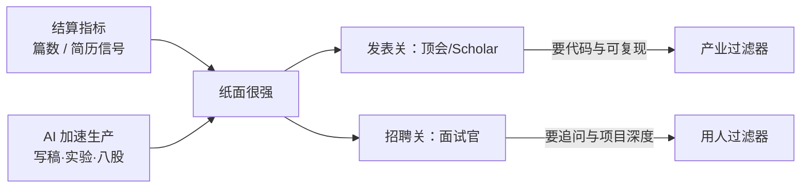

> 两边的帖：
> - 国外：[Can we talk about the ML research coming from China?](https://www.reddit.com/r/MachineLearning/comments/1xteym8/can_we_talk_about_the_ml_research_coming_from/)（整理见 [[china-ml-research-volume-reddit|本科生百篇论文？]]）
> - 国内：[最近秋招陆陆续续面了一堆应届生，说点感受](https://www.v2ex.com/t/1256189)（约 1.3 万浏览 / 123 回复）

隔一天，两个社区在吵同一件事的两面。

Reddit 侧是**审稿人/同行的困惑**：中国（尤其常驻国内）ML 产出「违背常识」——本科生百篇、一周一篇、合著者成群、实验近百页，LLM 痕迹明显却仍进顶会。  
V2EX 侧是**面试官的复杂心情**：硕士应届 CCF A、大厂实习、Agent/评测聊得全——「整体水平真的高」；可 token 计费、prefill/decode、KV cache 一追就露馅——**似懂非懂，一边心虚一边加速**。

一个在看 **PDF 军备**，一个在看 **简历军备**。结算货币不同，激励同构。

## 对照表：同构在哪里

| | Reddit（研究发表） | V2EX（秋招面试） |
|---|---|---|
| 表面信号 | 篇数、顶会、大合著、厚实验 | 顶会一作、两段实习、Agent 能聊 |
| 一捅就破 | 假消融、scatter-gun、无可复现代码 | 计费/推理阶段/KV 一问就空 |
| 加速器 | LLM 写稿、代发、挂名套餐 | GPT 出题做题阅卷、八股整理、模拟面 |
| 制度燃料 | 毕业篇数、职称、经费 KPI | 军备竞赛式求职，停下来补课=掉队 |
| 楼里解药倾向 | 看权重与代码，别看国旗 | 深挖项目/简历标定范围；争论「还要不要真懂」 |

Reddit 最高赞把机制说成算术：篇数 KPI → 互挂老板 →「几天一篇」。  
V2EX 最高频共鸣是：大家都在**拼命输入**，没时间发呆与输出——邪修短平快，内功来不及。

两边都承认：**高压同时挤出真东西和灌水/包装**。Reddit 有「中位数很强、顶端对齐、也有垃圾磨」；V2EX 有「上手干活没问题」和「纸面武装到牙齿」。

### 图：一条供应链上的两个关卡

## 分歧也对称

**Reddit 楼里**吵：别把离群值写成「中国研究者」全体；体量大所以极端值更显眼；AI 检测器不可靠。  
**V2EX 楼里**吵：三问算基础还是刁难；懂了 KV 也优化不了 TTFT（调 API 岗）；以及——「你这帖本身也 100% AI」「登味」。

有趣的对称：**生产侧用 AI 堆信号，评价侧也用 AI 写感想**——信号与元评论一起通胀。真正稀缺的变成「追问两句还在不在」。

V2EX 有人把招聘信号失效说透：Coding Agent 把很多人拉到「平均水平」，宽泛知识难区分做过还是临时背；公司已三年没校招 HC。Reddit 产业派更冷：没权重仓库的 PDF 直接忽略。

两套过滤器其实是一句：

> **别信单独的纸面密度；信还能被深挖的东西。**

## 放一起读，多出来的一层

若只读 Reddit，容易落成「那边学术灌水」的情绪片。  
若只读 V2EX，容易落成「面试官刁难 / 年轻人拧巴」的气氛组。

合读之后更清楚：

1. **这不是中国 vs 西方的文明戏，是指标 + AI 的全球加速。** Reddit 自己也说 paper mill 到处有；V2EX 说没有 AI 的时代学校与社会也脱节。中国体量和秋招密度让裂缝更容易被看见。  
2. **军备从实验室延伸到劳动力市场。** 同一批人：用 AI 堆论文进简历，再用 AI 堆八股过关——到了用人现场，底层一问就回到「做过没有」。  
3. **「真懂」没有过时，但考法在失效。** 标准答案会被吸进面经；更稳的是按对方声称的范围深挖，或像产业一样要可运行物证。  
4. **对做产品的人：** 追那 10% 可复现贡献；招人时少崇拜顶会行数，多看能否在自己的项目叙事里被追问而不崩。

国外帖问「怎么可能这么高产」；国内帖答「高产之后坐到对面长什么样」。互为上下文，不互为结论。

## 相关文章

- [[china-ml-research-volume-reddit|本科生百篇论文？Reddit 谈中国 ML 产量]]
- [[judge-dev-ability-in-ai-era|AI 时代怎么判断一个人会不会写代码]]
- [[future-company-moat-v2ex|未来公司的护城河是什么]]
- [[ai-era-clarity-matters|AI 时代最稀缺的能力：把话说清楚]]
