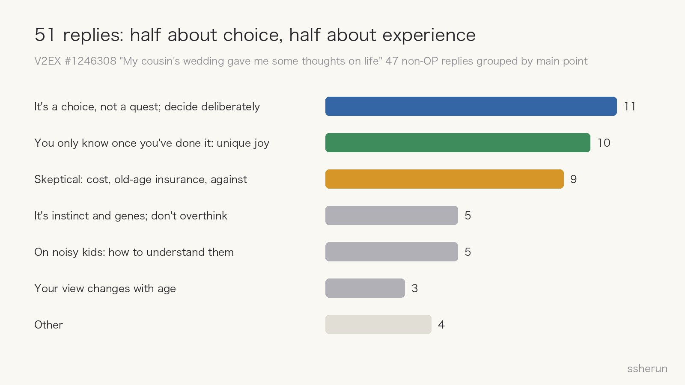
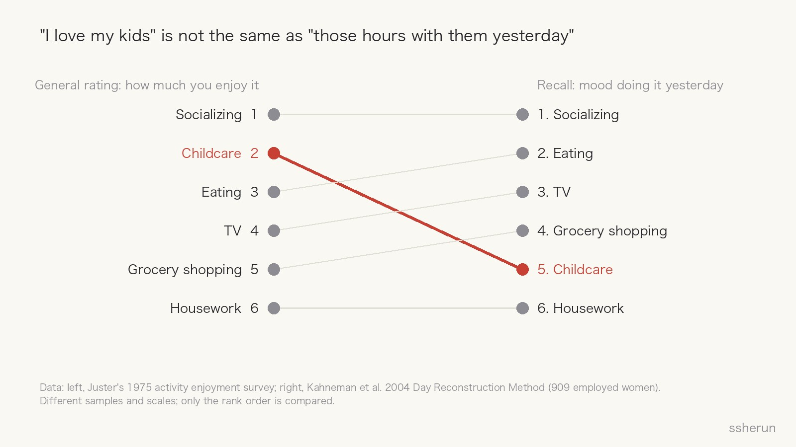
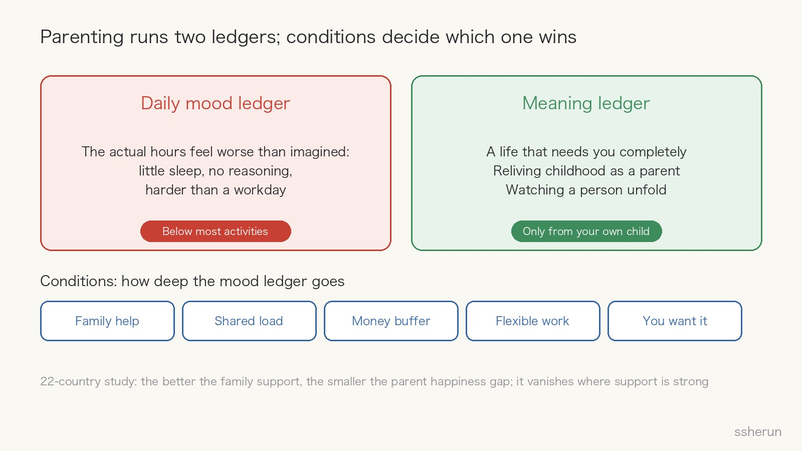

> Source discussion: [My cousin's wedding over the National Day holiday gave me some thoughts on life](https://www.v2ex.com/t/1246308) (V2EX, 51 replies)

During China's National Day holiday, a V2EX user went to his cousin's wedding. Grandparents, parents, cousins fresh out of college, noisy nieces and nephews: every stage of life in one room.

Watching them, a string of thoughts came up. Everyone around him seemed to have finished the "main quest" while he lagged far behind. The kids at the wedding were unbearably loud, even though their parents were highly educated. And finally a blunt question:

"I don't understand why life has to involve using a biological urge to produce a little tyrant, then serving him for years, just to feel gratified once he grows up."

In the replies, parents kept saying the same thing: that joy is something you can't experience without kids.

Which raises the question I want to answer: **does raising kids really bring a joy nothing else can?**

## What the replies said

Excluding the OP's own 4 replies, the remaining 47 fall into roughly three camps:

**It's a choice, not a quest** (11). The most representative line: "Don't fill in random answers just because others have handed in their papers." Another reply noted that many people aren't choosing marriage; they're obeying a standard answer they never tested themselves.

**You only know once you've done it** (10). They didn't describe vague happiness but specific experiences:

- "When a baby is born it depends on you completely. Being needed that totally by a life is hard to find in any other relationship."
- "Raising a child means re-examining your own upbringing, switching from the child's view to the parent's."
- A father of a two-year-old said a day with his son is more tiring than work, but the joy far outweighs the trouble: "It's like watching my younger self grow up."
- And one honest line: "You trade 90% worry for 10% joy, but that 10% is something you can't have without kids."

**Skeptics and opponents** (9). "Neither having kids nor not having them is selfless. Not having them is just the green, harmless kind of selfishness." "Continue the bloodline so they can be worker bees too?" And visible impatience with "you'll understand when you're older."

The OP pushed back on a parent: "What surprises, may I ask?" Someone immediately pointed out that saying you can't see the surprises without kids actually supports the parent's point.

## What the research says

This debate is old, and psychology and sociology have real data on it. Taken together, three studies give an answer more complicated than yes or no.

### "I love my kids" is not "those hours with them yesterday"

Ask people in general how much they enjoy various activities, and caring for children ranks near the top, just behind socializing.

But Kahneman and colleagues, in a 2004 *Science* paper, asked differently: 909 employed women reconstructed each episode of the previous day and how they felt. Childcare ranked just above the least enjoyable activities of working, housework, and commuting, behind eating, watching TV, and grocery shopping.

The researchers put it precisely: general ratings reflect the belief "I enjoy my kids"; episodic reports reflect "but they were a pain last night."

### Kids give meaning, not happiness

Baumeister and colleagues (2013) measured happiness and meaning separately. **For parents, caring for children was a major source of meaning but largely irrelevant to happiness**, because kids are sometimes delightful and sometimes stressful, and it balances out.

The other half of the finding is just as telling: for non-parents, caring for other people's children brought neither happiness nor meaning.

### The joy comes with conditions

Glass and colleagues (2016) compared 22 developed countries. In most, parents reported lower happiness than non-parents, but the gap varied widely. **The more generous the support (paid leave, childcare subsidies, flexible work), the smaller the gap; in countries with strong support packages, it disappeared.**

In other words, unhappy parents aren't the inevitable cost of children. It's a question of support.

## My answer

### Yes, part of it really is unique

What the parents described is structurally hard to get anywhere else: being needed completely by a life; reliving childhood from the parent's side and finally understanding your own parents; watching a person unfold from nothing.

Baumeister's study shows why: the same childcare is a source of meaning for parents and nothing for others. **The uniqueness comes from "this is my child," not from children as such.** Being an uncle or babysitting a nephew doesn't substitute.

### But unique doesn't mean happier

That unique thing is mostly **meaning**, not **daily pleasure**. When parents say "joy," they're usually evaluating a whole stretch of life, not reporting how one afternoon felt. "90% worry for 10% joy" is actually pretty accurate.

So the question needs splitting: do you want ease in your days, or meaning with weight to it? With kids, the two are often a trade.

### It has conditions

One father in the thread said it most directly: "The precondition is having grandparents help and a harmonious family. I know people whose mothers and wives don't get along, with no one to help; after the baby, everything fell apart." Add money, how partners split the load, and how flexible work is.

**The same child is a joy in a supported family and a drain in an unsupported one.** That's worth assessing before "should I or shouldn't I."

### It can't be verified from outside, or easily refuted from inside

"You can't know without kids" is something outsiders can never disprove. And parents, having invested enormously and irreversibly, rarely say it wasn't worth it.

The philosopher L. A. Paul, in *Transformative Experience*, uses having a child as her central example: some experiences can't be known in advance, and afterward, what you want changes. You can't use your current self to judge whether your future self will be satisfied.

The thread had a case in point: a senior executive, a Peking University graduate, chose to be child-free when young, then pursued IVF in their fifties. Preferences really do change.

So "uniquely joyful" is true, but it **isn't a reason you should have kids**. It answers "is there something," not "is it worth it," and certainly not "should I."

## The OP's real trouble may not be kids

The OP said he "doesn't really care that much" about marriage and kids. What bothers him is being pushed to center stage and expected to "put on a brilliant performance before people accept you."

That's main-quest anxiety, not a parenting question.

One reply was sharp: "We wanted kids, but not because it's a required main quest. The parents of those noisy kids are probably the ones completing a task." **Having children to complete a task is the worst starting point, for the parents and for the kids.**

The most-liked reply ended with: "Apart from people who truly love you, most people glance at your life, say a few words, and go back to their own. Most of the time, the spotlight isn't on you."

## About those noisy kids

The same top reply offered a good frame: parenting isn't a long war with an unreasonable little tyrant; it's **a fully developed brain guiding a still-developing one through the world**. Kids' language, emotional regulation, and self-control aren't finished yet. "Unreasonable" usually means tired, hungry, scared, or overwhelmed past what they can handle.

For public places, one reply gave a fair standard: parents who tried to calm the child and couldn't, acceptable; parents who don't try at all, not acceptable.

Also, people who dislike kids tend to notice and remember the loud ones and overlook the quiet ones. That's selective attention, not what all kids are like.

## Questions to ask before deciding

- [ ] Do I want everyday ease, or meaning with weight to it?
- [ ] Do I have support: grandparents, a partner who shares the load, a financial buffer, flexible work?
- [ ] Can my relationship withstand years of short sleep and disagreements?
- [ ] Do I actually want this, or am I completing someone else's main quest?
- [ ] Can I accept that it's irreversible, and plan for the worst case of expecting nothing back?
- [ ] If I can't answer yet, can I hold off? Preferences may change with time.

**Raising kids does bring something unique, but it's more meaning than daily happiness; it's real, but conditional; it's distinctive, but not necessary.**

## Related posts

- [[ai-cannot-replace-human-experience|AI cannot replace lived experience]]
- [[v2ex-lying-flat-meta-or-hometown|V2ers on Lying Flat: Meta Build, or Move Back to a County Town?]]
- [[rebuttal-personality-change-yourself|Fixing a contrarian habit: start with yourself, then learn to handle the contrarians around you]]
