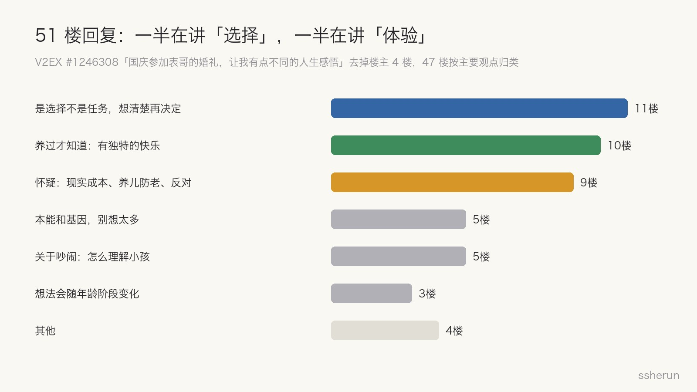
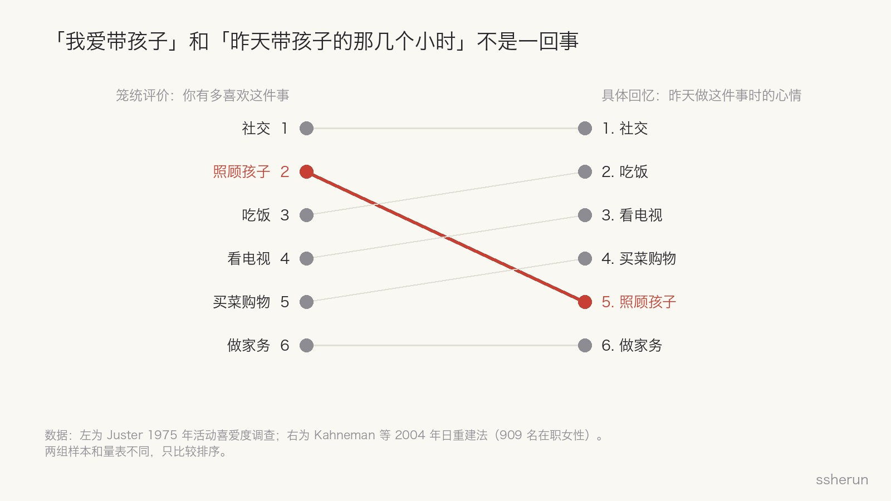
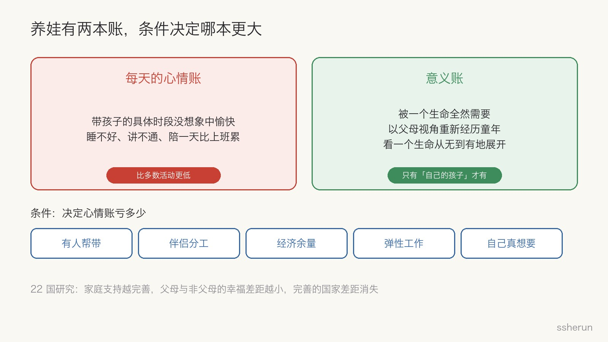

> 讨论来源：[国庆参加表哥的婚礼，让我有点不同的人生感悟](https://www.v2ex.com/t/1246308)（V2EX，51 楼）

国庆期间，一位 V2EX 用户参加了表哥的婚礼。老人、父母、刚毕业的表兄弟、吵闹的外甥侄女，全在一个空间里。

他看着看着，冒出一串念头：周围人好像都完成了主线任务，只有自己进度落后；婚礼上的小孩吵得不可理喻，父母还都是高知；最后是一个很直接的疑问：

「我不知道为什么人生一定要通过一个生理欲望，搞出一个小祖宗来，然后一直供奉着他，等他长大之后自己再欣慰。」

评论区里，养过孩子的人反复说同一句话：那份快乐，没养过的人体验不到。

这就引出了我想回答的问题：**养娃真的带来独一无二的快乐吗？**

## 评论区怎么说

去掉楼主自己的 4 楼，剩下 47 楼大致分成三派：

**是选择，不是任务**（11 楼）。最有代表性的一句是：「不要因为别人交卷了，你就乱填答案。」还有人提醒：很多人不是在选择婚姻，而是在服从一个从未被自己验证过的标准答案。

**养过才知道**（10 楼）。他们说的不是泛泛的开心，而是很具体的体验：

- 「孩子刚出生时非常依赖你，一个生命这样全然地需要你，这种感受在其他关系里不太容易得到。」
- 「养孩子等于重新审视一遍自己的成长经历，从儿童视角切换到父母视角。」
- 一位 2 岁男孩的爸爸说，陪一天比上班累多了，但快乐远超烦恼，「像陪小时候的自己长大」。
- 还有一句很诚实：「用 90% 的烦恼去换 10% 的快乐，但那 10% 是没有孩子无法体验到的。」

**怀疑和反对**（9 楼）。有人说「生与不生都不是无私之举，不生是绿色的、无公害的自私」；有人说「延续后代继续当牛马吗」；还有人对「到了年龄自然就懂」这种说法明显不耐烦。

楼主回击亲历者：「哪里惊喜了我请问？」立刻有人指出：你说没养体验不到惊喜，这恰好佐证了他的观点。

## 研究怎么说

这个问题吵了很多年，心理学和社会学其实有不少数据。三项研究放在一起看，答案比「有」或「没有」复杂得多。

### 「我爱带孩子」和「昨天带孩子的那几个小时」不是一回事

如果笼统地问人们「你有多喜欢这件事」，照顾孩子排在最喜欢的活动前列，仅次于社交。

但 Kahneman 等人 2004 年在《Science》上发表的研究换了一种问法：让 909 名在职女性回忆前一天的每个时段，以及当时的心情。结果，照顾孩子只比工作、家务、通勤这些最不愉快的活动略高，排在吃饭、看电视、买菜之后。

研究者的解释很精准：笼统评价反映的是「我爱我的孩子」这个信念，具体回忆反映的是「但他们昨晚真折腾」。

### 养娃给的是意义，不是快乐

心理学家 Baumeister 等人 2013 年的研究，把「快乐」和「意义」分开测量。结果发现：**对父母来说，照顾孩子是意义感的重要来源，但和快乐基本无关**，因为孩子时而可爱、时而烦人，正负抵消了。

更有意思的是另一半结果：对没有孩子的人来说，照顾别人的孩子，既不带来快乐，也不带来意义。

### 快乐是有条件的

Glass 等人 2016 年比较了 22 个发达国家：多数国家里，父母报告的幸福感低于没有孩子的人。但这个差距在不同国家差别很大。**带薪假、育儿补贴、弹性工作这些支持越完善，差距越小；在支持完善的国家，差距直接消失。**

也就是说，父母不快乐，不是养娃的宿命，而是支持系统的问题。

## 我的回答

### 是的，有一部分确实独一无二

亲历者描述的那几种体验，在结构上很难从别处获得：被一个生命全然需要；以父母的视角重新经历童年、重新理解自己的父母；看一个生命从无到有地展开。

Baumeister 的研究也说明了为什么：同样是照顾孩子，对父母是意义来源，对别人什么都不是。**独特性来自「这是我的孩子」，而不是来自孩子本身。** 所以当舅舅、带侄子，替代不了。

### 但「独一无二」不等于「更快乐」

那份独特的东西，更多是**意义**，而不是**每天的愉悦**。父母说「快乐」，多半是回顾整段人生时的评价，而不是某个下午的心情。那句「90% 的烦恼换 10% 的快乐」，其实相当准确。

所以问题要拆开问：你想要的是日常的轻松，还是一段有分量的意义？在养娃这件事上，两者往往是交换关系。

### 它有条件

一位爸爸在帖子里说得最直接：「前提是有父母带娃，家庭和谐。身边也有婆媳合不来、没人带娃的，生娃后一地鸡毛。」再加上钱、伴侣分工、工作弹性。

**同一个孩子，在有支持的家庭里是快乐，在没有支持的家庭里是消耗。** 这比「养不养」更值得先评估。

### 它从外面无法验证，从里面也很难反证

「没养过的人体验不到」这句话，外人永远无法证伪。反过来，养了的人投入巨大、不可逆，也很难说出「不值」。

哲学家 L. A. Paul 在《Transformative Experience》里，正是拿生孩子做核心例子：有些经历无法事先知道是什么感觉，而且经历之后，你想要的东西本身会改变。你没法用「现在的我」去评估「以后的我」会不会满意。

帖子里有个例子：一位北大毕业的高管，年轻时选择丁克，50 多岁又去做试管。偏好真的会变。

所以「独一无二」这句话是真的，但它**不能作为「你应该生」的理由**。它回答的是「有没有」，回答不了「值不值」，更回答不了「我该不该」。

## 楼主真正的困扰，可能不是孩子

楼主自己说，他对结婚生子「其实没有那么在意」，让他难受的是被推到舞台中央，「必须完成一段非常精妙绝伦的表演，大家才会认可你」。

这是主线任务焦虑，不是育儿问题。

有一条回复很尖锐：「我家要小孩，不是因为这是必须完成的主线任务。那些嘈闹的小孩，他们的父母应该就是完成任务的人。」**为了完成任务而生孩子，对父母、对孩子，都是最差的出发点。**

点赞最多的那条回复，最后一句是：「除了真正爱你、关心你的人，大多数人对你的生活不过是偶尔看一眼、说几句。大多数时候，聚光灯并没有打在你身上。」

## 关于那些吵闹的孩子

同一条高赞回复还给了一个很好的视角：养育不是和一个「不讲道理的小祖宗」长期斗争，而是**一个成熟的大脑，带着一个尚在发育的大脑认识世界**。孩子的语言、情绪调节、自我控制都还没发育完全，「不可理喻」多半是困了、饿了、怕了，或者情绪超出了当下能处理的限度。

至于公共场合，有人给了一个很合理的标准：家长用心管了、哄了但止不住，可以接受；完全不管，不能接受。

另外，不喜欢孩子的人，更容易注意并记住吵闹的那几个，而忽略安静的。这是选择性注意，不是所有孩子的样子。

## 决定前问自己的问题

- [ ] 我想要的是日常的轻松愉悦，还是一段有分量的意义？
- [ ] 我有支持系统吗：老人帮带、伴侣分工、经济余量、弹性工作？
- [ ] 我和伴侣的关系，扛得住长期睡眠不足和分歧吗？
- [ ] 我是自己想要，还是在完成别人眼里的主线任务？
- [ ] 我能接受它不可逆，并做好「不期望回报」的最坏打算吗？
- [ ] 如果现在答不上来，能不能先不急着答？偏好可能会随阶段改变。

**养娃确实能带来独一无二的东西，但那更多是意义，而不是每天的快乐；它是真实的，但有条件；它是独特的，但不是必需的。**

## 相关文章

- [[ai-cannot-replace-human-experience|AI 无法代替人的体验]]
- [[v2ex-lying-flat-meta-or-hometown|V2er 谈躺平：版本答案，还是回县城？]]
- [[rebuttal-personality-change-yourself|反驳型人格怎么改：从自己改起，也学会应对身边的反驳者]]
