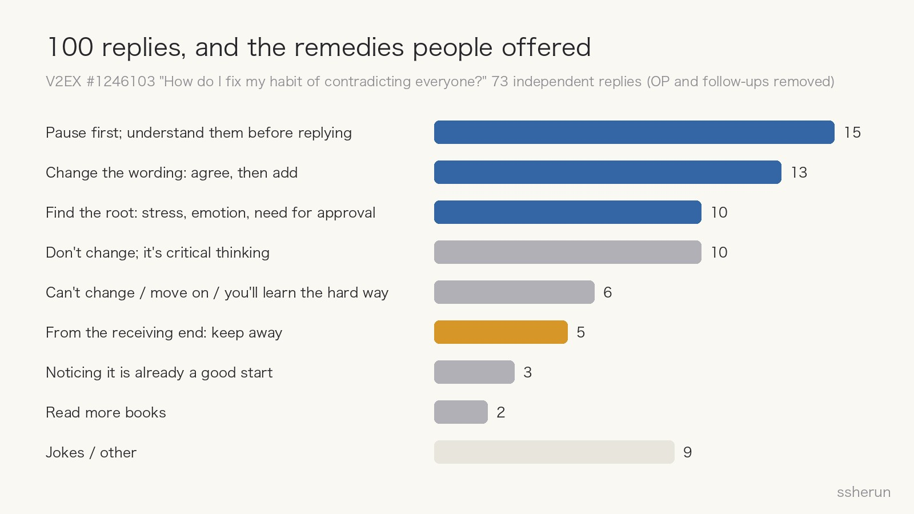
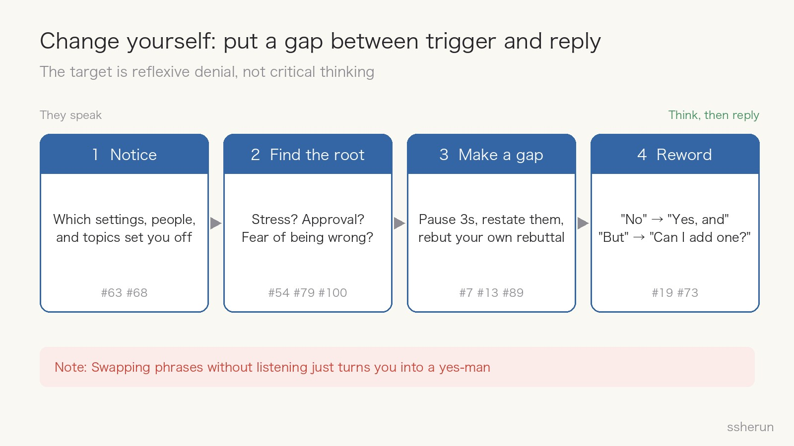
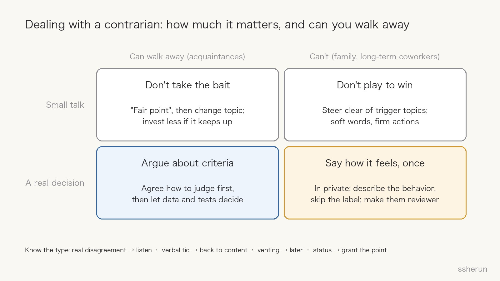

> Source discussion: [How do I fix my contrarian personality?](https://www.v2ex.com/t/1246103) (V2EX, 100 replies)

A V2EX user posted: "I never paid attention before, but now I realize I contradict pretty much everything people say."

The post was two lines long and drew 100 replies. The most-liked one was: "**No, there's no such person, you're making it up.**" A textbook contradiction, offered as a live demo of the problem.

My view: **a contrarian habit can only be fixed from your own side.** But the thread covers only half the story. The other half is just as common: what do you do when the person contradicting everything is someone in your life?

## What the replies said

The OP wrote 22 of the replies himself. After removing follow-ups and corrections, 73 independent opinions remain. The three biggest groups were all about how to change:

- **Pause first and understand the other person** (15). The classic version is #7: "Before giving your opinion in a meeting, briefly summarize the other person's point."
- **Change the wording: agree first, then add** (13). #19 offered a full substitution table: replace "but" and "that's wrong" with "oh, I see" or "tell me more"; if you really disagree, say "can I add a counterexample?"
- **Find the root cause** (10). #54: "On the surface you're arguing; underneath you're looking for approval." #100: "Contrarians usually avoid being wrong. Even when they are, they're too embarrassed to admit it."

Another 10 said there's nothing to fix: contradicting is critical thinking, and Socrates was a contrarian (#53). Society used to encourage looking at both sides; now that gets labeled a contrarian personality (#33).

Only 5 replies spoke from the receiving end, and they nearly all said the same thing: keep your distance. #17: "After being contradicted three times, I decide to keep away." #31: "My mother-in-law is like that. I'm very careful when I talk to her now." #75: "I hate people who start everything with 'no', then say roughly what you said. Why deny it first?"

## Why the fix has to start with you

### It's a habit, not a personality

#14 and #30 put it bluntly: everyone instinctively resists advice. What kid doesn't push back on their parents? #36 adds that people do it more when they're anxious. The OP admitted he'd been under a lot of stress.

A habit can be changed. Calling it a "personality" hands you an excuse not to.

### You can't swap out other people, only your first reaction

Some replies told the OP to leave his social circle, because "if you always want to argue, the people around you must be dumb" (#2).

That doesn't work. Wherever you go, you'll meet people you disagree with. A new environment only reduces the triggers; the first reaction is still yours. Blaming others for being "too dumb" is exactly how a contrarian thinks.

### The habit pays off, which is why it repeats

#79 made the key point: "If someone keeps using a pattern, it's doing something for them."

The OP said so himself: contradicting people "saves a lot of trouble at work." It can also earn a sense of being recognized (#54), spare you from admitting a mistake (#100), and make you look like you know everything (#91).

Until you see those payoffs, no script will stick.

### The target is the reflex, not critical thinking

The other camp has a point: disagreeing isn't wrong in itself. #22 nailed it: "You reply because you disagree. Pushing back is no big deal; **the problem is not understanding what the other person said**."

So the goal isn't to stop disagreeing. It's to **think before you disagree**. Swap the phrases without listening, and you become what the thread jokingly called a "Doubao personality": agreeing with everything, which is the same as not communicating. #19's phrases work because "tell me more" forces you to listen first.

## Four steps to change yourself

1. **Notice.** The OP has done this already; he realized it after a lot of chatting with AI. Go further: which settings, which people, and which topics set you off most?
2. **Find the root.** Stress and lack of sleep? A need for approval? Fear of being wrong? Or is the habit shielding you from trouble at work?
3. **Make a gap.** Pause three seconds (#13). Restate the other person's point (#7). Rebut your own rebuttal in your head first (#89: "Every time I imagine it, I don't feel like arguing anymore"). Ask whether you're trying to solve a problem or save face (#91).
4. **Reword.** Replace "no" with "yes, and"; replace "but" with "can I add something?" #73 gave a concrete drill: tell someone "you're right" three times a day.

#82 had another plain exercise: **soft words, firm actions.** Say a little less; do a little more.

## When the contrarian is someone else

This is the half the thread left out. Its only real advice was to keep away, but many relationships aren't optional: family, longtime coworkers.

### First, figure out which kind of contradiction it is

- **Real disagreement**: they actually see it differently. That's useful. Listen, and don't let a sharp tone make you miss the substance.
- **Verbal tic**: "No" up front, then they repeat your point (#75, #98). Don't correct them; say "right, we mean the same thing" and steer back to content.
- **Venting**: they're stressed and letting off steam. Reasoning won't land. Let it pass and talk later.
- **Status**: they need to win or be recognized. Grant the part they got right, and take the disagreement to another time.

### Then ask two questions: how much does the topic matter, and can you walk away?

- **Small talk, and you can walk away**: don't take the bait. Say "fair point" and change the subject. If it keeps happening, do what #17 does and invest less. Reforming them isn't your job.
- **Small talk, but you can't walk away**: don't play to win. Avoid topics that reliably start fights. Soft words, firm actions: you don't need to win the argument, just do what needs doing (#82).
- **A real decision, and you can walk away**: move the argument from people to criteria. Agree on how you'll judge first, then let data, documents, and small experiments decide. Prefer writing; it leaves less room for on-the-spot sparring.
- **A real decision, and you can't walk away**: pick a calm moment and, in private, tell them once how it feels. Describe the behavior ("you start with 'no' every time") and the feeling ("I end up feeling dismissed"). Skip the "contrarian" label; the label alone will trigger another round. At work you can also put the trait to use: make them the designated critic in design reviews.

### Two ground rules

- **Don't try to reform them.** It's the same principle as fixing yourself: the only thing you can change is how you respond.
- **Use them as a mirror.** The discomfort you feel when contradicted is what others feel when you do it to them. #95 quoted Confucius: "When you see someone lacking, look inward." If it feels like everyone around you keeps contradicting you, check whether you're doing it too.

## Checklist

**Changing yourself:**

- [ ] Can I restate the other person's point before I speak?
- [ ] Am I arguing with what they actually said, or what I assumed they said?
- [ ] Is this pushback about solving a problem, or about saving face?
- [ ] Do they need emotional support right now, or a judgment?
- [ ] Did my first sentence start with "no" or "but" again?

**Handling others:**

- [ ] Is this real disagreement, a verbal tic, venting, or a status play?
- [ ] Does this topic actually need a conclusion?
- [ ] Can we agree on criteria before we argue?
- [ ] Can I walk away from this relationship? If not, pick a moment and say how it feels, once. If so, invest less.

Noticing the problem at all already puts the OP ahead of most people (#63: "Most people never realize what they're like"). **Changing yourself is the only path that really works; handling others is about reading the situation, not winning every argument.**

## Related posts

- [[ai-era-clarity-matters|The scarcest skill in the AI era: saying it clearly]]
- [[chatgpt-critical-thinking-students|ChatGPT Improves Answers; Critical Thinking Widens Ideas]]
- [[ai-multi-advisor-decision-system|Put Drucker, Munger, and Jobs into an AI decision system]]
- [[v2ex-lying-flat-meta-or-hometown|V2ers on Lying Flat: Meta Build, or Move Back to a County Town?]]
