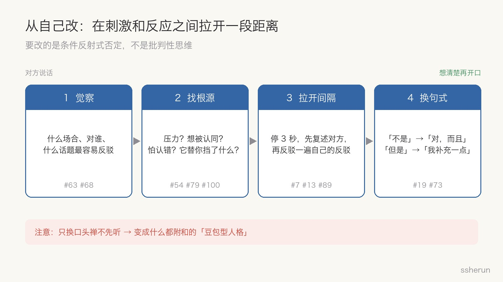
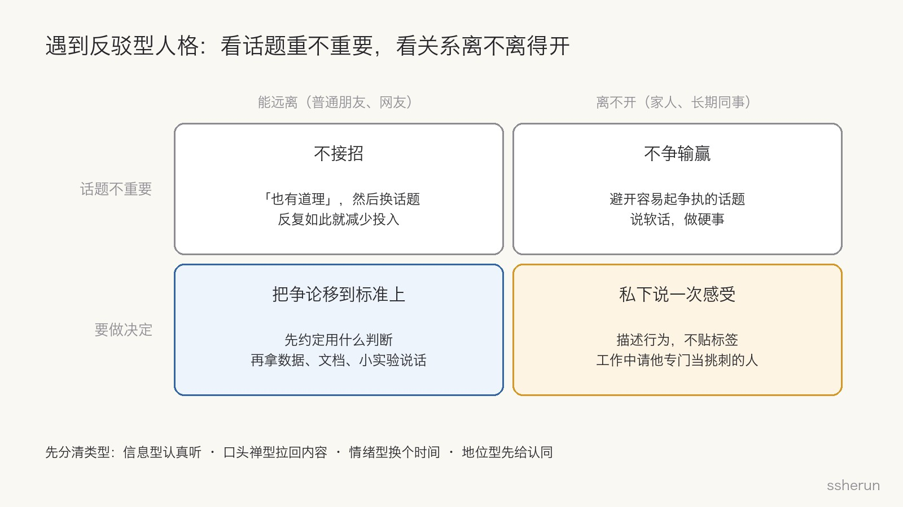

> 讨论来源：[现在反驳型人格怎么改呀？](https://www.v2ex.com/t/1246103)（V2EX，100 楼）

V2EX 上有人发帖：「之前自己都没有在意，现在才发现好像别人说什么自己都喜欢反驳。」

帖子很短，回复有 100 楼。点赞最多的一条是：「**不是，哪有这样的人，你瞎说呢吧**」——用一句标准的反驳句式，顺手演示了什么叫反驳型人格。

我的看法是：**反驳型人格只能从自己改起。** 但这个帖子只讨论了一半。另一半同样常见：日常生活里，遇到反驳型人格的人，你该怎么办？

## 评论区怎么说

楼主自己回了 22 楼，去掉同一人的追加和更正，剩下 73 条独立观点。最多的三类都是「怎么改」：

- **说话前先停一下，先理解对方**（15 楼）。最经典的一条是 #7：「开会时发表意见之前，先简要总结对方的观点。」
- **换话术：先肯定，再补充**（13 楼）。#19 列了一整套替换表：把「但是」「不对」换成「原来是这样啊」「再多说说」，实在想表达不同意见，就说「我能补充一个相反的情况吗」。
- **找根源**（10 楼）。#54：「表面上你在反驳，实际上你只是在寻求认同。」#100：「反驳型的人一般在逃避错误，错了也羞于认错。」

也有 10 楼认为根本不用改：反驳就是批判性思维，苏格拉底就是反驳型人格（#53）；以前社会提倡辩证看问题，现在却被叫作反驳型人格（#33）。

只有 5 楼站在被反驳者那一边，态度几乎一致：远离。#17 说「被反驳过 3 次就决定远离」，#31 说「我丈母娘就是这样的，我现在跟她说话都很小心」，#75 说「最讨厌不管你说什么都以『不是』开头的人，后面说的跟你差不多，那为什么非要先否定？」

## 为什么只能从自己改

### 它是习惯，不是人格

#14 和 #30 说得很直接：人人都会下意识抵抗别人的建议，哪个孩子不对父母的建议抵抗？#36 补充：人在焦虑期更容易这样。楼主自己也承认最近压力大。

既然是习惯，就能改。把它叫作「人格」，等于给自己找了一个不改的理由。

### 你换不了别人，只能换自己的第一反应

有人劝楼主「离开圈子」「换个环境」，理由是「你一直想反驳，说明和你交流的人太蠢了」（#2）。

这条路走不通。换到哪里都会遇到你不认同的人，环境只能减少触发，第一反应还是你自己的。把问题归给别人「太蠢」，正是反驳型人格最典型的思路。

### 反驳给你带来了好处，所以才会一直重复

#79 有一句很关键：「一个人经常用一个模式，说明这个模式对他有好处。」

楼主在楼里自己说了：反驳在上班时「可以避免很多麻烦」。除此之外，它还可能带来被认同感（#54）、不用承认自己错了（#100）、显得自己什么都懂（#91）。

不先看见这些好处，换多少套话术都会反弹。

### 要改的是条件反射，不是批判性思维

反对派的意见有道理：反驳本身不是错。#22 说到了点子上：「意见不同才想回复，反驳一下不算大事，**有问题的是不去理解对方说的内容**。」

所以目标不是「不再反驳」，而是**想清楚再反驳**。只换口头禅不先听，就会变成评论区调侃的「豆包型人格」：什么都附和，等于不沟通。#19 的替换句式之所以有用，是因为「再多说说」逼你先听。

## 从自己改的四步

1. **觉察**。楼主已经做到了，而且是和 AI 聊多了才发现的。可以继续往下记：一天里什么场合、对谁、什么话题最容易反驳。
2. **找根源**。是压力和缺觉？想被认同？怕认错？还是这个习惯在工作里替你挡了麻烦？
3. **拉开间隔**。停 3 秒（#13）；先复述对方的观点（#7）；在脑子里先把自己的反驳反驳一遍（#89：「我每次在想象完后，就不那么想反驳了」）；问自己这句话的目的是解决问题，还是保住面子（#91）。
4. **换句式**。「不是」换成「对，而且」；「但是」换成「我补充一点」。#73 的建议很具体：每天主动对别人说三次「你说得对」。

#82 还有一个朴素的练法：**说软话，做硬事**。说话少说两分，做事多做两分。

## 遇到反驳型人格的人，怎么处理

这是帖子里缺的那一半。评论区给出的办法基本只有「远离」，可很多关系是离不开的，比如家人、长期共事的同事。

### 先分清是哪种反驳

- **信息型**：真有不同意见，就事论事。这是好事，认真听，别因为对方语气冲就错过有用的信息。
- **口头禅型**：「不是」开头，后面说的和你一样（#75、#98）。不必纠正，直接说「对，我们意思一样」，把对话拉回内容。
- **情绪型**：对方压力大，在发泄。这时讲道理没用，先别接，换个时间再谈。
- **地位型**：对方需要赢，需要被认同。先承认他说得对的那部分，分歧部分换个场合谈。

### 再看两件事：话题重不重要，关系离不离得开

- **闲聊，关系也能远离**：不接招。说一句「也有道理」就换话题。反复如此，就像 #17 那样减少投入，不必花力气改造对方。
- **闲聊，但关系离不开**：不争输赢。避开容易起争执的话题；说软话，做硬事，嘴上不必赢，该做的事照做（#82）。
- **要做决定，关系能远离**：把争论从人移到标准上。先约定用什么判断，再拿数据、文档、小实验说话。尽量书面沟通，减少临场抬杠的空间。
- **要做决定，关系又离不开**：找对方情绪平稳的时候，私下说一次感受。描述行为（「你每次先说『不是』」）和感受（「我会觉得自己被否定」），不要贴「反驳型人格」的标签，标签本身就会引来一轮反驳。工作中还可以把这份能力用起来：请他专门当方案评审里挑刺的人。

### 两条底线

- **不要试图改造对方。** 这和「只能从自己改」是同一个道理，你能改的只有自己的应对方式。
- **照镜子。** 被反驳时的那种不舒服，就是你反驳别人时别人的感受。#95 引了一句「见不贤而内自省」。如果你觉得身边所有人都在反驳你，先看看自己是不是也在反驳。

## 检查清单

**改自己：**

- [ ] 开口前，我能复述对方的观点吗？
- [ ] 我反驳的是对方真正说的内容，还是我以为他说的？
- [ ] 这次反驳是为了解决问题，还是为了面子？
- [ ] 对方此刻需要的是情绪支持，还是一个判断？
- [ ] 我的第一句话是不是又以「不是」「但是」开头？

**应对别人：**

- [ ] 他是信息型、口头禅型、情绪型，还是地位型？
- [ ] 这个话题重要到需要分出结论吗？
- [ ] 能不能先约定判断标准，再讨论？
- [ ] 这段关系离得开吗？离不开就挑时机说一次感受，离得开就减少投入。

楼主能自己发现问题，已经比大多数人走得远了（#63：「大部分人是认识不到自己是怎样的」）。**改自己，是唯一真正有效的那条路；应对别人，靠的是分清场合，而不是赢下每一次争论。**

## 相关文章

- [[ai-era-clarity-matters|AI 时代最稀缺的能力：把话说清楚]]
- [[chatgpt-critical-thinking-students|ChatGPT 让答案更好，批判性思维让想法更宽]]
- [[ai-multi-advisor-decision-system|把德鲁克、芒格、乔布斯装进 AI 系统：一套多顾问决策架构]]
- [[v2ex-lying-flat-meta-or-hometown|V2er 谈躺平：版本答案，还是回县城？]]
