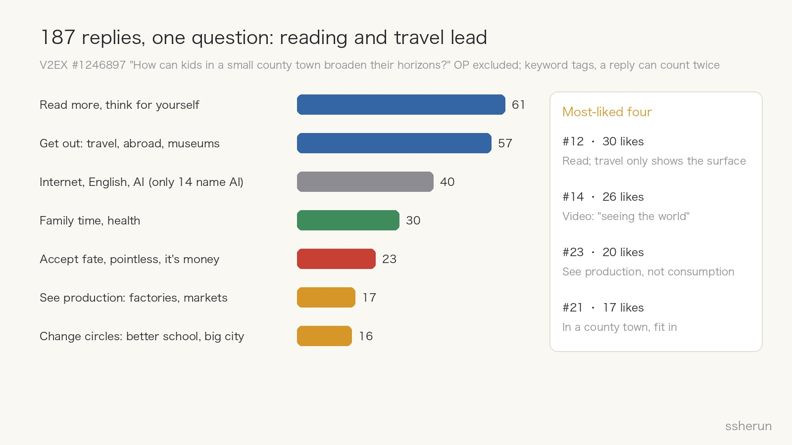
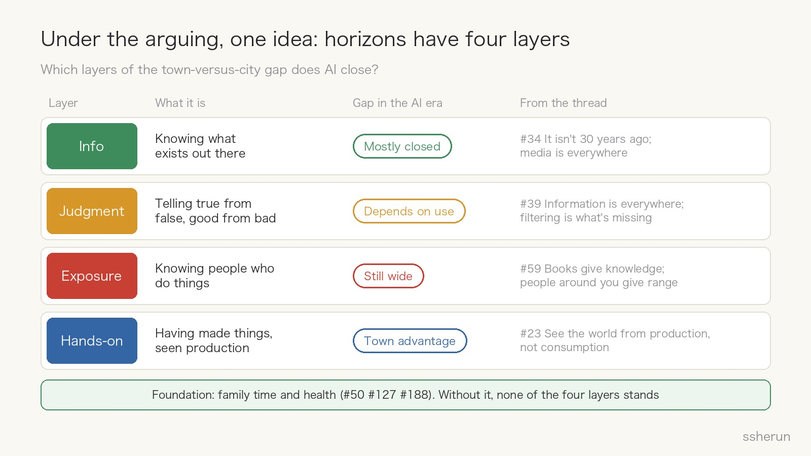
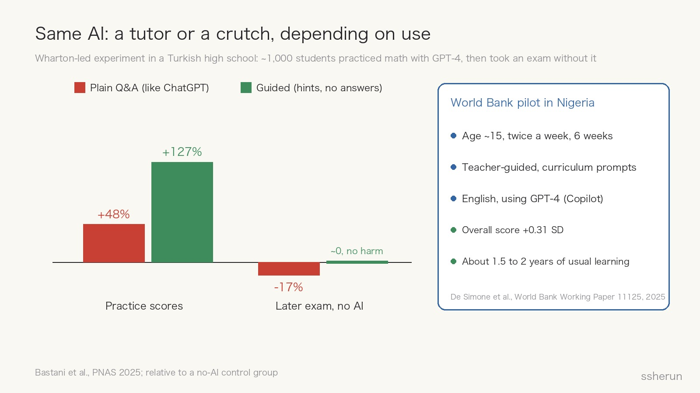
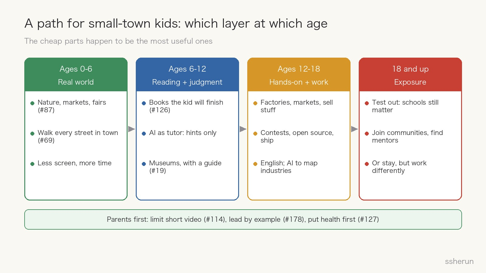

> Source discussion: [How can kids growing up in a small county town broaden their horizons?](https://www.v2ex.com/t/1246897) (V2EX, 194 replies)

A parent posted on V2EX, a Chinese tech forum: they live in a small prefecture-level city in China, 200 km from the provincial capital, a two-to-three-hour drive. How can their kid broaden their horizons and think more clearly?

In under a week the thread drew 15,000 views and 194 replies. The parent later clarified the goal: **they want the kid to think independently and tell right from wrong.**

The suggestions were all over the place: read more, go abroad, visit factories, scroll Douyin, buy a GPT subscription, accept your lot. At first glance nobody convinces anybody. But break the 187 non-OP replies apart and they turn out to describe different layers of the same thing. Push one step further, and that thing is changing in the AI era.

## The comments: reading and travel lead; only 14 mention AI

Tagged roughly by keyword (one reply can land in several groups), the most common advice was "read more, think for yourself" and "get out and travel", about 60 replies each. Next came the internet and English, then family time, the "accept your fate" camp, seeing production up close, and changing your circle.

The four most-liked replies happen to represent four positions:

- **#12 (30 likes):** Read, full stop. Travel shows only the surface; a good book distills the author's thinking and is the best value there is.
- **#14 (26 likes):** A screenshot of a short video on "what it means to have seen the world": city kids have seen skyscrapers, country kids have seen starry skies, and nobody has seen more of the world than anyone else.
- **#23 (20 likes):** See the world from the production side, not the consumption side. A few Starbucks lattes don't broaden anything; learning about sourcing and ingredients, recreating the product yourself, then promoting it, does.
- **#21 (17 likes):** If you live in a county town, your outlook should fit that environment. Otherwise the mismatch makes life painful.

One detail in #14's image is worth noting. It claimed Proust never traveled far and Kant was "a small-town doctor who never left his village." Reply #99 checked: Proust came from a wealthy Parisian family and was a regular in high-society salons; Kant was a professor, not a doctor, and Königsberg was a large port city, not a village. **Feel-good counterexamples often don't survive a single search.** That exchange is itself a live demonstration of judgment.

Another telling detail: out of well over a hundred replies, only 14 mentioned AI explicitly. #144 quipped that a kid has seen the world once their first instinct with a question is to ask AI. Exaggerated, but it points at a blind spot: most of the thread was still discussing "seeing the world" as it worked ten years ago.

## Under the arguing, one idea: horizons have four layers

Put the replies side by side and "horizons" splits into at least four layers:

1. **Information:** knowing what exists. #34 says this isn't 30 years ago; with today's media, the old notion of "seeing the world" no longer applies.
2. **Judgment:** telling true from false, good from bad. #39 says information is everywhere and what's missing is the ability to filter; #49 says what's missing is the ability to separate dross from gold.
3. **Exposure:** knowing people who do things, seeing how others live. #59 puts it as "knowledge comes from books, range comes from the people around you"; #52 notes that at better schools, classmates start thinking seriously about their futures.
4. **Hands-on:** having made things, having seen how things are produced. #23, #58 (take the kid to the market at dawn to buy stock and sell vegetables), and #112 (go watch production lines for screws or building blocks) all speak to this layer.

Underneath the four sits a foundation: family time and health. #188 says parents are a child's first view of the world; #127 wrote a long reply whose core is that "the body is the one thing every social class can equalize."

Seen this way, **the "read more" camp and the "get out" camp don't actually conflict.** Reading feeds information and judgment; getting out feeds exposure and hands-on experience. The real disagreement is that each camp overrates its own layer.

## AI closed the gap in what you know, not in who you know

Start with information. CNNIC's 57th report (data through the end of 2025) puts rural internet penetration in China at 69.5% (urban: 85.1%). Internet access in rural primary and secondary schools is 100%, and 95% of administrative villages have 5G. Generative AI users reached 602 million; users aged 19 and under make up 26.4%, and students are the largest user group.

In other words, the information and answers a county-town kid can get today are not fundamentally different from what a kid in Beijing's Haidian district gets. #13 says it plainly: YouTube Kids and Khan Academy are free, and the internet doesn't care that you live in a small town.

Exposure is a different story. In 2022, Raj Chetty's team at Harvard published a study in *Nature* using 21 billion Facebook friendships. They found that **the share of high-income friends among low-income people** (which they call "economic connectedness") is among the strongest predictors of upward mobility found to date, with a correlation of 0.65. If low-income children had the economic connectedness of the average high-income child, their adult incomes would rise by about 20%. And what matters is actual friendship, not merely living nearby.

Another study is even more direct. Bell, Chetty, and colleagues tracked 1.2 million American inventors. Children from top-1% income families were ten times as likely to become inventors as children from below-median families, even when the two groups had similar early math scores. The gap was not talent but exposure: growing up around inventors causally raises a child's odds of inventing, and it is field-specific. Children raised in cities with many medical device makers are more likely to patent medical devices. The researchers call the people who would have become inventors with that exposure "lost Einsteins."

That is the data version of #59's line: **information can come from the internet, but range comes from the people around you.** AI can answer any question a kid asks. It cannot be the person nearby who has already done the thing.

## Same AI: a tutor or a crutch, depending on use

Judgment is where AI's effect is most complicated.

The good side: in 2024 the World Bank ran a randomized pilot in Nigeria. Students around age 15 attended after-school sessions twice a week for six weeks, using GPT-4 (Microsoft Copilot) to learn English with a teacher guiding them. Overall scores rose by 0.31 standard deviations, roughly 1.5 to 2 years of usual learning, and the more sessions students attended, the bigger the gains. Small-town kids have long been held back by a shortage of good teachers; results like this suggest AI can close much of that gap.

The other side: a team from Wharton ran an experiment in a high school in Turkey, published in *PNAS* in 2025. Nearly a thousand students practiced math with GPT-4, then took an exam without it:

- Students using a **plain Q&A version** (like regular ChatGPT) scored 48% higher during practice, but **17% lower** on the closed-book exam than students who never had AI. They used it as a crutch, asking for answers and copying them, without realizing they were learning less.
- Students using a **guided version** (teacher-designed prompts that give hints, not answers) scored 127% higher in practice, and their exam results matched the control group. The harm essentially disappeared.

So suggestions like #77 ("get the kid a GPT Plus subscription") or #156 ("make them talk to ChatGPT for two hours a day") point the right way but skip the most important step: **guardrails**. The rules are simple:

- Try it yourself first; ask only when stuck.
- Ask for hints, not answers.
- Have the AI ask "why" instead of handing over the conclusion.
- Parents occasionally read the chat history to see whether the kid is thinking or copying.

AI can strengthen judgment or erode it. The difference isn't the tool, it's how it's used.

## The layer where small towns have the edge: production

#23, the reply with 20 likes, is the sharpest insight in the thread: see the world from production, not consumption. #169 adds that taking a kid out to spend money teaches nothing; show them how things actually get made.

This is the county town's hidden advantage. Big-city kids mostly see consumption: malls, restaurants, theme parks. County-town kids live closer to factories, farms, wholesale markets, village fairs, and family businesses. CNNIC's report cites rural online retail sales rising from 353 billion yuan in 2015 to 2.56 trillion yuan in 2024, and many county towns are themselves clusters for a particular product.

AI amplifies this layer. A middle schooler can use AI to map the factory down the road: where its materials come from and where its products go. They can use AI to write copy, make images, and edit videos, and help their family or neighbors sell further afield. What #23 described, "recreate it yourself, then promote it through social media", once took a team. Now a kid with an AI can start.

The point isn't to turn kids into early entrepreneurs. It's to **practice judgment in real production and trade**: price it wrong and you lose money; write weak copy and nobody buys. As #171 put it, in business you can test whether your read on people is right, because if it's wrong you lose money directly. No book or trip gives feedback like that.

## Answering two objections

**The "fit in where you live" camp** (#21 with 17 likes, plus #50, #74, #120) argues that an outlook far above your surroundings brings misery. Fair, but it assumes a broader outlook must make you an outsider. I see it differently: the point of a broader outlook isn't to become odd, it's to **have more options**. You can test into a university and leave, or stay in the county town and do things differently. With remote work and county-level e-commerce growing, staying is becoming an active choice rather than a fallback.

**The "you need money" camp** (#1, #25, #55) says you can't see the world without money. Going abroad and luxury hotels do cost money. But look back at the four layers: reading is nearly free, an AI tutor costs a few dollars a month or nothing, and walking every street in your hometown (#69) or visiting markets and factories costs nothing. **The most useful things happen to be the cheapest.** What's actually expensive is a parent's time, and whether the parent is willing to change first. #127 puts it bluntly: if you couldn't change yourself all these years, don't expect your kid to.

## A path by age

Combining the thread's advice with the research above, here is how I would sequence it:

- **Ages 0 to 6: the real world.** Nature, markets, fairs, busy places (#87). Walk every street in your hometown with the kid and tell the stories behind the street names (#69). Less screen time, more time together.
- **Ages 6 to 12: reading and judgment.** Find books the kid will actually finish, not the ones parents think they should read (#126). Start using AI, but only as a tutor that gives hints. At museums, hire a guide, or it's just a blur (#19).
- **Ages 12 to 18: hands-on work and a portfolio.** Visit factories and markets, help sell the family's goods. Enter contests, contribute to open source, build something other people can use (#71's "input, output, connect" loop). Learn English, and use AI to map the industry on your doorstep.
- **18 and up: exposure.** Test into a good university if you can. Good schools are still the biggest lever, because they place you in a circle with higher economic connectedness. If you can't, use communities, contests, and your work to meet people who have gone further. Staying is fine too, as long as you do things differently.

The foundation throughout is the parent: limit short-video apps (#114, #151), lead by example, and put health first.

## Closing thought

The parent wants their kid to think independently and tell right from wrong. Looking back, the thread itself is a good practice ground: #14's feel-good image collected 26 likes, and #99 dismantled its evidence with one line, "if you check it even a little."

In the AI era, what small-town kids lack is no longer knowing things. The internet and AI have closed most of the information gap. What remains is in two places: **who you know**, and **what you've made with your own hands**. The first takes testing out and joining new circles. The second is right outside the door.

## Related posts

- [[v2ex-lying-flat-meta-or-hometown|V2ers on Lying Flat: Meta Build, or Move Back to a County Town?]]
- [[raising-kids-unique-joy|Does raising kids bring a joy nothing else can?]]
- [[ai-era-clarity-matters|The scarcest skill in the AI era: saying it clearly]]
- [[what-can-programmers-still-do|What can programmers still do now that AI writes code?]]
