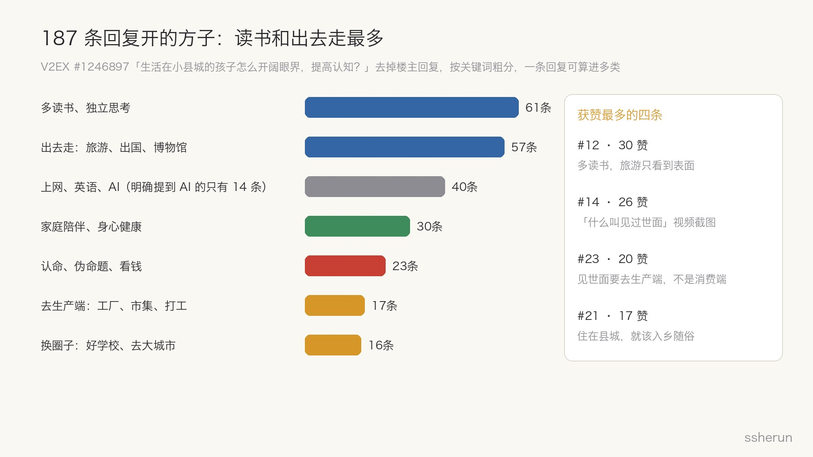
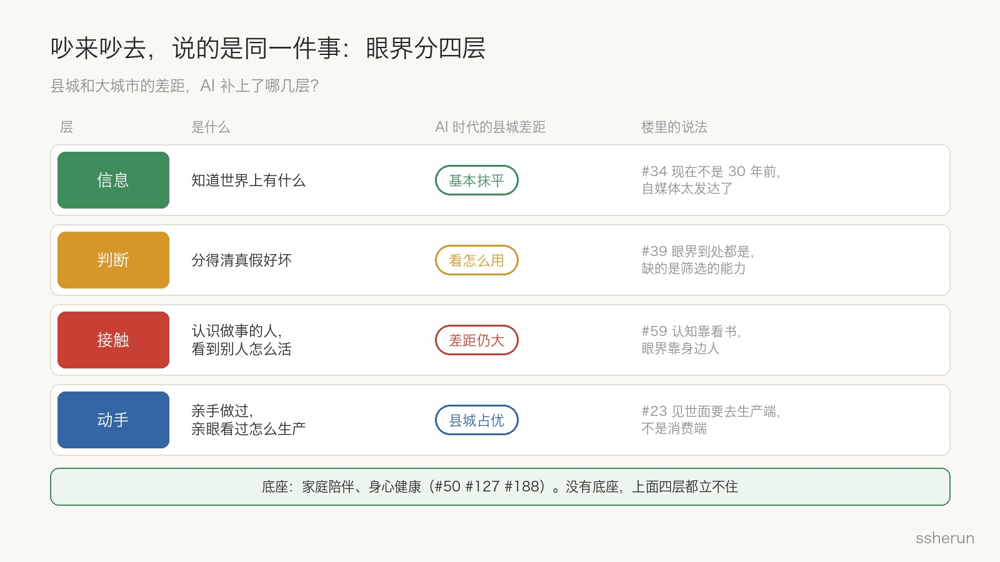
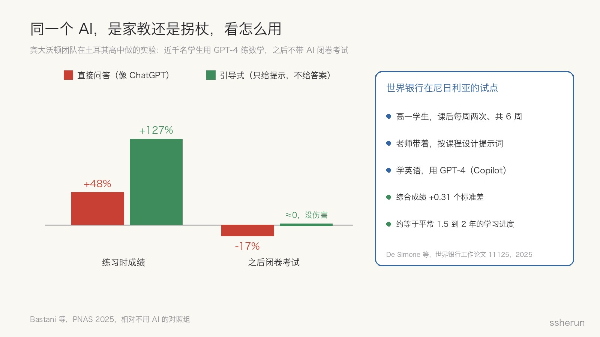
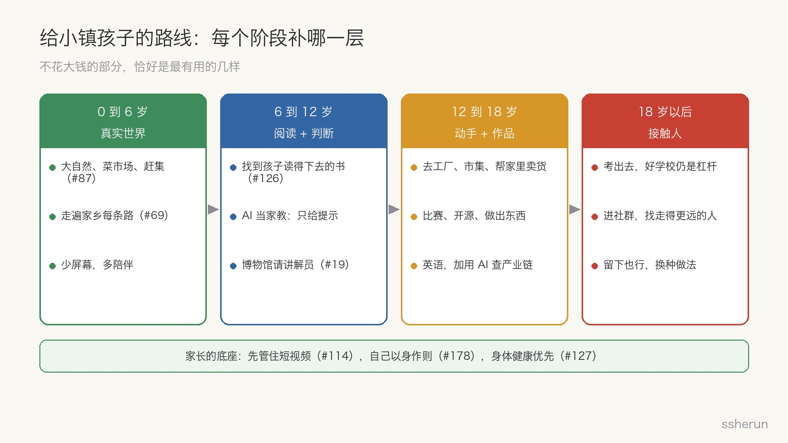

> 讨论来源：[生活在小县城的孩子怎么开阔眼界，提高认知？](https://www.v2ex.com/t/1246897)（V2EX，194 楼）

一位家长在 V2EX 发帖：住在三四线地级市，离省会 200 公里，开车两三个小时。孩子怎么开阔眼界、提高认知？

帖子不到一周就有 1.5 万浏览、194 楼。楼主后来说清了自己的目的：**想让孩子遇到问题能独立思考、明辨是非。**

评论区开出的方子五花八门：多读书、出国、去工厂、刷抖音、开 GPT 会员、认命。乍一看谁也说服不了谁。但把 187 条回复拆开，会发现它们其实在说同一件事的不同层面。再往前推一步，这件事在 AI 时代正在发生变化。

## 评论区：读书和出去走最多，提 AI 的只有 14 条

按关键词粗分（一条回复可以同时算进几类），提得最多的是「多读书、独立思考」和「出去走」，各有 60 条上下。接下来是上网和英语，然后是家庭陪伴、认命派、去生产端、换圈子。

获赞最多的四条正好代表了四种立场：

- **#12（30 赞）**：必须多读书。旅游看到的只是表面，好书里凝聚了作者的思考，性价比最高。
- **#14（26 赞）**：贴了一张「什么叫见过世面」的短视频截图，大意是城里孩子见过高楼、乡下孩子见过繁星，谁也不比谁更见过世面。
- **#23（20 赞）**：见世面要去生产端，而不是消费端。喝几杯星巴克不叫开眼界，去了解采购、原料，自己动手复刻、再推广出去才是。
- **#21（17 赞）**：既然住在县城，眼界和认知就要适配环境，否则出现断层，生活会很痛苦。

#14 那张图里有个细节值得一提：它说普鲁斯特没出过远门、康德是「没出过村的小镇医生」。#99 随手查了一下：普鲁斯特出身巴黎富裕家庭，年轻时是上流沙龙的常客；康德是教授不是医生，柯尼斯堡是港口大城，不是村子。**鸡汤里的反例，往往经不起一次搜索。** 这本身就是「判断力」的一个现场示范。

还有一个有意思的现象：上百条回复里，明确提到 AI 的只有 14 条。#144 吐槽说，什么时候孩子遇到问题第一反应是想到 AI，就算见过世面了。这句话有点夸张，但它指出了一个盲点：大家讨论的还是十年前的「见世面」。

## 吵来吵去，其实在说同一件事：眼界分四层

把这些回复放在一起看，「眼界」至少可以拆成四层：

1. **信息**：知道世界上有什么。#34 说现在不是 30 年前，自媒体太发达，已经没有过去那种「见世面」了。
2. **判断**：分得清真假好坏。#39 说信息爆炸，眼界到处都是，缺的是筛选能力；#49 说缺的是分辨糟粕和精华的能力。
3. **接触**：认识做事的人，看到别人怎么生活。#59 说「认知靠看书，眼界靠身边人」；#52 说越好的学校，同学越会想未来怎么活得更好。
4. **动手**：亲手做过，亲眼看过东西是怎么生产出来的。#23、#58（带孩子早起去菜市场进货卖菜）、#112（去看螺丝、积木的生产线）都在说这一层。

这四层下面还有一个底座：家庭陪伴和身心健康。#188 说父母是孩子的第一个世面；#127 写了一篇长文，核心是「身体是不同阶层唯一能追平的」。

这样一拆，**「读书派」和「出去走派」其实并不矛盾**。读书补的是信息和判断，出去走补的是接触和动手。真正的分歧在于，每一派都高估了自己负责的那一层。

## AI 抹平了「知道」，没有抹平「认识谁」

先看信息层。CNNIC 第 57 次报告（数据截至 2025 年底）显示，农村互联网普及率已经到 69.5%（城镇 85.1%），农村中小学的互联网接入率是 100%，95% 的行政村通了 5G。生成式 AI 用户达到 6.02 亿，其中 19 岁及以下的用户占 26.4%，学生是最大的使用群体。

也就是说，一个县城孩子今天能拿到的信息和解答，和北京海淀的孩子已经没有本质区别。#13 说得直接：YouTube Kids、可汗学院都是免费的，网络不会因为你在县城而有区别。

但接触层是另一回事。哈佛经济学家 Chetty 团队 2022 年在《Nature》上发表过一项研究，用了 210 亿条 Facebook 好友关系。他们发现，**低收入者的朋友里有多少高收入者**（他们称为「经济联结」），是迄今找到的最强的向上流动预测因子之一，与流动性的相关系数达到 0.65。如果低收入家庭的孩子能拥有高收入孩子平均水平的经济联结，成年后收入平均会高 20%。而且关键在于真正交往，只是住在同一片区域不够。

另一项研究更直接。Bell、Chetty 等人追踪了 120 万名美国发明家，发现父母收入前 1% 的孩子成为发明家的概率，是收入中位数以下家庭孩子的 10 倍，即使两组孩子早年的数学成绩相近也一样。差别不在天赋，在接触：童年时身边有发明家，会因果性地提高孩子成为发明家的概率，而且具体到领域。在医疗器械企业多的城市长大的孩子，更可能去申请医疗器械专利。研究者把那些本可以成为发明家、却因为没接触过而没走上这条路的人，叫作「消失的爱因斯坦」。

这正是 #59 那句话的数据版本：**信息可以从网上来，眼界却要从身边人来。** AI 能回答孩子的任何问题，但它没法成为孩子身边那个已经做成了某件事的人。

## 同一个 AI，是家教还是拐杖，看怎么用

判断层是 AI 影响最复杂的一层。

好的一面：世界银行 2024 年在尼日利亚做过一个随机对照试点。高一学生课后每周两次、共 6 周，在老师带领下用 GPT-4（微软 Copilot）学英语。结果综合成绩提高了 0.31 个标准差，大约相当于平常 1.5 到 2 年的学习进度，而且去的次数越多收益越大。县城孩子过去输在缺好老师，这类结果说明，AI 有机会把这块差距补上不少。

但还有另一面。宾大沃顿团队在土耳其一所高中做过实验，让近千名学生用 GPT-4 练数学，然后不带 AI 闭卷考试，结果发表在 2025 年的《PNAS》上：

- 用**直接问答版**（就像普通 ChatGPT）的学生，练习时成绩提高 48%，但闭卷考试反而比完全没用 AI 的学生**低 17%**。他们把 AI 当拐杖，直接要答案抄，而且自己意识不到学得更差了。
- 用**引导式版**（老师设计好提示词，只给提示、不给答案）的学生，练习成绩提高 127%，闭卷考试和对照组没有差别，伤害基本消除。

所以 #77「开一个 GPT Plus 会员给孩子用」、#156「每天强制和 ChatGPT 对话两小时」这类建议，方向没错，但缺了最重要的一步：**护栏**。规矩其实很简单：

- 先自己做，卡住了再问；
- 只要提示，不要答案；
- 让 AI 追问「为什么」，而不是替孩子说出结论；
- 家长偶尔抽查对话记录，看孩子是在思考还是在抄。

AI 能把判断力练得更强，也能让它退化。差别不在工具，在用法。

## 县城反而占优的一层：离生产端近

#23 那条 20 赞的回复，是整个帖子里我觉得最有洞察的一条。它说见世面要去生产端，不是消费端。#169 补了一句：带孩子花钱没用，要告诉他社会生产是怎样进行的。

这恰好是县城的反向优势。大城市孩子见到的多是消费端：商场、餐厅、游乐园。县城孩子离工厂、农田、批发市场、集市、家里的小生意更近。CNNIC 报告里引用的数据显示，农村网络零售额从 2015 年的 3530 亿元涨到 2024 年的 2.56 万亿元，很多县城本身就是某种产品的产业带。

在 AI 时代，这一层的价值被放大了。一个中学生可以用 AI 查清楚家门口那家工厂的上下游、原料从哪来、卖到哪去；可以用 AI 写文案、做图、剪视频，帮家里或邻居把东西卖到更远的地方。#23 说的「自己动手制作和复刻，再通过自媒体推广」，以前需要一个团队，现在一个孩子加一个 AI 就能起步。

这不是要孩子早早去做生意，而是让他们**在真实的生产和交易里练判断**：定价错了会亏钱，文案写得不好就没人买。#171 说得好，在商业里，你对人的认知对不对，可以自己去试，错了会直接赔钱。这种反馈，是任何读书和旅游都给不了的。

## 回应两种反对的声音

**「入乡随俗」派**（#21 17 赞、#50、#74、#120）认为，认知高出环境太多会很痛苦。这有道理，但它默认了一件事：认知高了就必须和周围格格不入。我的看法是，认知提高的意义不是变得另类，而是**多一个选择**：可以考出去，也可以留在县城、但换一种做法。AI 时代远程工作、县域电商越来越多，「留下」本身也越来越像一个主动的选项，而不只是退路。

**「有钱才行」派**（#1、#25、#55）说没钱就见不了世面。出国、住高端酒店确实要钱，但回头看那四层：读书几乎不花钱，AI 家教一个月几十块甚至免费，走遍家乡每条路（#69）、去市集和工厂看看也不花钱。**最有用的几样恰好最便宜**。真正贵的是家长的时间，以及家长自己愿不愿意先改变。#127 说得很重：你自己这么多年都改不了，就别指望孩子能做到。

## 一条按年龄走的路线

综合楼里的建议和上面的研究，我会这样排：

- **0 到 6 岁，补真实世界。** 大自然、菜市场、赶集、人多的地方（#87）；带孩子把家乡每条路走一遍，讲讲街巷名字的来历（#69）。少屏幕，多陪伴。
- **6 到 12 岁，补阅读和判断。** 找到孩子真能读下去的书，而不是家长觉得该读的书（#126）；开始用 AI，但只当家教、只给提示；去博物馆一定请讲解员，不然就是走马观花（#19）。
- **12 到 18 岁，补动手和作品。** 去工厂、市集，帮家里卖货；参加比赛、做开源、做出一个能给别人用的东西（#71 说的「输入、输出、链接」）；学好英语，用 AI 把家门口的产业链查清楚。
- **18 岁以后，补接触。** 能考出去就考出去，好学校仍然是最大的杠杆，因为它把你放进一个经济联结更高的圈子；考不出去，就用社群、比赛、作品去认识走得更远的人。选择留下也可以，但要换一种做法。

贯穿全程的底座是家长：先管住短视频（#114、#151），自己以身作则，把健康放在前面。

## 写在最后

楼主想让孩子学会独立思考、明辨是非。回头看，这个帖子本身就是一个很好的练习场：#14 那张鸡汤图拿了 26 赞，#99 一句「稍微证实一下」就拆掉了它的论据。

AI 时代，小镇孩子缺的不再是「知道」。信息差已经被互联网和 AI 抹平了大半，剩下的差距在两个地方：**认识谁**，和**亲手做过什么**。前者要靠考出去、进圈子去补；后者其实就在家门口。

## 相关文章

- [[v2ex-lying-flat-meta-or-hometown|V2er 谈躺平：版本答案，还是回县城？]]
- [[raising-kids-unique-joy|养娃真的带来独一无二的快乐吗？]]
- [[ai-era-clarity-matters|AI 时代最稀缺的能力：把话说清楚]]
- [[what-can-programmers-still-do|程序员还能做啥？AI 接走了写代码，剩下的才是大头]]
