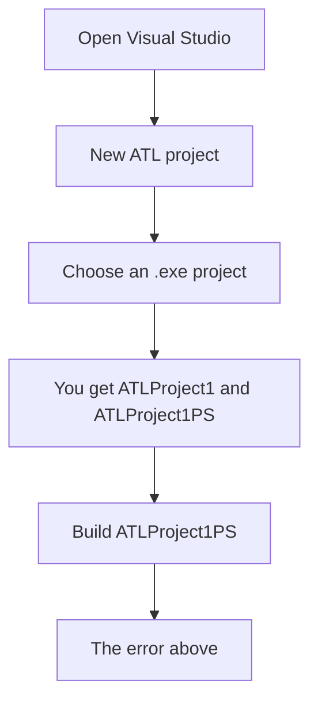
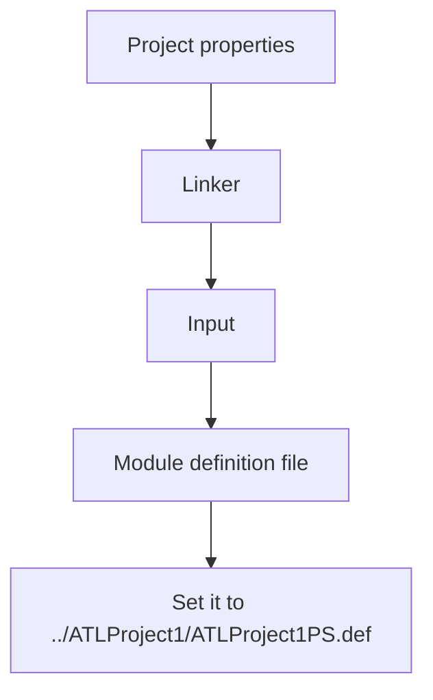

## The error

The build reports:

```
EXEC : error : MIDL will not generate DLLDATA.C unless you have at least 1 interface in the main project.
```

And the pre-build echo looks like this:

```
if exist dlldata.c goto :END
echo Error: MIDL will not generate DLLDATA.C unless you have at least 1 interface in the main project.
Exit 1
:END
```


## How you get here



## What is actually wrong

The message sounds like you forgot an interface. A stock Visual Studio template should generate that for you, so an "interface problem" is the wrong first guess.

Look at `if exist` — this is a **pre-build event**. If `dlldata.c` is not next to the project that checks for it, the check fails even when MIDL already wrote the file.

The proxy/stub (PS) project has a pre-build event that tests for `dlldata.c`. That file does not live in the same folder as the proxy/stub `.vcxproj`, so the check cannot see it. Change the pre-build event for every configuration/platform so it looks in the parent (main) project folder.

Linking the proxy/stub project has the same shape of bug: the linker cannot find `ATLProject1ps.def` because it lives under `ATLProject1`.


## The fix

### Step one

Point the pre-build event at the parent folder:

```
if exist ../ATLProject1/dlldata.c goto :END
echo Error: MIDL will not generate DLLDATA.C unless you have at least 1 interface in the main project.
Exit 1
:END
```

### Step two

Fix the module-definition path:



After both changes, the PS project can see `dlldata.c` and the `.def` file, and the MIDL error goes away.

## Why it looks in the wrong folder

When MIDL compiles the `.idl`, it writes `dlldata.c`, `*_p.c`, and `*_i.c` into the **main project** folder. The proxy/stub project's pre-build event and linker, however, resolve paths from **their own project folder**. The two disagree, so a file that was generated looks missing. Roughly:

```
ATLProject1/                  ← solution folder
├── ATLProject1/              ← main project: MIDL writes dlldata.c here
│   ├── ATLProject1.idl
│   ├── dlldata.c
│   └── ATLProject1PS.def
└── ATLProject1PS/            ← proxy/stub project: pre-build looks for dlldata.c here
```

The message about "at least 1 interface" is just text hard-coded in the script. The pre-build event only checks whether the file exists; it never counts interfaces. **When you see this error, check which folder the script is searching before you suspect the IDL.**

## A sturdier version: macros instead of bare relative paths

`../ATLProject1/` works, but it depends on the current directory at build time. MSBuild macros are safer:

```
if exist "$(ProjectDir)..\ATLProject1\dlldata.c" goto :END
echo Error: MIDL will not generate DLLDATA.C unless you have at least 1 interface in the main project.
Exit 1
:END
```

Use `$(ProjectDir)..\ATLProject1\ATLProject1PS.def` for the module-definition file too.

`$(ProjectDir)` is deliberate here. If you build the `.vcxproj` alone with command-line `msbuild`, there is no solution context, `$(SolutionDir)` is undefined, and the path breaks again.

## Troubleshooting table

| Symptom | Real cause | Fix |
|---------|------------|-----|
| `MIDL will not generate DLLDATA.C` | Pre-build event searches the PS project folder for `dlldata.c` | Change the pre-build path as above |
| Linker cannot open `ATLProject1PS.def` | The `.def` lives in the main project folder | Change the module-definition path |
| `dlldata.c` really is missing from the main folder | The main project has not been built, so MIDL never ran | Build the main project first; make the PS project depend on it |
| Works in the IDE, fails on the command line | The path uses `$(SolutionDir)` | Build the path from `$(ProjectDir)` |

One last check: under Build Dependencies → Project Dependencies, make sure the PS project depends on the main project so MIDL runs first. Otherwise parallel builds can occasionally reproduce the same error.

## Related posts

- [[windows-c-drive-cleanup-guide|A complete guide to cleaning a Windows C: drive]]
- [[winpe-pecmd-commands|PECMD commands in WinPE]]
