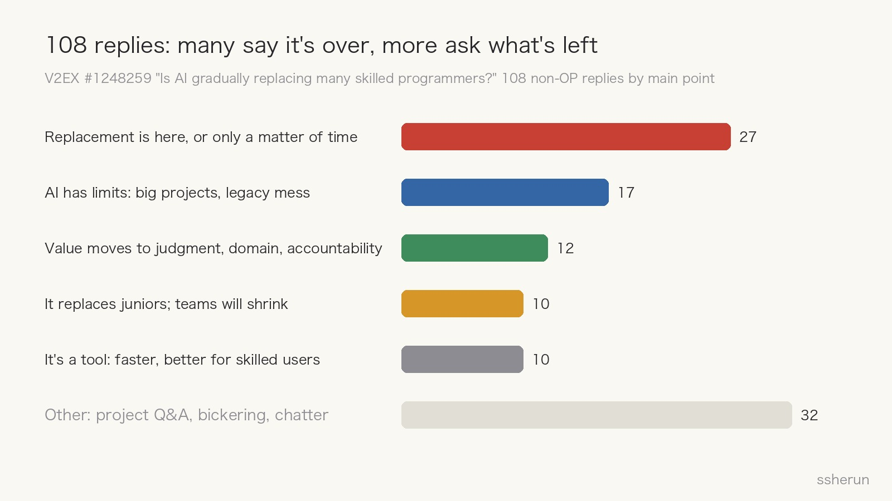
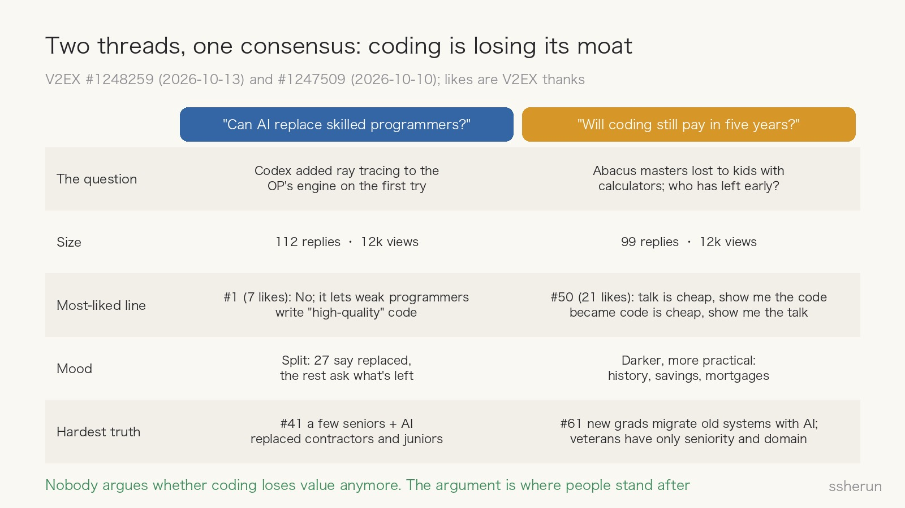
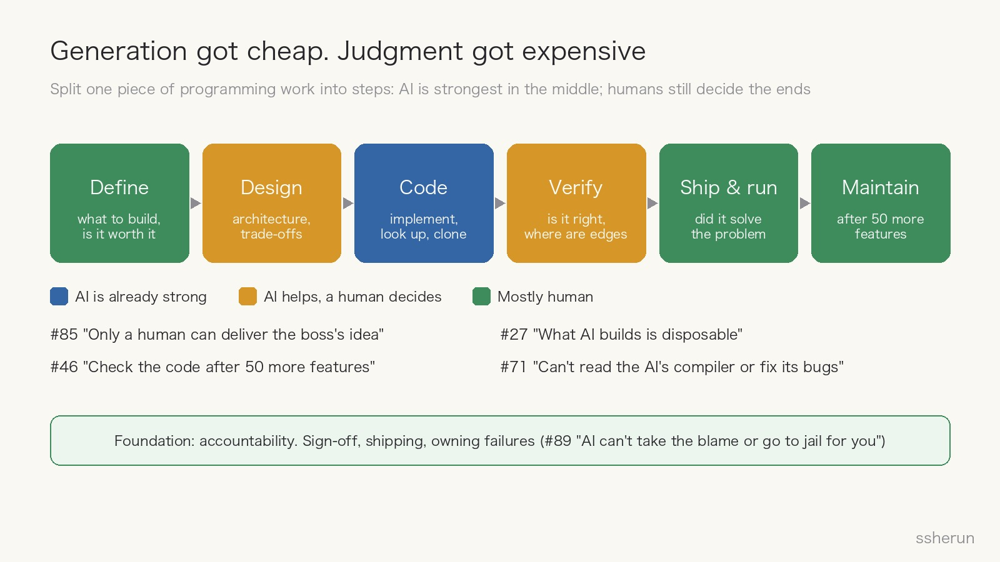
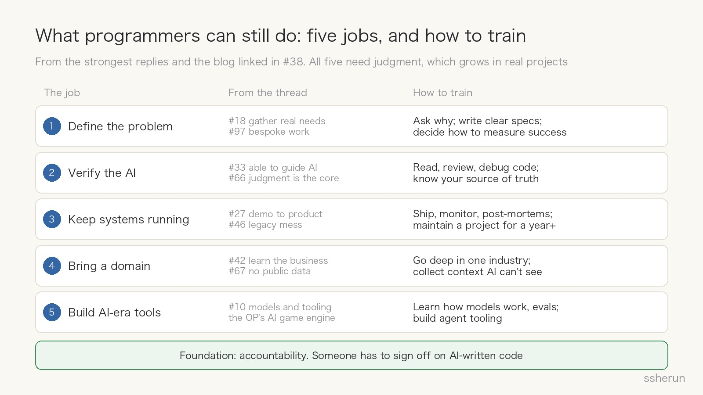

> Source discussions: [Is AI gradually replacing many skilled programmers?](https://www.v2ex.com/t/1248259) (V2EX, 112 replies); [In five years, how many programmers will still make a living writing code?](https://www.v2ex.com/t/1247509) (V2EX, 99 replies)

A V2EX user is building their own game engine in C++20 and Vulkan. They asked Codex to add ray tracing to the renderer, and it got it right on the first try, fitting cleanly into the existing code.

Their reaction: "I feel like there's nothing left for me to do."

Within a day and a half the thread had over 10,000 views and 112 replies. Just three days earlier, another V2EX thread with a similar view count asked: "In five years, how many programmers will still make a living writing code?"

Some say replacement started long ago, some say it's just a tool, and some are already saving money and paying off their mortgages early. What I care about is the question underneath: **what can programmers still do?**

## The comments: a quarter say replacement is here

Leaving out the OP's own 4 replies, the other 108 split like this:

- **27 say replacement has already happened, or is only a matter of time.** #24 leads a team and used to own architecture and the hardest problems; "now it all goes to AI, and I don't know how much longer this job will last." #19 ran the numbers: even at top-model API prices, AI is cheaper than people, and "it needs no benefits and can issue invoices."
- **17 point to AI's limits.** #49 says math is depth-first and software is breadth-first: AI already beats most programmers at algorithm puzzles but still can't handle large projects. #46: add fifty more features, then look at the code.
- **12 say the value has moved to judgment, domain knowledge, and accountability.** #66: "Do you think the code you write with Claude is the same level as what Linus writes with Claude?" #89: "AI can't take the blame for you, let alone go to jail for you."
- **10 say it's juniors who get replaced.** #41 put it most bluntly: in companies, the reality is the opposite of what the OP imagines. **A few senior programmers plus AI have replaced a large number of contractors and junior roles.**
- **10 say it's just a tool**, and skilled users get more out of it.

"Replacement is here" is the largest camp, but it's only a quarter. Most of the thread is really arguing about what's left after replacement.

## The other thread: will coding still pay in five years?

The thread from three days earlier (call it "the five-year thread") asked more bluntly. Its OP used an analogy: abacus masters eventually lost to schoolkids with calculators, not because of skill, but because the era changed tracks. How many more years does the programmer job have? Has anyone quietly left early, like selling a stock before the trend turns?

Its 99 replies were darker and more practical than the first thread's:

- Five-year thread #9 (11 likes) quoted a well-known Chinese line: "A person's fate depends on their own effort, but also on the course of history." Replies #11 and #16 repeated it word for word.
- Five-year thread #17: in the age of electric cars, what good are 20 years of experience rebuilding engines and gearboxes? EVs don't have engines.
- Five-year thread #61, 40 years old and doing IT at a manufacturer: last year's new graduates used AI to migrate an old project to a new platform seamlessly, and **the veterans are left with only seniority and a better grasp of the business**. His response: save money and cut spending. With no debt, he's calmer than colleagues with mortgages. Five-year thread #76 says they're paying off their mortgage early.

But the most-liked replies weren't the pessimistic ones:

- Five-year thread #50 (21 likes, the most across both threads): "It used to be 'talk is cheap, show me the code.' Now it's 'code is cheap, show me the talk.'"
- Five-year thread #5 (7 likes): writing code is typing; building a product is writing an essay. Everyone can type. Not everyone can write well.
- Five-year thread #2 pushed back on the OP's analogy: so in your eyes, abacus masters are people who refuse to improve and resist calculators?

The most pessimistic and most logical reply was five-year thread #82: software development will go from labor-intensive craft to a "lights-out software factory," leaving humans only the two ends, **defining the project and accepting the result**, and neither end "needs programmers in their current form." So do more work that involves people; only dealing with machines is a dead end.

I agree with the first half. The key words in the second half are "in their current form." Programmers whose job is mostly writing code will keep getting rarer; the people who remain will be doing exactly those two ends. That's what the rest of this post is about.

Put the two threads together and **nobody is arguing anymore about whether coding loses value. The argument is about where people stand after it does.**

## What the data says: the squeeze is at the entry level

Beyond gut feeling, there's the Stanford Digital Economy Lab study "[Canaries in the Coal Mine](https://digitaleconomy.stanford.edu/news/canariesaug26/)." Using ADP payroll data covering millions of US workers, they released an update in August 2026:

- **No evidence of widespread, economy-wide job displacement.**
- But **employment of 22- to 25-year-olds in highly AI-exposed occupations is about 19% below that of same-age peers in less-exposed ones.** A year earlier the gap was 15%, and it's still widening.
- **Experienced workers show no comparable gap.**
- The adjustment happens mainly through **hiring fewer young people**, not through layoffs.
- In occupations where AI mostly complements people, employment is flat or rising, especially for experienced workers.

The previous version had a sharper number: employment of software developers aged 22 to 25 fell nearly 20% from its late-2022 peak. The authors stress these are early, descriptive signals, not causal estimates.

That matches what #41, #54 ("it's replaced junior and mid-level programmers"), and #56 ("ten people might only need one or two skilled ones") see on the ground. **What AI pushes out first isn't the skilled programmer. It's the entry-level seat.**

## First, admit it: writing code is getting cheap

The OP's example is real. #27 says they built an MMO's client, server, and map editor from scratch in a few days, work that used to take their team most of a year. The cost of generating code is falling fast. That isn't an illusion.

But look again at who the OP is: someone who can design a game engine from scratch and knows exactly what "add ray tracing to a Vulkan renderer" involves. Being able to confirm that AI got it right the first time is itself a high level of skill.

**AI got it right. Who decided it was right?**

## Generation got cheap. Judgment got expensive

Split a piece of development work into steps, and AI is strongest in the middle: writing code, looking things up, cloning known solutions. The two ends still need a human to decide.

- **Verification**: #71 admits that the compiler and interpreter AI wrote for them are completely unreadable to them. When there's a bug they can't fix it; they can only tell the AI where the problem is and let it fix itself. If you can't read it, you have to take its word.
- **Convergence**: #27 had a demo in days, and two weeks later was still at the demo stage because they were restructuring the framework: "What AI produces is disposable. Standardizing it takes real effort. Be a hands-off boss and it will stab you in the back sooner or later."
- **Long-term maintenance**: #46 and #47 say that after fifty features it's the same pile of legacy mess, except now you can't change it yourself.

One more fact that's easy to miss: **feeling faster and being faster are different things.** In early 2025, METR ran a randomized controlled trial in which 16 experienced open-source developers were [19% slower](https://metr.org/blog/2025-07-10-early-2025-ai-experienced-os-dev-study/) with AI tools, yet afterward still believed they'd been 20% faster. Models have improved since, and METR's follow-up measured some speedup, but every confidence interval included zero. That doesn't mean AI is useless. It means how much it helps has to be measured, not felt.

## Five things programmers can still do

Reply #38 linked a blog post, "[The value of programmers in the AI era](https://jt26wzz.com/posts/0017-the-value-of-programmers-in-the-ai-era/)" (in Chinese). Its author borrows an interview question from Rust developer Jon Gjengset:

> How do you convince yourself you are building the right thing in the right way, and that it runs correctly?

Those three questions, plus the strongest replies in the thread, roughly add up to what programmers can still do:

**1. Define the problem.** Work out what to build, whether it's worth building, and how far to take it. #18 says the job may stop being called development and become "app creator," mostly gathering real needs. #85 says cloning existing things is easy, but only a human can deliver "the boss's idea." #97 says AI handles generic needs fast; what will be worth money is bespoke work. The blog's author counted that about half the features he shipped were barely used. Writing fast doesn't help if the direction is wrong. That's what five-year thread #50 meant by "code is cheap, show me the talk."

**2. Verify the AI.** Read it, judge it, and know what your source of truth is and where its limits lie. #33 says "skilled" needs redefining, and one kind is understanding the underlying principles well enough to guide AI: "someone who's better at steering AI and someone who isn't will get clearly different results on the same task." #82 says Linus can understand whatever AI writes; many people can't, or don't even care what it wrote. Five-year thread #93 put it more fully: AI is more like an executor, and the person using it should think of themselves as a manager who sets direction, breaks down problems, evaluates results, and keeps correcting course. Without fundamentals, an understanding of how things work, and engineering experience, it's hard to have good judgment, and hard to be a good manager.

**3. Keep systems running correctly in the real world.** Converge the architecture, ship, monitor, run post-mortems, keep evolving. Much of the knowledge here is tacit: you frown at a piece of code and know it will bite later; you know a handful of customers in some far corner still depend on a buggy behavior. That's hard to write down, so AI can't learn it. The five-year thread had a cautionary example: someone said give AI an SSH connection and it can handle 98% of ops work, and #56 replied that the other 2% is running `rm -R /`. #98 said a colleague had done exactly that to a server they maintained, and they spent the night recovering it.

**4. Bring knowledge of an industry.** #67 says AI breezes through anything with public documentation, but in fields without it, AI just applies formulas like a fool. #42's boss told every employee to "dig into the business," and #55 says mastering the business is the only way to stay in the industry. AI has the world's public data. It doesn't have your company's or your industry's private context. People in industrial fields in the five-year thread got specific: #62 says industrial control is "non-standard," so even two production lines built at the same time end up with different programs because of on-site conditions. #58 works in semiconductors, where a single problem often spans software, mechanics, and electrical work, plus physical conditions like temperature, humidity, and vacuum. Factory data is confidential, so AI can't learn it, and AI can't take responsibility for a factory accident.

**5. Build tools for the AI era.** #10 says the remaining programmers will build models and the tools around them. #33's second kind of skill is understanding how AI itself works, so you can find a fix when it breaks. The OP's own game engine is designed specifically for AI-driven game development, which is a direction in itself. But note the debate in the five-year thread: #66 argues that building Skills, MCP servers, and custom agents separates people today the way building libraries once did; #65 argues these will all be packaged into simple, general tools and won't be a lasting barrier. Both are right: the ability to build tools has value, but any given tool goes stale, so you have to keep moving.

Underneath all five is **accountability**: signing off, shipping, owning the failure. #89 put it crudely, but correctly. AI won't go to jail for you.

## The bad news, stated plainly

This isn't a "relax, programmers will always be needed" pep talk. A few things need saying:

- **There will be fewer jobs.** If one person plus AI can do the work of five, you don't need as many people. #56 is right: not everyone gets replaced, but headcount will shrink. The question is whose.
- **The entry path is being cut off.** Stanford's data shows the hiring drop is among young people. The blog's author describes his own apprenticeship: fresh out of school, he got dozens of review comments on under 100 lines of code, and crouched behind a senior colleague watching them debug a production incident. **AI is removing the chances for newcomers to learn by doing, while employers want experienced specialists.** Chicken, meet egg. Five-year thread #73 said the same: the problem isn't only shrinking demand, it's that junior engineers no longer have a ready-made path to becoming senior.
- **Seniority alone isn't a moat.** At five-year thread #61's company, new grads migrated an old project with AI, and the veterans were left with seniority and business knowledge. Seniority only pays if it turns into judgment and domain knowledge.
- **Judgment grows out of writing code.** Outsource the craft entirely to AI and you gradually lose the ability to tell whether AI got it right.

## For those still on the way

- **Use AI, but don't outsource judgment.** Let AI write, but be able to explain why every line is the way it is.
- **Practice reading code, reviewing, debugging, and writing minimal reproductions.** That's the core of verifying AI, and an underrated craft in this era.
- **Build complete projects that ship and get used.** That's the only way to learn the "does it actually run right" part.
- **Be a programmer with a domain.** Finance, healthcare, manufacturing, games: pick one and go deep.
- **Seek out apprenticeship.** Review pull requests in open source, and handle production incidents alongside senior people.
- **Do more of the work that involves people.** Gathering requirements, working across teams, being accountable to customers: what five-year thread #82 calls "work that involves people."
- **Build a financial buffer.** Five-year thread #61 has savings and no debt and feels calmer than colleagues; #76 is paying off the mortgage early. It isn't technical advice, but it decides whether you have choices when the change arrives.

## Closing

What can programmers still do?

**The part beyond writing code. And that part was always most of what makes a good programmer.** As #96 put it: excellent programmers, at least by my definition, were never about writing code well. Five-year thread #86 said it shorter: most of software engineering's experience isn't in the code.

In five years, how many programmers will make a living writing code? Not many, I'd guess. But plenty will make a living defining problems, verifying results, keeping systems running, knowing an industry, and owning the outcome.

What has really changed is the path. Before, writing code paid the bills and judgment grew along the way. From now on, code is the easy part, and judgment has to be trained on purpose.

## Related posts

- [[software-engineering-splits-three|Software engineering is splitting into three layers]]
- [[judge-dev-ability-in-ai-era|When Everyone Uses AI, How Do You Judge a Developer?]]
- [[ai-accelerate-or-replace-thinking|AI panic: is our intelligence locked in?]]
