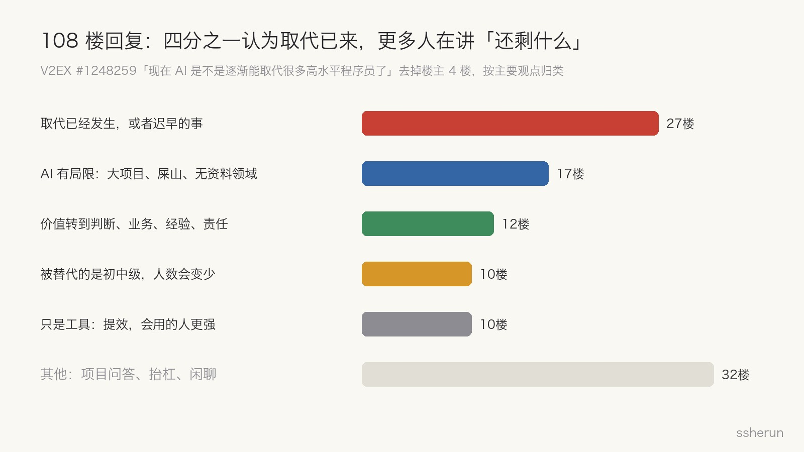
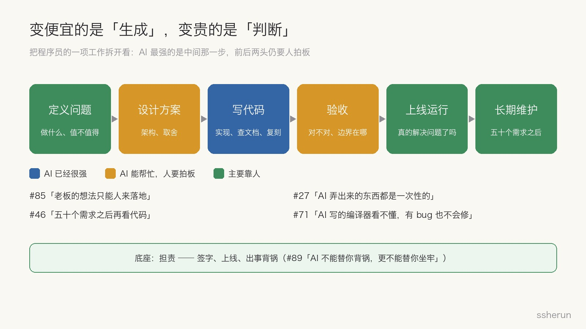

> 讨论来源：[现在 AI 是不是逐渐能取代很多高水平程序员了](https://www.v2ex.com/t/1248259)（V2EX，112 楼）

一位 V2EX 用户在开发自己的游戏引擎，C++20 加 Vulkan。他让 Codex 给渲染器加上光线追踪，结果一次就写对了，还完美整合进了现有代码。

他的感受是：「感觉我已经不用干啥了。」

帖子发出一天多，就有一万多浏览、112 楼回复。有人说取代早就开始了，有人说只是工具。我更关心的是那个绕不开的问题：**程序员还能做啥？**

## 评论区：四分之一认为取代已来

去掉楼主自己的 4 楼，108 楼回复里：

- **27 楼认为取代已经发生，或者迟早的事。** #24 带团队，架构设计、难点攻关本来都是自己做，「现在统一交给 AI 了，也不知道这个工作还能干几天」。#19 算了笔账：就算按顶级模型的 API 价格，AI 也比人工便宜，「不需要五险一金，还能开票」。
- **17 楼在讲 AI 的局限。** #49 说数学是深度优先、软件是广度优先，算法题 AI 已经超过多数程序员，大型项目还搞不定。#46 说：加五十个需求之后再看看代码。
- **12 楼认为价值转到了判断、业务和责任上。** #66：「你觉得你用 Claude 和 Linus 用 Claude，写出来的代码是一个水平吗？」#89：「AI 不能替你背锅，更不能替你坐牢。」
- **10 楼认为被替代的是初中级。** #41 说得最直接：企业里的现状和楼主设想的相反，是**少数资深程序员加 AI，替代了大量外包和初级岗位**。
- **10 楼认为它只是工具**，会用的人更强。

认为「取代已来」的是最大的一派，但只占四分之一。更多人在讨论的，其实是「取代之后还剩什么」。

## 数据怎么说：被挤压的是入门岗位

体感之外，可以看斯坦福数字经济实验室的研究「[Canaries in the Coal Mine](https://digitaleconomy.stanford.edu/news/canariesaug26/)」。他们用美国薪资服务商 ADP 覆盖数百万人的数据，2026 年 8 月发布了更新版：

- **没有看到经济整体范围的岗位替代。**
- 但 **22 到 25 岁、高度暴露于 AI 的职业，就业比同龄低暴露职业低约 19%**。一年前这个缺口是 15%，还在扩大。
- **资深从业者没有类似的缺口。**
- 调整主要通过**少招年轻人**发生，而不是裁员。
- 在 AI 主要用来「辅助」人的职业里，就业持平甚至上升，资深的人尤其如此。

上一版报告里有一个更具体的数字：22 到 25 岁软件开发者的就业，比 2022 年底的高点下降了近 20%。作者也强调，这是早期的描述性信号，不是因果结论。

这和 #41、#54「是替代了初中级程序员」、#56「10 个人可能只需要 1 到 2 个高水平的」的体感一致。**AI 先挤掉的不是高水平程序员，是入门的位置。**

## 先承认：写代码这件事正在变便宜

楼主的例子是真的。#27 也说，自己从零写一个 MMO 的前后端和地图编辑器，几天就做完了以前团队大半年的工作。代码生成的成本在快速下降，这不是幻觉。

但值得多看一眼楼主是谁：一个能自己从零设计游戏引擎、清楚「给 Vulkan 渲染器加光追」意味着什么的人。他能确认 AI 一次写对了，这本身就是高水平。

**AI 写对了，是谁判断它写对了？**

## 变便宜的是「生成」，变贵的是「判断」

把一项开发工作拆开看，AI 最强的是中间那一步：写代码、查文档、复刻已有方案。前后两头，仍然要人拍板。

- **验收**：#71 坦白说，AI 写的编译器和解释器完全看不懂，有 bug 也不知道怎么修，只能告诉 AI 哪里有问题，让它自己修。看不懂，就只能听它的。
- **收敛**：#27 几天做出了 demo，两周后还停在 demo，因为在梳理框架：「AI 弄出来的东西都是一次性的，标准化你还得花心思，甩手掌柜迟早要背刺。」
- **长期维护**：#46 和 #47 说，五十个需求之后，一样是屎山，只是你没办法改这个屎山了。

还有一个容易忽视的事实：**「感觉变快了」和「真的变快了」不是一回事。** METR 在 2025 年上半年做过一个随机对照实验，16 位资深开源开发者用 AI 工具后，完成任务反而[慢了 19%](https://metr.org/blog/2025-07-10-early-2025-ai-experienced-os-dev-study/)，但他们事后仍以为自己快了 20%。之后模型变强了，METR 的后续实验测出了一定提速，但置信区间都包含零。这不说明 AI 没用，只说明提效多少，得量，不能靠感觉。

## 程序员还能做的五件事

#38 楼链接了一篇博客《[AI 时代下程序员的价值](https://jt26wzz.com/posts/0017-the-value-of-programmers-in-the-ai-era/)》，作者借用了 Rust 开发者 Jon Gjengset 的一道面试题：

> 你怎么说服自己，你在做对的事、用对的方式做，而且它真的跑对了？

这三问，加上评论区的高信号回复，大致能拼出程序员还能做的事：

**1. 定义问题。** 搞清楚做什么、值不值得做、做到什么程度。#18 说以后可能不叫开发，叫「应用创造者」，主要工作是收集有效需求；#85 说复刻已有的东西容易，「老板的想法」只能人来落地；#97 说通用需求 AI 快速搞定，以后值钱的是「私人订制」。那篇博客的作者自己统计过，他开发的功能大约一半上线后很少有人用。写得再快，方向错了也是零。

**2. 验收 AI。** 读得懂、判得准，知道什么是真相源、它的边界在哪。#33 说「高水平」要重新定义，其中一种是对原理理解深到足以指导 AI，「更会驾驭 AI 和不太会驾驭 AI 的人做同一件事，明显是两个结果」。#82 说对 Linus 来说，AI 写啥他都能看明白；很多人是看不明白，或者压根不关心 AI 写了啥。

**3. 让系统在真实世界里长期跑对。** 架构收敛、上线、监控、故障复盘、持续演进。这一段的知识大多是「缄默知识」：看到某段代码眉头一皱，知道后面要埋坑；知道遥远的某个角落还有一小撮客户依赖着一个错误的实现。这些很难写进文档，AI 也就学不到。

**4. 带上一个行业的知识。** #67 说有公开资料的东西 AI 很轻松，遇到没有资料的领域，AI 像个傻子套公式。#42 的老板在全员信里写「钻研业务」，#55 说想在行业里继续混，精通业务是唯一的方法。AI 有全世界的公开资料，没有你公司和你行业的私域知识。

**5. 造 AI 时代的工具。** #10 说以后剩下的程序员负责开发模型和相应工具；#33 说的第二种高水平，是理解 AI 本身的原理，它出问题时能找到办法。楼主自己的游戏引擎，就是专门为 AI 开发游戏设计的，这本身就是一个方向。

这五件事的底座是**担责**：签字、上线、出事背锅。#89 那句话说得粗，但没错，AI 不能替你坐牢。

## 坏消息也要说清楚

这不是一篇「别焦虑，程序员永远需要」的鸡汤。有三件事得直说：

- **人数会变少。** 如果一个人加 AI 能干原来五个人的活，就不需要那么多人。#56 说得对：不会全取代，但人数缩减是肯定的，就看谁被缩减。
- **入门的路被截断了。** 斯坦福的数据显示，少招的是年轻人。那篇博客的作者讲到学徒制：他刚毕业时，100 行不到的代码被提了几十条 review 意见，线上出事时蹲在资深同事身后看他排查。**AI 在削减新人摸爬滚打的机会，招聘却要垂直领域的专家。**先有鸡还是先有蛋。
- **判断力是从写代码里长出来的。** 把手艺全外包给 AI，会逐渐失去判断 AI 是否做对的能力。

## 给还在路上的人

- **用 AI，但别外包判断。** 让 AI 写，但你要能讲清楚每一行为什么这么写。
- **练读代码、review、debug、写最小复现。** 这是验收 AI 的基本功，也是 AI 时代被低估的手艺。
- **做完整的项目，上线，有人用。** 只有这样才能体验「跑对了没有」那一段。
- **带着一个领域做程序员。** 金融、医疗、制造、游戏，选一个扎进去。
- **主动找「学徒」的机会。** 去开源社区做 review，跟资深的人一起处理线上问题。

## 写在最后

程序员还能做啥？

**写代码之外的那部分。而那部分，本来就是好程序员的大头。** #96 说：优秀的程序员，起码在我的定义里，从来不是代码写得好。

真正变了的是路径。以前，写代码能养活人，判断力在写代码的过程中顺便长出来；以后，代码是顺手的事，判断力得刻意去练。

## 相关文章

- [[software-engineering-splits-three|软件工程正在分裂为三层：你在哪一层？]]
- [[judge-dev-ability-in-ai-era|人人都用 AI 之后，怎么判断程序员能力高低？]]
- [[ai-accelerate-or-replace-thinking|AI 恐慌：人类智力是否此刻已经锁死？]]
